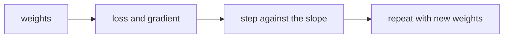

# Gradient descent and learning rates

## The idea

Training a model means finding the weights with the lowest loss. For linear regression with a few features there is a formula. For logistic regression there is none, and for most models there never is. What every one of them has is a **slope**: for each weight, how fast the loss changes when that weight grows a tiny bit and the others stay put. That slope is the weight's **partial derivative**, and the list of them, one per weight, is the **gradient**.

The gradient points uphill, toward a larger loss. **Gradient descent** takes a step the other way:

```text
weight = weight - learning_rate * slope
```

for every weight at once, from slopes all computed before any weight moved, and then repeats. Each step lowers the loss a little, as long as the steps are small enough. It is walking downhill in fog: you cannot see the bottom, but you can feel which way the ground slopes under your feet.

The **learning rate** is the length of the stride, and it is the setting that matters most:

- **Too small**, and every step lowers the loss so little that training crawls.
- **About right**, and the loss falls quickly and settles at the bottom.
- **Too large**, and a step crosses the bottom of the valley and lands higher on the other side. The next step does the same from further away, and the loss grows without limit: the training **diverges**.



<!-- text-of-mermaid sha256:0cd0feb55c6a14595214ad9005e96664c902067c7d1c04df97bdf7ff5df6ddb8 -->
```text
┌───────┐    ┌─────────────────┐    ┌──────────────────────┐    ┌───────────────────────┐
│weights├───►│loss and gradient├───►│step against the slope├───►│repeat with new weights│
└───────┘    └─────────────────┘    └──────────────────────┘    └───────────────────────┘
```

The drawing is the whole algorithm: compute the gradient at the current weights, step, and start again from the new weights. Training stops after a fixed number of steps, when the loss stops improving, or when the validation error starts to rise, which the guide on [overfitting](../overfitting-and-regularization/guide.md) explains.

## A worked example

### Four learning rates

Take the smallest possible model, `y = w * x` with one weight and no bias, and four examples. Its MSE is a parabola in `w`, and a parabola has the same **curvature**, the rate at which its slope changes, everywhere. That makes the effect of a step exact: each step multiplies the distance between `w` and the best `w` by `1 - rate * curvature`. When that factor is between -1 and 1, the distance shrinks; past -1, it grows. So the rate must stay below `2 / curvature`.

```python examples/learning_rates.py
"""Gradient descent on a one-weight model, with four learning rates.

The model predicts y = w * x, and the loss is the mean squared error. That loss is a parabola in w
whose curvature is the same everywhere, so each step multiplies the distance to the best w by the
same factor, 1 - rate * curvature.
"""

xs = [1.0, 2.0, 3.0, 4.0]
ys = [2.1, 3.9, 6.2, 7.8]
n = len(xs)


def loss(w: float) -> float:
    return sum((w * x - y) ** 2 for x, y in zip(xs, ys)) / n


def gradient(w: float) -> float:
    return 2 / n * sum((w * x - y) * x for x, y in zip(xs, ys))


curvature = 2 / n * sum(x * x for x in xs)  # the second derivative of the loss
best = sum(x * y for x, y in zip(xs, ys)) / sum(x * x for x in xs)
print(f"curvature {curvature:g}, so rates below {2 / curvature:.4f} converge")
print(f"loss at w = 0: {loss(0):.4f}; best w {best:.4f}, lowest loss {loss(best):.4f}")
print()
print(f"rate   factor   {"loss at 1":>11}{"at 5":>11}{"at 20":>11}   {"w at 20":>10}")
for rate in [0.01, 0.05, 0.12, 0.14]:
    w, losses = 0.0, []
    for step in range(1, 21):
        w -= rate * gradient(w)
        if step in (1, 5, 20):
            losses.append(loss(w))
    after = "".join(f"{value:11.4f}" for value in losses)
    print(f"{rate:.2f}   {1 - rate * curvature:+.2f}   {after}   {w:10.4f}")
```

It prints:

```output examples/learning_rates.py
curvature 15, so rates below 0.1333 converge
loss at w = 0: 29.7250; best w 1.9900, lowest loss 0.0243

rate   factor     loss at 1       at 5      at 20      w at 20
0.01   +0.85       21.4830     5.8716     0.0689       1.9129
0.05   +0.25        1.8805     0.0243     0.0243       1.9900
0.12   -0.80       19.0327     3.2133     0.0282       1.9671
0.14   -1.10       35.9622    77.0603  1344.2581     -11.3977
```

- **0.01** keeps 85% of the distance at each step: after 20 steps it is still on the way.
- **0.05** keeps a quarter: within five steps the loss is at its lowest, 0.0243, which no weight can beat because the four points are not exactly on a line.
- **0.12** has a negative factor: each step jumps past the best `w` to the other side, closer each time. It converges, zigzagging.
- **0.14** has a factor of -1.1: each jump lands 10% further away than the last, and after 20 steps the loss is 1,344 and `w` has the wrong sign.

Nothing in the code differs between the four runs but one number. Real losses are not exact parabolas, but near their bottom they are close to one, which is why the same three behaviours appear everywhere.

### Why features need a common scale

With several weights, the loss has a curvature in every direction, and they can differ wildly. One learning rate serves all of them, and it must be safe for the steepest; the flattest then barely moves. The ratio of the largest curvature to the smallest is the **condition number**. The program fits a flat's price from its area, with a bias, first with the area in square metres and then **standardized**: shifted by its mean and divided by its standard deviation, so that it has mean 0 and spread 1.

```python examples/scaling.py
"""The same data, fitted by gradient descent with its feature as it comes and standardized.

A flat's price (in thousands) from its area in square metres, with a bias. The loss is a bowl with
two curvatures, one per main direction. Their ratio, the condition number, says how many steps the
slow direction needs at a rate that is safe for the fast one.
"""

import math
import statistics

areas = [52.0, 61.0, 68.0, 75.0, 83.0, 90.0, 98.0, 110.0]
prices = [150.0, 171.0, 185.0, 205.0, 220.0, 238.0, 255.0, 290.0]


def mse(xs: list[float], b: float, w: float) -> float:
    return statistics.fmean((b + w * x - y) ** 2 for x, y in zip(xs, prices))


def descend(xs: list[float], rate: float, steps: int) -> tuple[float, float]:
    b = w = 0.0
    n = len(xs)
    for _ in range(steps):
        misses = [b + w * x - y for x, y in zip(xs, prices)]
        grad_b = 2 / n * sum(misses)
        grad_w = 2 / n * sum(miss * x for miss, x in zip(misses, xs))
        b, w = b - rate * grad_b, w - rate * grad_w
    return b, w


def curvatures(xs: list[float]) -> tuple[float, float]:
    """The eigenvalues of the loss's matrix of second derivatives, 2 * [[1, m1], [m1, m2]]."""
    m1, m2 = statistics.fmean(xs), statistics.fmean(x * x for x in xs)
    half_trace, det = (1 + m2) / 2, m2 - m1 * m1
    root = math.sqrt(half_trace**2 - det)
    return 2 * (half_trace + root), 2 * (half_trace - root)


mean, spread = statistics.fmean(areas), statistics.pstdev(areas)
standardized = [(x - mean) / spread for x in areas]
lowest = mse(standardized, *descend(standardized, 0.5, 1))  # the bottom of the bowl, see below

for name, xs in [("as it comes", areas), ("standardized", standardized)]:
    big, small = curvatures(xs)
    rate = 1 / big
    print(f"{name}: curvatures {big:.4g} and {small:.4g}, condition number {big / small:.4g}")
    for steps in [10, 100, 10_000]:
        excess = mse(xs, *descend(xs, rate, steps)) - lowest
        print(f"  rate {rate:.4g}, {steps:>6} steps: loss above the lowest {excess:.4f}")
print(f"lowest loss {lowest:.4f}")
```

It prints:

```output examples/scaling.py
as it comes: curvatures 1.334e+04 and 0.09914, condition number 1.346e+05
  rate 7.494e-05,     10 steps: loss above the lowest 31.6432
  rate 7.494e-05,    100 steps: loss above the lowest 31.6009
  rate 7.494e-05,  10000 steps: loss above the lowest 27.2777
standardized: curvatures 2 and 2, condition number 1
  rate 0.5,     10 steps: loss above the lowest 0.0000
  rate 0.5,    100 steps: loss above the lowest 0.0000
  rate 0.5,  10000 steps: loss above the lowest 0.0000
lowest loss 4.4770
```

With the area in square metres, the bias and the weight pull against each other: the steep direction has a curvature more than a hundred thousand times the flat one. The rate is set to `1 / largest curvature`, which keeps the steep direction safe, and the flat direction moves by a fraction of a percent per step: after 10,000 steps the loss is still 27 above its lowest. Standardized, both curvatures are 2, the bowl is round, and a rate of `0.5` makes the factor `1 - 0.5 * 2` exactly 0: one step lands on the bottom. Both runs fit the same line; only the units of the weight changed, and the predictions at the bottom are the same.

Here all the data is used to compute the mean and the spread, because nothing is being measured. With a validation set, they come from the training set only, as [data splits and leakage](../data-splits-and-leakage/guide.md) explains.

## When to use it

- **When there is no formula**: logistic regression, neural networks, and penalties with no closed form, such as L2 on a large model (an L1 penalty needs a variant, since `|w|` has no slope at 0).
- **When the formula is too expensive**: least squares through the normal equations costs about `d³` for `d` features, and gradient steps can be cheaper when `d` is large.
- **When the data is too large to read at every step**: stochastic and minibatch gradient descent, below, take each step from a small sample.
- **Not when a closed form exists and is cheap**: linear regression on a few features is solved exactly, in one pass, by least squares.

## Common traps

- **A learning rate chosen once and never checked.** Plot the loss against the step. A loss that rises, or swings violently, needs a smaller rate; one that falls in a straight line for thousands of steps can take a larger one.
- **Features on different scales.** One feature in thousands and another below ten make a long narrow valley, as in the example. Standardize, using the training set's mean and spread.
- **Mistaking divergence for a bug, or a bug for divergence.** A wrong gradient also makes the loss rise. Check the gradient against finite differences, as the expert notes describe, before blaming the rate.
- **Stopping on the training loss.** It keeps falling long after the model has started to learn noise. Watch the validation error too.
- **Comparing runs with different numbers of steps, or of examples per step,** as if only the rate had changed.

## Complexity

For `n` examples with `d` features:

| Method | Time per step | Extra space |
|--------|---------------|-------------|
| Batch gradient descent, every example in every step | O(n d) | O(d) for the gradient |
| Minibatch of `m` examples | O(m d) | O(d) |
| Stochastic, one example per step | O(d) | O(d) |

How many steps are needed depends on the learning rate and the condition number. In the one-weight example, the distance to the best weight shrinks by a constant factor at every step, so reaching a given precision takes a number of steps proportional to the logarithm of the precision wanted, larger as the factor approaches 1.

## Expert notes

- **The step and the curvature.** Goodfellow, Bengio and Courville (*Deep Learning*, §4.3) call the method steepest descent or gradient descent, and the step size the learning rate, set to a small constant or found by a line search, trying several sizes and keeping the best. §4.3.1 shows that a step can go uphill when the curvature along it is large, that the best step along the steepest curvature is `1 / largest eigenvalue` of the matrix of second derivatives, and that a large condition number makes gradient descent perform poorly and makes the step size hard to choose: small enough for the steep direction is too small for the flat one.
- **Batch, minibatch and stochastic.** In *Deep Learning*'s terms (§8.1.3), methods that use the whole training set at every step are batch or deterministic methods, methods that use one example at a time are stochastic or online, and most training uses a **minibatch** of examples in between. The minibatches must be drawn at random: data stored in a meaningful order, such as by patient or by date, gives gradient estimates that are not independent. The method goes back to Robbins and Monro's stochastic approximation of 1951, which, as Bottou, Curtis and Nocedal recount, was first proposed not as a gradient method but as a Markov chain.
- **Decaying the rate.** A stochastic gradient carries noise that does not vanish at the minimum, so in practice the learning rate is decreased over time (*Deep Learning*, §8.3.1). A sufficient condition for convergence is that the rates add up to infinity while their squares add up to a finite number. A rate that is too large makes the learning curve oscillate violently; one that is too small learns slowly or gets stuck. The cost of one stochastic step does not grow with the size of the training set, which is why it scales.
- **Momentum and adaptive rates.** Momentum (Polyak, 1964, described in *Deep Learning*, §8.3.2) keeps a decaying average of past gradients and moves along it, which helps with poor conditioning and noisy gradients. Adam (Kingma and Ba, 2015) keeps a decaying average of each weight's gradient and one of its square, corrects both for starting at zero, and moves each weight by the first divided by the square root of the second, so the size of a step hardly depends on the scale of the gradient; the paper's suggested defaults are a step size of 0.001, decay rates of 0.9 and 0.999, and 10⁻⁸ added to the denominator.
- **Convex and not.** Bottou, Curtis and Nocedal contrast the convex optimization problems of logistic regression with the highly nonlinear, nonconvex ones of deep neural networks. On a convex loss any local minimum is a global minimum (*Deep Learning*, §8.2.2), so the only question is how fast gradient descent gets there.
- **Checking a gradient.** A gradient computed by hand is easy to get wrong. *Deep Learning* (§11.5) recommends comparing it with finite differences: nudge one weight by a small amount, recompute the loss, and divide the change by the nudge. The centered difference, `(f(x + h/2) - f(x - h/2)) / h`, is more accurate, and the nudge must be large enough not to be lost to rounding.

## Practice

- `cstudy start gradient-descent-models`: trains linear and logistic regression by full-batch gradient descent from zero weights, including a learning rate large enough to diverge.

## Further reading

- [Goodfellow, Bengio and Courville, *Deep Learning*, chapter 4](https://www.deeplearningbook.org/contents/numerical.html): §4.3, gradient-based optimization, curvature and the condition number.
- [*Deep Learning*, chapter 8](https://www.deeplearningbook.org/contents/optimization.html): minibatches, stochastic gradient descent, learning rate schedules and momentum.
- [*Deep Learning*, chapter 11](https://www.deeplearningbook.org/contents/guidelines.html): §11.5, comparing gradients with finite differences.
- [Bottou, Curtis and Nocedal, *Optimization Methods for Large-Scale Machine Learning* (arXiv 1606.04838)](https://arxiv.org/abs/1606.04838): the stochastic gradient method and its history.
- [Kingma and Ba, *Adam: A Method for Stochastic Optimization* (arXiv 1412.6980)](https://arxiv.org/abs/1412.6980): the algorithm and its default settings.
