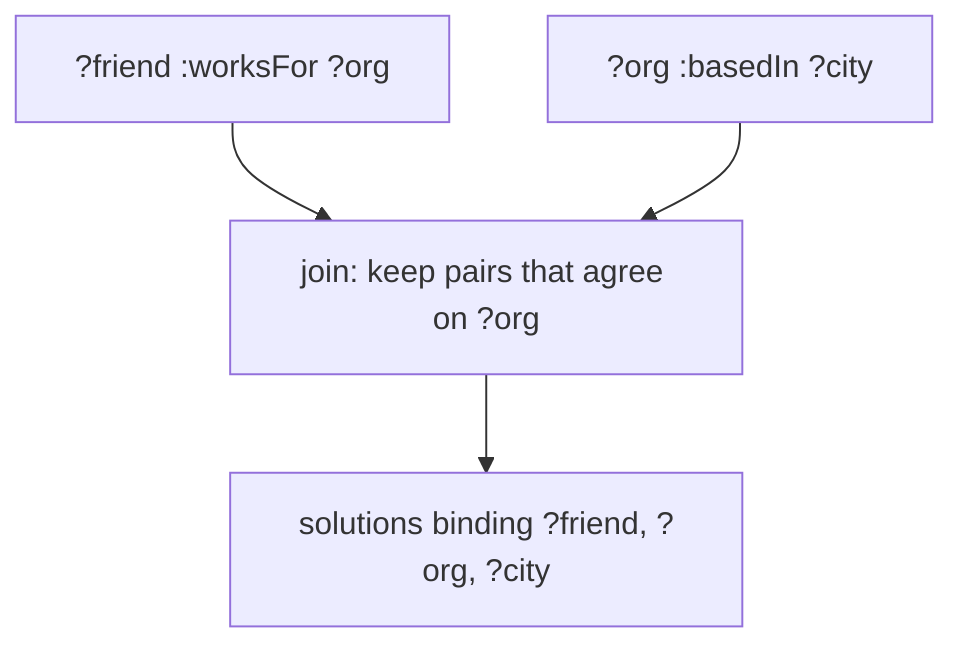

# Querying graphs: basic graph patterns and SPARQL

## The idea

A graph of triples, as in the [previous guide](../rdf-triples/guide.md), holds facts such as "Ada knows Cy", "Cy works at the library" and "the library is in Oslo". The question "in which cities are the employers of Ada's friends based?" needs three facts at once, joined where they share a node: the friend, then the employer.

A **triple pattern** is a triple in which some positions are **variables**, written with a question mark: `:ada :knows ?friend`. Matching it against a graph means finding terms to put in place of the variables so that the result is a triple of the graph. Each way of doing so is a **solution**: here, `?friend = :cy` and `?friend = :dee`.

A **basic graph pattern** is a set of triple patterns that share variables:

```text
:ada     :knows    ?friend .
?friend  :worksFor ?org .
?org     :basedIn  ?city .
```

SPARQL, the W3C's query language for RDF, defines a solution of the whole pattern this way: it gives each variable one term, the same in every pattern where it appears, such that every pattern becomes a triple of the graph. Put differently, the three filled-in triples are a small piece of the graph, a subgraph, shaped like the pattern.

SPARQL's algebra adds three terms, which give another way to compute the same answers.

- A **solution mapping** is a partial function from variables to terms: a dictionary that binds some variables.
- Two solution mappings are **compatible** if they give the same term to every variable they both bind.
- The **join** of two collections of solutions is every merge of a compatible pair, one from each: the algebra's `Join`.

Because a solution must satisfy every pattern at once, joining the per-pattern solutions with SPARQL's compatible-mapping `Join` gives the same answer: the solutions of the first pattern, joined with the solutions of the second, joined with those of the third.



<!-- text-of-mermaid sha256:a597ec48ed0ce24ffa0858572e4c4be1bccd39e73d95ccdb701600caf80b2c5d -->
```text
┌──────────────────────────────────────┐    ┌───────────────────┐
│        ?friend :worksFor ?org        │    │?org :basedIn ?city│
└───────────────────┬──────────────────┘    └─────────┬─────────┘
                    ▼─────────────────────────────────┘
┌──────────────────────────────────────┐
│ join: keep pairs that agree on ?org  │
└───────────────────┬──────────────────┘
                    ▼
┌──────────────────────────────────────┐
│solutions binding ?friend, ?org, ?city│
└──────────────────────────────────────┘
```

The drawing is one step of that join. Each side yields solutions on its own; the join keeps only the pairs that bind `?org` to the same organization.

In SPARQL syntax, the question reads:

```sparql
PREFIX : <https://ex.org/>
SELECT DISTINCT ?city WHERE {
  :ada :knows ?friend .
  ?friend :worksFor ?org .
  ?org :basedIn ?city .
}
```

`SELECT ?city` keeps only the city from each solution, and `DISTINCT` removes solutions that are then the same. Without `ORDER BY`, the solutions come in no particular order.

Some questions follow a relation any number of times: "who is above Dana in the chain of command?" SPARQL 1.1 has **property paths** for this. `:reportsTo+` matches one or more `:reportsTo` arrows in a row, `:reportsTo*` zero or more (so it also matches from a node to itself), `:reportsTo?` zero or one, `^:reportsTo` the arrow followed backwards, `:p/:q` a `:p` arrow then a `:q` arrow, and `:p|:q` either.

## A worked example

The program answers the question above against a graph of ten triples, the way the algebra allows: the solutions of each pattern by scanning the graph, then `Join`. It runs the patterns in two orders and prints how many solutions there are after each join:

```python examples/bgp.py
"""Answer a basic graph pattern the way SPARQL defines it: solutions of each pattern, then joins.

A solution is a dictionary from variables to terms. Each triple pattern, matched against the
graph, gives a list of solutions; two solutions are compatible when they agree on every variable
they share, and the join of two lists merges every compatible pair. Joining in another order
gives the same answers, through intermediate lists of other sizes.
"""

GRAPH = {
    (":ada", ":worksFor", ":bakery"), (":bob", ":worksFor", ":bakery"),
    (":cy", ":worksFor", ":library"), (":dee", ":worksFor", ":clinic"),
    (":bakery", ":basedIn", ":paris"), (":library", ":basedIn", ":oslo"),
    (":clinic", ":basedIn", ":paris"), (":ada", ":knows", ":cy"),
    (":ada", ":knows", ":dee"), (":cy", ":knows", ":cy"),
}


def match(pattern: tuple[str, str, str]) -> list[dict[str, str]]:
    solutions = []
    for triple in sorted(GRAPH):
        solution: dict[str, str] = {}
        for slot, term in zip(pattern, triple):
            if slot.startswith("?"):
                if solution.setdefault(slot, term) != term:  # ?x twice must be one term
                    break
            elif slot != term:
                break
        else:
            solutions.append(solution)
    return solutions


def join(left: list[dict], right: list[dict]) -> list[dict]:
    return [{**a, **b} for a in left for b in right
            if all(a[v] == b[v] for v in a.keys() & b.keys())]


def evaluate(bgp: list[tuple[str, str, str]], show: bool = False) -> list[dict]:
    solutions: list[dict] = [{}]  # the join of no patterns: one solution that binds nothing
    for pattern in bgp:
        solutions = join(solutions, match(pattern))
        if show:
            print(f"  after {' '.join(pattern)}: {len(solutions)} solutions")
    return solutions


def select_distinct(solutions: list[dict], *variables: str) -> list[tuple[str, ...]]:
    return sorted({tuple(s[v] for v in variables) for s in solutions})


query = [(":ada", ":knows", "?friend"), ("?friend", ":worksFor", "?org"),
         ("?org", ":basedIn", "?city")]
for order in (query, query[::-1]):
    print("order:", " . ".join(" ".join(p) for p in order))
    answer = evaluate(order, show=True)
print("SELECT DISTINCT ?city:", select_distinct(answer, "?city"))
print("works for an org based in :paris:", select_distinct(
    evaluate([("?who", ":worksFor", "?org"), ("?org", ":basedIn", ":paris")]), "?who"))
print("knows themselves:", select_distinct(evaluate([("?x", ":knows", "?x")]), "?x"))
```

It prints:

```output examples/bgp.py
order: :ada :knows ?friend . ?friend :worksFor ?org . ?org :basedIn ?city
  after :ada :knows ?friend: 2 solutions
  after ?friend :worksFor ?org: 2 solutions
  after ?org :basedIn ?city: 2 solutions
order: ?org :basedIn ?city . ?friend :worksFor ?org . :ada :knows ?friend
  after ?org :basedIn ?city: 3 solutions
  after ?friend :worksFor ?org: 4 solutions
  after :ada :knows ?friend: 2 solutions
SELECT DISTINCT ?city: [(':oslo',), (':paris',)]
works for an org based in :paris: [(':ada',), (':bob',), (':dee',)]
knows themselves: [(':cy',)]
```

- **Same answer, different work.** In the written order, Ada's two friends limit everything that follows: two solutions at every step. Reversed, the first pattern matches every organization's city (three solutions), the join with every employment gives four, and only the last pattern, about Ada, cuts it down to two. Both orders end with the same two solutions; on a large graph, the second order would build a huge intermediate result first.
- **Distinct.** Cy's employer is in Oslo and Dee's in Paris, so the answer has two cities. With two friends working in the same city, the projection would give that city twice, and `DISTINCT` would keep one.
- **A fixed term in a pattern.** `?org :basedIn :paris` binds no variable in its object position: it only filters. Ada and Bob work at the bakery, Dee at the clinic, both in Paris.
- **A variable twice in one pattern.** `?x :knows ?x` asks for someone who knows themselves: the variable must take the same term in both positions, and only Cy does.

## When to use it

- **Questions that join facts**: friends of friends, the employer's city, the books by authors born in a given country. Each join is a shared variable.
- **Reachability**: everything above a node in a hierarchy, everything a page links to through any number of links. A property path asks it in one pattern instead of a loop in your code. On a SKOS taxonomy, `?c skos:broader+ :vehicle` finds every concept under `:vehicle`.
- **Retrieval for a language model.** Fetching the facts within a few hops of the entities a question names, and citing the path to each, is the graph variant of retrieval-augmented generation; the [retrieval guide](../retrieval-augmented-generation/guide.md) covers the rest of that pipeline.
- **Not for** heavy aggregation over millions of uniform rows, where a column store and SQL are built for the job.

## Common traps

- **Relying on the order of results.** Solutions come in no specific order unless the query says `ORDER BY`. A test that compares results in the order they happened to arrive will fail one day.
- **Forgetting that solutions can repeat.** The results of a basic graph pattern form a multiset, an unordered collection in which the same element may appear more than once, and projecting away variables makes repeats likely. Add `DISTINCT` when you want a set.
- **Patterns that share no variable.** Two solutions with no variable in common are always compatible, so joining two such patterns pairs every solution of one with every solution of the other. One forgotten shared variable turns a query into a product of two large lists.
- **A literal as a subject.** SPARQL's triple patterns allow one, but RDF graphs never contain one, so such a pattern matches nothing.
- **Walking a path by hand into a cycle.** If `a next b`, `b next c` and `c next a`, a loop that follows arrows never stops. SPARQL defines `+` and `*` over distinct nodes, so a cycle cannot make the answer infinite; your own code needs a visited set to do the same, as in [breadth-first search](../breadth-first-search/guide.md).
- **`*` where you meant `+`.** Zero steps is a path too, so `?x :reportsTo* ?boss` pairs every node of the graph with itself, and lists every person as their own boss.

## Complexity

For a graph of `n` triples and a basic graph pattern of `k` triple patterns:

| Step | Time | Space |
|------|------|-------|
| Solutions of one pattern, by scanning | O(n) | O(answers) |
| The same with an index for the pattern's known positions | O(answers) average | O(n) per index |
| Join lists of `a` and `b` solutions, every pair | O(a · b) | O(output) |
| The same with a hash table on the shared variables | O(a + b + output) average | O(a) for the table |
| `x :p+ ?y` from one known node | O(V + E) over the `:p` arrows, a walk with a visited set | O(V) |

The size of the answer itself can grow like `n^k` when patterns share few variables, which no algorithm can avoid. Practical engines estimate how many solutions each pattern has, and start with the most selective.

## Expert notes

- **The definitions.** In SPARQL 1.1, a triple pattern is a member of (RDF terms ∪ variables) × (IRIs ∪ variables) × (RDF terms ∪ variables), which includes literal subjects, and a basic graph pattern is a set of triple patterns. A solution mapping μ is a partial function from variables to RDF terms, and μ is a solution of a basic graph pattern when replacing the pattern's variables by their terms gives a subgraph of the graph (§18.3.1). In the algebra (§18.5), two mappings are compatible if, for every variable both define, they give the same term, and `Join(Ω₁, Ω₂)` is the set of merges of compatible pairs. The empty basic graph pattern has one solution, the empty mapping, which is why the example starts its joins from `[{}]`.
- **Blank nodes in queries.** Blank nodes in a graph pattern act as variables, not as references to specific blank nodes in the data.
- **Multisets and modifiers.** Matching yields an unordered collection of solutions, then treated as a sequence in no specific order. Modifiers turn it into the result: `ORDER BY` establishes an order, projection keeps chosen variables, and `DISTINCT` eliminates duplicate solutions, so that only one solution binding the same variables to the same terms is returned.
- **Paths over cycles.** The specification says that `+` and `*` match on distinct nodes, that such connectivity matching does not introduce duplicates (it does not count the ways a connection can be made), and that it is defined so that cycles do not lead to undefined or infinite results. Its algorithm follows paths and stops extending a path at a node it has already visited; an implementation may use any method that gives the same results.
- **A property path.** The specification defines a property path as a sequence of triples where the object of each is the subject of the next; it starts at the subject of the first and ends at the object of the last, and it does not span several graphs of a dataset.

## Practice

- `cstudy start triple-store`: joined queries over shared variables with distinct, sorted rows; one-or-more paths that survive cycles; then answers as of a past time, with the sources behind each row.
- `cstudy start graphrag-context`: the facts within a few hops of an entity in a weighted, timestamped knowledge graph, ranked, packed into a token budget, and printed with the path that leads to each.

## Further reading

- [W3C, *SPARQL 1.1 Query Language*, Recommendation, 21 March 2013](https://www.w3.org/TR/sparql11-query/): basic graph patterns, solution modifiers, property paths, and the algebra of section 18.
