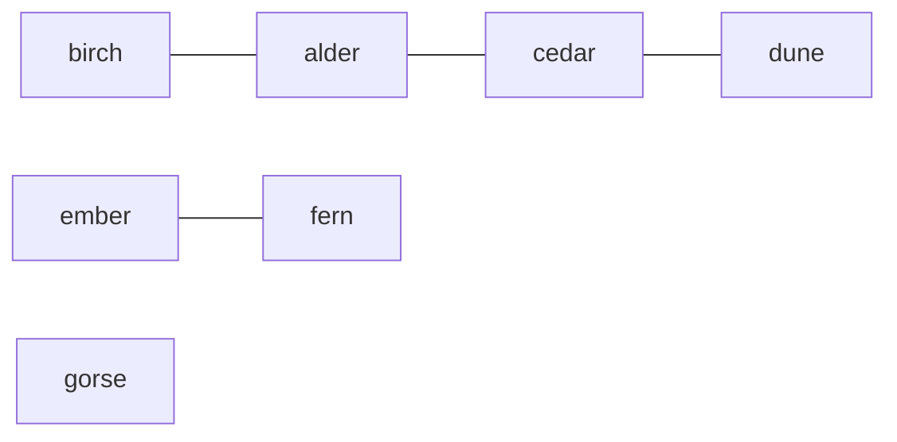
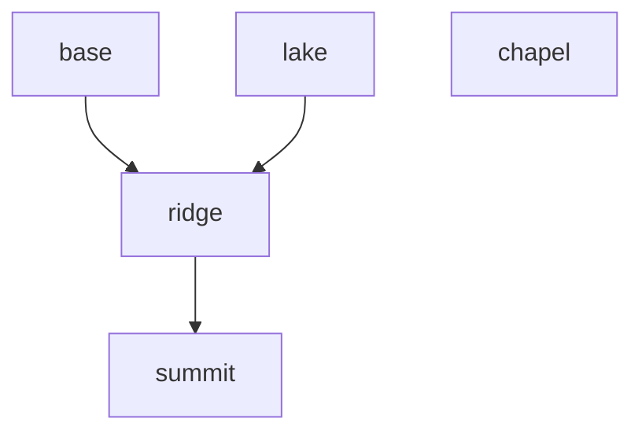

# Graphs and how to store them

## The idea

A **graph** is a set of things and the links between them. The things are **nodes** (also called vertices) and the links are **edges**. Huts joined by hiking trails, people and who follows whom, web pages and their links, tasks and what each one waits for, the squares of a board and the moves between them: each is a graph. Once you see the graph, one small family of algorithms answers questions about all of them: can I get from here to there, in how many steps, which things hang together, in what order can I do them.

A few words come back in every graph guide:

- An edge is **undirected** when it works both ways, like a trail, and **directed** when it goes one way only, like a ski lift or "a follows b". A graph whose edges are all directed is a directed graph.
- Two nodes joined by an edge are **neighbors**. The **degree** of a node is how many edges touch it. In a directed graph a node has an **out-degree**, the edges leaving it, and an **in-degree**, the edges arriving.
- A **path** is a walk along edges from node to node. A **cycle** is a path that comes back to where it started without reusing an edge.
- An edge may carry a number, a **weight**: a distance, a price, a time. A graph without weights treats every edge as one step.
- A graph is **connected** when every node can reach every other. Many graphs are not, and fall apart into pieces called **connected components**.

An algorithm does not see a drawing. It sees whatever data structure you put the graph in, and that choice decides what is cheap to ask. There are three common ones, plus a fourth that stores no edges at all:

1. An **edge list**: one entry per edge, such as the pair `("alder", "birch")`. It is the shape graphs usually arrive in.
2. An **adjacency list**: for each node, the list of its neighbors. It is what most graph algorithms want, because their basic step is "for each neighbor of this node".
3. An **adjacency matrix**: a V by V table of 0s and 1s, for V nodes, where row `u`, column `v` says whether the edge from `u` to `v` exists.
4. An **implicit graph**: no stored edges, only a function that computes a node's neighbors when asked. A grid map is the everyday case.

## A worked example

### One trail map, stored three ways

Seven huts and four trails. Every trail can be walked both ways, so the graph is undirected.



<!-- text-of-mermaid sha256:ce19059ecbf8b27483da3afba069ad29c57543942e7c68a79a865472d3d9d477 -->
```text
┌─────┐    ┌─────┐    ┌─────┐    ┌────┐
│birch├────│alder├────│cedar├────│dune│
└─────┘    └─────┘    └─────┘    └────┘

┌─────┐    ┌─────┐
│ember├────│ fern│
└─────┘    └─────┘

┌─────┐
│gorse│
└─────┘
```

The drawing shows three pieces: birch, alder, cedar and dune hang together in a line; ember and fern form a pair; gorse stands alone. The program below starts from the edge list, the four pairs, and builds the other two forms.

```python examples/storing_graphs.py
"""One trail map stored three ways: an edge list, an adjacency list and an adjacency matrix."""

from collections import defaultdict

huts = ["alder", "birch", "cedar", "dune", "ember", "fern", "gorse"]
trails = [  # the edge list: one pair per trail, walkable both ways
    ("alder", "birch"),
    ("alder", "cedar"),
    ("cedar", "dune"),
    ("ember", "fern"),
]

# Adjacency list: every hut gets an entry, even gorse with no trail, and each trail is stored twice.
neighbors: dict[str, list[str]] = {hut: [] for hut in huts}
for a, b in trails:
    neighbors[a].append(b)
    neighbors[b].append(a)
for hut, near in neighbors.items():
    print(f"{hut:>5}: {near}")

# Adjacency matrix: row i, column j holds 1 when huts i and j share a trail.
index = {hut: position for position, hut in enumerate(huts)}
matrix = [[0] * len(huts) for _ in huts]
for a, b in trails:
    matrix[index[a]][index[b]] = 1
    matrix[index[b]][index[a]] = 1
print("matrix row of cedar:", matrix[index["cedar"]])
print("trail between birch and cedar?", matrix[index["birch"]][index["cedar"]] == 1)

degrees = {hut: len(near) for hut, near in neighbors.items()}
print("degrees:", degrees)
print(f"sum of degrees: {sum(degrees.values())} = 2 x {len(trails)} trails")
print(f"matrix cells: {len(huts) ** 2}, adjacency list entries: {sum(degrees.values())}")

# A defaultdict builds the same lists with less code, and brings two surprises.
lazy: defaultdict[str, list[str]] = defaultdict(list)
for a, b in trails:
    lazy[a].append(b)
    lazy[b].append(a)
print("gorse in the defaultdict?", "gorse" in lazy)
print("neighbors of zinnia:", lazy["zinnia"], "| keys now:", len(lazy))
```

It prints:

```output examples/storing_graphs.py
alder: ['birch', 'cedar']
birch: ['alder']
cedar: ['alder', 'dune']
 dune: ['cedar']
ember: ['fern']
 fern: ['ember']
gorse: []
matrix row of cedar: [1, 0, 0, 1, 0, 0, 0]
trail between birch and cedar? False
degrees: {'alder': 2, 'birch': 1, 'cedar': 2, 'dune': 1, 'ember': 1, 'fern': 1, 'gorse': 0}
sum of degrees: 8 = 2 x 4 trails
matrix cells: 49, adjacency list entries: 8
gorse in the defaultdict? False
neighbors of zinnia: [] | keys now: 7
```

Read the output from the top:

- **The adjacency list** has one entry per hut. Each trail appears twice, once in each direction: `alder` lists `birch` and `birch` lists `alder`. An undirected edge is stored as two directed ones. `gorse` has an entry with an empty list, because the dictionary was started from the list of huts, not from the trails.
- **The adjacency matrix** has a row per hut. Cedar's row has a 1 in the columns of alder and dune. Asking "is there a trail between birch and cedar?" is one lookup, row 1, column 2, which is the matrix's strength; the lists would have to scan birch's neighbors. For an undirected graph the matrix is symmetric: row `u`, column `v` equals row `v`, column `u`.
- **The degrees** add up to 8, twice the 4 trails. That is always so: every edge adds 1 to the degree of each of its two ends, so the sum of the degrees is exactly twice the number of edges. It makes a quick check after building a graph: if the sum is odd, an edge went in only one way.
- **The sizes** differ. The matrix has 49 cells whatever the trails are, while the lists hold 8 entries, one per end of each trail. A matrix spends V² cells; lists spend one entry per node plus two per undirected edge.
- **The defaultdict** shows two surprises. It builds the same lists with fewer lines, but `gorse` is missing, since a hut with no trail never appears in the edge list. And reading `lazy["zinnia"]`, a hut that does not exist, did not fail: it returned an empty list and inserted the key, so the dictionary grew from 6 keys to 7. Python's documentation says so: a missing key read with `[]` calls `default_factory`, inserts the result and returns it, while `get()` does not.

### Directed edges

Ski lifts go one way: up. Each lift is stored once, under the station it leaves from.



<!-- text-of-mermaid sha256:b4edf25222f0cecd06a82fc0bb63f77a4d0bf903435c462a25f8a7b921b63bed -->
```text
┌──────┐    ┌────┐    ┌──────┐
│ base │    │lake│    │chapel│
└───┬──┘    └──┬─┘    └──────┘
    ▼──────────┘
┌──────┐
│ridge │
└───┬──┘
    ▼
┌──────┐
│summit│
└──────┘
```

The arrows in the drawing are the directions you can ride. Two lifts arrive at ridge, one from base and one from lake, and nothing leaves summit.

```python examples/one_way_lifts.py
"""A directed graph: ski lifts only go up, so each edge is stored once, from where it starts."""

stations = ["base", "lake", "ridge", "summit", "chapel"]
lifts = [("base", "ridge"), ("lake", "ridge"), ("ridge", "summit")]

out_edges: dict[str, list[str]] = {station: [] for station in stations}
in_degree = dict.fromkeys(stations, 0)
for start, end in lifts:
    out_edges[start].append(end)  # one direction only
    in_degree[end] += 1

for station in stations:
    print(
        f"{station:>6}: lifts to {out_edges[station]}, "
        f"out-degree {len(out_edges[station])}, in-degree {in_degree[station]}"
    )

# The reverse graph answers "which lifts arrive here?" as fast as out_edges answers "where to?".
in_edges: dict[str, list[str]] = {station: [] for station in stations}
for start, end in lifts:
    in_edges[end].append(start)
print("lifts arriving at ridge come from", in_edges["ridge"])
print("can a lift take you from summit to base?", "base" in out_edges["summit"])
```

It prints:

```output examples/one_way_lifts.py
  base: lifts to ['ridge'], out-degree 1, in-degree 0
  lake: lifts to ['ridge'], out-degree 1, in-degree 0
 ridge: lifts to ['summit'], out-degree 1, in-degree 2
summit: lifts to [], out-degree 0, in-degree 1
chapel: lifts to [], out-degree 0, in-degree 0
lifts arriving at ridge come from ['base', 'lake']
can a lift take you from summit to base? False
```

`out_edges` answers "where can I go from here?" by looking at one list. It cannot answer "which lifts arrive here?" without scanning every list, so when an algorithm needs both directions, it builds the **reverse graph** too, as `in_edges` does. The in-degree is worth counting on its own: a node with in-degree 0, like `base` or `lake`, is one that no edge leads to, which is where the [topological order](../topological-order/guide.md) guide starts.

### A grid is a graph nobody stores

A floor plan as a grid of characters: `.` is open floor, `#` is a wall, and you move one cell up, down, left or right.

```text
. . # .
. # # .
. . . .
```

Each open cell is a node, and two open cells are joined when they share a side. Building a list of neighbors for every cell would copy what the grid already holds, so a function computes a cell's neighbors when the algorithm asks instead: try the four steps, and keep the ones that stay inside the grid and land on open floor.

```python examples/grid_neighbors.py
"""A grid is a graph nobody stores: each open cell is a node, its edges computed on demand."""

FLOOR = [
    "..#.",
    ".##.",
    "....",
]
ROWS, COLUMNS = len(FLOOR), len(FLOOR[0])
STEPS = [(-1, 0), (1, 0), (0, -1), (0, 1)]  # up, down, left, right


def neighbors(row: int, column: int):
    for row_step, column_step in STEPS:
        r, c = row + row_step, column + column_step
        if 0 <= r < ROWS and 0 <= c < COLUMNS and FLOOR[r][c] == ".":
            yield (r, c)


for cell in [(0, 0), (0, 3), (2, 1), (2, 3)]:
    print(f"{cell} -> {list(neighbors(*cell))}")

open_cells = [(r, c) for r in range(ROWS) for c in range(COLUMNS) if FLOOR[r][c] == "."]
edge_ends = sum(len(list(neighbors(*cell))) for cell in open_cells)
print(f"{len(open_cells)} open cells, {edge_ends // 2} edges, none of them stored")
```

It prints:

```output examples/grid_neighbors.py
(0, 0) -> [(1, 0), (0, 1)]
(0, 3) -> [(1, 3)]
(2, 1) -> [(2, 0), (2, 2)]
(2, 3) -> [(1, 3), (2, 2)]
9 open cells, 8 edges, none of them stored
```

The cell `(0, 3)` in the top right corner has a single neighbor, `(1, 3)`: the wall cuts it off on the left, and the grid ends above it and to its right. The grid holds 9 nodes and 8 edges, and the program stored none of the edges.

A node does not have to be a place. It can be any value you can put in a set: the positions of the pieces in a puzzle, a word, a tuple of numbers. Its neighbors are then the values one move away, computed on demand. Such a graph can be far too large to store, and a search only ever builds the part it visits. The [breadth-first search](../breadth-first-search/guide.md) guide solves a puzzle this way.

## When to use it

The question is never which form is best, but which one makes your algorithm's main step cheap.

- **Adjacency list:** the default. Traversals, shortest paths and topological order all loop over a node's neighbors, which a list gives in time proportional to the degree. Use a dict of lists when nodes have names, a list of lists when they are numbered `0` to `V - 1`.
- **Adjacency matrix:** when you ask "is there an edge from `u` to `v`?" far more often than you list neighbors, or when the graph is **dense**, with a number of edges close to V². A matrix of 10,000 nodes already has 100 million cells, so it suits small graphs.
- **Edge list:** when the algorithm looks at each edge on its own, in some order, rather than node by node. [Union-find](../union-find/guide.md) consumes edges this way.
- **Implicit:** grids, boards, puzzles and any state space. Write a `neighbors(state)` function and let the search call it.
- **Objects with neighbor references:** some programs hold a graph as objects that refer to each other, each node holding a list of the nodes it links to. You walk it the same way; to remember what you have seen, key a set or a map by the object itself.

Data rarely arrives as an adjacency list. It comes as rows of a table, records with ids, pairs, a column naming each row's parent, or a grid of characters, and the first lines of most graph programs turn it into one. Decide the direction of each edge as you do: "a waits for b" and "b unblocks a" are the same fact stored in opposite directions, and the algorithm needs one of them.

## Common traps

- **Storing an undirected edge once.** Then `b` cannot see `a`, and a search from `b` misses part of the graph. Add both directions, or check that the degrees sum to twice the edge count.
- **Forgetting nodes with no edges.** A graph built from its edges alone has no entry for an isolated node, as `gorse` showed, so a loop over the dictionary's keys skips it. Create an entry for every node first when the nodes are known.
- **A defaultdict read that writes.** Reading a missing key with `[]` inserts it, so a lookup inside a loop over the same dictionary can change its size while you iterate, which Python refuses with `RuntimeError: dictionary changed size during iteration`. Use `in` or `.get()` to ask without inserting.
- **Swapping rows and columns.** `grid[r][c]` is row `r`, column `c`, and the row is the vertical position. Name the variables `row` and `column` rather than `x` and `y`, and check each against its own bound.
- **Numbering from 1.** When nodes are labelled `1` to `n`, a list of size `n` has no slot for `n`. Use size `n + 1` and ignore slot 0, or subtract 1 everywhere, but decide once.
- **Duplicate and self edges.** The same pair listed twice, or a node linked to itself, is legal in some inputs. Decide whether it matters: it changes the degrees, and an edge from a node to itself is already a cycle.

## Complexity

For V nodes and E edges:

| Question | Edge list | Adjacency list | Adjacency matrix |
|----------|-----------|----------------|------------------|
| Memory | O(E) | O(V + E) | O(V²) |
| Is there an edge from `u` to `v`? | O(E) | O(degree of `u`), or O(1) on average with a hash set per node | O(1) |
| List the neighbors of `u` | O(E) | O(degree of `u`) | O(V) |
| Visit every edge once | O(E) | O(V + E) | O(V²) |
| Add an edge | O(1) amortized | O(1) amortized | O(1) |

A simple undirected graph, with no duplicate edges and no edge from a node to itself, has at most V(V − 1)/2 edges, and a simple directed graph at most V(V − 1). So E is O(V²), and a traversal over adjacency lists, O(V + E), is never worse than one over a matrix, O(V²), and far better when E is much smaller than V². Most graphs met in practice are like that: maps, social networks and dependency graphs have a small average degree.

A grid of R rows and C columns has R · C nodes and at most four edges per node, so it has O(R · C) edges, and its implicit form uses no memory for them.

## Expert notes

- **Compressed sparse rows.** Adjacency lists made of many small lists cost an allocation each. A graph that does not change, with nodes numbered `0` to `V - 1`, fits in two flat arrays instead: `targets`, every node's neighbors one after the other, and `start`, of length V + 1, where the neighbors of `u` are `targets[start[u]:start[u + 1]]`. It takes V + 1 + E integers for a directed graph and reads memory in order, which suits large sparse graphs. The price is that adding an edge means rebuilding the arrays.
- **A set per node.** Storing each node's neighbors in a hash set instead of a list makes "is `v` a neighbor of `u`?" O(1) on average, at the cost of memory, and drops duplicate edges for free. It also makes the order of the neighbors arbitrary, which changes the order a traversal visits them in: fine for correctness, awkward for tests that compare output.
- **Bit rows.** A dense graph's matrix can store each row as a bit set, V bits instead of V bytes or words, so that "the neighbors of `u` that are also neighbors of `v`" is one AND of two rows.
- **Multigraphs and hypergraphs.** A multigraph allows several edges between the same pair, such as two flights on one route at different prices; store each edge with its own data instead of a 0 or a 1. A hypergraph's edges join any number of nodes, such as a meeting and all its attendees; the usual way to store one is an ordinary graph with an extra node per hyperedge, joined to every node it contains.
- **Numbers for names.** Algorithms on numbered nodes can use flat lists instead of dictionaries, which index by position and never hash a key. Map each name to an index once, `index = {name: i for i, name in enumerate(names)}`, work with the indices, and map back at the end.

## Practice

These two problems hand you a graph in a form that is not an adjacency list. Build one, then walk it; the [breadth-first search](../breadth-first-search/guide.md) and [depth-first search](../depth-first-search/guide.md) guides show the walks.

- `cstudy start employee-importance`: people given as records, each listing who reports to them directly. How much does everyone in one person's group add up to?
- `cstudy start time-to-inform-employees`: a company given as one manager per person. How long until news from the top reaches everyone?

## Further reading

- [Python `collections.defaultdict`](https://docs.python.org/3/library/collections.html#collections.defaultdict): `__missing__` inserts the default for a missing key read with `[]`, and `get()` does not call it.
- [Python `dict`](https://docs.python.org/3/library/stdtypes.html#mapping-types-dict): the mapping behind most adjacency lists, and the `in` test that reads without inserting.
