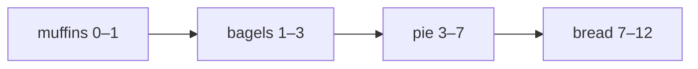
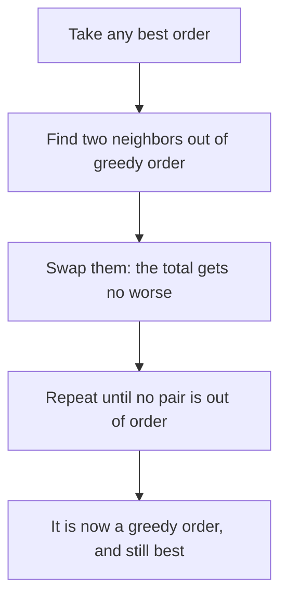

# Greedy choices and how to prove them

## The idea

A **greedy algorithm** builds its answer one decision at a time. At each step it takes the choice that looks best by one fixed rule, such as "the shortest job next" or "the interval that ends first", and it never goes back to change a decision. Many greedy algorithms are a sort followed by one pass, so they are short and fast.

Writing one is easy. Knowing that it is right is the whole difficulty. Several rules usually sound reasonable, some of them are wrong on some input, and a wrong greedy algorithm can still pass the first examples you try. So a greedy algorithm comes with an argument that its choice is **safe**: taking it never rules out the best answer. Two kinds of argument come up again and again:

- **The exchange argument.** Take any best answer that differs from the greedy one, and show that swapping in the greedy choice makes it no worse. Repeat until it is the greedy answer, which is therefore as good as the best.
- **Greedy stays ahead.** Pick a measure of progress, and show that after every step the greedy partial answer is at least as far along as any other answer after the same number of steps. Then show that being ahead at the end means being best.

This guide works through one example of each, then shows how the exchange argument exposes an obvious rule that fails and tells you the right one.

## A worked example

One oven bakes one batch at a time. Each batch has a baking time, and its customer waits from opening, minute 0, until the batch comes out. You want the order of batches that makes the **total waiting** of all customers smallest.

| Batch | Minutes |
|-------|---------|
| bread | 5 |
| bagels | 2 |
| pie | 4 |
| muffins | 1 |

Baked in the listed order, bread comes out at minute 5, bagels at 7, pie at 11 and muffins at 12: a total of 5 + 7 + 11 + 12 = 35 minutes of waiting. The greedy rule to try is **shortest batch first**, because a short batch keeps everyone after it waiting only a little.



<!-- text-of-mermaid sha256:7b0c2405d53a4f6330d706f19a1b30a56a004dd3326823f312a19ece19fc308f -->
```text
┌───────────┐    ┌──────────┐    ┌───────┐    ┌──────────┐
│muffins 0–1├───►│bagels 1–3├───►│pie 3–7├───►│bread 7–12│
└───────────┘    └──────────┘    └───────┘    └──────────┘
```

The drawing is the oven's time line: each batch starts when the one before it comes out. The waits are 1, 3, 7 and 12 minutes, 23 in total. The program below checks it against every one of the 24 possible orders:

```python examples/oven_order.py
"""One oven bakes one batch at a time, and every customer waits from opening until their batch
comes out. Which order of batches makes the total waiting smallest?"""

from fractions import Fraction
from itertools import permutations
from typing import NamedTuple


class Batch(NamedTuple):
    name: str
    minutes: int
    customers: int = 1


def total_wait(order: list[Batch]) -> int:
    clock = total = 0
    for batch in order:
        clock += batch.minutes
        total += clock * batch.customers
    return total


def best_of_every_order(batches: list[Batch]) -> int:
    return min(total_wait(list(order)) for order in permutations(batches))


def shortest_first(batches: list[Batch]) -> list[Batch]:
    return sorted(batches, key=lambda batch: batch.minutes)


def fewest_minutes_per_customer(batches: list[Batch]) -> list[Batch]:
    return sorted(batches, key=lambda batch: Fraction(batch.minutes, batch.customers))


def names(order: list[Batch]) -> str:
    return ", ".join(batch.name for batch in order)


batches = [Batch("bread", 5), Batch("bagels", 2), Batch("pie", 4), Batch("muffins", 1)]
print(f"as listed ({names(batches)}): total wait {total_wait(batches)}")
clock = 0
for batch in shortest_first(batches):
    clock += batch.minutes
    print(f"  {batch.name:<8} out at minute {clock:>2}")
print("shortest first: total wait", total_wait(shortest_first(batches)))
print("best of all 24 orders:", best_of_every_order(batches))
swapped = [batches[1], batches[0], *batches[2:]]
print(f"swap bread and bagels: {total_wait(batches)} -> {total_wait(swapped)}")

print()
batches = [Batch("cookies", 4, 1), Batch("croissants", 6, 3), Batch("scones", 2, 2)]
for rule in (shortest_first, fewest_minutes_per_customer):
    order = rule(batches)
    print(f"{rule.__name__} ({names(order)}): total wait {total_wait(order)}")
print("best of all 6 orders:", best_of_every_order(batches))
```

It prints:

```output examples/oven_order.py
as listed (bread, bagels, pie, muffins): total wait 35
  muffins  out at minute  1
  bagels   out at minute  3
  pie      out at minute  7
  bread    out at minute 12
shortest first: total wait 23
best of all 24 orders: 23
swap bread and bagels: 35 -> 32

shortest_first (scones, cookies, croissants): total wait 46
fewest_minutes_per_customer (scones, croissants, cookies): total wait 40
best of all 6 orders: 40
```

The first half matches the time line: shortest first waits 23 minutes, and no order does better. The second half is about the counterexample further down. Trying every order proves nothing about the next input, though, so here is the proof.

### Proving it with an exchange

Take any order in which some batch `x` comes right before a batch `y` that is shorter: `x` takes `a` minutes, `y` takes `b`, and `a > b`. Swap the two and see what changes.

- **Batches before the pair** are untouched.
- **Batches after the pair** start once both are out, and the pair takes `a + b` minutes in either order, so their times do not change either.
- **The pair itself.** Say the pair starts at minute `s`. Before the swap, `x` is out at `s + a` and `y` at `s + a + b`. After it, `y` is out at `s + b` and `x` at `s + b + a`. The second finish time is the same, and the first one moved from `s + a` to `s + b`. So the total changes by `b - a`, which is negative.

That is the line `swap bread and bagels: 35 -> 32` of the output: bagels (2 minutes) moved ahead of bread (5 minutes), and the total fell by 5 - 2 = 3.

Now the argument. There are finitely many orders, so at least one of them has the smallest total; call it a best order. A best order cannot have a longer batch right before a shorter one, since swapping them would lower its total, and then it would not be best. An order in which every batch is at most as long as the next is sorted by baking time. So a best order is sorted. Two sorted orders differ only in how they arrange batches of equal length, and swapping two equal neighbors changes the total by `b - a = 0`. So every shortest-first order has the smallest total, whatever it does with ties.



<!-- text-of-mermaid sha256:27d1ad31188c00bade050758e8ef267b4cde05c810d877ac79cb3def7b9f7283 -->
```text
┌────────────────────────────────────────┐
│          Take any best order           │
└────────────────────┬───────────────────┘
                     ▼
┌────────────────────────────────────────┐
│ Find two neighbors out of greedy order │
└────────────────────┬───────────────────┘
                     ▼
┌────────────────────────────────────────┐
│   Swap them: the total gets no worse   │
└────────────────────┬───────────────────┘
                     ▼
┌────────────────────────────────────────┐
│  Repeat until no pair is out of order  │
└────────────────────┬───────────────────┘
                     ▼
┌────────────────────────────────────────┐
│It is now a greedy order, and still best│
└────────────────────────────────────────┘
```

The drawing is the shape of this proof, and of the deadline proof in the [scheduling guide](../scheduling-with-deadlines/guide.md): each swap of two neighbors fixes the order of exactly that pair and never makes the total worse, so after finitely many swaps the best order has become a greedy order without getting worse.

## Greedy stays ahead

A cargo bike carries at most 20 kg, and you want to deliver as many parcels as possible in one trip. The parcels weigh 9, 3, 7, 4, 6 and 8 kg. The greedy rule: **take the lightest parcel that is left, while it fits.**

```python examples/lightest_first.py
"""A cargo bike carries at most 20 kg. Taking the lightest parcels first carries the most parcels,
and its load after k parcels never exceeds the load of any other plan after its k lightest."""

from itertools import accumulate, combinations

CAPACITY_KG = 20


def lightest_first(parcels: list[int]) -> list[int]:
    taken: list[int] = []
    for weight in sorted(parcels):
        if sum(taken) + weight > CAPACITY_KG:
            break
        taken.append(weight)
    return taken


def most_parcels_by_brute_force(parcels: list[int]) -> int:
    return max(
        size
        for size in range(len(parcels) + 1)
        for plan in combinations(parcels, size)
        if sum(plan) <= CAPACITY_KG
    )


parcels = [9, 3, 7, 4, 6, 8]
greedy = lightest_first(parcels)
other_plan = [9, 4, 7]
print("lightest first takes", greedy, "->", len(greedy), "parcels")
print("another plan that fits:", other_plan, "->", len(other_plan), "parcels")
print("load after k parcels, greedy:  ", list(accumulate(greedy)))
print("load after k parcels, the plan:", list(accumulate(sorted(other_plan))))
print("most parcels of any plan:", most_parcels_by_brute_force(parcels))
```

It prints:

```output examples/lightest_first.py
lightest first takes [3, 4, 6, 7] -> 4 parcels
another plan that fits: [9, 4, 7] -> 3 parcels
load after k parcels, greedy:   [3, 7, 13, 20]
load after k parcels, the plan: [4, 11, 20]
most parcels of any plan: 4
```

The measure of progress is the **load after k parcels**, and the two lines of loads show greedy staying ahead: after 1, 2 and 3 parcels it carries 3, 7 and 13 kg where the other plan carries 4, 11 and 20, so greedy always has more room left. Here is why that holds for every plan, and why it is enough.

1. **Greedy stays ahead.** Greedy's first `k` parcels are the `k` lightest of all. Any `k` parcels weigh at least as much as the `k` lightest, so after `k` parcels any plan's load is at least greedy's.
2. **Ahead means best.** If greedy took every parcel, no plan can carry more. Otherwise, suppose some plan that fits carries more parcels than greedy, say at least `k + 1` where greedy carried `k`. Greedy stopped because its next parcel did not fit: the `k + 1` lightest parcels weigh more than 20 kg. But any `k + 1` of the plan's parcels weigh at least as much as the `k + 1` lightest, so more than 20 kg too, and the plan does not fit after all. So no plan carries more than greedy.

The art of a stays-ahead proof is the choice of measure. "Parcels carried so far" would not work: every plan carries `k` parcels after `k` steps. Load works because a smaller load means more room, which is exactly what the last step needs.

## When the obvious greedy fails

Change one thing in the oven: some batches are for several customers. Scones (2 minutes) are for 2 customers, cookies (4 minutes) for 1, and croissants (6 minutes) for 3, and every waiting customer counts. Shortest first still sounds right, and it is wrong: the second half of the output shows it waiting 46 customer-minutes, while the best order waits 40.

The exchange argument finds the mistake and the fix. Redo the swap of a neighboring pair, with `x` taking `a` minutes for `u` customers and `y` taking `b` minutes for `v` customers. The `u` customers of `x` now wait `b` minutes longer, and the `v` customers of `y` wait `a` minutes less, so the total changes by `u·b - v·a`. The swap helps exactly when `u·b < v·a`, that is, when `b / v < a / u`: when `y` has **fewer minutes per customer** than `x`. Shortest first compared minutes alone, which is guaranteed right only when every batch has the same number of customers.

So the safe rule sorts by minutes per customer: scones (1 minute per customer), croissants (2), cookies (4), which waits 40 customer-minutes, the best of all six orders. The same proof as before, with `u·b - v·a` in place of `b - a`, shows that every order sorted this way is best. Swapping cookies and croissants in the shortest-first order changes the total by 1·6 - 3·4 = -6, from 46 to 40.

This is the pattern to remember: an obvious rule that fails usually fails on an input where some quantity it ignores differs, and redoing the exchange with that quantity in it tells you what to sort by.

## When to use it

- **The answer is a sequence or a set built from choices**, and some simple measure ranks the candidates now: a length, an end time, a deadline, a ratio, a weight.
- **You can prove it.** Write the exchange or the stays-ahead argument before trusting the rule. If no argument comes, compare the rule against brute force on every small input; the [traps guide](../greedy-traps/guide.md) shows how.
- **Choices that interact through a budget or a value call for something else.** When taking one item changes what the others are worth, or a choice can only be judged by what comes after it, a greedy rule usually fails and dynamic programming or a search is the tool.
- **A stated rule is a heuristic, not an optimum.** Some tasks spell out a greedy rule to follow, such as "take items by score while they fit". Follow it exactly, and do not claim it is the best possible answer.

## Common traps

- **Trusting examples.** A rule that matches three examples has proved nothing. Most wrong greedy rules are right on typical inputs and fail on a few.
- **Proving a different problem.** The shortest-first proof is correct for one customer per batch and silently wrong with several. Re-read which quantity the problem counts before reusing a proof.
- **A measure that does not finish the proof.** In a stays-ahead proof, the measure must make the last step work. Being ahead in parcel count says nothing; being ahead in load does.
- **Forgetting ties.** A proof must cover equal keys: either show that their order does not matter, as the swap of two equal batches did, or decide it on purpose.
- **Dropping the sort.** "Take the next item that fits" is only safe in the order the proof used. The cargo bike may stop at the first parcel that does not fit only because every later parcel is heavier.

## Complexity

| Step | Time | Space |
|------|------|-------|
| Sort n items by the greedy key | O(n log n) | O(n), or O(1) extra for an in-place sort |
| One pass over the sorted items | O(n) | O(1) besides the answer |
| Brute force over every order | O(n! · n) | O(n) |
| Brute force over every subset | O(2^n · n) | O(n) |

Brute force is a checking tool only: 4 batches have 24 orders, but 10 have 3,628,800. The key in the example is a `Fraction`, an exact rational number; for the small integers here, comparing two of them costs a constant amount of work.

## Expert notes

- **The ratio rule has a name and a theorem.** In scheduling theory, ordering jobs by processing time per unit of weight to minimize the weighted sum of completion times is Smith's ratio rule, published by W. E. Smith in 1956; shortest first is its special case with equal weights, and the book *Elements of Scheduling* notes that the origins of shortest first itself are unknown. Its Theorem 4.1 states both directions: a sequence is optimal **if and only if** it is in ratio order, proved by the same interchange of neighboring jobs. Jeff Erickson's *Algorithms* proves the same two results for files on a tape, sorted by length and by length divided by access frequency.
- **Compare ratios exactly.** Floating-point division can round two different ratios to the same number, or make a tie look like a difference. Python's `Fraction` compares rationals exactly. In a language without one, compare `a·v` with `b·u` in integers, which is the same test when `u` and `v` are positive, and check that the products cannot overflow.
- **A sort key must be an order.** The exchange argument compares neighbors two at a time, but sorting needs one consistent order over all items. Minutes per customer is a number per batch, so sorting by it is consistent. A pairwise rule such as "`x` goes first if swapping does not help" is only safe when, like this one, it comes from a key; a rule that is not transitive gives a sort nothing it can satisfy.
- **A third proof style.** Kevin Wayne's lecture slides for Kleinberg and Tardos's *Algorithm Design* name three strategies for greedy proofs: greedy stays ahead, the exchange argument, and a **structural** bound, where you show that every answer must cost at least some amount and that greedy pays exactly that.
- **Small changes in the objective break greedy rules.** Minimizing the total waiting is solved by a sort; the [scheduling guide](../scheduling-with-deadlines/guide.md) shows a deadline problem that a sort and a heap solve, and a weighted version of it that is NP-hard.

## Practice

- `cstudy start best-time-to-buy-sell-stock`: the largest profit from one purchase and one later sale. Say in one sentence why your rule cannot miss a better trade.
- `cstudy start jump-game`: decide whether a run of jumps can reach the end of an array. Argue that what you keep track of is enough.
- `cstudy start partition-labels`: cut a string into as many pieces as possible so that each letter lives in one piece. Prove that you get the most pieces, not only valid ones.
- `cstudy start gas-station`: find the station from which a trip around a circle of stations can start.
- `cstudy start hand-of-straights`: decide whether a hand of cards splits into runs of consecutive numbers.
- `cstudy start candy-distribution`: the fewest candies for a line of children under rules between neighbors.

## Further reading

- [Jeff Erickson, *Algorithms*, chapter 4: Greedy Algorithms](https://jeffe.cs.illinois.edu/teaching/algorithms/book/04-greedy.pdf): files on a tape sorted by length and by length per access, class scheduling, and the general pattern of exchange arguments.
- [Kevin Wayne, lecture slides for Kleinberg and Tardos, *Algorithm Design*, chapter 4](https://www.cs.princeton.edu/~wayne/kleinberg-tardos/pdf/04GreedyAlgorithmsI.pdf): the three proof strategies, stays ahead, structural and exchange.
- [Jan Karel Lenstra and David B. Shmoys (eds.), *Elements of Scheduling*](https://arxiv.org/abs/2001.06005), chapter 4: Smith's ratio rule and its proof by interchange.
- [W. E. Smith, "Various optimizers for single-stage production", *Naval Research Logistics Quarterly* 3 (1956)](https://doi.org/10.1002/nav.3800030106): the ratio rule.
- [Python `fractions`](https://docs.python.org/3/library/fractions.html): exact rational numbers.
