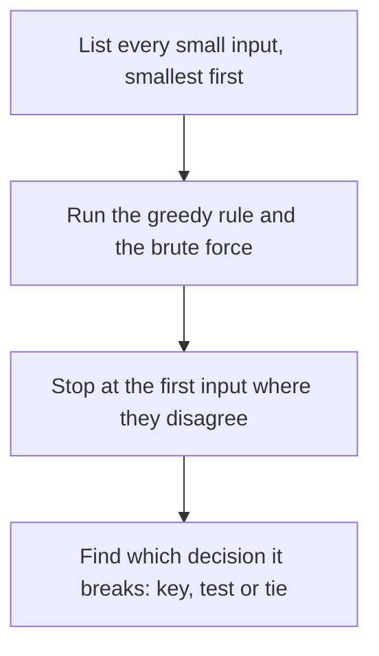

# Greedy and interval traps

## The idea

A greedy algorithm is a few lines long, and its correctness rests on a handful of decisions: **which key it sorts by**, **which comparison it uses at the endpoints**, **what it does with ties**, and **whether the proof matches the problem**. Each of these can be wrong while every example in the statement still passes, because the inputs that expose them are rare: two intervals that touch, two jobs due at the same hour, a list given in an unlucky order.

This guide collects the traps of the [greedy choices](../greedy-choices/guide.md), [intervals](../intervals/guide.md) and [sweep line](../sweep-lines/guide.md) guides in one place, and starts with a tool that finds most of them for you: **compare the greedy rule with brute force on every small input, smallest first, and look at the first input where they disagree.**

## A worked example

Brute force is too slow to use, but it is easy to get right: try every set, count at every point. On inputs of two or three intervals it is instant. So generate every small input, run both, and stop at the first disagreement. Because the inputs come smallest first, the first failure is one of the smallest, and small enough to check by hand.

The program checks five rules on every list of one to three half-open intervals with endpoints from 0 to 3, repeats allowed: 6 possible intervals, so 6 + 36 + 216 = 258 lists.

- **Most intervals that fit together**, granted in start order, in end order with a closed-interval overlap test on half-open data, and in end order with the right test.
- **The peak of a sweep**, with opens before closes at equal times, and with closes first.

```python examples/find_counterexample.py
"""Check greedy rules against brute force on every small input, smallest first, and print the first
input on which they disagree. Each plausible bug below fails on two or three intervals."""

from collections.abc import Callable, Iterator
from itertools import combinations, product

Interval = tuple[int, int]
Event = tuple[int, int]  # (time, change): +1 opens, -1 closes
LAST_POINT = 3
EVERY_INTERVAL = [(s, e) for s in range(LAST_POINT + 1) for e in range(s + 1, LAST_POINT + 1)]


def small_inputs() -> Iterator[list[Interval]]:
    """Every list of 1 to 3 half-open intervals with endpoints 0 to 3, repeats allowed."""
    for size in (1, 2, 3):
        yield from (list(chosen) for chosen in product(EVERY_INTERVAL, repeat=size))


def half_open_overlap(a: Interval, b: Interval) -> bool:
    return a[0] < b[1] and b[0] < a[1]


def closed_overlap(a: Interval, b: Interval) -> bool:
    return a[0] <= b[1] and b[0] <= a[1]


def most_by_brute_force(intervals: list[Interval]) -> int:
    return max(
        size
        for size in range(len(intervals) + 1)
        for chosen in combinations(intervals, size)
        if not any(half_open_overlap(a, b) for a, b in combinations(chosen, 2))
    )


def peak_by_brute_force(intervals: list[Interval]) -> int:
    return max(sum(s <= t < e for s, e in intervals) for t in range(LAST_POINT + 1))


def grant(
    intervals: list[Interval],
    key: Callable[[Interval], int],
    overlap: Callable[[Interval, Interval], bool],
) -> int:
    granted: list[Interval] = []
    for interval in sorted(intervals, key=key):
        if not any(overlap(interval, kept) for kept in granted):
            granted.append(interval)
    return len(granted)


def peak(intervals: list[Interval], event_order: Callable[[Event], tuple[int, int]]) -> int:
    events = [(s, +1) for s, _ in intervals] + [(e, -1) for _, e in intervals]
    open_now = highest = 0
    for _, change in sorted(events, key=event_order):
        open_now += change
        highest = max(highest, open_now)
    return highest


def by_start(interval: Interval) -> int:
    return interval[0]


def by_end(interval: Interval) -> int:
    return interval[1]


def closes_first(event: Event) -> tuple[int, int]:
    return event[0], event[1]


def opens_first(event: Event) -> tuple[int, int]:
    return event[0], -event[1]


CHECKS = {
    "most, earliest start": (
        lambda intervals: grant(intervals, by_start, half_open_overlap),
        most_by_brute_force,
    ),
    "most, earliest end, closed test": (
        lambda intervals: grant(intervals, by_end, closed_overlap),
        most_by_brute_force,
    ),
    "most, earliest end": (
        lambda intervals: grant(intervals, by_end, half_open_overlap),
        most_by_brute_force,
    ),
    "peak, opens first at ties": (
        lambda intervals: peak(intervals, opens_first),
        peak_by_brute_force,
    ),
    "peak, closes first at ties": (
        lambda intervals: peak(intervals, closes_first),
        peak_by_brute_force,
    ),
}

inputs = list(small_inputs())
for name, (rule, truth) in CHECKS.items():
    failure = next((i for i in inputs if rule(i) != truth(i)), None)
    if failure is None:
        print(f"{name}: agrees on all {len(inputs)} inputs")
    else:
        print(f"{name}: fails on {failure}, {rule(failure)} instead of {truth(failure)}")
```

It prints:

```output examples/find_counterexample.py
most, earliest start: fails on [(0, 2), (0, 1), (1, 2)], 1 instead of 2
most, earliest end, closed test: fails on [(0, 1), (1, 2)], 1 instead of 2
most, earliest end: agrees on all 258 inputs
peak, opens first at ties: fails on [(0, 1), (1, 2)], 2 instead of 1
peak, closes first at ties: agrees on all 258 inputs
```

Each failure is a lesson of its own.

- **Earliest start** fails on `[(0, 2), (0, 1), (1, 2)]`: it grants `[0, 2)`, which blocks the other two. This input fails only because the tie between `(0, 2)` and `(0, 1)`, both starting at 0, goes to the one listed first; listed the other way round, it passes. But `[(0, 3), (1, 2), (2, 3)]` fails whatever the tie order, so the rule is wrong, not unlucky.
- **The closed test** fails on `[(0, 1), (1, 2)]`: `[0, 1)` and `[1, 2)` touch without sharing a point, but `<=` calls them overlapping and grants only one.
- **Opens first** fails on the same two intervals: at time 1 it counts the opening interval before the closing one is gone, and reports 2 open at once where there is never more than 1.
- **The two right rules** agree with brute force on all 258 inputs. That is evidence, not proof: the proofs in the earlier guides cover every size.



<!-- text-of-mermaid sha256:67bce2143b5d52031eba1fec22e1dfcd02eac76895215a79be855c77c10b6916 -->
```text
┌───────────────────────────────────────────────┐
│     List every small input, smallest first    │
└───────────────────────┬───────────────────────┘
                        ▼
┌───────────────────────────────────────────────┐
│    Run the greedy rule and the brute force    │
└───────────────────────┬───────────────────────┘
                        ▼
┌───────────────────────────────────────────────┐
│  Stop at the first input where they disagree  │
└───────────────────────┬───────────────────────┘
                        ▼
┌───────────────────────────────────────────────┐
│Find which decision it breaks: key, test or tie│
└───────────────────────────────────────────────┘
```

Two choices make the tool work:

- **Every input, not random ones.** The telescope example of the intervals guide found shortest first wrong on only 6 of 1,940 small inputs. A few random tests would likely miss all six; listing every input cannot.
- **A brute force that shares nothing with the rule.** The peak's brute force counts the intervals that contain each point, straight from the definition, instead of reusing the sweep's events. A brute force built from the same helper as the rule repeats its bug and agrees with it.

## Sorting by the wrong key

Most wrong greedy algorithms are right algorithms with the wrong key. The guides of this path met these:

| Goal | Wrong key | Right key | Where |
|------|-----------|-----------|-------|
| Least total waiting, one customer per batch | listed order | length | [greedy choices](../greedy-choices/guide.md) |
| Least total waiting, several customers per batch | length | length per customer | [greedy choices](../greedy-choices/guide.md) |
| Most intervals that fit together | start, or length | end | [intervals](../intervals/guide.md) |
| Smallest worst lateness | length | deadline | [scheduling](../scheduling-with-deadlines/guide.md) |
| Most jobs on time | deadline alone, never revising | deadline, then give up the longest | [scheduling](../scheduling-with-deadlines/guide.md) |

Two habits catch most of these. Redo the exchange argument with every quantity of the problem in it: a quantity the key ignores is where the counterexample lives. And when a key is a ratio, compare it exactly, with `Fraction` or by cross-multiplying integers, never with rounded floats.

## Endpoints

- **Pick the test from the convention.** For half-open `[a, b)` and `[c, d)`, overlap is `a < d and c < b`; for closed intervals, `a <= d and c <= b`. The closed test on half-open data rejected `[0, 1)` next to `[1, 2)`.
- **The tie rule of a sweep follows the same convention.** Half-open: closes before opens at equal times. Closed: opens before closes.
- **One convention inside the program.** If the input is closed and the code thinks half-open, every comparison is a chance to forget. Convert once, where the data comes in, and write down which convention the rest of the code uses.
- **Empty and single-point intervals.** A half-open `[t, t)` is empty and overlaps nothing; a closed `[t, t]` holds one point. Decide what the input allows before the code has to.
- **"By hour 8".** Whether finishing exactly at a deadline counts as on time is the same question in another form: `<=` or `<`.

## Ties

Python's `sorted` and `list.sort` are **stable**: items with equal keys keep the order they had in the input. That makes the result well defined, but it makes it depend on the input's order whenever the key leaves ties.

```python examples/ties.py
"""Ties in a sort key and in a heap. Python's sort is stable, so equal keys keep their input order:
an incomplete key makes the result depend on how the input happened to be listed."""

import heapq
from collections.abc import Callable
from itertools import count
from typing import Any

Interval = tuple[int, int]


def earliest_end(requests: list[Interval], key: Callable[[Interval], Any]) -> list[Interval]:
    granted: list[Interval] = []
    for start, end in sorted(requests, key=key):
        if all(end <= kept_start or kept_end <= start for kept_start, kept_end in granted):
            granted.append((start, end))
    return granted


def end_only(request: Interval) -> int:
    return request[1]


def end_then_start(request: Interval) -> tuple[int, int]:
    return request[1], request[0]


def pop_order(entries: list[tuple[Any, ...]]) -> list[str]:
    heap: list[tuple[Any, ...]] = []
    for entry in entries:
        heapq.heappush(heap, entry)
    return [heapq.heappop(heap)[-1]["name"] for _ in entries]


listed = [(2, 5), (3, 5), (0, 2)]
relisted = [(0, 2), (3, 5), (2, 5)]
for key in (end_only, end_then_start):
    print(f"key {key.__name__}:")
    for requests in (listed, relisted):
        print(f"  {requests} -> grants {earliest_end(requests, key)}")

jobs = [(2, {"name": "scan"}), (1, {"name": "print"}), (2, {"name": "bind"})]
try:
    print("heap of (hours, job):", pop_order(jobs))
except TypeError as error:
    print("heap of (hours, job): TypeError:", error)
arrivals = count()
with_arrivals = [(hours, next(arrivals), job) for hours, job in jobs]
print("heap of (hours, arrival, job):", pop_order(with_arrivals))
```

It prints:

```output examples/ties.py
key end_only:
  [(2, 5), (3, 5), (0, 2)] -> grants [(0, 2), (2, 5)]
  [(0, 2), (3, 5), (2, 5)] -> grants [(0, 2), (3, 5)]
key end_then_start:
  [(2, 5), (3, 5), (0, 2)] -> grants [(0, 2), (2, 5)]
  [(0, 2), (3, 5), (2, 5)] -> grants [(0, 2), (2, 5)]
heap of (hours, job): TypeError: '<' not supported between instances of 'dict' and 'dict'
heap of (hours, arrival, job): ['print', 'scan', 'bind']
```

- **An incomplete key changes which items are chosen.** Sorted by end alone, `(2, 5)` and `(3, 5)` tie, and the request granted second depends on which was listed first. Both answers grant two requests, as the earliest-end proof promises for any tie order, but a program that must return the requests themselves gives different answers for the same set. A complete key, here `(end, start)`, makes the output the same however the input is listed.
- **Decide for each rule whether ties matter.** Some proofs cover every tie order: the exchange of two equal batches costs nothing, and earliest end never used its tie order. Others do not: a sweep must put closes first for half-open intervals. Write down which kind each tie is.
- **Heap entries compare element by element.** A heap of `(hours, job)` compares the jobs when two hours are equal, and a `dict` has no order, so popping raises `TypeError`. An arrival counter as the second element settles every tie, and also makes equal hours come out first in, first out.

## When to use it

- **Before trusting any greedy rule** that you have not proved, and after changing the key or a comparison of one you have.
- **When a proof feels too easy.** A proof that never used the endpoint convention, or the tie order, may be right, or may have skipped the case that breaks the code. Brute force on small inputs shows which.
- **When a statement fixes a convention.** Half-open or closed, "at or before" or "before": these are exactly the details the examples rarely exercise.

## Common traps

- **Checking only the examples.** The statement's examples are chosen to explain the problem, not to break your solution.
- **Random tests instead of every small input.** Rare failures stay rare: 6 failures in 1,940 inputs is a 0.3% chance per input.
- **A brute force that shares the rule's helpers**, and so its bugs.
- **Inputs too small to fail.** Some wrong rules only fail on larger inputs. A clean run over small inputs raises confidence; it is the proof that settles it.
- **Fixing the counterexample instead of the rule.** A special case for `[(0, 1), (1, 2)]` makes the checker pass and leaves the bug. Find which decision, key, comparison or tie, the counterexample exposes.

## Complexity

| Check | Cost |
|-------|------|
| Every list of up to `k` intervals from `m` possible ones | `m + m² + ... + m^k` inputs: 258 for `m = 6`, `k = 3` |
| Brute force for the most intervals that fit | O(2^k · k²) per input |
| Brute force for the peak | O(T · k) per input, for `T` points |

The number of inputs grows exponentially with their size, so keep both the size and the range of endpoints small; every bug in this guide shows up on three intervals or fewer.

## Expert notes

- **Stability differs between languages.** Python's `sorted` and `list.sort` are guaranteed stable. Java's `Arrays.sort` for objects and `List.sort` are stable; JavaScript's `Array.prototype.sort` has been stable since ECMAScript 2019. Go's `sort.Slice` and `slices.SortFunc` are not guaranteed to be stable, and `sort.SliceStable` and `slices.SortStableFunc` are. Code that relies on ties keeping their order in one language can break when it is ported.
- **A comparison instead of a key.** Some orders are easier to write as a comparison of two items, such as comparing two ratios by cross-multiplying. Python's `functools.cmp_to_key` turns such a function, negative for less, zero for equal, positive for greater, into a key for `sorted`, `min`, `max` and `heapq.nsmallest`.
- **Ties in a priority queue.** The `heapq` documentation lists equal priorities among the difficulties of a priority queue and recommends storing an entry count between the priority and the task, so that equal priorities come out in the order they were added and two tasks are never compared.
- **Evidence and proof work together.** An exhaustive check over small inputs is cheap to write and fast to run, and it finds wrong keys, comparisons and tie rules in seconds. A proof covers every size but can quietly assume something the code does not do. Use both: the check to find the bug, the proof to know there is no other.

## Practice

- `cstudy start remove-covered-intervals`: count the intervals that no other interval of the list contains.

## Further reading

- [Python sorting techniques](https://docs.python.org/3/howto/sorting.html): key functions, stability and sorting on several keys.
- [Python `sorted`](https://docs.python.org/3/library/functions.html#sorted) and [`list.sort`](https://docs.python.org/3/library/stdtypes.html#list.sort): both guaranteed stable.
- [Python `functools.cmp_to_key`](https://docs.python.org/3/library/functools.html#functools.cmp_to_key): a comparison function as a sort key.
- [Python `heapq`, priority queue notes](https://docs.python.org/3/library/heapq.html#priority-queue-implementation-notes): tuple ties and the entry count.
- [Java `Arrays.sort`](https://docs.oracle.com/en/java/javase/21/docs/api/java.base/java/util/Arrays.html) and [`List.sort`](https://docs.oracle.com/en/java/javase/21/docs/api/java.base/java/util/List.html#sort(java.util.Comparator)): stable sorts of objects.
- [MDN: `Array.prototype.sort`](https://developer.mozilla.org/en-US/docs/Web/JavaScript/Reference/Global_Objects/Array/sort): stable since ECMAScript 2019.
- [Go `sort.Slice`](https://pkg.go.dev/sort#Slice) and [`slices.SortFunc`](https://pkg.go.dev/slices#SortFunc): not guaranteed stable, with stable variants beside them.
