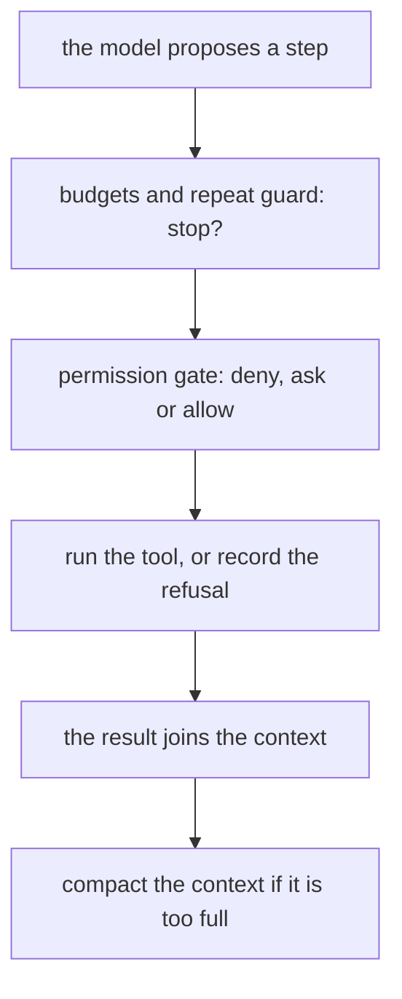
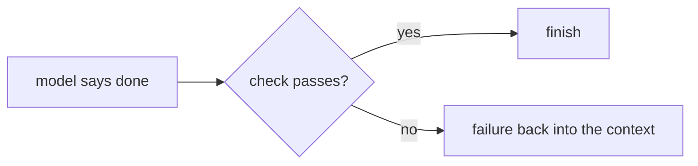

# Harness engineering

## The idea

An agent is a model in a loop with tools. Everything around the model, the loop itself, what it may touch, what it remembers, when it stops and how its work is checked, is the **harness**. The model proposes; the harness decides what actually happens. Two agents built on the same model can behave very differently because of their harnesses, and most of the reliability of an agent is engineered there.

The harness has six jobs, and this guide takes each in turn:

| Job | The question it answers |
|-----|-------------------------|
| **Permission gates** | May this action run: always, never, or only if a person says yes? |
| **Loop budgets** | When must the loop stop, whatever the model wants? |
| **Compaction** | What happens when the context window fills up? |
| **Sessions** | How does work survive a crash, a restart or tomorrow? |
| **Subagents** | When should a task run in a fresh context of its own? |
| **Completion checks** | How do we know the agent is actually done? |

Around those mechanisms sits the environment the agent works in: the instructions and documents it can read, the tests and linters that check its work, and the logs it can inspect. Designing that environment is much of the work of the people around an agent: specifying intent, shaping the environment and giving structured feedback, with rules enforced by tools rather than by reminders in a prompt.

## A worked example

### A permission gate

The gate sits between what the model proposes and what runs. Its rules have three outcomes, **deny**, **ask** and **allow**, checked in that order of strictness, so that a deny always beats an allow and anything no rule covers is denied. The proposals and the user's answers are scripted.

```python examples/permission_gate.py
"""A permission gate between an agent's proposed actions and the tools that would carry them out.

Rules are checked in a fixed order of strictness: any matching deny wins, then any matching ask,
then any matching allow; an action that no rule matches is denied. The user's answers are scripted.
"""

from pathlib import PurePosixPath

KNOWN_CHECKS = {"pytest -q", "ruff check ."}


def escapes(path: str) -> bool:
    """True when the path, taken from the workspace root, leaves the workspace."""
    depth = 0
    for part in PurePosixPath(path).parts:
        if part == "/":
            return True
        depth += -1 if part == ".." else 0 if part == "." else 1
        if depth < 0:
            return True
    return False


RULES = [  # (decision, tool, test on the argument, reason)
    ("deny", "read_file", escapes, "outside the workspace"),
    ("deny", "write_file", escapes, "outside the workspace"),
    ("deny", "write_file", lambda path: PurePosixPath(path).name == ".env", "secrets are never written"),
    ("deny", "run", lambda command: command.split()[0] in {"rm", "curl", "sudo"}, "never run"),
    ("ask", "write_file", lambda path: True, "a file would change"),
    ("ask", "run", lambda command: command not in KNOWN_CHECKS, "an unknown command"),
    ("allow", "read_file", lambda path: True, "reading inside the workspace"),
    ("allow", "run", lambda command: command in KNOWN_CHECKS, "a known check"),
]


def decide(tool: str, argument: str) -> tuple[str, str]:
    for strictness in ("deny", "ask", "allow"):
        for decision, rule_tool, test, reason in RULES:
            if decision == strictness and rule_tool == tool and test(argument):
                return decision, reason
    return "deny", "no rule allows it"


proposed = [
    ("read_file", "src/app.py"),
    ("run", "pytest -q"),
    ("write_file", "src/app.py"),
    ("write_file", "config/.env"),
    ("read_file", "docs/../../secrets.txt"),
    ("read_file", "/etc/passwd"),
    ("run", "rm -rf build"),
    ("run", "make deploy"),
    ("send_email", "team@example.com"),
]
user_says_yes = {("write_file", "src/app.py"): True, ("run", "make deploy"): False}
for tool, argument in proposed:
    decision, reason = decide(tool, argument)
    if decision == "ask":
        decision = "allowed by the user" if user_says_yes[(tool, argument)] else "declined by the user"
    print(f"{tool}({argument}): {decision}, {reason}")
```

It prints:

```output examples/permission_gate.py
read_file(src/app.py): allow, reading inside the workspace
run(pytest -q): allow, a known check
write_file(src/app.py): allowed by the user, a file would change
write_file(config/.env): deny, secrets are never written
read_file(docs/../../secrets.txt): deny, outside the workspace
read_file(/etc/passwd): deny, outside the workspace
run(rm -rf build): deny, never run
run(make deploy): declined by the user, an unknown command
send_email(team@example.com): deny, no rule allows it
```

Each line is one decision:

- **Reading the code and running the known test command** are allowed without asking: they change nothing.
- **Writing a source file** asks the user, who approves.
- **Writing `.env`** is denied by a specific rule, even though another rule would have asked: deny rules are checked first, so no allow or ask can override them.
- **`docs/../../secrets.txt` and `/etc/passwd`** are denied because they leave the workspace. The check walks the path's parts; a check that only looked at the first directory would have let the first one through. This check is lexical; a real gate resolves symlinks first.
- **`rm -rf build`** is denied outright; **`make deploy`** is unknown, so the user is asked, and declines.
- **`send_email`** matches no rule at all, so it is denied. A gate that allows by default is a gate that fails open.

### The loop: budgets, repeats, compaction and checks

```python examples/harness_loop.py
"""The loop around an agent: budgets, a repeated-action guard, compaction and a completion check.

The model is a fake that plays back scripted steps; the tools and the test run are fakes too.
Tokens are counted as words.
"""

WINDOW = 50  # tokens of context the model can take
COMPACT_AT = 0.7  # compact when the context passes this share of the window
KEEP_RECENT = 2  # entries kept word for word when compacting


def tokens(text: str) -> int:
    return len(text.split())


class FakeRepo:
    def __init__(self) -> None:
        self.edits = 0

    def run_tool(self, tool: str, argument: str) -> str:
        if tool == "read_file" and argument.startswith("tests/"):
            return "assert total([Item(price=2, quantity=3)]) == 6"
        if tool == "read_file":
            return "def total(items): return sum(item.price for item in items)  # quantity is ignored"
        if tool == "edit_file":
            self.edits += 1
            return f"edited {argument}"
        return self.tests()

    def tests(self) -> str:
        return "2 passed" if self.edits >= 2 else "1 failed: test_total_counts_quantity"


def run(steps: list[dict[str, str]], max_steps: int = 8, max_tokens: int = 400) -> None:
    repo, context, spent, seen = FakeRepo(), ["task: make test_total_counts_quantity pass"], 0, {}
    for number, step in enumerate(steps, start=1):
        if number > max_steps:
            print("  stop: the step limit was reached")
            return
        spent += sum(map(tokens, context))  # the model reads the whole context on every step
        if spent > max_tokens:
            print(f"  stop: the token budget was spent ({spent} > {max_tokens})")
            return
        if "done" in step:
            result = repo.tests()  # the harness checks the claim instead of believing it
            print(f"  step {number}: model says done -> check: {result}")
            if result.endswith("passed"):
                print(f"  finished after {number} steps, {spent} tokens read")
                return
            context.append(f"check failed: {result}")
            continue
        key = (step["tool"], step["arg"])
        seen[key] = seen.get(key, 0) + 1
        if seen[key] == 3:
            print(f"  stop: {step['tool']}({step['arg']}) proposed 3 times with the same arguments")
            return
        observation = repo.run_tool(step["tool"], step["arg"])
        context.append(f"{step['tool']}({step['arg']}) -> {observation}")
        print(f"  step {number}: {step['tool']}({step['arg']}) -> {observation}")
        if sum(map(tokens, context)) > COMPACT_AT * WINDOW:
            folded = len(context) - KEEP_RECENT
            summary = f"summary of {folded} earlier entries: total() ignores quantity; one test fails"
            context = [summary, *context[-KEEP_RECENT:]]  # a model call writes this summary
            print(f"    compacted: {folded} entries -> 1 summary, context now {sum(map(tokens, context))} tokens")


print("a run that finishes:")
run([
    {"tool": "read_file", "arg": "src/cart.py"},
    {"tool": "run_tests", "arg": "pytest -q"},
    {"tool": "edit_file", "arg": "src/cart.py"},
    {"done": "fixed"},
    {"tool": "edit_file", "arg": "src/cart.py"},
    {"done": "fixed"},
])
print("a run that repeats itself:")
run([{"tool": "run_tests", "arg": "pytest -q"}] * 5)
print("a run with a small token budget:")
run([{"tool": "read_file", "arg": "src/cart.py"}, {"tool": "read_file", "arg": "tests/test_cart.py"},
     {"tool": "run_tests", "arg": "pytest -q"}], max_tokens=40)
```

It prints:

```output examples/harness_loop.py
a run that finishes:
  step 1: read_file(src/cart.py) -> def total(items): return sum(item.price for item in items)  # quantity is ignored
  step 2: run_tests(pytest -q) -> 1 failed: test_total_counts_quantity
  step 3: edit_file(src/cart.py) -> edited src/cart.py
  step 4: model says done -> check: 1 failed: test_total_counts_quantity
  step 5: edit_file(src/cart.py) -> edited src/cart.py
    compacted: 4 entries -> 1 summary, context now 20 tokens
  step 6: model says done -> check: 2 passed
  finished after 6 steps, 127 tokens read
a run that repeats itself:
  step 1: run_tests(pytest -q) -> 1 failed: test_total_counts_quantity
  step 2: run_tests(pytest -q) -> 1 failed: test_total_counts_quantity
  stop: run_tests(pytest -q) proposed 3 times with the same arguments
a run with a small token budget:
  step 1: read_file(src/cart.py) -> def total(items): return sum(item.price for item in items)  # quantity is ignored
  step 2: read_file(tests/test_cart.py) -> assert total([Item(price=2, quantity=3)]) == 6
  stop: the token budget was spent (47 > 40)
```

Three runs, three ways a loop ends:

- **The first run finishes, but not when the model first says so.** At step 4 the model claims it is done; the harness runs the tests itself and they still fail, so the failure goes back into the context and the loop continues. At step 6 the claim is checked again and the tests pass. Along the way the context passed 70% of its 50-token window, so the four oldest entries were folded into one summary, and the last two were kept word for word.
- **The second run repeats itself.** The same tool with the same argument is counted a third time and the loop stops. A model that repeats an action with nothing new to learn from it is stuck, and waiting for it to notice costs tokens.
- **The third run hits its token budget.** Every step re-reads the whole context, so tokens spent grow faster than steps. The budget counts what was actually read, and stops the run before the next call.



<!-- text-of-mermaid sha256:92cac2790d78eb748ae3fe0a89d7b057ccd2a28acaaaa30026d8e080e1f26ef5 -->
```text
┌─────────────────────────────────────┐
│      the model proposes a step      │
└──────────────────┬──────────────────┘
                   ▼
┌─────────────────────────────────────┐
│   budgets and repeat guard: stop?   │
└──────────────────┬──────────────────┘
                   ▼
┌─────────────────────────────────────┐
│ permission gate: deny, ask or allow │
└──────────────────┬──────────────────┘
                   ▼
┌─────────────────────────────────────┐
│ run the tool, or record the refusal │
└──────────────────┬──────────────────┘
                   ▼
┌─────────────────────────────────────┐
│     the result joins the context    │
└──────────────────┬──────────────────┘
                   ▼
┌─────────────────────────────────────┐
│compact the context if it is too full│
└─────────────────────────────────────┘
```



<!-- text-of-mermaid sha256:18c2cebff9a0cbe077afe74526f6d81e5e6b6df3b54e7074c4267ec44332ee67 -->
```text
┌───────────────┐    ◇─────────────◇        ┌─────────────────────────────┐
│model says done├───►│check passes?│ ├─yes─►│            finish           │
└───────────────┘    ◇──────┬──────◇        └─────────────────────────────┘
                            │
                            │               ┌─────────────────────────────┐
                            └──────no──────►│failure back into the context│
                                            └─────────────────────────────┘
```

The first drawing is one step of the loop, top to bottom; after the last box the model is called again. Each box can end or change the step: the budgets can stop the run, the gate can refuse the action, and compaction can shrink what the next call reads. The second drawing is the only way the loop ends in success, and it goes through a check the harness runs, not through the model's claim.

## When to use it

- **Permission gates** for every agent with tools that change anything. Default to deny; allow what is read-only and safe; ask for what is reversible but significant; deny what is irreversible unless a person explicitly approves it outside the loop.
- **Loop budgets** on every loop, without exception: steps, tokens, time and money. A budget that is only an alert is not a budget; it must stop the run.
- **Compaction** for long tasks: when the context passes a threshold, summarize the oldest part and keep the most recent turns verbatim. Tell the summarizer what must survive: the goal, decisions made, facts learned, what failed.
- **Sessions** whenever work may outlive a process: keep an append-only log of messages, tool calls and results, so that a run can be resumed from the log, audited, and replayed in a test.
- **Subagents** when a subtask needs a lot of reading but returns a little: searching a codebase, reading ten documents, trying an approach that may fail. A fresh context with only the subtask keeps the main context small, and the subagent returns a short result. Give it its own, narrower permissions.
- **Completion checks** whenever "done" can be tested: tests pass, the linter is clean, the output parses, the file exists. Prefer a check the harness runs to the model's own claim.

## Common traps

- **Gates that fail open.** A rule list that allows anything it does not recognize turns every new tool into an unchecked one. Deny by default.
- **Asking too often.** A person asked to approve fifty trivial actions stops reading them. Allow the safe ones silently, ask about few things, and show the exact action, not a summary of it.
- **Checking a path by its text.** `docs/../../x`, symbolic links and absolute paths all escape a workspace that a prefix check would accept. Resolve the path, then check where it ends up.
- **Budgets measured in steps alone.** One step can read a huge file. Count tokens, time and money as well as steps.
- **Compaction that forgets the goal.** A summary that keeps the details of the last hour and drops the task itself sends the agent wandering. The original instructions stay outside what is compacted.
- **Believing "done".** A model's claim that it finished is a proposal like any other. Without an external check, an agent can stop with failing tests and a confident message.
- **Self-review as the only check.** Asking the same model whether its own answer is right is weak evidence. Use a check that does not depend on the model: tests, a validator, a different model with a rubric, a person.
- **Sessions that replay side effects.** Resuming from a log must not re-send the email the log recorded. Record each action's result, and give actions with side effects an idempotency key.
- **Subagents with the parent's full powers.** A subagent reading untrusted documents is exactly where an injected instruction lands. Give it read-only tools when reading is all it needs.

## Complexity

For a run of `s` steps whose context grows by about `c` tokens per step, in a window of `W` tokens:

| Mechanism | Cost |
|-----------|------|
| Permission gate | O(r) per action for `r` rules; negligible |
| Repeat guard | O(1) per action with a hash map keyed by tool and argument |
| Tokens read without compaction | About c · s² / 2 over the run: step `i` re-reads `i` steps |
| Compaction | One model call per compaction; afterwards the context is back to the summary plus the recent turns |
| Completion check | Whatever the check costs: a test suite run, per claim of done |
| Session log | O(1) per appended entry; resuming reads the log once |

Compaction changes the growth: with the context held under a fraction of `W`, each step reads at most that much, so total tokens grow linearly in `s` instead of quadratically, at the price of a summary call every so often and of whatever the summaries lose.

## Expert notes

- **Paging for context.** Packer and colleagues borrowed virtual memory from operating systems to manage a model's context: when the prompt passes a warning threshold, for example 70% of the window, the system tells the model that memory is under pressure so it can save what matters; at a flush threshold, for example 100%, it evicts part of the conversation, for example half the window, and writes a new recursive summary from the old summary and the evicted messages. The example's compaction is the same idea with one threshold.
- **Circuit breakers.** The 2026 OWASP Top 10 for LLM Applications advises, under Unbounded Consumption, enforcing step limits, recursion depth limits, time limits and per-run cost ceilings on every agent execution, using state hashing to detect loops, and setting spending caps that halt inference rather than thresholds that only alert.
- **Graduated permissions.** The same list's entry on Excessive Agency describes graduated enforcement, audit, warn, block or escalate, so that low-consequence or easily reversible actions can be approved automatically while irreversible ones go to a person, and asks for authorization enforced in code rather than decided by the model. Its entry on prompt injection adds that a confirmation should show the exact action to be executed, and warns that approval fatigue degrades reviewers' judgement.
- **Why external checks.** Huang and colleagues found that models struggle to correct their own reasoning without external feedback, and that performance can even get worse after self-correction. A completion check should therefore rest on something outside the model's own opinion.
- **Step limits in the research.** The ReAct experiments capped runs at 7 and 5 steps on their question-answering and fact-verification benchmarks because more steps did not improve results. Pick limits from measurements of your own tasks, and treat hitting one as a signal to inspect, not just to retry.
- **No session in the protocol.** The Model Context Protocol's current revision is stateless: a server must not treat a connection as a conversation, and state that spans requests is referred to by an explicit identifier on every request. A harness that needs sessions keeps them itself.
- **Designing the environment.** For agents that write software, treat the harness as the whole environment they work in: keep the knowledge they need in the repository as structured documents that serve as their source of truth, enforce architectural rules with linters, structural tests and continuous integration rather than with instructions alone, give them telemetry they can read to reproduce and diagnose problems, and run agents periodically to find documentation that has drifted or rules that are being broken. When an agent struggles, treat it as a signal of what the environment is missing: a tool, a guardrail or a document.

## Practice

- `cstudy start tool-calling-agent-loop-typescript`: a loop with an allowlist per role, tool output treated as untrusted data, and a step and token budget that stops the run whatever the model does.
- `cstudy start loop-controller`: the budgets and stopping rules around an agent's loop.
- `cstudy start tool-permission-gate`: allow, ask and deny decisions for proposed tool calls.
- `cstudy start context-compaction`: keeping a growing context inside its window.

## Further reading

- [Packer and others, *Towards LLMs as Operating Systems* (2023, title shortened)](https://arxiv.org/abs/2310.08560): virtual context management, memory pressure warnings and recursive summaries on eviction.
- [Huang and others, *Large Language Models Cannot Self-Correct Reasoning Yet* (2024)](https://arxiv.org/abs/2310.01798): self-correction without external feedback.
- [Yao and others, *ReAct: Synergizing Reasoning and Acting in Language Models* (2023)](https://arxiv.org/abs/2210.03629): step limits in practice.
- [Model Context Protocol, base protocol, revision 2026-07-28](https://modelcontextprotocol.io/specification/2026-07-28/basic): statelessness and explicit identifiers for state.
- [OWASP Top 10 for LLM Applications 2026](https://genai.owasp.org/resource/owasp-genai-llm-top-10-2026/): LLM03:2026 Excessive Agency (2025: LLM06) and LLM06:2026 Unbounded Consumption (2025: LLM10).
