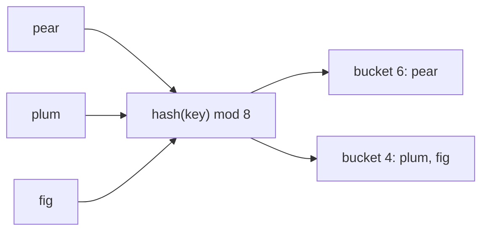

# What a hash function is

## The idea

A hash function takes a key, such as a word, a number or a tuple of both, and turns it into a number. That is all it does. Two properties make it useful.

- **It is deterministic.** The same key gives the same number every time it is asked, for as long as the program runs. Without that, you could store something under a key and never find it again.
- **It spreads keys out.** Different keys should give numbers that look unrelated, so that a collection of keys lands evenly across the range of numbers instead of piling up on a few.

The number is called the key's **hash** (or hash code). On its own it is just a large integer. What makes it work is the next step: a table with `m` slots, called **buckets**, takes the hash modulo `m` and gets a bucket index between `0` and `m - 1`. To store a key, you put it in that bucket. To look a key up, you compute the same hash, go to the same bucket, and look only there.

That is the whole trick behind hash maps and hash sets. Instead of searching through every stored key, you compute where the key must be and check one small place.



<!-- text-of-mermaid sha256:8df9f9808eb16936ea87419f6089e851e1dc2e32761ab8d90ad1089fdaed1ee6 -->
```text
┌────┐    ┌───────────────┐    ┌───────────────────┐
│pear├───►│hash(key) mod 8├───►│   bucket 6: pear  │
└────┘    └───────┬───────┘    └───────────────────┘
                  ▲
┌────┐            │            ┌───────────────────┐
│plum├────────────┼───────────►│bucket 4: plum, fig│
└────┘            │            └───────────────────┘
                  │
┌────┐            │
│fig ├────────────┘
└────┘
```

The diagram shows three keys going through one hash function into a table of eight buckets. `pear` lands alone in bucket 6, while `plum` and `fig` both land in bucket 4. When two different keys land in the same bucket, that is a **collision**.

### Collisions cannot be avoided

There are far more possible keys than buckets. There are more possible words than any table could have slots, and even a 64-bit hash has only 2^64 values for infinitely many strings. So some different keys must share a hash, and many more must share a bucket. This is the **pigeonhole principle**: put `n` pigeons into `m` holes with `n > m`, and some hole holds at least two. With `n` keys in `m` buckets, some bucket holds at least `n / m` of them, rounded up.

Collisions also come much sooner than intuition says. If keys land in buckets at random, the chance that two of them share a bucket passes one half at about 1.18 times the square root of `m`. With 365 buckets that is only 23 keys: the classic birthday problem. So a hash table is never designed to avoid collisions. It is designed to keep them few and to cope with them, which [hash maps and sets](../hash-maps-and-sets/guide.md) explains.

## A worked example

Here are two hash functions for short strings, and what they do with the same keys.

- `letter_sum` adds up the character codes. It is deterministic, but it ignores the order of the letters, so every rearrangement of a word gets the same hash.
- `polynomial` treats the string as digits in base 31: `value = value * 31 + code` for each character. Position now matters. Java's `String.hashCode()` is documented as exactly this sum, `s[0]*31^(n-1) + s[1]*31^(n-2) + ... + s[n-1]` in 32-bit arithmetic.

Trace `polynomial("fig")`: `f` is 102, `i` is 105, `g` is 103.

1. Start at 0. Then `0 * 31 + 102 = 102`.
2. `102 * 31 + 105 = 3,267`.
3. `3,267 * 31 + 103 = 101,380`.
4. With 8 buckets, `101,380 mod 8 = 4`, so `fig` goes to bucket 4.

```python examples/buckets.py
"""A hash function maps a key to a number, and the number picks a bucket."""

BUCKETS = 8


def letter_sum(key: str) -> int:
    """A poor hash: it ignores the order of the letters."""
    return sum(ord(character) for character in key)


def polynomial(key: str) -> int:
    """A better one: each letter is weighted by its position (31 is a common multiplier)."""
    value = 0
    for character in key:
        value = (value * 31 + ord(character)) % 2**32
    return value


def bucket(key: str, hash_function) -> int:
    return hash_function(key) % BUCKETS


print("same key, same bucket:", bucket("pear", polynomial) == bucket("pear", polynomial))
for word in ("pear", "plum", "fig"):
    print(f"{word:>5} -> hash {polynomial(word):>10} -> bucket {bucket(word, polynomial)}")

print("letter_sum: listen", bucket("listen", letter_sum), "silent", bucket("silent", letter_sum))
print("polynomial: listen", bucket("listen", polynomial), "silent", bucket("silent", polynomial))

nine = ["ash", "elm", "fir", "oak", "yew", "bay", "box", "fig", "lime"]
used = {bucket(word, polynomial) for word in nine}
print(f"{len(nine)} keys, {BUCKETS} buckets, {len(used)} buckets used: a collision is certain")

keys = [f"user{number}" for number in range(1000)]
for name, function in (("letter_sum", letter_sum), ("polynomial", polynomial)):
    sizes = [0] * 64
    for key in keys:
        sizes[function(key) % 64] += 1
    print(f"{name:>10}: 1000 keys in 64 buckets, largest bucket {max(sizes)}, empty {sizes.count(0)}")

no_collision = 1.0
for placed in range(23):
    no_collision *= (365 - placed) / 365
print(f"23 keys in 365 buckets, hashed at random: a collision {1 - no_collision:.1%} of the time")
```

It prints:

```output examples/buckets.py
same key, same bucket: True
 pear -> hash    3436774 -> bucket 6
 plum -> hash    3444116 -> bucket 4
  fig -> hash     101380 -> bucket 4
letter_sum: listen 7 silent 7
polynomial: listen 7 silent 5
9 keys, 8 buckets, 7 buckets used: a collision is certain
letter_sum: 1000 keys in 64 buckets, largest bucket 70, empty 23
polynomial: 1000 keys in 64 buckets, largest bucket 40, empty 12
23 keys in 365 buckets, hashed at random: a collision 50.7% of the time
```

Read the output line by line:

- The same key always lands in the same bucket.
- `plum` and `fig` collide in bucket 4 even with the better function: collisions are normal.
- `letter_sum` puts `listen` and `silent` in the same bucket, and it always will, whatever the table size, because their sums are equal. `polynomial` separates them.
- Nine keys in eight buckets must collide somewhere, as the pigeonhole principle says. Here two pairs collide (`ash` and `elm`, `yew` and `box`), and seven of the eight buckets are used.
- On 1,000 keys of the form `user0` to `user999`, `letter_sum` leaves 23 of 64 buckets empty and piles 70 keys into one: the keys are similar, their sums are close, and only a narrow range of buckets gets used. `polynomial` spreads them better: about 16 keys per bucket on average, 40 at most.
- The last line is the birthday problem computed: 23 keys in 365 buckets collide about half the time.

### Python's own `hash()`

Python's built-in `hash()` is the function that `dict` and `set` use. Two of its rules show up in everyday code.

```python examples/python_hash.py
"""Python's own hash(): equal values hash alike, and str hashes change between runs."""

import os
import subprocess
import sys

print("1 == 1.0 == True:", 1 == 1.0 == True)
print("hash(1) == hash(1.0) == hash(True):", hash(1) == hash(1.0) == hash(True))
print("a tuple of hashable values is hashable:", hash((1, "a")) == hash((1, "a")))

try:
    hash([1, 2])
except TypeError as error:
    print("a list is not hashable:", type(error).__name__)


def hash_in_new_process(expression: str, seed: str) -> str:
    """hash(expression) in a fresh interpreter whose PYTHONHASHSEED is `seed`."""
    environment = {**os.environ, "PYTHONHASHSEED": seed}
    command = [sys.executable, "-c", f"print(hash({expression}))"]
    return subprocess.run(command, env=environment, capture_output=True, text=True).stdout


pear = "'pear'"
print("str, same seed:", hash_in_new_process(pear, "1") == hash_in_new_process(pear, "1"))
print("str, other seed:", hash_in_new_process(pear, "1") == hash_in_new_process(pear, "2"))
print("int, other seed:", hash_in_new_process("12345", "1") == hash_in_new_process("12345", "2"))
```

It prints:

```output examples/python_hash.py
1 == 1.0 == True: True
hash(1) == hash(1.0) == hash(True): True
a tuple of hashable values is hashable: True
a list is not hashable: TypeError
str, same seed: True
str, other seed: False
int, other seed: True
```

- **Equal values hash alike.** `1`, `1.0` and `True` compare equal, so they must have the same hash, and they are the same key in a dict. This is the one rule every hash function must keep: if `a == b`, then `hash(a) == hash(b)`. The reverse is not required, since collisions exist.
- **Mutable containers are not hashable.** A list can change after you store it, which would move it to another bucket while the table still has it in the old one, so Python refuses to hash it. A tuple of hashable values is hashable.
- **String hashes change between runs.** Python salts the hashes of `str` and `bytes` with a random value chosen when the interpreter starts. Within one process they never change; between processes they differ, unless the environment variable `PYTHONHASHSEED` fixes the seed. Integers are not salted, so `hash(12345)` is the same in every process.

## When to use it

Reach for a hash function, through a hash map or a hash set, whenever the question is "have I seen this key?" or "what is stored under this key?" and you will ask it many times.

- You need to find things by **exact equality**: a user by email, a word in a dictionary, a value seen earlier in a loop.
- You do not need order. A hash scatters keys on purpose, so "the smallest key" or "every key between `a` and `f`" needs a sorted structure, such as a balanced search tree or a sorted array with binary search.
- You need the speed of a lookup in one place instead of a search through many.

You will rarely write a hash function yourself. Every language ships good ones for its built-in types, and composes them for tuples and records. You write one when you define what equality means for your own type, and then the hash must follow the same definition.

## Common traps

- **Equal but different hashes.** If you redefine equality for a type, say two `Point`s are equal when their coordinates are, but keep the default hash, which depends on the object's identity, then equal points land in different buckets and lookups miss. Python protects you here: a class that overrides `__eq__` without `__hash__` gets its `__hash__` set to `None`, so its instances are not hashable at all.
- **Hashing what can change.** A key's hash must not change while it is stored. If you hash a mutable object and then mutate it, the table looks in the wrong bucket. [Hash maps and sets](../hash-maps-and-sets/guide.md) shows this happening in Java.
- **Relying on hash values across runs.** Python's string hashes differ between processes, so never store `hash(text)` in a file or a database to compare later, and never use it as a checksum. Use a [cryptographic hash](../cryptographic-hashes/guide.md) such as SHA-256, whose output is fixed by a standard.
- **Ignoring part of the key.** `letter_sum` ignores order. A hash of a record that skips a field, or that truncates long strings, collides on everything that differs only there.
- **Thinking a collision is a bug.** Two keys with the same hash are expected. The table must compare the keys themselves with `==` after finding the bucket.

## Complexity

| Step | Cost | Why |
|------|------|-----|
| Hashing a key of length `L` | O(L) | Every character or field has to be read once |
| Hashing a fixed-size key (an int, a pair of ints) | O(1) | A few arithmetic operations |
| Turning the hash into a bucket | O(1) | One modulo, or a bit mask when `m` is a power of two |

These costs are certain. What a hash function cannot promise is how many other keys share your bucket. If the function spreads keys well and the table has about as many buckets as keys, a bucket holds a constant number of keys **on average**, and a lookup is O(1) on average. If many keys collide, a bucket holds many keys and a lookup degrades towards O(n) in the **worst case**. Whether that worst case happens depends on the keys, on the function, and, as the expert notes show, sometimes on an attacker.

The memory a hash function needs is O(1): it keeps a running value and nothing else.

## Expert notes

- **Uniform hashing is an assumption, not a fact.** The O(1) average of hash tables is proven under the assumption that each key is equally likely to land in any bucket, independently of the others. Real keys are not random: they share prefixes, they are multiples of 1,000, they are generated in sequences. A good hash function makes such structured keys behave as if they were random. **Universal hashing** goes further: the table picks its hash function at random from a family designed so that any two distinct keys collide with probability at most `1/m`. The average then holds for every set of keys, because the randomness is in the function, not the data.
- **Low bits matter when `m` is a power of two.** Many tables use `m = 2^k` so that `hash mod m` becomes a cheap bit mask that keeps only the lowest `k` bits. A hash whose low bits vary little then crowds a few buckets. Java's `HashMap` guards against this by mixing the high half of the hash into the low half before masking: its source computes `h ^ (h >>> 16)`.
- **Hash flooding.** If an attacker can predict your hash function, they can send keys that all land in one bucket, turning every insert into a scan and n inserts into O(n²) work. oCERT advisory 2011-003 described it in 2011 for the web platforms of Java, PHP, Python, Ruby and others, where a single request with many crafted form parameters could keep a CPU busy for hours. Java's `String.hashCode()` is a documented formula, so collisions are easy to build: `"Aa"` and `"BB"` both hash to 2112, and any string built from those two blocks collides with every other string of the same number of blocks, as the Java example shows. The defenses are to randomize the hash function per process, which Python has done by default for `str` and `bytes` since 3.3 and Rust does with its default randomly seeded hasher, or to make a crowded bucket cheap to search, which Java's `HashMap` does with tree bins.
- **Strides and low bits.** A hash that leaves integer keys almost as they are is fast and fine for random integers, but keys with a common stride defeat a table that keeps only the low bits: multiples of 64 all land in bucket 0 of a 64-bucket table. Mixing the bits first, as Java does, or choosing a prime number of buckets, spreads such keys out again.
- **A table hash is not a fingerprint.** The functions in this guide are fast and good at spreading keys, but nothing stops someone from finding two inputs with the same output. When you need that to be infeasible, for checksums, signatures or tamper evidence, you need a cryptographic hash, which is a different tool with different costs: see [cryptographic hashes and integrity](../cryptographic-hashes/guide.md).

```java examples/StringHashes.java
// Java's String.hashCode() is a documented formula, s[0]*31^(n-1) + ... + s[n-1], so anyone can
// compute it, and anyone can find strings that collide.
public class StringHashes {
    public static void main(String[] args) {
        System.out.println("\"Aa\".hashCode() = " + "Aa".hashCode());
        System.out.println("\"BB\".hashCode() = " + "BB".hashCode());
        // Two colliding blocks combine: every string of n blocks collides with the others.
        String[] keys = {"AaAa", "AaBB", "BBAa", "BBBB"};
        for (String key : keys) {
            System.out.println(key + " -> " + key.hashCode());
        }
        System.out.println("\"\".hashCode() = " + "".hashCode());
    }
}
```

It prints:

```output examples/StringHashes.java
"Aa".hashCode() = 2112
"BB".hashCode() = 2112
AaAa -> 2031744
AaBB -> 2031744
BBAa -> 2031744
BBBB -> 2031744
"".hashCode() = 0
```

## Practice

This guide has no problem of its own: hash functions are practised through the tables built on them. Continue with [hash maps and sets](../hash-maps-and-sets/guide.md), whose problems use exactly the idea above: compute where a key belongs, then look only there.

## Further reading

- [Python data model: `object.__hash__`](https://docs.python.org/3/reference/datamodel.html#object.__hash__): equal objects must hash alike, a class that overrides `__eq__` loses its hash, and `str` and `bytes` hashes are salted per process (since 3.3).
- [Python command line: `PYTHONHASHSEED`](https://docs.python.org/3/using/cmdline.html#envvar-PYTHONHASHSEED): fixing or disabling the salt.
- [Python built-in types](https://docs.python.org/3/library/stdtypes.html): numbers that compare equal must hash alike, so `hash(1) == hash(1.0)`.
- [Java `String.hashCode()`](https://docs.oracle.com/en/java/javase/21/docs/api/java.base/java/lang/String.html#hashCode()): the documented formula.
- [OpenJDK `HashMap` source](https://github.com/openjdk/jdk/blob/master/src/java.base/share/classes/java/util/HashMap.java): the `hash()` method that spreads high bits downward.
- [oCERT advisory 2011-003](https://ocert.org/advisories/ocert-2011-003.html): denial of service through hash collisions, which the Python docs cite as the reason for salting.
- [Rust `HashMap`](https://doc.rust-lang.org/std/collections/struct.HashMap.html): a randomly seeded default hasher, chosen to resist HashDoS.
