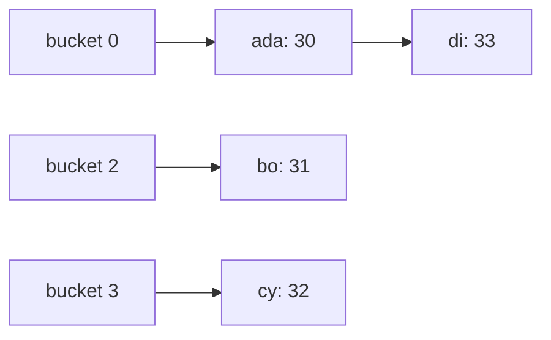
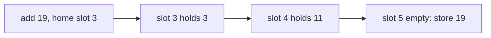
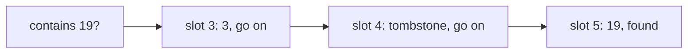

# Hash maps and sets

## The idea

A **hash map** stores values under keys: `ages["ada"] = 30`, then `ages["ada"]` gives 30 back. A **hash set** is the same structure with keys and no values: it answers "is this key in here?". Python calls them `dict` and `set`, Java `HashMap` and `HashSet`, Go has `map`, JavaScript `Map` and `Set`, Rust `HashMap` and `HashSet`.

Both are built on an array of **buckets** and a [hash function](../hash-functions/guide.md). To find a key, hash it, take the hash modulo the number of buckets, and look in that one bucket. Because the hash spreads keys evenly, a bucket holds only a few keys, so a lookup checks a few keys instead of all of them. That is why a lookup takes constant time **on average**, however many keys the map holds.

Three questions make up the rest of the design, and this guide answers each:

1. **Collisions.** Two keys can land in the same bucket. Where does the second one go?
2. **Growth.** A table of 8 buckets holding a million keys would have long buckets. When does the table grow, and what does growing cost?
3. **Keys.** What may be a key, and what breaks if a key changes while it is stored?

## A worked example

### Separate chaining

The simplest answer to collisions: each bucket holds a small list, a **chain**, of the entries that landed there. To put a key, walk its chain; if the key is there, replace its value, otherwise append. To get a key, walk its chain and compare keys with `==`.



<!-- text-of-mermaid sha256:66a882b107efcc39767ea067f6c26cdeb066e4c861d27126d868f62f6a543bf6 -->
```text
┌────────┐    ┌───────┐    ┌──────┐
│bucket 0├───►│ada: 30├───►│di: 33│
└────────┘    └───────┘    └──────┘

┌────────┐    ┌───────┐
│bucket 2├───►│ bo: 31│
└────────┘    └───────┘

┌────────┐    ┌───────┐
│bucket 3├───►│ cy: 32│
└────────┘    └───────┘
```

In the drawing, `ada` and `di` collided in bucket 0, so they share a chain, and finding `di` costs two comparisons instead of one. Bucket 1 is empty. A lookup of a key that is not there, say `zed`, walks the chain of its bucket to the end and answers "not found".

The **load factor** is the number of entries divided by the number of buckets, often written α. If the hash spreads keys evenly, the average chain has length α. Keep α below a constant, and the average lookup checks a constant number of entries. So the table **resizes**: when α passes a limit, it allocates twice as many buckets and puts every entry in again, because each entry's bucket index, `hash mod m`, changes with `m`.

Here is a complete separate-chaining map that doubles when α passes 0.75, the same limit Java's `HashMap` uses by default. It counts how many entries every resize copies.

```python examples/chaining.py
"""A hash map with separate chaining that doubles its buckets when the load factor passes 0.75.

It hashes with zlib.crc32, which is the same in every run, so the output is too; Python's own
hash() of a str changes from run to run."""

import zlib

MAX_LOAD = 0.75


class ChainedMap:
    def __init__(self, buckets: int = 4) -> None:
        self.buckets: list[list[tuple[str, int]]] = [[] for _ in range(buckets)]
        self.size = 0
        self.moved = 0  # entries copied by every resize so far

    def bucket_of(self, key: str) -> list[tuple[str, int]]:
        return self.buckets[zlib.crc32(key.encode()) % len(self.buckets)]

    def put(self, key: str, value: int) -> None:
        chain = self.bucket_of(key)
        for position, (stored, _) in enumerate(chain):
            if stored == key:  # a collision is fine: compare the keys themselves
                chain[position] = (key, value)
                return
        chain.append((key, value))
        self.size += 1
        if self.size / len(self.buckets) > MAX_LOAD:
            self.resize(2 * len(self.buckets))

    def get(self, key: str) -> int | None:
        for stored, value in self.bucket_of(key):
            if stored == key:
                return value
        return None

    def resize(self, buckets: int) -> None:
        entries = [entry for chain in self.buckets for entry in chain]
        self.buckets = [[] for _ in range(buckets)]
        for key, value in entries:
            self.bucket_of(key).append((key, value))
        self.moved += len(entries)


ages = ChainedMap()
for number, name in enumerate(["ada", "bo", "cy", "di"], start=30):
    ages.put(name, number)
    print(f"put {name}: {ages.size} entries in {len(ages.buckets)} buckets")
print("get('cy') =", ages.get("cy"), "| get('zed') =", ages.get("zed"))

for count in (1_000, 100_000):
    table = ChainedMap()
    for number in range(count):
        table.put(f"key{number}", number)
    longest = max(len(chain) for chain in table.buckets)
    print(
        f"{count:>7} puts: {len(table.buckets):>6} buckets, "
        f"{table.moved / count:.2f} moves per put, longest chain {longest}"
    )
```

It prints:

```output examples/chaining.py
put ada: 1 entries in 4 buckets
put bo: 2 entries in 4 buckets
put cy: 3 entries in 4 buckets
put di: 4 entries in 8 buckets
get('cy') = 32 | get('zed') = None
   1000 puts:   2048 buckets, 1.54 moves per put, longest chain 3
 100000 puts: 262144 buckets, 1.97 moves per put, longest chain 4
```

The trace shows the resize: after the fourth `put`, four entries in four buckets is a load factor of 1.0, over 0.75, so the table doubles to eight buckets. Then look at the cost. A single resize copies every entry, so that one `put` is O(n). But resizes are rare: they happen at sizes 4, 8, 16 and so on, and the copies add up to about `n + n/2 + n/4 + ...`, which is less than `2n`. Spread over all `n` puts, that is fewer than 2 copies per put: 1.54 at 1,000 puts and 1.97 at 100,000, never 2. This is an **amortized** O(1): any single put may be slow, but any sequence of `n` puts costs O(n) in total. And the chains stay short: the longest of 262,144 buckets holds 4 entries.

### Open addressing

The other answer stores every entry in the array itself, with no chains. A key whose **home slot** is taken tries other slots in a fixed order, its **probe sequence**, until it finds its key or an empty slot. The simplest order is **linear probing**: the home slot, then the next slot, then the one after, wrapping around at the end.



<!-- text-of-mermaid sha256:9288d32eb3b0db87c3a264c60319c22895bf3a4c0f23498931b9514e6e64dce2 -->
```text
┌───────────────────┐    ┌──────────────┐    ┌───────────────┐    ┌──────────────────────┐
│add 19, home slot 3├───►│slot 3 holds 3├───►│slot 4 holds 11├───►│slot 5 empty: store 19│
└───────────────────┘    └──────────────┘    └───────────────┘    └──────────────────────┘
```

Deleting is where open addressing gets subtle. A search stops at the first empty slot, since the key would have been stored there. So if you delete `11` by emptying slot 4, a later search for `19` stops at slot 4 and wrongly answers "not here". The fix is a **tombstone**: a marker that says "deleted, but keep searching past me". An insert may reuse a tombstone's slot.



<!-- text-of-mermaid sha256:daf4a66d7f63226176ae93aa049dee2effe1b522998d1e81dc04509b0fe95b2e -->
```text
┌────────────┐    ┌────────────────┐    ┌────────────────────────┐    ┌─────────────────┐
│contains 19?├───►│slot 3: 3, go on├───►│slot 4: tombstone, go on├───►│slot 5: 19, found│
└────────────┘    └────────────────┘    └────────────────────────┘    └─────────────────┘
```

The example uses small integers hashed as `key % 8` so that every collision is easy to follow.

```python examples/open_addressing.py
"""Open addressing with linear probing: a key that finds its home slot taken tries the next one.

Keys are small integers hashed as `key % 8`, so that the collisions are easy to follow.
"""

SLOTS = 8
EMPTY = None
DELETED = "<deleted>"  # a tombstone: the slot is free to reuse, but a search goes on past it


class ProbingSet:
    def __init__(self) -> None:
        self.slots: list[int | str | None] = [EMPTY] * SLOTS

    def probe(self, key: int):
        """The slots to try for `key`: its home slot, then the next ones, wrapping around."""
        home = key % SLOTS
        return [(home + step) % SLOTS for step in range(SLOTS)]

    def add(self, key: int) -> list[int]:
        tried = []
        reusable = None
        for slot in self.probe(key):
            tried.append(slot)
            if self.slots[slot] == key:
                return tried
            if self.slots[slot] == DELETED and reusable is None:
                reusable = slot
            if self.slots[slot] is EMPTY:
                self.slots[slot if reusable is None else reusable] = key
                return tried
        raise RuntimeError("full: a real table resizes long before this")

    def contains(self, key: int) -> tuple[bool, list[int]]:
        tried = []
        for slot in self.probe(key):
            tried.append(slot)
            if self.slots[slot] is EMPTY:
                return False, tried
            if self.slots[slot] == key:
                return True, tried
        return False, tried

    def remove(self, key: int, tombstone: bool = True) -> None:
        for slot in self.probe(key):
            if self.slots[slot] == key:
                self.slots[slot] = DELETED if tombstone else EMPTY
                return


table = ProbingSet()
for key in (3, 11, 19, 6):
    print(f"add {key:>2}: home {key % SLOTS}, tried slots {table.add(key)}")
print("slots:", table.slots)

table.remove(11)
print("remove 11 with a tombstone:", table.slots)
print("contains 19?", table.contains(19))

broken = ProbingSet()
for key in (3, 11, 19):
    broken.add(key)
broken.remove(11, tombstone=False)
print("remove 11 by emptying its slot, contains 19?", broken.contains(19))
```

It prints:

```output examples/open_addressing.py
add  3: home 3, tried slots [3]
add 11: home 3, tried slots [3, 4]
add 19: home 3, tried slots [3, 4, 5]
add  6: home 6, tried slots [6]
slots: [None, None, None, 3, 11, 19, 6, None]
remove 11 with a tombstone: [None, None, None, 3, '<deleted>', 19, 6, None]
contains 19? (True, [3, 4, 5])
remove 11 by emptying its slot, contains 19? (False, [3, 4])
```

Keys 3, 11 and 19 all have home slot 3, so each one probes further than the last. Removing 11 with a tombstone keeps 19 reachable; emptying the slot instead loses it. Tombstones have a price: they fill the table like live entries, so a table with many deletions resizes or rebuilds to clear them.

Open addressing keeps entries in one contiguous array, which is friendly to CPU caches and avoids a separate allocation per entry. It is also more sensitive to the load factor: as the table fills, runs of occupied slots merge into long clusters. Knuth's analysis of linear probing gives about `(1 + 1/(1 - α)) / 2` probes for a successful search and `(1 + 1/(1 - α)²) / 2` for an unsuccessful one, so at α = 0.5 a miss takes about 2.5 probes, and at α = 0.9 about 50. Open-addressing tables therefore resize at lower load factors than chaining tables do.

### What may be a key

A key's hash must never change while it is stored, and equal keys must hash alike. Languages enforce this in different ways.

```python examples/keys_and_order.py
"""What Python's dict and set accept as keys, and the order a dict keeps."""

from dataclasses import dataclass

stock = {"apples": 3, "pears": 5, "plums": 1}
stock["apples"] = 4  # updating a key keeps its place
del stock["pears"]
stock["pears"] = 2  # a key added again goes to the end
print("insertion order:", list(stock))

for candidate in ([1, 2], {"a": 1}, {1, 2}):
    try:
        {candidate: "value"}
    except TypeError:
        print(f"{type(candidate).__name__:>5} as a key: TypeError, not hashable")
print("tuple as a key:", {(1, 2): "value"}[(1, 2)])


class Point:
    def __init__(self, x: int, y: int) -> None:
        self.x, self.y = x, y

    def __eq__(self, other: object) -> bool:
        return isinstance(other, Point) and (self.x, self.y) == (other.x, other.y)


print("Point overrides __eq__ only, so its __hash__ is", Point.__hash__)


@dataclass(frozen=True)
class FrozenPoint:
    x: int
    y: int


visited = {FrozenPoint(0, 0), FrozenPoint(0, 0), FrozenPoint(1, 2)}
print("a frozen dataclass is hashable; the set holds", len(visited), "points")
```

It prints:

```output examples/keys_and_order.py
insertion order: ['apples', 'plums', 'pears']
 list as a key: TypeError, not hashable
 dict as a key: TypeError, not hashable
  set as a key: TypeError, not hashable
tuple as a key: value
Point overrides __eq__ only, so its __hash__ is None
a frozen dataclass is hashable; the set holds 2 points
```

- A Python `dict` keeps **insertion order**, guaranteed since Python 3.7 (it was an implementation detail of CPython 3.6). Updating a key keeps its place; a key deleted and added again goes to the end.
- Lists, dicts and sets are mutable, so Python refuses to hash them. A tuple of hashable values is hashable.
- A class that defines `__eq__` without `__hash__` has its `__hash__` set to `None`, which makes it unhashable instead of silently wrong. A frozen dataclass derives both from its fields, so two equal points are one key.

Java takes the opposite approach: any object can be a key, and keeping it unchanged is your job.

```java examples/MutableKey.java
import java.util.ArrayList;
import java.util.HashMap;
import java.util.List;
import java.util.Map;

// Java lets a mutable object be a key. Changing it while it is stored changes its hashCode, so the
// map looks for it in the wrong bucket.
public class MutableKey {
    public static void main(String[] args) {
        List<String> route = new ArrayList<>(List.of("home", "office"));
        Map<List<String>, Integer> minutes = new HashMap<>();
        minutes.put(route, 25);
        System.out.println("before: get(route) = " + minutes.get(route));

        route.add("gym");  // the key changes while it is in the map
        System.out.println("after:  get(route) = " + minutes.get(route));
        System.out.println("after:  containsKey(route) = " + minutes.containsKey(route));
        System.out.println("after:  size() = " + minutes.size());
        boolean stillThere = false;
        for (List<String> key : minutes.keySet()) {
            stillThere |= key == route;
        }
        System.out.println("after:  the same object is still a key = " + stillThere);
    }
}
```

It prints:

```output examples/MutableKey.java
before: get(route) = 25
after:  get(route) = null
after:  containsKey(route) = false
after:  size() = 1
after:  the same object is still a key = true
```

The list's hash code is defined from its elements, so adding `"gym"` changes it. The map still holds the entry, in the bucket chosen by the old hash, but `get` and `containsKey` now look in another bucket and find nothing. The entry is lost to lookups while it still takes space. Java's `Map` documentation warns about exactly this: the behavior of a map is not specified if a key changes in a way that affects `equals` while it is in the map.

## When to use it

- **"Have I seen this before?"** A set of what you have seen turns a quadratic scan of pairs into one pass. Each step asks the set and adds to it.
- **"What goes with this key?"** A map from a key to a value, a count, an index or a list: a lookup table, a cache, a group.
- **"Where was it?"** A map from a value to its position answers "which earlier element would complete this one?" in one lookup.
- **Exact matches only.** For ranges, order or "the nearest key", use a sorted structure: a balanced tree (`TreeMap` in Java, `BTreeMap` in Rust) or a sorted array with binary search. A hash map has no order to search by.

A set or a map costs memory, a few times the size of the keys and values themselves. When the keys are small integers in a known range, such as letters `a` to `z`, a plain array indexed by the key does the same job with less memory and no hashing.

## Common traps

- **Mutating a key.** As the Java example shows, the entry becomes unreachable. Use immutable keys: strings, numbers, tuples, records, frozen dataclasses.
- **Defining equality without the hash.** Override both or neither, and derive both from the same fields.
- **Relying on order.** Python's `dict` and JavaScript's `Map` keep insertion order, but Python's `set` and Java's `HashMap` promise no order at all, and Go randomizes map iteration on purpose. Sort the keys when the output must be stable.
- **Treating "not found" as a value.** `ages.get("zed")` returns `None` in Python and `null` in Java, which may also be a stored value. Use `in` or `containsKey` when the difference matters.
- **Modifying a map while iterating over it.** Python raises `RuntimeError: dictionary changed size during iteration`; a Java `HashMap` changed during a loop over its keys throws `ConcurrentModificationException`; Go allows it but does not say whether an entry added during the loop will be visited. Collect the changes, then apply them.
- **Assuming the worst case cannot happen.** A poor hash, or keys chosen by someone hostile, can put everything in one bucket. See the expert notes.

## Complexity

With a hash function that spreads keys evenly and a load factor kept below a constant by resizing:

| Operation | Average | Worst case |
|-----------|---------|------------|
| Lookup, insert, delete | O(1) | O(n): every key in one bucket, or one long probe run |
| Insert, counting resizes | O(1) amortized | O(n) for the one insert that triggers a resize |
| Iterate over every entry | O(n + m) for chaining, O(m) for open addressing, with `m` buckets and `m` proportional to `n` | Same |
| Memory | O(n) | O(n) |

Why the average is O(1): with α kept at most, say, 0.75, the expected number of entries in a bucket is at most 0.75 under uniform hashing, so a lookup does the hash plus a constant expected number of comparisons. Hashing itself costs O(L) for a key of length L, so "O(1)" means O(1) hash computations and comparisons; for long strings, the hash and the final `==` comparison each cost O(L).

Why the worst case is O(n): nothing stops all keys from landing in one bucket. Chaining then walks one list of n entries, and linear probing walks one run of n slots. Some implementations bound this: since Java 8, a `HashMap` bucket that grows past 8 entries turns into a balanced tree once the table has at least 64 buckets, so a crowded bucket of keys that are `Comparable` costs O(log n), not O(n).

## Expert notes

- **Java `HashMap`.** Default capacity 16 buckets, default load factor 0.75, and the table rehashes into about twice as many buckets when entries exceed capacity times load factor, all as its documentation states. The capacity is a power of two, and the hash is spread first with `h ^ (h >>> 16)` so that the high bits influence the bucket. A bin is a linked list until it holds 8 entries (`TREEIFY_THRESHOLD`); then, if the table has at least 64 buckets (`MIN_TREEIFY_CAPACITY`), it becomes a red-black tree, which turns back into a list when it shrinks to 6 (`UNTREEIFY_THRESHOLD`). Below 64 buckets the table resizes instead. These constants are implementation details of OpenJDK's source, not guarantees of the API. The documentation only promises that when keys are `Comparable`, the class may use their order to break ties.
- **Python `dict` and `set`.** CPython's dict is an open-addressing table (its source says open addressing is preferred over chaining to avoid the link overhead), made compact and ordered in 3.6, with insertion order a language guarantee since 3.7. Its `set` is a separate hash table and keeps no order. `str` and `bytes` hashes are salted per process, so a set of strings iterates in a different order from run to run.
- **Go `map`.** The language specification says the iteration order over maps is not specified and is not guaranteed to be the same from one iteration to the next, and Go 1 made it unpredictable on purpose so that no program could come to depend on it. Since Go 1.12, `fmt` prints maps sorted by key, which makes test output stable without changing iteration. Go 1.24 rebuilt the built-in map on Swiss Tables, an open-addressing design.
- **JavaScript `Map` versus plain objects.** An object's keys are strings or symbols, so `obj[1]` and `obj["1"]` are the same property, and an object inherits keys from its prototype unless made with `Object.create(null)`. A `Map` takes any value as a key, compares keys with SameValueZero (so `NaN` finds `NaN`), iterates in insertion order, has a `size`, and is the one built for frequent additions and removals.
- **Rust `HashMap`.** It uses a randomly seeded SipHash 1-3 by default, chosen to resist HashDoS: an attacker who cannot see the seed cannot compute which keys collide. The documentation says other hashers outperform it for small keys such as integers, but typically give up that protection; the table itself is a port of Google's SwissTable.
- **Robin Hood and Swiss tables.** Modern open-addressing tables attack long probes in two ways. Robin Hood hashing lets an inserted key take the slot of one that sits closer to its own home slot, which evens out probe lengths. Swiss tables keep one byte of metadata per slot, holding 7 bits of the key's hash and whether the slot is empty, full or deleted, and use SIMD instructions to narrow 16 candidates down to the few whose 7 bits match before comparing any key.
- **Resizing has a latency cost.** Amortized O(1) still means one insert in a while copies the whole table. Systems that cannot afford the pause resize incrementally, moving a few buckets on each operation, or size the table up front when they know how many entries are coming, as Java's `HashMap(int initialCapacity)` constructor allows.

## Practice

- `cstudy start contains-duplicate`: the plainest "have I seen this before?". Compare the set against sorting, and against checking every pair.
- `cstudy start two-sum`: decide what to remember about the numbers already seen, so that the partner of each new number is one lookup away.
- `cstudy start valid-anagram`: two strings, one question about their letters. A map of counts works for any alphabet; a fixed array works when the alphabet is small.

## Further reading

- [Java `HashMap`](https://docs.oracle.com/en/java/javase/21/docs/api/java.base/java/util/HashMap.html): capacity, load factor 0.75, rehashing to about twice the buckets, and `Comparable` keys breaking ties.
- [Java `Map`](https://docs.oracle.com/en/java/javase/21/docs/api/java.base/java/util/Map.html): the warning about mutable keys.
- [OpenJDK `HashMap` source](https://github.com/openjdk/jdk/blob/master/src/java.base/share/classes/java/util/HashMap.java): `TREEIFY_THRESHOLD`, `UNTREEIFY_THRESHOLD` and `MIN_TREEIFY_CAPACITY`.
- [Python `dict`](https://docs.python.org/3/library/stdtypes.html#mapping-types-dict): insertion order since 3.7, and which keys are allowed.
- [Python data model: `object.__hash__`](https://docs.python.org/3/reference/datamodel.html#object.__hash__): why overriding `__eq__` removes the hash.
- [The Go specification: for statements with range clause](https://go.dev/ref/spec#For_range): map iteration order is not specified; and the [Go 1 release notes](https://go.dev/doc/go1#iteration) on making it unpredictable.
- [Go 1.12 release notes](https://go.dev/doc/go1.12#fmt) (maps printed sorted) and [Go 1.24 release notes](https://go.dev/doc/go1.24#runtime) (Swiss Tables).
- [MDN: `Map`](https://developer.mozilla.org/en-US/docs/Web/JavaScript/Reference/Global_Objects/Map): SameValueZero, insertion order, and the comparison with objects.
- [Rust `HashMap`](https://doc.rust-lang.org/std/collections/struct.HashMap.html): SipHash 1-3, HashDoS resistance and SwissTable.
