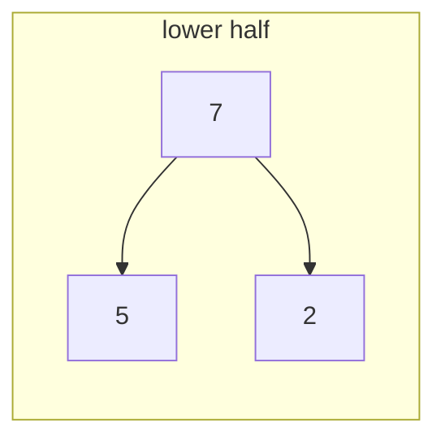
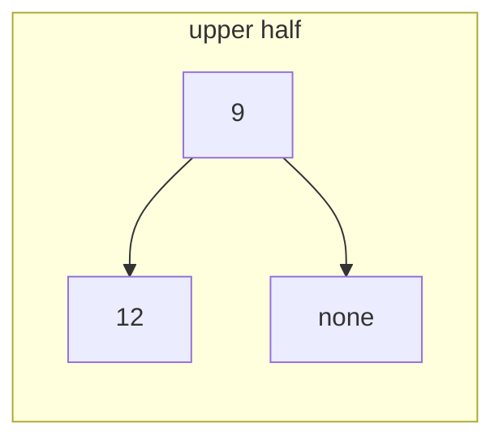

# Heap patterns: top k and two heaps

## The idea

A heap shows you exactly one item cheaply: its root. Everything else costs a sift. The patterns of this guide come from choosing what sits at the root, so that the one item you can see is the one your question needs to compare against.

**A bounded heap keeps the best k.** To keep the k largest items of a long stream, hold at most k of them in a **min-heap**. That sounds backwards, so look at what the root is: the smallest of the items kept so far. It is the only item a newcomer has to beat. A newcomer larger than the root belongs among the kept items, and the root drops out: one heap operation replaces it. A newcomer no larger than the root cannot be in the top k at all, and is dismissed after a single comparison. The heap never grows past k, so each operation costs O(log k), not O(log n), and the memory is O(k), however long the stream. To keep the k smallest instead, turn every comparison around.

**Two heaps keep the middle in reach.** A heap answers "smallest" or "largest", never "middle". But split the items into a lower part and an upper part, keep the lower part in a **max-heap** and the upper part in a **min-heap**, and the two roots sit on either side of the split, back to back. If the split stays in the middle, the middle values of the whole collection are always at the two roots.

## A worked example

At a county fair, pumpkins are weighed one at a time, and the podium shows the three heaviest so far. Keep a min-heap of at most three `(weight, name)` entries.

| Arrives | Weight | The lightest kept before | What happens | Kept after, lightest first |
|---------|--------|--------------------------|--------------|----------------------------|
| Hollis | 412 | none | Fewer than 3 kept: push | 412 |
| Maren | 388 | 412 | Fewer than 3 kept: push | 388, 412 |
| Juno | 455 | 388 | Fewer than 3 kept: push | 388, 412, 455 |
| Pell | 301 | 388 | 301 is not heavier than 388: dismissed after one comparison | 388, 412, 455 |
| Odile | 470 | 388 | Heavier than 388: replace the root, Maren drops out | 412, 455, 470 |
| Brann | 433 | 412 | Heavier than 412: Hollis drops out | 433, 455, 470 |
| Esk | 402 | 433 | Not heavier than 433: dismissed | 433, 455, 470 |
| Tamsin | 468 | 433 | Heavier than 433: Brann drops out | 455, 468, 470 |

Each row compares the newcomer with the root only. Pell and Esk cost one comparison each, and never touch the heap. The heap ends holding the right three, but in heap order, not podium order, so a final sort of the k items gives the podium: Odile, Tamsin, Juno.

```python examples/podium.py
"""Keep the k best of a stream in a min-heap of size k: the weakest of the kept is at the root,
so each newcomer is compared with it once, and only a winner costs a heap operation."""

import heapq
import random


def podium(entries: list[tuple[int, str]], k: int, trace: bool = False) -> list[tuple[int, str]]:
    kept: list[tuple[int, str]] = []  # (weight, name), a min-heap by weight
    for weight, name in entries:
        if len(kept) < k:
            heapq.heappush(kept, (weight, name))
            note = "kept: the podium is not full yet"
        elif weight > kept[0][0]:
            dropped = heapq.heapreplace(kept, (weight, name))  # pop the root, push the newcomer
            note = f"kept, {dropped[1]} ({dropped[0]} kg) drops out"
        else:
            note = f"not kept: the lightest kept weighs {kept[0][0]} kg"
        if trace:
            print(f"{name:>6} {weight:>4} kg: {note}")
    return sorted(kept, reverse=True)  # the heap holds the k best, but not in order


weigh_in = [
    (412, "Hollis"),
    (388, "Maren"),
    (455, "Juno"),
    (301, "Pell"),
    (470, "Odile"),
    (433, "Brann"),
    (402, "Esk"),
    (468, "Tamsin"),
]
top = podium(weigh_in, 3, trace=True)
print("podium:", [f"{name} {weight}" for weight, name in top])
print("same as sorting everything:", top == sorted(weigh_in, reverse=True)[:3])


def heap_operations(values: list[float], k: int) -> int:
    """The same loop on bare numbers, counting the pushes and replacements it makes."""
    kept: list[float] = []
    operations = 0
    for value in values:
        if len(kept) < k:
            heapq.heappush(kept, value)
            operations += 1
        elif value > kept[0]:
            heapq.heapreplace(kept, value)
            operations += 1
    return operations


rng = random.Random(11)
stream = [rng.random() for _ in range(1_000_000)]
print("random stream of 1,000,000, k = 10:", heap_operations(stream, 10), "heap operations")
ascending = sorted(stream[:100_000])
print("ascending stream of 100,000, k = 10:", heap_operations(ascending, 10), "heap operations")
```

It prints:

```output examples/podium.py
Hollis  412 kg: kept: the podium is not full yet
 Maren  388 kg: kept: the podium is not full yet
  Juno  455 kg: kept: the podium is not full yet
  Pell  301 kg: not kept: the lightest kept weighs 388 kg
 Odile  470 kg: kept, Maren (388 kg) drops out
 Brann  433 kg: kept, Hollis (412 kg) drops out
   Esk  402 kg: not kept: the lightest kept weighs 433 kg
Tamsin  468 kg: kept, Brann (433 kg) drops out
podium: ['Odile 470', 'Tamsin 468', 'Juno 455']
same as sorting everything: True
random stream of 1,000,000, k = 10: 114 heap operations
ascending stream of 100,000, k = 10: 100000 heap operations
```

`heapq.heapreplace` pops the root and pushes the newcomer in one sift, cheaper than a pop followed by a push. The last two lines count heap operations. On a million values in random order, with k = 10, only 114 values ever entered the heap: once the podium holds strong entries, a random newcomer rarely beats the weakest of them. In ascending order, every value is a new record and enters the heap, which is the worst case.

The random count is no accident. The notes in CPython's `Lib/heapq.py` give the reason: in random order, the i-th value is among the k largest of the first i values with probability k/i, so the expected number of values that enter is about `k + k · (1/(k+1) + 1/(k+2) + ... + 1/n)`, roughly `k · (1 + ln(n/k))`. For n = 1,000,000 and k = 10 that is about 125; the run above saw 114.

## Two heaps: a running middle

Here are five values, 2, 5, 7, 9 and 12, split between two heaps. The lower half, 2, 5 and 7, is a max-heap, so its largest value is its root:



<!-- text-of-mermaid sha256:e5e4c8e77cd308c05e51b2f6ba880aff3121ddfae533cec21e35e710be1c1864 -->
```text
┌────────────┐
│lower half  │
│            │
│            │
│ ┌─┐        │
│ │7├─────┐  │
│ └┬┘     │  │
│  ▼      ▼  │
│ ┌─┐    ┌─┐ │
│ │5│    │2│ │
│ └─┘    └─┘ │
│            │
└────────────┘
```

The upper half, 9 and 12, is a min-heap, so its smallest value is its root:



<!-- text-of-mermaid sha256:8ccb9acfafa22d19a6d0f9df922ca6dae229fa5242066b2059863afd8f7b8e39 -->
```text
┌────────────────┐
│  upper half    │
│                │
│                │
│ ┌──┐           │
│ │9 ├───────┐   │
│ └─┬┘       │   │
│   ▼        ▼   │
│ ┌──┐    ┌────┐ │
│ │12│    │none│ │
│ └──┘    └────┘ │
│                │
└────────────────┘
```

Here the two roots, 7 and 9, are the values on either side of the middle of 2, 5, 7, 9, 12, and the middle value itself, 7, is one of them. Reading them takes O(1), whatever the size of the collection. What it takes to keep such a split correct while values keep arriving, and why that stays cheap, is what the practice problem `median-data-stream` asks you to work out.

The same idea can watch another fixed rank of a growing collection, such as the 90th percentile, not only the middle.

## When to use it

- **The best k of many, when k is much smaller than n.** A bounded heap takes O(n log k) time and O(k) memory, against O(n log n) time and O(n) memory to sort everything. It also works on a stream that never ends or does not fit in memory, since it keeps only k items.
- **The best k, when k is close to n.** Then sorting is simpler and no slower. Python's `heapq` documentation gives the same advice for its own top-k tools: heaps for small k, `sorted()` for large k, `min()` or `max()` for k = 1.
- **The middle, or another rank, of a collection that keeps growing, read often.** Two heaps give O(log n) per new value and O(1) per read. If values must also leave the collection, both heaps need deletion of arbitrary items, which a binary heap does not do cheaply: a balanced search tree may be the better tool.

## Common traps

- **A max-heap for the k largest.** Pushing everything into a max-heap and popping k works, but holds all n items and costs up to O(n log n) to fill by pushes, or O(n) with a heapify, plus O(k log n) for the pops. The min-heap of size k is the one that saves work, because its root is the item to evict.
- **Comparing with the wrong end.** A newcomer must beat the *weakest* kept item, the root of the min-heap. Comparing it with the strongest lets weak items in, or keeps strong ones out.
- **Mixing up `heapreplace` and `heappushpop`.** `heapreplace` pops first and then pushes, so it can return an item larger than the one you pushed. `heappushpop` pushes first and returns the smaller of the two, leaving the larger in the heap. For "add the newcomer only if it beats the root", either works once you have checked the root yourself, as the example does.
- **Reading the heap as the answer in order.** The heap holds the k best in heap order. Sort them, O(k log k), or pop them, if the order matters.
- **Ties at the boundary.** When several items tie with the weakest kept one, which one stays depends on arrival order and on the comparison you wrote (`>` or `>=`). If the result must be deterministic, put a tie-breaker into the key, as the [heaps guide](../heaps/guide.md) does with a counter.
- **Edge cases of k.** `k = 0` must keep nothing, and `k > n` must keep everything without failing on the root of an empty heap.

## Complexity

For a stream of n items and a bounded heap of size k:

| Approach | Time | Extra memory |
|----------|------|--------------|
| Sort everything, take k | O(n log n) | O(n) |
| Heapify everything, pop k | O(n + k log n) | O(n) |
| Bounded min-heap of size k | O(n log k) worst case, about O(n + k log k · log(n/k)) on random order | O(k) |
| Final sort of the k kept | O(k log k) | O(k) |

For two heaps holding n values:

| Operation | Time |
|-----------|------|
| Read the middle | O(1) |
| Add a value and keep the split correct | O(log n) |
| Memory | O(n) |

## Expert notes

- **`heappushpop` and `heapreplace`.** Python's documentation says `heappushpop` runs more efficiently than a push followed by a pop, and that `heapreplace`, a pop then a push, "can be more appropriate when using a fixed-size heap". Both do a single sift instead of two.
- **The expected cost on random order.** CPython's `Lib/heapq.py` notes analyse the bounded heap behind its own top-k tools: one comparison for each item against the root, and a heap operation only for the roughly `k · ln(n/k)` items that enter. For k = 100, its measured comparisons are 5.7% more than `min()` needs on 100,000 random items, and 0.8% more on a million. Its worst case is input in the opposite order, where every item enters.
- **Bounded heaps in other languages.** In Java, a `PriorityQueue` in natural order holds the k largest: `offer` each item, and `poll` when the size passes k; `peek` shows the item to beat. In Rust, `BinaryHeap` is a max-heap, so the k largest are kept with `Reverse` around each item. Go's `container/heap` takes its order from your `Less`.
- **Percentiles and their cost.** Two heaps track one fixed rank. To answer any rank on demand, or to let values expire from a window, the collection needs a structure that can find and remove any value, which a heap does not provide cheaply.
- **Why the root, and not a sorted list of k.** A sorted list of the k best also exposes its weakest item, but inserting a winner into it costs O(k) shifts, against O(log k) for the heap.

## Practice

- `cstudy start kth-largest-element`: find the value at a given rank from the top, without sorting the whole array.
- `cstudy start k-closest-points`: return the k points nearest to the origin.
- `cstudy start top-k-frequent-elements`: return the k values that occur most often.
- `cstudy start design-twitter`: build a news feed of the ten most recent posts from the people a user follows.
- `cstudy start merge-k-sorted-lists`: merge k sorted linked lists into one, at well under k comparisons per node.
- `cstudy start median-data-stream`: report the median of a stream of numbers at any moment.
- `cstudy start maximize-capital`: choose at most k projects, in order, to end with the most capital.
- `cstudy start scheduled-transfers-bank`: build a bank whose transfers can run later, in four levels.

## Further reading

- [Python `heapq`](https://docs.python.org/3/library/heapq.html): `heappushpop`, `heapreplace` and their fixed-size use, and the advice on small and large k. Its section "Other Applications" contains a complete running median: try `median-data-stream` first.
- [CPython `Lib/heapq.py`](https://github.com/python/cpython/blob/main/Lib/heapq.py): the algorithm notes on keeping the k most extreme values, with the k/i argument and measured comparison counts.
- [Java `PriorityQueue`](https://docs.oracle.com/en/java/javase/21/docs/api/java.base/java/util/PriorityQueue.html): `offer`, `poll` and `peek` and their costs.
- [Rust `BinaryHeap`](https://doc.rust-lang.org/std/collections/struct.BinaryHeap.html): a max-heap, and `Reverse` for the other order.
- [The counting and frequency guide](../counting-and-frequency/guide.md): the same bounded heap, ranking counts.
