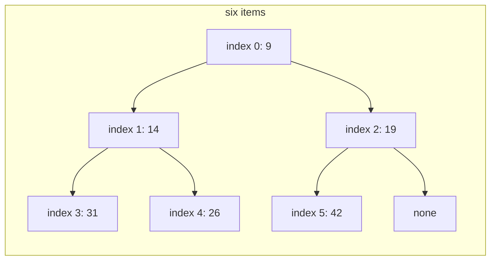
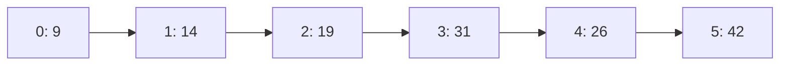

# Heaps and priority queues

## The idea

A **priority queue** is a collection with three operations: add an item, look at the item with the best priority, and remove that item. "Best" is usually the smallest key, such as the earliest deadline or the shortest job, or the largest, such as the highest score. Unlike a plain queue, it does not care in which order items arrived, only how they compare.

The obvious ways to build one are each slow somewhere. An unsorted list adds in O(1) but must scan all n items to find the best. A sorted list hands out the best in O(1) but must shift items to insert, O(n). A **binary heap** does both in O(log n), and looks at the best in O(1).

A **min-heap** is a binary tree with two properties:

1. **Shape: it is complete.** Every level is full except possibly the last, which fills from the left. So it can live in a plain array, with no links: the children of index `i` are at `2i + 1` and `2i + 2`, and its parent at `(i - 1) // 2` (see [trees and binary trees](../trees/guide.md)). Its height is `floor(log2 n)`.
2. **Order: every parent is at most each of its children.** This is the **heap property**. Following any path down from the root, the keys never decrease, so the smallest key of all is at the root, index 0.

The heap property is much weaker than sorted order. It says nothing about siblings, or about nodes on different paths: a heap is only "sorted along every path down". That weakness is what makes it cheap to maintain. A **max-heap** is the same with every comparison reversed, and keeps the largest item at the root.

Both operations that change the heap follow one plan: first keep the shape, by changing only the last position of the array, then repair the order, by swapping along one path.

- **Push** puts the new item in the next free position, at the end of the array. That keeps the tree complete, but the item may be smaller than its parent. So it **sifts up**: while it is smaller than its parent, swap the two. At most one swap per level.
- **Pop** takes the root, the item to return. The last item of the array moves into the root's place, which keeps the tree complete, but it is probably too large for the top. So it **sifts down**: while it is larger than its smaller child, swap it with that child. At most one swap per level.

## A worked example

Push 31, 14, 42, 9, 26 and 19 into an empty min-heap.

1. **31** becomes the root: `[31]`.
2. **14** goes to index 1, below 31. It is smaller than its parent, so they swap: `[14, 31]`.
3. **42** goes to index 2, below 14. It is larger than its parent: nothing to do. `[14, 31, 42]`.
4. **9** goes to index 3, whose parent is index 1, holding 31. 9 is smaller: swap, and 9 is now at index 1, whose parent is the root, 14. Still smaller: swap again. 9 is the new root: `[9, 14, 42, 31]`. It climbed the whole height of the tree, two swaps.
5. **26** goes to index 4, whose parent is index 1, holding 14. 26 is larger: done. `[9, 14, 42, 31, 26]`.
6. **19** goes to index 5, whose parent is index 2, holding 42. Swap: 19 is at index 2, below the root 9. 9 is smaller: done. `[9, 14, 19, 31, 26, 42]`.



<!-- text-of-mermaid sha256:37890b4bb09b3c34ef7a0ee6b8dec3d1e526e3576e28b877942c8d0eb3f7d736 -->
```text
┌───────────────────────────────────────────────────────────┐
│                         six items                         │
│                                                           │
│                                                           │
│ ┌───────────┐                                             │
│ │ index 0: 9├──────────┐                                  │
│ └─────┬─────┘          │                                  │
│       ▼                ▼                                  │
│ ┌───────────┐    ┌───────────┐                            │
│ │index 1: 14├──┐ │index 2: 19├────┬─────┐                 │
│ └─────┬─────┘  │ └───────────┘    └─────┼─────────────┐   │
│       ▼        └───────▼                ▼             ▼   │
│ ┌───────────┐    ┌───────────┐    ┌───────────┐    ┌────┐ │
│ │index 3: 31│    │index 4: 26│    │index 5: 42│    │none│ │
│ └───────────┘    └───────────┘    └───────────┘    └────┘ │
│                                                           │
└───────────────────────────────────────────────────────────┘
```

The same heap is just this list:



<!-- text-of-mermaid sha256:f3da470e1f2a619a8b0299278f582f04e8c8d88f27cc6df65b630fa0fbdd2ae9 -->
```text
┌────┐    ┌─────┐    ┌─────┐    ┌─────┐    ┌─────┐    ┌─────┐
│0: 9├───►│1: 14├───►│2: 19├───►│3: 31├───►│4: 26├───►│5: 42│
└────┘    └─────┘    └─────┘    └─────┘    └─────┘    └─────┘
```

Notice that the list is not sorted: 31 comes before 26. Only the root is certain to be the smallest.

Now **pop**. The root, 9, is the answer. The last item, 42, moves into index 0, and the array shrinks to five items: `[42, 14, 19, 31, 26]`. 42 is larger than its smaller child, 14, so they swap: `[14, 42, 19, 31, 26]`. At index 1, 42's children are 31 and 26; the smaller is 26, so they swap: `[14, 26, 19, 31, 42]`. 42 is now a leaf. The new root, 14, is the second smallest item, as it must be. Sifting down always swaps with the *smaller* child: swapping with the larger one would put it above a smaller sibling and break the heap property.

### Building a heap from a whole array

Pushing n items one at a time costs up to O(n log n). There is a faster way to make a heap from items you already have, called **heapify**: leave them where they are, then sift down every node that has a child, starting from the last one and moving back to the root. When a node is sifted down, both of its subtrees are already heaps, because their roots were handled earlier, so one sift-down makes its whole subtree a heap. Leaves are heaps of one item and need no work, which is half of the array.

Heapify `[17, 8, 12, 5, 3, 10, 4, 1]`, eight items, so indexes 3 to 0 have children:

1. **Index 3**, holding 5: its only child, 1, is smaller. Swap. `[17, 8, 12, 1, 3, 10, 4, 5]`.
2. **Index 2**, holding 12: its children are 10 and 4. Swap with 4. `[17, 8, 4, 1, 3, 10, 12, 5]`.
3. **Index 1**, holding 8: its children are 1 and 3. Swap with 1; 8 is now at index 3, whose child is 5. Swap again. `[17, 1, 4, 5, 3, 10, 12, 8]`.
4. **Index 0**, holding 17: children 1 and 4. Swap with 1; at index 1, children 5 and 3. Swap with 3; 17 is now a leaf at index 4. `[1, 3, 4, 5, 17, 10, 12, 8]`.

Six swaps for eight items. The program below does exactly these steps, prints every swap, and checks its heap against Python's `heapq`.

```python examples/min_heap.py
"""A binary min-heap in a plain list, with every swap printed: push sifts up, pop sifts down,
and heapify builds a heap from the bottom up."""

import heapq


class MinHeap:
    def __init__(self, items: list[int] | None = None, trace: bool = True) -> None:
        self.items = list(items or [])
        self.trace = trace
        self.swaps = 0

    def swap(self, i: int, j: int) -> None:
        a = self.items
        if self.trace:
            print(f"    swap {a[i]} (index {i}) with {a[j]} (index {j})")
        a[i], a[j] = a[j], a[i]
        self.swaps += 1

    def sift_up(self, i: int) -> None:
        while i > 0:
            parent = (i - 1) // 2
            if self.items[parent] <= self.items[i]:
                return  # the parent is no larger: the heap property holds again
            self.swap(i, parent)
            i = parent

    def sift_down(self, i: int) -> None:
        n = len(self.items)
        while True:
            smallest = i
            for child in (2 * i + 1, 2 * i + 2):
                if child < n and self.items[child] < self.items[smallest]:
                    smallest = child
            if smallest == i:
                return  # no child is smaller: the heap property holds again
            self.swap(i, smallest)
            i = smallest

    def push(self, item: int) -> None:
        self.items.append(item)  # the next free place keeps the tree complete
        self.sift_up(len(self.items) - 1)

    def pop(self) -> int:
        top = self.items[0]
        last = self.items.pop()
        if self.items:
            self.items[0] = last  # the last leaf fills the hole at the root
            self.sift_down(0)
        return top

    def heapify(self) -> None:
        for i in reversed(range(len(self.items) // 2)):  # every node that has a child
            self.sift_down(i)


heap = MinHeap()
for item in (31, 14, 42, 9, 26, 19):
    print(f"push {item}")
    heap.push(item)
    print(f"    heap: {heap.items}")

print("pop")
print(f"    returned {heap.pop()}, heap: {heap.items}")

data = [17, 8, 12, 5, 3, 10, 4, 1]
print(f"heapify {data}")
built = MinHeap(data)
built.heapify()
print(f"    heap: {built.items}, {built.swaps} swaps")

reference = list(data)
heapq.heapify(reference)
built.trace = False
ours = [built.pop() for _ in data]
theirs = [heapq.heappop(reference) for _ in data]
print("pops in the same order as heapq:", ours == theirs, ours)
```

It prints:

```output examples/min_heap.py
push 31
    heap: [31]
push 14
    swap 14 (index 1) with 31 (index 0)
    heap: [14, 31]
push 42
    heap: [14, 31, 42]
push 9
    swap 9 (index 3) with 31 (index 1)
    swap 9 (index 1) with 14 (index 0)
    heap: [9, 14, 42, 31]
push 26
    heap: [9, 14, 42, 31, 26]
push 19
    swap 19 (index 5) with 42 (index 2)
    heap: [9, 14, 19, 31, 26, 42]
pop
    swap 42 (index 0) with 14 (index 1)
    swap 42 (index 1) with 26 (index 4)
    returned 9, heap: [14, 26, 19, 31, 42]
heapify [17, 8, 12, 5, 3, 10, 4, 1]
    swap 5 (index 3) with 1 (index 7)
    swap 12 (index 2) with 4 (index 6)
    swap 8 (index 1) with 1 (index 3)
    swap 8 (index 3) with 5 (index 7)
    swap 17 (index 0) with 1 (index 1)
    swap 17 (index 1) with 3 (index 4)
    heap: [1, 3, 4, 5, 17, 10, 12, 8], 6 swaps
pops in the same order as heapq: True [1, 3, 4, 5, 8, 10, 12, 17]
```

The last line compares the order of the pops rather than the arrays themselves, because `heapq` sifts down a little differently (see the expert notes) and may arrange the same items into another valid heap.

## Why heapify takes linear time

A sift-down costs at most the **height** of the node it starts from, the number of levels below it. Heapify sifts every node once, so its total cost is at most the sum of all the nodes' heights. In a complete tree, most nodes are near the bottom, where heights are small:

- about half of the nodes are leaves, with height 0: no work;
- about a quarter have height 1: at most 1 swap each;
- about an eighth have height 2: at most 2 swaps each;
- and so on, with half as many nodes at each height up.

Add it up: at most `n · (1/4 · 1 + 1/8 · 2 + 1/16 · 3 + ...)` swaps. That series adds up to exactly 1. One way to see it: write the term `k / 2^(k+1)` as k copies of `1 / 2^(k+1)`, and regroup the copies into rows. The first row takes one copy from every term, `1/4 + 1/8 + 1/16 + ... = 1/2`; the second takes one from every term from the second on, `1/8 + 1/16 + ... = 1/4`; then `1/8`, and so on. The rows add up to `1/2 + 1/4 + 1/8 + ... = 1`. So heapify makes **at most about n swaps**, and about two comparisons per swap level, which is O(n).

Pushing one at a time has no such luck. The worst case for a min-heap is input in decreasing order: every new item is the smallest so far and climbs all the way to the root, and half of the items arrive when the tree is already within one level of its final height. That is O(n log n).

```python examples/build_cost.py
"""Two ways to turn n items into a min-heap, counted in swaps: n pushes, each sifting up, or one
bottom-up heapify, sifting down from the last parent to the root."""

import random


def push_all(items: list[float]) -> int:
    heap: list[float] = []
    swaps = 0
    for item in items:
        heap.append(item)
        i = len(heap) - 1
        while i > 0 and heap[(i - 1) // 2] > heap[i]:
            heap[i], heap[(i - 1) // 2] = heap[(i - 1) // 2], heap[i]
            i = (i - 1) // 2
            swaps += 1
    return swaps


def heapify(items: list[float]) -> int:
    heap = list(items)
    n, swaps = len(heap), 0
    for i in reversed(range(n // 2)):
        while True:
            smallest = i
            for child in (2 * i + 1, 2 * i + 2):
                if child < n and heap[child] < heap[smallest]:
                    smallest = child
            if smallest == i:
                break
            heap[i], heap[smallest] = heap[smallest], heap[i]
            i = smallest
            swaps += 1
    return swaps


def total_height(n: int) -> int:
    """The sum of the heights of all nodes of a complete binary tree with n nodes."""
    total = 0
    for i in range(n):
        child = 2 * i + 1
        while child < n:  # the leftmost path down is the longest in a complete tree
            total += 1
            child = 2 * child + 1
    return total


rng = random.Random(7)
print("      n  input       swaps by n pushes (per item)  swaps by heapify (per item)")
for n in (1_000, 100_000):
    for name, items in (
        ("descending", [float(n - i) for i in range(n)]),
        ("random", [rng.random() for _ in range(n)]),
    ):
        pushes, built = push_all(items), heapify(items)
        print(f"{n:>7}  {name:<10} {pushes:>20} ({pushes / n:5.2f}) {built:>20} ({built / n:4.2f})")
    print(f"{n:>7}  the heights of all {n} nodes add up to {total_height(n)}")
```

It prints:

```output examples/build_cost.py
      n  input       swaps by n pushes (per item)  swaps by heapify (per item)
   1000  descending                 7987 ( 7.99)                  992 (0.99)
   1000  random                     1243 ( 1.24)                  744 (0.74)
   1000  the heights of all 1000 nodes add up to 994
 100000  descending              1468946 (14.69)                99990 (1.00)
 100000  random                   127993 ( 1.28)                74377 (0.74)
 100000  the heights of all 100000 nodes add up to 99994
```

On decreasing input, n pushes make 8 swaps per item for a thousand items and 14.7 for a hundred thousand, growing with log n; heapify makes at most one per item at either size, and the sum of all heights, its upper bound, is just under n. On random input both are cheap: about 1.3 swaps per push, because a random new item rarely belongs near the top.

## When to use it

- **You need the smallest or largest item, again and again, while items keep arriving.** That is exactly a priority queue: scheduling by deadline or by priority, choosing the cheapest next step, always serving the most urgent request first.
- **You process events in time order, and handling one event creates later ones.** Python's `heapq` documentation describes this use: the heap holds all pending events, the smallest scheduled time wins, and new events go in as they are created.
- **You need the best k of many, or a statistic of a changing collection.** Those are the [heap patterns](../heap-patterns/guide.md).

Use something else when:

| You need | Use |
|----------|-----|
| To find or remove an arbitrary item by its key | A hash map, or a balanced search tree; a heap must scan for it, O(n) |
| Everything in sorted order, once | Sort the list: O(n log n), simpler and usually faster than n pops |
| The smallest *and* the largest, or the nearest key to a value | A [balanced search tree](../binary-search-trees/guide.md), which keeps full order |
| The minimum of a fixed array, once | `min()`: O(n), with no structure at all |

## Common traps

- **Treating the heap's list as sorted.** Only index 0 is guaranteed. The second smallest item is one of the root's two children, `heap[1]` or `heap[2]`, and beyond that the list says little. Pop to get items in order.
- **Forgetting which end you get.** Python's `heapq`, Java's `PriorityQueue` and Go's `container/heap` give the smallest item; Rust's `BinaryHeap` gives the largest. Check before you rely on it.
- **Ties that compare the payload.** A Python heap of `(priority, item)` tuples compares the items when two priorities are equal: ties then come out in the items' order instead of the order they arrived, and items that cannot be compared raise `TypeError`. Put a counter between the two, as below.
- **Changing an item's priority while it sits in the heap.** The heap property is checked only when an item moves. If you change a key in place, the item stays where it is, possibly above smaller items, and the heap returns wrong answers. Rust's documentation calls this a logic error. Remove and re-insert, or use an API built for it, such as Go's `heap.Fix`.
- **Iterating over a heap and expecting order.** Java's `PriorityQueue` documentation warns that its iterator follows no particular order; the same holds for printing a Python heap list or iterating a Rust `BinaryHeap`.
- **Using a heap to ask "is x in here?".** A heap is not searchable: finding an item is a scan of every element. Java's `PriorityQueue` documents `contains` and `remove(Object)` as linear time.

Here is the tie trap and its fix, in a triage queue where 1 is the most urgent:

```python examples/triage.py
"""A priority queue on heapq: the most urgent case first, and equal urgency in arrival order.

heapq compares whole entries. A (priority, payload) pair falls back to comparing payloads when
the priorities tie, which orders ties by payload instead of by arrival, or fails for payloads
that cannot be compared. A running counter between the two settles every tie by arrival."""

import heapq
import itertools

arrivals = [  # (urgency, case): 1 is the most urgent
    (2, {"name": "Rosa", "issue": "sprained ankle"}),
    (1, {"name": "Tomas", "issue": "chest pain"}),
    (2, {"name": "Amara", "issue": "deep cut"}),
    (3, {"name": "Lin", "issue": "sore throat"}),
    (1, {"name": "Kofi", "issue": "breathing trouble"}),
]

naive: list[tuple[int, dict[str, str]]] = []
try:
    for entry in arrivals:
        heapq.heappush(naive, entry)
except TypeError as error:
    print("(urgency, case) pairs fail on a tie:", error)

queue: list[tuple[int, int, dict[str, str]]] = []
order = itertools.count()  # 0, 1, 2, ...: never equal, so the cases are never compared
for urgency, case in arrivals:
    heapq.heappush(queue, (urgency, next(order), case))

while queue:
    urgency, arrived, case = heapq.heappop(queue)
    print(f"urgency {urgency}, arrival {arrived}: {case['name']}, {case['issue']}")
```

It prints:

```output examples/triage.py
(urgency, case) pairs fail on a tie: '<' not supported between instances of 'dict' and 'dict'
urgency 1, arrival 1: Tomas, chest pain
urgency 1, arrival 4: Kofi, breathing trouble
urgency 2, arrival 0: Rosa, sprained ankle
urgency 2, arrival 2: Amara, deep cut
urgency 3, arrival 3: Lin, sore throat
```

Without the counter, the push of Kofi ties with Tomas at urgency 1, and Python tries to compare two dictionaries. With it, every entry is unique by its first two fields, and equal urgency comes out in arrival order. `heapq`'s documentation recommends exactly this: store entries as (priority, entry count, task).

## Complexity

For a binary heap of n items:

| Operation | Time | Why |
|-----------|------|-----|
| Look at the best item | O(1) | It is at index 0 |
| Push | O(log n) worst case | One sift-up along one path |
| Pop the best item | O(log n) | One sift-down along one path |
| Heapify n items | O(n) | The sum of the heights is less than n |
| n pushes | O(n log n) worst case | Each may climb to the root |
| Pop everything (heapsort) | O(n log n) | n sift-downs |
| Find an arbitrary item | O(n) | No order to search by |
| Memory | O(n) | One array, no links |

On random input a push is much cheaper than its worst case: Rust's `BinaryHeap` documentation states an expected O(1) cost per push, averaged over every possible order of the pushed items, and O(log n) amortized when they arrive in ascending order; the run above shows about 1.3 swaps per push.

## Expert notes

- **Where the heap came from.** Crossref records "Algorithm 232: Heapsort" by J. W. J. Williams in *Communications of the ACM*, volume 7, issue 6, pages 347 to 348, June 1964. A transcription of its ALGOL 60 text shows the heap already in its modern form: elements 1 to n of an array, arranged so that each element is at most its children, the elements at twice its index and twice plus one. "Such an arrangement will be called a heap", it says, and the first element is always the least. Its procedures add an element, extract the least, do both at once, and build a heap by adding the elements one by one. Its comment on adding says the sift-up loop may run log2 n times, "but on average is repeated twice only", consistent with the 1.3 swaps per random push measured above, which is 2.3 passes of the loop counting the last, failed comparison. It names its uses as sorting, replacement-selection sorting, and "choosing the current minimum of any set of items to which new items are added from time to time": a priority queue.
- **Linear-time building is documented, not just proved.** Python's `heapq.heapify` transforms a list "in-place, in linear time"; Go's `heap.Init` is O(n); Rust converts a `Vec` into a `BinaryHeap` in place in O(n). Prefer these over a loop of pushes when the items are all known up front.
- **Python's `heapq`.** It works on a plain list: `heappush`, `heappop`, `heap[0]` to peek, `heapify`, and `heappushpop` and `heapreplace`, which combine a push and a pop more cheaply than the two calls. It is a min-heap and, like `list.sort()`, compares only with `<`. Python 3.14 added max-heap versions of these functions, with names ending in `_max`; on older versions a max-heap of numbers stores them negated, and other items need a wrapper whose `<` is reversed.
- **How CPython sifts down.** The comments in `Lib/heapq.py` explain a variant: on a pop, move the smaller child up at every level until the hole reaches a leaf, then sift the displaced item up from there. The item moved to the root during a pop is usually large, so checking it at every level rarely stops the loop early, and skipping those checks saves comparisons. That is why `heapq` can arrange the same items differently from the textbook version above, while every pop still returns the same item.
- **Java's `PriorityQueue`.** It is "an unbounded priority queue based on a priority heap", ordered by natural ordering or a `Comparator`, with the least element at the head and ties broken arbitrarily. `offer`, `poll`, `remove()` and `add` take O(log n), `peek`, `element` and `size` constant time. For a max-heap, pass `Comparator.reverseOrder()`. It is not thread-safe; its documentation points to `PriorityBlockingQueue` for that.
- **Go's `container/heap`.** You implement `heap.Interface`, which is `sort.Interface` (`Len`, `Less`, `Swap`) plus `Push` and `Pop` methods that only append to and remove from the end of your slice, then call the package functions `heap.Init`, `heap.Push` and `heap.Pop`, never your methods directly. It is a min-heap by `Less`; the documentation suggests ordering by the negative priority to pop the highest first. It is the one standard heap here that updates or removes an item at any position in O(log n): `heap.Fix(h, i)` restores the order after the item at index `i` changed, and `heap.Remove(h, i)` removes it, as long as you know the index.
- **Rust's `BinaryHeap`** is a max-heap. Wrap items in `std::cmp::Reverse`, or give them a reversed `Ord`, to get a min-heap.
- **JavaScript has no heap.** MDN's list of standard built-in objects has `Array`, the typed arrays, `Map`, `Set`, `WeakMap` and `WeakSet` as collections, and nothing for priorities. Write a heap on an array, as `MinHeap` above does in Python, or use a package.
- **Heaps are not stable, and heapsort is not either.** Equal keys come out in no guaranteed order. `heapq`'s documentation shows a heapsort built from pushes and pops and notes that, unlike `sorted()`, it is not stable. A tie-breaking counter, as in the triage queue, makes any priority queue first-in, first-out among equals.

## Practice

- `cstudy start last-stone-weight`: repeatedly combine the two heaviest stones of a pile until at most one is left.
- `cstudy start single-threaded-cpu`: report the order in which a one-core CPU, following a fixed policy, runs tasks that arrive over time.
- `cstudy start task-scheduler`: find the fewest time slots to run labelled tasks when equal labels need a cooldown between them.

## Further reading

- [Python `heapq`](https://docs.python.org/3/library/heapq.html): the heap invariant, linear-time `heapify`, `heappushpop` and `heapreplace`, the `_max` functions added in 3.14, and the tie-breaking counter. Its sections "Other Applications" and "Priority Queue Implementation Notes" go on to solve parts of `median-data-stream` and `scheduled-transfers-bank`, two problems of the [heap patterns](../heap-patterns/guide.md) guide: read them after you have tried those.
- [CPython `Lib/heapq.py`](https://github.com/python/cpython/blob/main/Lib/heapq.py): the comments on why `heapq` sifts down to a leaf first.
- [Java `PriorityQueue`](https://docs.oracle.com/en/java/javase/21/docs/api/java.base/java/util/PriorityQueue.html): ordering, ties, the cost of each method and the unordered iterator; [`Comparator.reverseOrder`](https://docs.oracle.com/en/java/javase/21/docs/api/java.base/java/util/Comparator.html#reverseOrder()).
- [Go `container/heap`](https://pkg.go.dev/container/heap): `heap.Interface`, and `Init`, `Push`, `Pop`, `Fix` and `Remove` with their costs.
- [Rust `BinaryHeap`](https://doc.rust-lang.org/std/collections/struct.BinaryHeap.html): a max-heap, `Reverse` for a min-heap, the expected cost of `push`, and the O(n) conversion from a `Vec`.
- [MDN: Standard built-in objects](https://developer.mozilla.org/en-US/docs/Web/JavaScript/Reference/Global_Objects): JavaScript's collections, with no heap among them.
- J. W. J. Williams, "Algorithm 232: Heapsort", *Communications of the ACM* 7(6), 1964, [doi:10.1145/512274.3734138](https://doi.org/10.1145/512274.3734138).
