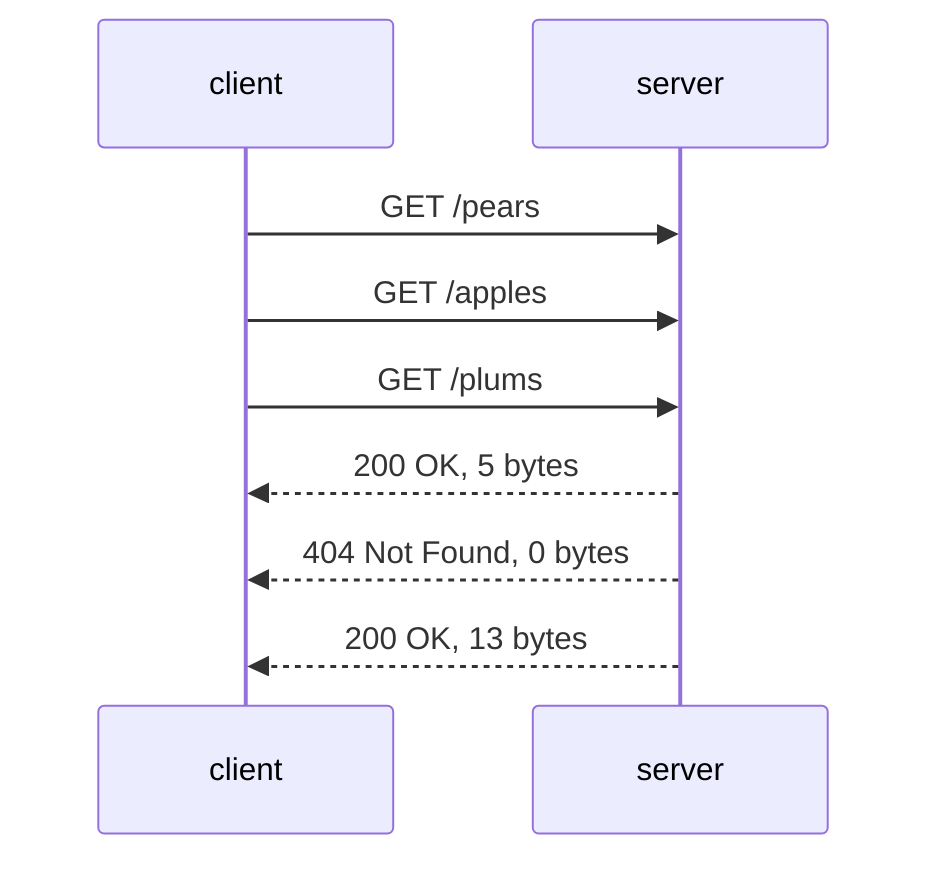
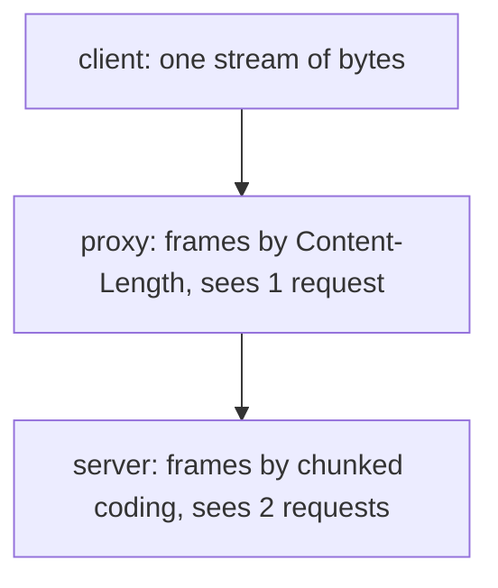

# HTTP messages and connections

## The idea

HTTP is how a browser, or any program, asks a server for something and gets an answer. RFC 9110 describes it as a stateless application-level protocol: a client sends a **request**, the server sends back a **response**, and each pair stands on its own. The standard comes in two halves. RFC 9110 defines the **semantics**, what a method, a status code or a field means, for every version. RFC 9112 defines how HTTP/1.1 writes a message as bytes on a connection, which is the subject of this guide. HTTP/2 and HTTP/3 carry the same semantics in other formats.

An HTTP/1.1 message is lines of text, then an optional body. RFC 9112 gives its shape:

```text
HTTP-message   = start-line CRLF
                 *( field-line CRLF )
                 CRLF
                 [ message-body ]
```

**CRLF** is two bytes, carriage return (byte 13) and line feed (byte 10), written `\r\n` in most languages. Every line ends with one. The parts, in order:

- The **start line**. A request starts with a **request line**: a **method** (what to do), a **target** (what to do it to) and the version, separated by single spaces, such as `GET /index.html HTTP/1.1`. A response starts with a **status line**: the version, a three-digit **status code**, and an optional **reason phrase**, such as `HTTP/1.1 404 Not Found`.
- **Header fields**, one per line: a name, a colon, and a value, such as `Host: example.com`. RFC 9110 makes field names case-insensitive, so `host` and `HOST` are the same field.
- An **empty line**: a CRLF right after the last field's CRLF. It ends the **head**, everything before the body.
- The **body**, if there is one. How long it is, the head must say.


<!-- text-of-mermaid sha256:65eb4db7b5894af654eed4621ed7bf8d7eb2e23e1b6ba588be65d553cdbfa370 -->
```text
┌────────────────┐    ┌──────────────────────┐    ┌──────────┐    ┌────┐
│start line, CRLF├───►│field lines, each CRLF├───►│CRLF alone├───►│body│
└────────────────┘    └──────────────────────┘    └──────────┘    └────┘
```

The status code's first digit gives its class (RFC 9110):

| Class | Meaning in RFC 9110 | Examples |
|-------|---------------------|----------|
| 1xx Informational | The request was received, continuing process | 100 |
| 2xx Successful | The request was successfully received, understood, and accepted | 200, 201, 204 |
| 3xx Redirection | Further action needs to be taken to complete the request | 301, 304 |
| 4xx Client Error | The request contains bad syntax or cannot be fulfilled | 400, 404, 429 |
| 5xx Server Error | The server failed to fulfill an apparently valid request | 500, 503 |

One field is required in every HTTP/1.1 request. RFC 9112: a client must send a `Host` field, and a server must answer `400 Bad Request` to an HTTP/1.1 request without one, or with more than one. RFC 9110 explains what it is for: it carries the host and port of the target, so that a server answering for many host names can tell their resources apart.

## A worked example

Here are a request and a response built by hand, each with a body framed a different way:

```python examples/build_messages.py
"""Write an HTTP/1.1 request and response as bytes, each body framed a different way.

The request's body has a known length, so a Content-Length field announces it. The response's
body is produced in pieces, so it is sent with the chunked transfer coding: each chunk is its
size in hexadecimal, CRLF, the data and CRLF, and a chunk of size zero ends the body.
"""

CRLF = "\r\n"


def head(start_line: str, fields: list[tuple[str, str]]) -> str:
    lines = [start_line] + [f"{name}: {value}" for name, value in fields]
    return CRLF.join(lines) + CRLF + CRLF  # the empty line ends the head


def chunked(pieces: list[str]) -> str:
    body = "".join(f"{len(piece):x}{CRLF}{piece}{CRLF}" for piece in pieces)
    return body + "0" + CRLF + CRLF  # the last chunk, then an empty trailer section


def show(label: str, message: str) -> None:
    print(f"{label} ({len(message)} bytes):")
    *lines, rest = message.split(CRLF)
    for line in lines:
        print(f"  {line}\\r\\n")
    if rest:
        print(f"  {rest}")


content = '{"item": "pear", "qty": 3}'
request = (
    head(
        "POST /orders HTTP/1.1",
        [
            ("Host", "example.com"),
            ("Content-Type", "application/json"),
            ("Content-Length", str(len(content))),
        ],
    )
    + content
)
show("request", request)

pieces = ["order 41: ", "3 pears, ", "confirmed"]
response = head(
    "HTTP/1.1 201 Created",
    [("Content-Type", "text/plain"), ("Transfer-Encoding", "chunked")],
) + chunked(pieces)
show("response", response)
body = chunked(pieces)
print(f"chunk sizes: {[f'{len(piece):x}' for piece in pieces]} in hexadecimal")
print(f"the content is {len(''.join(pieces))} bytes; chunked, the body is {len(body)} bytes")
```

It prints:

```output examples/build_messages.py
request (122 bytes):
  POST /orders HTTP/1.1\r\n
  Host: example.com\r\n
  Content-Type: application/json\r\n
  Content-Length: 26\r\n
  \r\n
  {"item": "pear", "qty": 3}
response (126 bytes):
  HTTP/1.1 201 Created\r\n
  Content-Type: text/plain\r\n
  Transfer-Encoding: chunked\r\n
  \r\n
  a\r\n
  order 41: \r\n
  9\r\n
  3 pears, \r\n
  9\r\n
  confirmed\r\n
  0\r\n
  \r\n
chunk sizes: ['a', '9', '9'] in hexadecimal
the content is 28 bytes; chunked, the body is 48 bytes
```

The request knows its body in advance, 26 bytes of JSON, so `Content-Length: 26` says how many bytes follow the empty line. The reader counts them and knows the message is over. Note that no CRLF follows the body: the body is exactly 26 bytes, and whatever comes next on the connection is the next message.

The response does not announce a length. It says `Transfer-Encoding: chunked` and sends its content in **chunks**: each chunk is its size in hexadecimal, CRLF, that many bytes of data, and CRLF. `a` is 10, the length of `order 41: `, and `9` is 9. A chunk of size `0` is the **last chunk**; after it comes the **trailer section**, empty here, and a final CRLF. The 28 bytes of content took 48 bytes of body.

## Where a body ends

A reader must find the end of each message from its head alone, because on a persistent connection the next message follows immediately. RFC 9112 gives the rules in order of precedence; the first that applies decides:

| Situation | Where the body ends |
|-----------|---------------------|
| A response to `HEAD`, or a status 1xx, 204 or 304 | No body: the message ends at the empty line, whatever its fields say |
| A 2xx response to `CONNECT`, the method that asks the recipient to open a tunnel to another server | The connection becomes a tunnel after the head |
| Both `Transfer-Encoding` and `Content-Length` | `Transfer-Encoding` overrides `Content-Length`; such a message might be an attempt at request smuggling; a server may reject it, and must close the connection after responding to it |
| `Transfer-Encoding` with `chunked` last | Read and decode the chunks until the last chunk and the trailer section |
| `Transfer-Encoding` without `chunked` last | A response: read until the server closes the connection. A request: the server must answer `400 Bad Request` and close the connection |
| An invalid `Content-Length` | Unrecoverable framing error, except that a list of identical valid values counts as one |
| A valid `Content-Length` | That many bytes |
| A request with neither | No body: length zero |
| A response with neither | Everything until the server closes the connection |

The chunked format, in RFC 9112's grammar:

```text
chunked-body   = *chunk last-chunk trailer-section CRLF
chunk          = chunk-size [ chunk-ext ] CRLF chunk-data CRLF
chunk-size     = 1*HEXDIG
last-chunk     = 1*("0") [ chunk-ext ] CRLF
```

`1*HEXDIG` means one or more hexadecimal digits. A **chunk extension** (`chunk-ext`) is an optional `;name=value` after the size, and RFC 9112 says a recipient must ignore the extensions it does not recognize. Chunk data can hold any bytes, carriage returns and line feeds included. The **trailer section** holds field lines sent after the content; RFC 9110 suggests uses such as message integrity checks and digital signatures, values a sender can compute only once it has sent everything.

In RFC 9112's words, chunked coding enables content streams of unknown size to be transferred as a sequence of length-delimited buffers: the output of a program, a file being compressed, a long-running query. RFC 9112 requires every HTTP/1.1 recipient to be able to parse and decode it, and forbids a sender to apply it more than once to a body.

## One connection, many messages

Opening a TCP connection costs a round trip before anything else can happen. RFC 9112 says HTTP/1.1 defaults to **persistent connections**: after a response, the connection stays open for the next request. A side that sends the `close` connection option, `Connection: close`, says the connection will not persist after the current response.

A client may also **pipeline**: send several requests without waiting for each response. RFC 9112 lets a client that supports persistent connections pipeline its requests, and requires the server to send the responses in the same order the requests arrived. Nothing in a response names the request it answers; the order is the only link. Here a client reads three pipelined responses from one buffer:

```python examples/pipelined_responses.py
"""Split the responses that arrive on one persistent connection, using only their framing.

A client sent three GET requests one after another without waiting, and the server answered
them in the same order. Nothing in the bytes says where a response ends except its head: here,
each head's Content-Length. This reader trusts its input and handles only that one framing; a
real one checks every rule of RFC 9112 and refuses what it cannot frame.
"""

CRLF = "\r\n"
RECEIVED = (
    "HTTP/1.1 200 OK\r\nContent-Length: 5\r\n\r\npears"
    "HTTP/1.1 404 Not Found\r\nContent-Length: 0\r\n\r\n"
    "HTTP/1.1 200 OK\r\nContent-Length: 13\r\n\r\nplums\r\n\r\nfigs"
)


def split_responses(data: str) -> list[tuple[str, str]]:
    responses = []
    while data:
        head_end = data.index(CRLF + CRLF)
        status_line, *field_lines = data[:head_end].split(CRLF)
        fields = {}
        for line in field_lines:
            name, value = line.split(":", 1)
            fields[name.lower()] = value.strip(" \t")
        length = int(fields["content-length"])
        body_start = head_end + len(CRLF + CRLF)
        responses.append((status_line, data[body_start : body_start + length]))
        data = data[body_start + length :]
    return responses


for request, (status, body) in zip(
    ["/pears", "/apples", "/plums"], split_responses(RECEIVED), strict=True
):
    print(f"GET {request:<8} -> {status:<22} body {body!r}")
naive = RECEIVED.split(CRLF + CRLF)
print(f"cutting at every empty line instead gives {len(naive)} pieces, not 3 heads and bodies")
```

It prints:

```output examples/pipelined_responses.py
GET /pears   -> HTTP/1.1 200 OK        body 'pears'
GET /apples  -> HTTP/1.1 404 Not Found body ''
GET /plums   -> HTTP/1.1 200 OK        body 'plums\r\n\r\nfigs'
cutting at every empty line instead gives 5 pieces, not 3 heads and bodies
```

Each response is found by its framing alone. The third body contains an empty line, `\r\n\r\n`, so a reader that guessed where messages end from empty lines would cut it in the wrong place and lose its place in the stream for good.



<!-- text-of-mermaid sha256:69e4b7b7ddd80a61df57490ecd10c5ced03325cdf4af3321b85db2180468f028 -->
```text
┌────────┐                  ┌────────┐
│ client │                  │ server │
└────┬───┘                  └────┬───┘
     │                           │
     │        GET /pears         │
     │───────────────────────────▶
     │                           │
     │        GET /apples        │
     │───────────────────────────▶
     │                           │
     │        GET /plums         │
     │───────────────────────────▶
     │                           │
     │      200 OK, 5 bytes      │
     ◀╌╌╌╌╌╌╌╌╌╌╌╌╌╌╌╌╌╌╌╌╌╌╌╌╌╌╌│
     │                           │
     │  404 Not Found, 0 bytes   │
     ◀╌╌╌╌╌╌╌╌╌╌╌╌╌╌╌╌╌╌╌╌╌╌╌╌╌╌╌│
     │                           │
     │     200 OK, 13 bytes      │
     ◀╌╌╌╌╌╌╌╌╌╌╌╌╌╌╌╌╌╌╌╌╌╌╌╌╌╌╌│
     │                           │
┌────┴───┐                  ┌────┴───┐
│ client │                  │ server │
└────────┘                  └────────┘
```

The ordering rule has a cost. A slow first response holds up every response behind it, even ones the server finished long before. RFC 9113, which defines HTTP/2, says pipelining only partially addressed request concurrency, and that HTTP/1.1 still suffers from application-layer **head-of-line blocking**. HTTP/2 sends many exchanges at once over one connection, each on its own **stream**. Over TCP, though, a lost packet still stalls all of them: RFC 9114 notes that TCP's loss recovery cannot see HTTP/2's streams, so a lost or reordered packet makes every active transaction wait. HTTP/3 runs over QUIC instead, which provides reliability per stream.

## Why framing must be unambiguous

A request often passes through several programs: a **proxy**, a program the client chose to forward its requests, a load balancer, the server. Each finds the end of each message on its own. If two of them disagree, bytes that one takes for the end of a body, the next takes for the start of a new request, one that the first never inspected. RFC 9112 calls this **request smuggling**: a technique that exploits differences in protocol parsing among recipients to hide additional requests.



<!-- text-of-mermaid sha256:9cd397d04842388458dc55e34a7bf3919d737b84a2f7b45d80d381d5227c4127 -->
```text
┌─────────────────────────────────────────────────┐
│           client: one stream of bytes           │
└────────────────────────┬────────────────────────┘
                         ▼
┌─────────────────────────────────────────────────┐
│ proxy: frames by Content-Length, sees 1 request │
└────────────────────────┬────────────────────────┘
                         ▼
┌─────────────────────────────────────────────────┐
│server: frames by chunked coding, sees 2 requests│
└─────────────────────────────────────────────────┘
```

The defense is that every recipient frames a message the same way, and refuses one it cannot frame without guessing. Several of RFC 9112's rules point the same way:

- No whitespace is allowed between a field name and its colon, and a server must reject a request that has it with `400 Bad Request`. RFC 9112 notes that differences in handling such whitespace have led to security vulnerabilities in request routing and response handling.
- A message with both `Transfer-Encoding` and `Content-Length` might be a smuggling attempt; `Transfer-Encoding` overrides, a server may reject the request outright, and it must close the connection after responding to it.
- An invalid `Content-Length` is an unrecoverable error, not something to repair.
- A sender must not send a bare CR, one not followed by LF. A recipient may accept a lone LF as a line end; a server that receives a field continued onto the next line, the obsolete line folding, must reject it or replace the fold with spaces. Each such leniency is safe in one program and dangerous in a chain whose members choose differently.

## When to use it

- **Debugging.** A hung client that waits for a body that never comes, a response cut short, a proxy that mixes up two requests: each is a framing question, answered by reading the head.
- **Writing a proxy, a server, or a client by hand.** Then every rule of RFC 9112 matters, and the strict reading is the safe one.
- **Streaming a response.** Use chunked coding, or a newer version's streams, when the size is not known in advance.
- **Instead**, almost always: use a mature HTTP library, which implements these rules and their limits. Knowing them is what lets you read its errors and set its limits sensibly.

## Common traps

- **Reading until the connection closes.** Only a response with no framing field ends that way; a request with neither field has no body. On a persistent connection, reading to the end waits forever.
- **Splitting lines on any whitespace.** The request line's grammar separates its parts with single spaces. RFC 9112 permits a recipient to split it on any whitespace instead, but warns that two lenient parsers can disagree, and that when a message has several recipients, each with its own leniency, the result can be request smuggling. Around a field value, the optional whitespace is spaces and tabs only: RFC 9112 writes a field line as `field-name ":" OWS field-value OWS`, with `OWS` defined in RFC 9110 as any number of spaces and horizontal tabs, so a general trim removes characters the next program keeps.
- **Trusting the first `Content-Length`.** Two different values are an error, not a choice. Picking one is the disagreement smuggling needs.
- **Reading a size into a fixed-size integer.** RFC 9110 and RFC 9112 warn that recipients must anticipate large numerals, decimal and hexadecimal, and prevent errors from integer overflow. A chunk size that wraps around to 0 ends a body early, and the rest becomes a new request.
- **Forgetting `HEAD` and the codes without a body.** RFC 9110 says a server should send the same header fields in response to `HEAD` as it would for `GET`, which can include `Content-Length`, and must send no content. A reader that applies the length reads the next response as a body.
- **Treating a cut-off message as complete.** RFC 9112 says a client that receives an incomplete response must record it as incomplete. A body shorter than its `Content-Length`, or chunks without the last chunk, are not a smaller success.
- **Merging trailer fields into the header fields** as if they had arrived first. They describe the message after its content, and RFC 9110 forbids merging one into the header section unless the recipient understands that field's definition and the definition explicitly permits it.

## Complexity

| Cost | Size |
|------|------|
| Finding the end of a head | linear in its length; a server bounds the head's size |
| Reading a body | linear in its length |
| Chunk overhead | the size in hexadecimal and two CRLFs per chunk, plus 5 bytes for `0\r\n\r\n` with an empty trailer: 20 bytes on 28 in the example |
| Requests on new connections | one round trip to open each connection, then one per request and response |
| Requests on one persistent connection | one round trip to open it, then one per request and response |
| Pipelined requests | one round trip to open, then about one for the whole batch, with responses in order |

A parser needs memory for what it has received and not yet framed, which is why servers cap the size of a head and of a body. Counting round trips explains why persistent connections matter: ten requests on new connections cost about twenty round trips; on one connection, about eleven.

## Expert notes

- **Lenient parsing, stated in the standard.** RFC 9112 asks a server to ignore at least one empty line received before a request line, lets a recipient split the request line on any whitespace, lets it recognize a single LF as a line end, and lets a server replace obsolete line folding with spaces. A strict server refuses all of these; what matters most is that the programs in a chain agree.
- **Repeated lengths.** RFC 9112's rule for an invalid `Content-Length` makes one exception: a comma-separated list of identical valid values counts as one length.
- **Pipelining in practice.** RFC 9112 says a user agent should not pipeline requests after a non-idempotent method, and notes that idempotent methods matter for pipelining because they can be retried automatically after a connection failure. The guide on retries explains why.
- **HTTP/2.** RFC 9113's abstract: field compression and multiple concurrent exchanges on one connection make for more efficient use of the network and lower latency. RFC 9113 says HTTP/2 uses binary message framing, with the frame as its basic unit, so none of the text framing of this guide applies to it.
- **HTTP/3.** RFC 9114 maps HTTP onto QUIC, whose stream multiplexing, per-stream flow control and quick connection setup suit HTTP, and which builds TLS 1.3 into the transport.
- **Bytes, not text.** RFC 9112 requires a recipient to parse a message as a sequence of octets in an encoding that is a superset of US-ASCII, and warns that parsing it as a stream of Unicode characters creates security vulnerabilities, because string libraries handle invalid sequences in different ways.
- **Smuggling is a family.** RFC 9112 notes that, like response splitting, request smuggling can lead to a variety of attacks on HTTP usage. Any field that affects framing is a place where two programs can disagree.

## Practice

- `cstudy start http-message-parser`: read HTTP/1.1 requests from raw bytes: the request line and fields, bodies by `Content-Length` and by chunks, requests split across reads and pipelined on one connection, and refusing ambiguous framing.

## Further reading

- [RFC 9110, HTTP Semantics](https://www.rfc-editor.org/rfc/rfc9110.html): field names (section 5.1), trailer fields (section 6.5), `Content-Length` (section 8.6), methods (section 9) and status codes (section 15).
- [RFC 9112, HTTP/1.1](https://www.rfc-editor.org/rfc/rfc9112.html): the message format and parsing (section 2), the request line and `Host` (section 3), the status line (section 4), field lines (section 5), framing and body length (section 6), chunked coding (section 7), incomplete messages (section 8), persistence and pipelining (section 9.3), and request smuggling (section 11.2).
- [RFC 9113, HTTP/2](https://www.rfc-editor.org/rfc/rfc9113.html): why one connection carries many streams (section 1).
- [RFC 9114, HTTP/3](https://www.rfc-editor.org/rfc/rfc9114.html): head-of-line blocking over TCP, and what QUIC offers (section 1).
