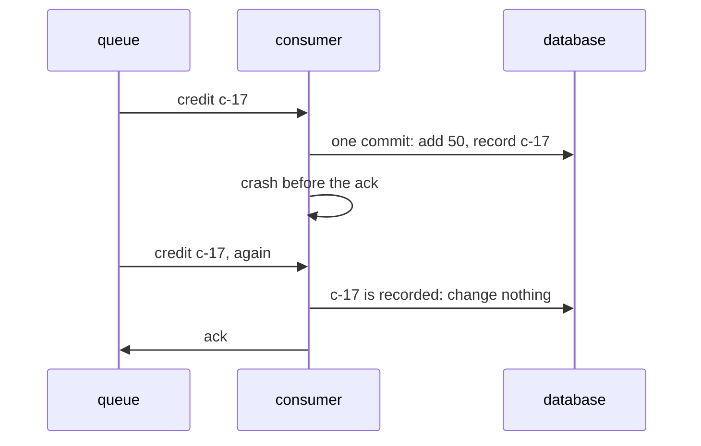

# Idempotency and exactly-once effects

## The idea

A message travels from a **sender** to a **receiver**, for example from a queue to the program that consumes it, or from a client to a server. The guide on why distributed systems are hard showed that a sender who hears nothing back cannot tell a lost message from a lost reply. That leaves it two choices, and each has a name.

- **At most once.** Send, and never send again. Nothing is done twice, and anything lost is lost.
- **At least once.** Send again until the receiver **acknowledges** it, that is, replies that it has the message. Nothing is lost, and anything whose acknowledgement was lost arrives twice.

What everyone wants is **exactly once**, and a network that loses messages does not allow it as a property of delivery. A sender that must not lose a message has to send it again when it hears nothing, and then the receiver may get it twice; a sender that never sends again may lose it. No rule for when to resend avoids both, because, to the sender, a lost acknowledgement looks exactly like a lost message. What a system can promise is an **exactly-once effect**: messages may arrive more than once, but each has its effect only once. A paper by Akidau and others on a fault-tolerant stream processor (2013) states the recipe: deliveries are retried until they are acknowledged, an at-least-once requirement that is a prerequisite for exactly-once, and duplicates are detected and discarded so that delivery is exactly once from the user's point of view.

The tool is **idempotency**. An operation is **idempotent** when doing it twice has the same effect as doing it once. HTTP's specification, RFC 9110, defines it for requests: a method is idempotent if the intended effect on the server of several identical requests is the same as the effect of one, which is why such a request can be repeated automatically after a communication failure. Some operations are idempotent by nature: "set the balance to 150", "delete order 9", "mark invoice 4 as paid". Others are not: "add 50", "append a line", "send an email". An operation that is not idempotent by nature can be made so, with three ideas:

1. **Give every intended change an id**, chosen by whoever decides on the change, before the first attempt: the client that wants a payment, the program that emits an event. Every retry of the same change carries the same id; a new change gets a new id.
2. **Record the id in the same commit as the effect.** The receiver checks whether the id is recorded; if not, it makes the change and records the id, in one atomic write of its database, a write that lands completely or not at all. The stream processing paper does exactly this: every record gets a unique id when it is produced, and the id is stored in the same atomic write as the state change, so that a retried record is recognized, discarded and acknowledged.
3. **Acknowledge after the commit.** A crash before the commit loses nothing, since the message comes again; a crash after it costs one duplicate, which the id turns into a no-op.

The same thinking applies on the sending side. A program that changes its database and then sends a message about the change can crash between the two, and the message is never sent; sending first can announce a change that then fails. The fix is to commit the outgoing message together with the change, as a row in the same database, and to send it afterwards, again and again until it is acknowledged. The stream processing paper calls this a **strong production**: produced records are checkpointed before delivery, in the same atomic write as the state change. The practice problem on this pattern calls such a table of messages waiting to be sent, written in the same transaction as the change, an **outbox**.

## A worked example

A consumer credits 50 points to an account for the message `credit c-17`. The queue redelivers any message that was not acknowledged, and the consumer can crash at different points of its work. Three consumers handle the same message:

```python examples/crash_points.py
"""A consumer credits 50 points for one message, and may crash at any point of its work.

The queue redelivers a message until it is acknowledged, so a crash before the ack means the
message comes again, to a fresh consumer. Only the database survives a crash, and a commit
writes all of its changes or none. Three consumers handle the same message, `credit c-17`:

- ack first: acknowledge, then credit;
- credit first: credit, then acknowledge;
- dedupe: in one commit, credit and record the operation id c-17, unless it is already recorded;
  then acknowledge.
"""


class Crash(Exception):
    pass


def deliver(strategy: str, crash_at: str | None) -> int:
    db = {"points": 0, "done": frozenset()}
    acked = False
    while not acked:  # the queue redelivers until it hears an ack
        try:
            if strategy == "ack first":
                acked = True
                if crash_at == "after ack":
                    raise Crash
                db = {**db, "points": db["points"] + 50}
            elif strategy == "credit first":
                db = {**db, "points": db["points"] + 50}
                if crash_at == "after commit":
                    raise Crash
                acked = True
            else:  # dedupe
                if crash_at == "before commit":
                    raise Crash
                if "c-17" not in db["done"]:  # the check and the credit commit together
                    db = {"points": db["points"] + 50, "done": db["done"] | {"c-17"}}
                if crash_at == "after commit":
                    raise Crash
                acked = True
        except Crash:
            crash_at = None  # the next consumer does not crash
    return db["points"]


CASES = [
    ("ack first", None), ("ack first", "after ack"),
    ("credit first", None), ("credit first", "after commit"),
    ("dedupe", None), ("dedupe", "before commit"), ("dedupe", "after commit"),
]
for strategy, crash_at in CASES:
    points = deliver(strategy, crash_at)
    print(f"{strategy:<12} crash {crash_at or 'never':<13} -> {points:>3} points")
```

It prints:

```output examples/crash_points.py
ack first    crash never         ->  50 points
ack first    crash after ack     ->   0 points
credit first crash never         ->  50 points
credit first crash after commit  -> 100 points
dedupe       crash never         ->  50 points
dedupe       crash before commit ->  50 points
dedupe       crash after commit  ->  50 points
```



<!-- text-of-mermaid sha256:c4e634bd37c3d6e7793f64a0b836767f0a196502d62e341771e5787fd262cfe1 -->
```text
 ┌───────┐             ┌──────────┐                          ┌──────────┐
 │ queue │             │ consumer │                          │ database │
 └───┬───┘             └─────┬────┘                          └─────┬────┘
     │                       │                                     │
     │      credit c-17      │                                     │
     │───────────────────────▶                                     │
     │                       │                                     │
     │                       │   one commit: add 50, record c-17   │
     │                       │─────────────────────────────────────▶
     │                       │                                     │
     │                       ├───┐                                 │
     │                       │   │ crash before the ack            │
     │                       ◀───┘                                 │
     │                       │                                     │
     │  credit c-17, again   │                                     │
     │───────────────────────▶                                     │
     │                       │                                     │
     │                       │  c-17 is recorded: change nothing   │
     │                       │─────────────────────────────────────▶
     │                       │                                     │
     │          ack          │                                     │
     ◀───────────────────────│                                     │
     │                       │                                     │
 ┌───┴───┐             ┌─────┴────┐                          ┌─────┴────┐
 │ queue │             │ consumer │                          │ database │
 └───────┘             └──────────┘                          └──────────┘
```

Each row is one story:

- **Ack first** is at most once. With no crash, 50 points. A crash between the acknowledgement and the credit loses the message: the queue thinks it was handled, and the account has 0.
- **Credit first** is at least once. With no crash, 50 points. A crash after the credit and before the acknowledgement makes the queue deliver again, and the account gets 100.
- **Dedupe** gives 50 in every case. Before the commit, nothing landed, and the second delivery does the work. After the commit, the second delivery finds `c-17` recorded and only acknowledges, as the drawing shows.

The third consumer works because the check, the credit and the record of the id are one commit. If they were separate writes, a crash between the credit and the record would leave the money credited and the id missing, and the duplicate would credit it again.

## When to use it

- **Any consumer of a queue that delivers at least once**, which is most of them: make each message's effect idempotent, by nature or with an id.
- **Any client that retries**, after a timeout or a dropped connection: the request needs an id the server can recognize, unless the operation is idempotent by nature. RFC 9110 says a client should not automatically retry a request that is not idempotent unless it knows the request is idempotent anyway or that the original was never applied.
- **Any program that changes its data and tells others about it**: commit the message with the change and send it afterwards, rather than writing to two systems one after the other.
- **Prefer operations that are idempotent by nature** when you can choose the interface: "set the status to shipped" survives retries with no bookkeeping; "advance the status" does not.
- **When order matters as well**, idempotency is not enough: an older update that arrives after a newer one is not a duplicate, and applying it once is still wrong. Version numbers or log positions, as in the guide on change data capture, decide whether a message is newer than what you hold.

## Common traps

- **An id that names the delivery, not the change.** The id must be chosen by whoever decides on the change, and reused on every attempt of it.
- **Checking and writing in separate steps.** "If not seen, do it, then mark it seen" with a crash between the second and third steps does it twice. The mark and the effect must commit together.
- **Effects outside the commit.** An email sent, a payment taken by another company's service: your database cannot make them atomic with your record, so a crash between the effect and your commit repeats the effect when the message comes again.
- **Forgetting the ids too early.** An id must be kept as long as a duplicate can still arrive. The stream processing paper deletes recorded ids once every sender is known to have finished retrying, and keeps them hours longer for sources that often deliver late.
- **Acknowledging before committing.** It feels faster, and it is at most once, as the first consumer shows.
- **Assuming "exactly once" in a product's description covers your side effects.** The stream processing paper is explicit: when code contacts external systems, making those effects idempotent is up to the user.

## Complexity

For a receiver that keeps the ids of the changes it applied:

| Cost | Amount | Condition |
|------|--------|-----------|
| Checking an id | O(1) on average with a hash index, O(log n) with a tree index over `n` ids | The lookup runs inside the commit that applies the change |
| Recording an id | One more row in the same commit | No extra round trip, since it rides on the commit that was happening anyway |
| Memory for ids | O(number of ids kept) | Bounded by how long duplicates can arrive, times the rate of changes |
| Outbox | One more row per outgoing message, in the same commit; then a send and a mark per message | Each message may be sent more than once, so its consumers deduplicate in turn |

The stream processing paper adds a fast path: a Bloom filter, a compact set that answers "certainly not seen" or "maybe seen", lets most new records skip the lookup, and only a "maybe" reads the stored ids.

## Expert notes

- **Exactly once in consensus.** The Raft paper aims at linearizable semantics, where each operation appears to take effect instantaneously and exactly once between its invocation and its response, and notes that a leader that crashes after committing a command but before replying makes the client retry it with the new leader, executing it twice. Its fix is the one above: clients give every command a unique serial number, and the replicated state machine remembers the latest serial number executed for each client, with its response, answering a repeat at once without executing it again.
- **The source of the duplicate stories.** Waldo and his co-authors describe an application that retried every queue operation after a timeout until it succeeded, and then found requests processed two, three, four or more times. The retry was right; what was missing was a way for the receiver to recognize a repeat.
- **Strong and weak productions.** The stream processing paper lets an application turn off its deduplication, or send its output before saving its state, when its computation is idempotent anyway, trading the guarantee for latency and resources. Idempotency by nature is cheaper than idempotency by bookkeeping.
- **What RFC 9110 does not promise.** The RFC notes that idempotency covers only what was requested: a server may log each request separately or keep a revision history, which are side effects of each repeat. Idempotent means "the intended effect is the same", not "nothing else happens".

## Practice

- `cstudy start idempotent-document-consumer-typescript`: a consumer of a queue that delivers at least once: duplicates, retries by the producer, messages out of order, messages that can never succeed, and crashes before the acknowledgement.
- `cstudy start transactional-outbox-typescript`: commit a change, its audit row and its event as one, then relay the events to a broker that fails and loses acknowledgements, in order per rental, to a consumer that applies each event once.
- `cstudy start vendor-retry-client-typescript`: the client's side: a client that retries only what is safe to repeat, sends the same key on every attempt of a request that has one, and reports an unknown outcome when it cannot tell whether the work was done.
- `cstudy start payment-webhook-receiver-typescript`: a receiver of signed payment events that the provider delivers at least once, late and out of order, and that must apply each event once and in its order.
- `cstudy start reliable-transport-sim`: the same recipe one layer down: segments resent until acknowledged, and a receiver that uses their sequence numbers to deliver each byte once and in order, then a sliding window and congestion control.
- `cstudy start agent-job-workers`: background jobs for agents: jobs submitted under ids that a client can send twice, leases that let another worker run a crashed worker's job again, and step outputs saved once each, so that a resumed job repeats no step.

## Further reading

- [RFC 9110, *HTTP Semantics*, section 9.2.2, Idempotent Methods](https://www.rfc-editor.org/rfc/rfc9110.html#name-idempotent-methods): the definition, and when a client may retry automatically.
- [Akidau and others, *MillWheel: Fault-Tolerant Stream Processing at Internet Scale*, Proceedings of the VLDB Endowment 6(11), 2013](https://www.vldb.org/pvldb/vol6/p1033-akidau.pdf): section 6.1, at-least-once delivery with deduplication by record id in the same atomic write as the state, garbage collection of the ids, and strong and weak productions.
- [Ongaro and Ousterhout, *In Search of an Understandable Consensus Algorithm (Extended Version)*, 2014](https://raft.github.io/raft.pdf): section 8, client serial numbers that keep a retried command from executing twice.
- [Waldo, Wyant, Wollrath and Kendall, *A Note on Distributed Computing*, 1994](https://web.archive.org/web/2010/http://www.cc.gatech.edu/classes/AY2010/cs4210_fall/papers/smli_tr-94-29.pdf): the queue whose retried requests were processed several times.
