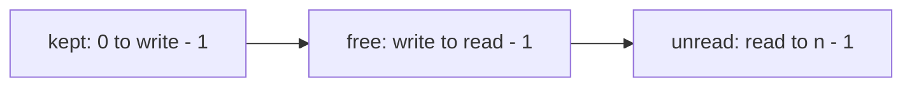

# In-place compaction

## The idea

You often need to drop some values from an array: readings below zero, repeated values in a sorted list, records marked as deleted. Deleting each one where it stands is slow. An array keeps its values side by side, so deleting one from the middle moves every value after it one place to the left. Deleting `k` values that way moves up to `n` values each time, O(n · k) in all, which is O(n²) when a large share of the array goes.

**Compaction** does it in one pass with two pointers moving in the same direction:

- `read` visits every position once, from left to right.
- `write` is the position where the next kept value goes.

When the value at `read` is kept, copy it to `write` and move `write` on. Either way, move `read` on.

The loop keeps one **invariant**: positions `0` to `write - 1` hold exactly the values kept among positions `0` to `read - 1`, in their original order. It holds at the start, when both pointers are 0 and both ranges are empty. A step that keeps a value appends it to the kept prefix, and a step that drops one leaves the prefix alone, so every step keeps it true. When `read` reaches `n`, the front of the array holds every kept value, in order.

Copying never destroys anything you still need. `write` moves only on steps where `read` moves too, so `write <= read` at all times, and the copy lands on a position that has already been read. The positions from `write` to `read - 1` are free space: their old values were read and either copied forward or dropped.



<!-- text-of-mermaid sha256:aaadead2d2254e844f63ba5fb435a41c7f69e98a67d141e0c56a477565d40799 -->
```text
┌────────────────────┐    ┌───────────────────────┐    ┌─────────────────────┐
│kept: 0 to write - 1├───►│free: write to read - 1├───►│unread: read to n - 1│
└────────────────────┘    └───────────────────────┘    └─────────────────────┘
```

When the pass ends, only the first `write` positions are the answer. The positions after them still hold old values. What to do with them is up to the **contract**, the function's specification of what it promises its callers: cut them off (`del values[write:]` in Python), report the new length and leave them, or overwrite them.

## A worked example

Remove the repeats from the sorted list `[1, 1, 2, 3, 3, 3, 5]`, in place. In a sorted list equal values sit next to each other, so a value is new exactly when it differs from the **last value kept**, `values[write - 1]`. The first value is always new.

| `read` | `write` | Value | Last kept | Action | Kept prefix |
|--------|---------|-------|-----------|--------|-------------|
| 0 | 0 | 1 | none | keep, copy to 0 | `1` |
| 1 | 1 | 1 | 1 | skip | `1` |
| 2 | 1 | 2 | 1 | keep, copy to 1 | `1 2` |
| 3 | 2 | 3 | 2 | keep, copy to 2 | `1 2 3` |
| 4 | 3 | 3 | 3 | skip | `1 2 3` |
| 5 | 3 | 3 | 3 | skip | `1 2 3` |
| 6 | 3 | 5 | 3 | keep, copy to 3 | `1 2 3 5` |

The pass ends with `write = 4`, and the list is `[1, 2, 3, 5, 3, 3, 5]`: the answer, then three leftovers.

The program below runs this, a filter that keeps the readings of at least 0, the trap of removing values from a list while looping over it, and a version that keeps at most two copies of each value:

```python examples/compaction.py
"""A reader and a writer: keep the wanted values at the front of the same list, in order."""


def keep_at_least(readings: list[int], limit: int) -> int:
    """Move the readings of at least `limit` to the front, in order; return how many there are."""
    write = 0
    for read in range(len(readings)):
        if readings[read] >= limit:
            readings[write] = readings[read]  # write <= read: no unread value is overwritten
            write += 1
    return write


readings = [7, -2, 5, -1, -3, 8, 0]
kept = keep_at_least(readings, 0)
print("after the pass:", readings, "| kept:", kept)
del readings[kept:]
print("truncated:     ", readings)

naive = [7, -2, -1, 5]
for value in naive:  # removing from the list being looped over
    if value < 0:
        naive.remove(value)
print("removing while looping:", naive)


def dedupe_sorted(values: list[int]) -> int:
    """Keep one copy of each value of a sorted list at its front; return how many."""
    write = 0
    for read in range(len(values)):
        keep = write == 0 or values[read] != values[write - 1]  # compare with the last value kept
        print(f"  read={read} write={write} value={values[read]}: {'keep' if keep else 'skip'}")
        if keep:
            values[write] = values[read]
            write += 1
    return write


values = [1, 1, 2, 3, 3, 3, 5]
print("dedupe", values)
size = dedupe_sorted(values)
print("result:", values[:size], "| the tail still holds", values[size:])


def at_most_two(values: list[int], against_kept: bool) -> list[int]:
    """Keep at most two copies of each value of a sorted list."""
    write = 0
    for read in range(len(values)):
        if read >= 2:  # then write >= 2 too, since the first two values are always kept
            earlier = values[write - 2] if against_kept else values[read - 2]
            if values[read] == earlier:
                continue
        values[write] = values[read]
        write += 1
    return values[:write]


print("at most two, compared with what was kept:", at_most_two([1, 1, 1, 2, 2, 3], True))
print("at most two, compared with what was read:", at_most_two([1, 1, 1, 2, 2, 3], False))
```

It prints:

```output examples/compaction.py
after the pass: [7, 5, 8, 0, -3, 8, 0] | kept: 4
truncated:      [7, 5, 8, 0]
removing while looping: [7, -1, 5]
dedupe [1, 1, 2, 3, 3, 3, 5]
  read=0 write=0 value=1: keep
  read=1 write=1 value=1: skip
  read=2 write=1 value=2: keep
  read=3 write=2 value=3: keep
  read=4 write=3 value=3: skip
  read=5 write=3 value=3: skip
  read=6 write=3 value=5: keep
result: [1, 2, 3, 5] | the tail still holds [3, 3, 5]
at most two, compared with what was kept: [1, 1, 2, 2, 3]
at most two, compared with what was read: [1, 1, 2, 3]
```

- The filter leaves `[-3, 8, 0]` behind its four kept readings: old values, not part of the answer, until `del` cuts them off.
- Removing while looping skips a value: on CPython 3.13, `-1` survives. Removing `-2` shifted `-1` back into the position the loop had just visited, and the loop moved on to the next one.
- The dedupe trace is the table above, line for line.
- Keeping at most two copies works when each value is compared with the value kept two places back, and fails when it is compared with the value read two places back: see the expert notes.

## When to use it

- You must filter **in place**: the contract says so, or there is no memory for a second array.
- The kept values must keep their **order**.
- The data is **sorted** and you want each value once, or at most a few times: equal values are next to each other, so one comparison with the last kept value decides.

When a new list is fine, `[x for x in values if keep(x)]` is clearer, with the same O(n) time and O(n) extra space. To change a list that other code also refers to, `values[:] = [x for x in values if keep(x)]` replaces the contents of the same list object, though it still builds the new list first.

## Common traps

- **Forgetting the tail.** After the pass, the positions from `write` on still hold old values. Returning the whole array returns them too. Cut, fill or report the length, as the contract asks.
- **Removing from a list while looping over it.** The loop and the removals disagree about positions, so values are skipped, as the example shows. Python's tutorial says such code can be tricky to get right, and suggests looping over a copy or building a new collection. Compaction is the in-place way.
- **Comparing with what was read instead of what was kept.** The kept prefix is the truth; the positions behind `read` may have been overwritten. For one copy per value both happen to work, for two copies only the comparison with the kept prefix does.
- **An empty array.** The comparison with `values[write - 1]` needs a kept value. The guard `write == 0` handles the first value and the empty array alike; reading `values[0]` before the loop does not.
- **Swapping when copying would do.** A swap writes twice and reorders the dropped values. Use it only when the dropped values must stay in the array.

## Complexity

| Approach | Time | Extra space |
|----------|------|-------------|
| Delete each unwanted value where it stands | O(n · k) for `k` deletions, O(n²) at worst | O(1) |
| Copy the kept values into a new list | O(n) | O(n) |
| Reader and writer in the same array | O(n) | O(1) |

`read` takes `n` steps, and each step does one test and at most one copy or swap, so a pass is O(n). `write` never passes `read`, so there are at most `n` copies.

## Expert notes

- **Stability.** Copying keeps the kept values in order. When the dropped values must stay in the array, behind the kept ones, the writer can swap instead of copy: the kept values still land in the order they were read, but a dropped value can be swapped past other dropped values, so their order is lost. A third way works from **both ends**: one pointer from the left looks for a value that belongs at the back, one from the right for a value that belongs at the front, and they swap. Every swap settles two values, so there are at most `n / 2` swaps, but neither side keeps its order. It is the right choice when order does not matter and writes are expensive.
- **More than two regions.** The invariant can split the array into three regions or more, each boundary with a pointer of its own, and still finish in one pass. `sort-colors` practises that.
- **At most `k` copies.** In a sorted list, compare `values[read]` with `values[write - k]`. The kept prefix is sorted, so its copies of a value sit together at its end. If `values[read]` equals the value `k` places back in the prefix, then every value between them is equal too, and `k` copies are kept already: skip. Otherwise fewer than `k` are kept: keep it. The comparison with `values[read - k]` fails once `write` falls behind `read`, because that position may have been overwritten: in the example, the second `2` met an overwritten position that held `2` and was skipped.
- **Go.** The `slices` package, new in Go 1.21, has both operations: `slices.DeleteFunc` removes in place the elements for which a function returns true and returns the shortened slice, and `slices.Compact` replaces runs of equal elements with a single copy, which on a sorted slice is the dedupe of the worked example. Since Go 1.22, the functions that shrink a slice zero the elements between the new length and the old one, so the tail no longer refers to the removed values.

## Practice

- `cstudy start move-zeroes`: compaction in which the dropped values must reappear, all at the end.
- `cstudy start sort-colors`: three regions in one pass.

## Further reading

- [Python mutable sequence types](https://docs.python.org/3/library/stdtypes.html#mutable-sequence-types): `del s[i:j]` is the same as `s[i:j] = []`, and `s[i:j] = t` replaces a slice with the contents of an iterable.
- [Python tutorial, `for` statements](https://docs.python.org/3/tutorial/controlflow.html#for-statements): changing a collection while looping over it, and the two safer strategies.
- [Go `slices` package](https://pkg.go.dev/slices): `DeleteFunc` and `Compact`.
- [Go 1.21 release notes: the new `slices` package](https://go.dev/doc/go1.21#slices), and [Go 1.22 release notes: minor changes to the library](https://go.dev/doc/go1.22#minor_library_changes), where, under `slices`, the functions that shrink a slice start zeroing the tail.
