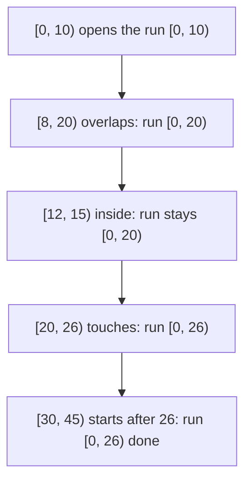
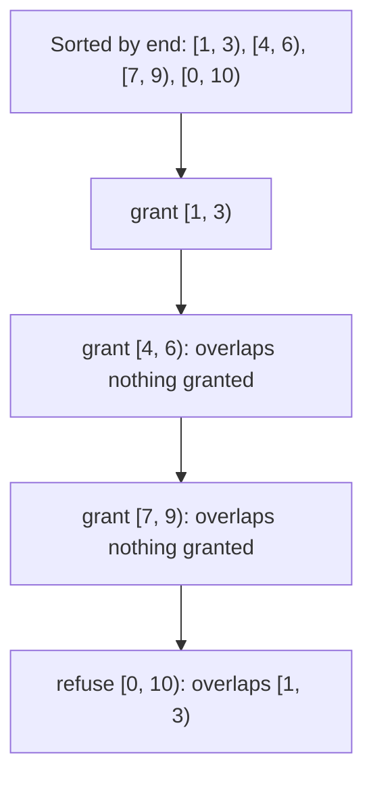

# Intervals: sorting, merging and choosing

## The idea

An **interval** is a stretch of a line between two endpoints: a booking from 9:00 to 10:30, the bytes 100 to 199 of a file, the minutes a show is on air. Interval problems ask how a collection of them relate: which overlap, what they cover together, how many can coexist.

First decide what the endpoints mean, because two conventions are common and they disagree exactly where intervals touch.

| Convention | Written | Holds | `[1, 3]` or `[1, 3)` with `[3, 5]` or `[3, 5)` |
|------------|---------|-------|----------------------------------|
| Closed | `[a, b]` | every `x` with `a <= x <= b` | share the point 3: they overlap |
| Half-open | `[a, b)` | every `x` with `a <= x < b` | touch but share nothing |

Half-open intervals are common in programs, and the rest of this guide uses them. Their length is `b - a`, and `[a, b)` followed by `[b, c)` covers `[a, c)` with no point counted twice and no point missing. Python's `range(a, b)` and its slices `s[a:b]` are half-open in the same way. A careful problem statement says which convention it uses, sometimes only through an example; find it before writing a comparison.

**Overlap.** Two half-open intervals `[a, b)` and `[c, d)` fail to overlap exactly when one ends before the other starts: `b <= c` or `d <= a`. So they overlap exactly when

```python
a < d and c < b
```

For closed intervals, both `<` become `<=`. This one test, with the right convention, is the base of everything else.

Two moves then solve most interval questions:

- **Sort by start to see what runs together.** In start order, an interval can only overlap the ones that came before it if it starts before they end, so one pass that remembers how far the current group reaches finds every group.
- **Sort by end to choose.** To keep the most intervals that do not overlap, the one that ends first leaves the most room for the others, and that choice can be proved safe.

## A worked example

A channel airs segments, some of them at the same time on different streams, as half-open intervals in minutes: `[30, 45)`, `[0, 10)`, `[8, 20)`, `[12, 15)`, `[20, 26)`, `[40, 52)` and `[60, 70)`, in the order they were logged. What is the longest stretch during which something was on air without a break?

Sort the segments by start, then walk them keeping one **run**: the stretch from the start of the current group to the furthest end seen in it. A segment that starts at or before the run's end continues the run; one that starts after it opens a new run.

```python examples/longest_stretch.py
"""A channel airs segments [start, end) in minutes, some of them at the same time. Find the longest
stretch during which something was on air without a break."""

from collections.abc import Iterator

Interval = tuple[int, int]


def show(interval: Interval) -> str:
    start, end = interval
    return f"[{start:>2}, {end:>2})"


def unbroken_runs(segments: list[Interval]) -> Iterator[Interval]:
    """Yield the stretches without a break, from left to right, printing each step."""
    ordered = sorted(segments)
    run_start, run_end = ordered[0]
    print(f"{show(ordered[0])} opens a run")
    for start, end in ordered[1:]:
        if start <= run_end:
            run_end = max(run_end, end)  # a segment may end inside the run
            print(f"{show((start, end))} joins it: {show((run_start, run_end))}")
        else:
            print(f"{show((start, end))} starts after {run_end}: a new run opens")
            yield run_start, run_end
            run_start, run_end = start, end
    yield run_start, run_end


segments = [(30, 45), (0, 10), (8, 20), (12, 15), (20, 26), (40, 52), (60, 70)]
start, end = max(unbroken_runs(segments), key=lambda run: run[1] - run[0])
print(f"longest unbroken stretch: [{start}, {end}), {end - start} minutes")
```

It prints:

```output examples/longest_stretch.py
[ 0, 10) opens a run
[ 8, 20) joins it: [ 0, 20)
[12, 15) joins it: [ 0, 20)
[20, 26) joins it: [ 0, 26)
[30, 45) starts after 26: a new run opens
[40, 52) joins it: [30, 52)
[60, 70) starts after 52: a new run opens
longest unbroken stretch: [0, 26), 26 minutes
```

`sorted` orders the tuples by their first element, the start, and breaks ties by the second, because Python compares tuples element by element. Follow the first run in the drawing.



<!-- text-of-mermaid sha256:a9caf23e326e5e239d2bc29ffa08b06f42e40a05ef2052e785c388e6353886dc -->
```text
┌──────────────────────────────────────────┐
│      [0, 10) opens the run [0, 10)       │
└─────────────────────┬────────────────────┘
                      ▼
┌──────────────────────────────────────────┐
│      [8, 20) overlaps: run [0, 20)       │
└─────────────────────┬────────────────────┘
                      ▼
┌──────────────────────────────────────────┐
│    [12, 15) inside: run stays [0, 20)    │
└─────────────────────┬────────────────────┘
                      ▼
┌──────────────────────────────────────────┐
│      [20, 26) touches: run [0, 26)       │
└─────────────────────┬────────────────────┘
                      ▼
┌──────────────────────────────────────────┐
│[30, 45) starts after 26: run [0, 26) done│
└──────────────────────────────────────────┘
```

Three details of the walk matter:

- **The run's end is a maximum.** `[12, 15)` ends before the run does, so the run keeps its end at 20 instead of shrinking to 15.
- **Touching continues the run.** `[20, 26)` starts at 20, where the run ends. With half-open segments there is no instant of silence between minute 20 of one and minute 20 of the other, so the test is `start <= run_end`.
- **Why one pass is enough.** When a segment starts after the run's end, there is a gap: every segment seen so far ends by the run's end, and every segment still to come starts no earlier than this one, because they are sorted by start. Nothing can fill the gap later, so the run is complete the moment the gap appears.

## Choosing the most intervals

One telescope receives observation requests, each a half-open interval of hours. It can serve one request at a time and wants to grant as many as possible. A greedy algorithm takes the requests in some order and grants each one that overlaps nothing granted so far. Which order? Three rules sound reasonable:

- **Earliest start**: begin as soon as possible.
- **Shortest first**: a short request blocks the least time.
- **Earliest end**: free the telescope as soon as possible.

```python examples/one_telescope.py
"""One telescope, many observation requests [start, end) in hours. Grant as many as possible with no
two overlapping. Three greedy rules take requests in a different order; only one is always best."""

from collections.abc import Callable
from itertools import combinations

Interval = tuple[int, int]
Rule = Callable[[Interval], int]

RULES: dict[str, Rule] = {
    "earliest start": lambda request: request[0],
    "shortest first": lambda request: request[1] - request[0],
    "earliest end": lambda request: request[1],
}


def overlap(first: Interval, second: Interval) -> bool:
    return first[0] < second[1] and second[0] < first[1]


def greedy(requests: list[Interval], rule: Rule) -> list[Interval]:
    granted: list[Interval] = []
    for request in sorted(requests, key=rule):
        if not any(overlap(request, kept) for kept in granted):
            granted.append(request)
    return granted


def most_by_brute_force(requests: list[Interval]) -> int:
    return max(
        size
        for size in range(len(requests) + 1)
        for chosen in combinations(requests, size)
        if not any(overlap(a, b) for a, b in combinations(chosen, 2))
    )


for requests in ([(0, 10), (1, 3), (4, 6), (7, 9)], [(0, 5), (4, 7), (6, 11)]):
    print(f"requests {requests}: best is {most_by_brute_force(requests)}")
    for name, rule in RULES.items():
        print(f"  {name:<14} grants {greedy(requests, rule)}")

every_request = [(start, end) for start in range(6) for end in range(start + 1, 6)]
inputs = [list(chosen) for size in (1, 2, 3, 4) for chosen in combinations(every_request, size)]
print(f"every set of 1 to 4 requests within hours 0 to 5: {len(inputs)} inputs")
for name, rule in RULES.items():
    wrong = sum(len(greedy(requests, rule)) < most_by_brute_force(requests) for requests in inputs)
    print(f"  {name:<14} falls short on {wrong}")
```

It prints:

```output examples/one_telescope.py
requests [(0, 10), (1, 3), (4, 6), (7, 9)]: best is 3
  earliest start grants [(0, 10)]
  shortest first grants [(1, 3), (4, 6), (7, 9)]
  earliest end   grants [(1, 3), (4, 6), (7, 9)]
requests [(0, 5), (4, 7), (6, 11)]: best is 2
  earliest start grants [(0, 5), (6, 11)]
  shortest first grants [(4, 7)]
  earliest end   grants [(0, 5), (6, 11)]
every set of 1 to 4 requests within hours 0 to 5: 1940 inputs
  earliest start falls short on 227
  shortest first falls short on 6
  earliest end   falls short on 0
```

Each wrong rule has its counterexample:

- **Earliest start** grants `[0, 10)` first, the earliest to begin, and it blocks the three short requests inside it.
- **Shortest first** grants `[4, 7)`, the shortest, which overlaps both of the requests that fit together.

Earliest end is right on both, and on all 1,940 sets of up to four requests with endpoints between 0 and 5; the other two fall short on some, with ties going to the request listed first. Shortest first fails on only 6 of them, which is why testing a few examples by hand rarely catches it. The drawing traces earliest end on the first input:



<!-- text-of-mermaid sha256:bf925e4d71db6d82de3fd81b0c7ffed15add404bfa753089b999b208b3b39af4 -->
```text
┌──────────────────────────────────────────────┐
│Sorted by end: [1, 3), [4, 6), [7, 9), [0, 10)│
└───────────────────────┬──────────────────────┘
                        ▼
┌──────────────────────────────────────────────┐
│                 grant [1, 3)                 │
└───────────────────────┬──────────────────────┘
                        ▼
┌──────────────────────────────────────────────┐
│    grant [4, 6): overlaps nothing granted    │
└───────────────────────┬──────────────────────┘
                        ▼
┌──────────────────────────────────────────────┐
│    grant [7, 9): overlaps nothing granted    │
└───────────────────────┬──────────────────────┘
                        ▼
┌──────────────────────────────────────────────┐
│       refuse [0, 10): overlaps [1, 3)        │
└──────────────────────────────────────────────┘
```

### Why the earliest end is safe

The proof is a **stays-ahead** argument, as in the [greedy choices guide](../greedy-choices/guide.md). The measure is the time at which the telescope is free again: the end of the last request granted. Every request is assumed to have `start < end`.

Let greedy grant `g1, g2, ..., gk`, in the order it granted them, which is the order of their ends. Take any set of requests that do not overlap, `o1, o2, ..., om`, listed by end; since they do not overlap, each one starts at or after the end of the one before it.

1. **Greedy stays ahead: `gi` ends no later than `oi`, for every `i` up to both lengths.** For `i = 1`, `g1` is the request that ends first of all, since nothing is granted yet to block it. Now suppose `gi` ends no later than `oi`. The request `o(i+1)` starts at or after the end of `oi`, so at or after the end of `gi`, and so after every request greedy has granted so far, since they all end by then. It ends after `gi` does, so the greedy scan reaches it after granting `gi`, and finds it overlapping nothing granted. If greedy had not granted anything since `gi` by then, it grants `o(i+1)` itself. Either way, greedy's next grant ends no later than `o(i+1)`.
2. **Ahead means best.** Suppose the other set is larger, `m > k`. Then `o(k+1)` starts at or after the end of `ok`, which is at or after the end of `gk`, so it overlaps none of greedy's grants and comes after `gk` in the scan. Greedy would have granted it, a `(k+1)`-th request. So `m <= k`: no set of requests that fit together is larger than greedy's.

The proof never used how ties are broken, so earliest end is safe with any tie order.

## When to use it

- **Anything with a start and an end**: bookings, time windows, byte ranges, segments of a road, versions valid from one date to another.
- **"Which overlap", "what do they cover together", "is there a break"**: sort by start and walk once with a run.
- **"The most that fit together"**: sort by end, grant what fits.
- **"How many at once"**: turn the endpoints into events and sweep them, as the [sweep line guide](../sweep-lines/guide.md) shows.

## Common traps

- **Using the other convention's test.** A half-open test on closed intervals misses intervals that share one point; a closed test on half-open ones reports touching intervals as overlapping. Find the convention in the statement and its examples before writing `<` or `<=`.
- **Sorting by the wrong end.** Start order finds what runs together; it does not choose the most. End order chooses; it does not group overlapping intervals into runs.
- **Comparing only neighbors in unsorted input.** Neighbors in the input say nothing about overlap; neighbors after sorting by start do.
- **Empty intervals.** `[t, t)` holds no point, so it overlaps nothing, but code that only compares starts and ends may still count it. Decide whether the input can contain one, and what it means.
- **Trusting a rule that passes the examples.** Shortest first was wrong on 6 inputs out of 1,940. Compare a new rule with brute force on every small input, as the example does.

## Complexity

| Step | Time | Space |
|------|------|-------|
| Sort n intervals | O(n log n) | O(n) for `sorted`, which copies the list |
| Walk the sorted intervals with a run | O(n) | O(1) besides the output |
| Earliest end, written as in the example | O(n · k) for k grants, since each request is checked against every grant | O(k) |
| Check every pair for overlap | O(n²) | O(1) |
| Brute force over every subset | O(2^n · n²) | O(n) |

A more careful earliest end runs in O(n) after the sort. Either way the sort dominates, so the whole algorithm is O(n log n).

## Expert notes

- **Why half-open.** Edsger Dijkstra's note EWD831, "Why numbering should start at zero", compares the four ways to write a range of integers and prefers `a <= i < b`: the difference of the bounds is the length, two adjacent ranges share a bound, and an empty range is written without an unnatural bound. He reports that programmers of the Mesa language, which offered all four, were advised to use only this one.
- **The mirror image is safe too.** Reflect the time line, `t` to `-t`: ends become starts, and two requests overlap after the reflection exactly when they did before. So granting by **latest start**, working from the right end of the line towards the left, grants as many requests as earliest end does. For any problem that looks the same in a mirror, a rule and its mirror image are equally good, which is a quick sanity check on a new rule.
- **The same rule, other sources.** Jeff Erickson's *Algorithms*, §4.2, proves the earliest-end rule a different way, and Kevin Wayne's slides for Kleinberg and Tardos give counterexamples for earliest start and for shortest interval.

## Practice

- `cstudy start can-attend-meetings`: decide whether one person can attend every meeting of a day.
- `cstudy start merge-intervals`: replace overlapping intervals by intervals that cover the same points.
- `cstudy start insert-interval`: add one interval to a list that is already sorted and separate, and keep it that way.
- `cstudy start interval-list-intersections`: the times when two people are both free, from their two lists.
- `cstudy start coverage-gaps`: the stretches of a window that no period covers.
- `cstudy start non-overlapping-intervals`: the fewest bookings to cancel so that the rest never conflict.
- `cstudy start range-module`: track which parts of a line are covered while ranges are added, removed and queried.

## Further reading

- [Jeff Erickson, *Algorithms*, chapter 4: Greedy Algorithms](https://jeffe.cs.illinois.edu/teaching/algorithms/book/04-greedy.pdf): §4.2, scheduling classes, the earliest-end rule and its proof, and exercises with other rules.
- [Kevin Wayne, lecture slides for Kleinberg and Tardos, *Algorithm Design*, chapter 4](https://www.cs.princeton.edu/~wayne/kleinberg-tardos/pdf/04GreedyAlgorithmsI.pdf): interval scheduling and counterexamples for earliest start and shortest interval.
- [Edsger W. Dijkstra, EWD831, "Why numbering should start at zero"](https://www.cs.utexas.edu/~EWD/transcriptions/EWD08xx/EWD831.html): the case for half-open ranges.
- [Python sequence types](https://docs.python.org/3/library/stdtypes.html#sequence-types-list-tuple-range): slices `s[i:j]` hold the items with `i <= k < j`, and `range` stops before `stop`.
- [Python value comparisons](https://docs.python.org/3/reference/expressions.html#value-comparisons): sequences such as tuples compare lexicographically, element by element.
