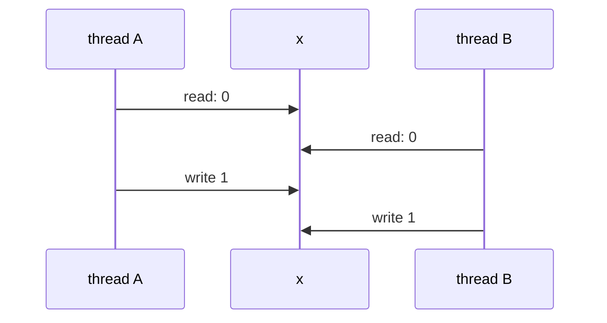
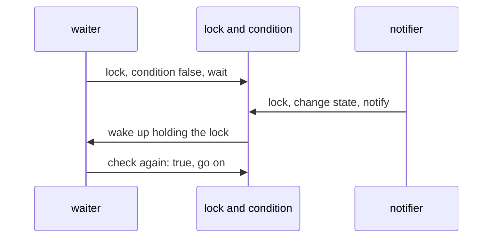

# Locks, condition variables and semaphores

## The idea

Threads share memory, which makes them fast to coordinate and easy to get wrong. Adding 1 to a shared number looks like one step, but a processor does it in three: **read** the value into a register, **add** 1, **write** it back. If two threads interleave those steps, both can read the same old value, and one addition is lost. Dijkstra used exactly this example, two processes each executing `S1 := S1 + 1`, in his notes *Cooperating Sequential Processes*. A bug whose outcome depends on how threads happen to interleave is a **race condition**.

The code that touches shared state is a **critical section**, and the cure is **mutual exclusion**: at most one thread inside a critical section at a time. Three primitives provide it and build on it.

- A **lock**, or **mutex** (for mutual exclusion), has two operations. `acquire` takes the lock, waiting while another thread holds it; `release` gives it back. Code between them runs in one thread at a time.
- A **condition variable** lets a thread wait, without spinning (busy waiting, checking in a loop), until some condition about shared state becomes true, such as "the count reached zero", and lets another thread wake it when it changes that state.
- A **semaphore** is a counter that never goes below zero. Taking one unit waits while the counter is zero; giving one back may wake a waiting thread. With a counter of 1 it works as a lock; with a counter of n it lets n threads in.

All three need one thing from the hardware: an **atomic** operation, one that no other processor can interleave with. The textbook *Operating Systems: Three Easy Pieces* describes the simplest, **test-and-set**: in one indivisible step, write a new value to a memory word and return the old one. A thread that writes "locked" and gets back "unlocked" owns the lock.

## A worked example

The program below runs two threads that each add 1 to `x`, once without a lock and once with one. The threads are simulated, so the interleaving is the same on every run: each thread yields control after every step, and a scheduler gives them turns, one step each. In the version with a lock, checking that the lock is free and taking it happen in one step, as test-and-set makes them.

```python examples/race.py
"""Two threads add 1 to the same number; without a lock, one of the additions is lost.

The threads are simulated, so that the interleaving is the same on every run: each thread is a
generator that yields after every step, and the scheduler lets the two take turns, one step each.
Reading x, adding 1 and writing it back are separate steps, as they are on a real processor.
"""

from collections.abc import Iterator


def add_one(name: str, memory: dict, use_lock: bool) -> Iterator[str]:
    if use_lock:
        while memory["lock"] is not None:
            yield f"{name} waits for the lock"
        memory["lock"] = name  # the test and the set run in one step: nobody runs in between
        yield f"{name} takes the lock"
    value = memory["x"]
    yield f"{name} reads x = {value}"
    memory["x"] = value + 1
    yield f"{name} writes x = {value + 1}"
    if use_lock:
        memory["lock"] = None
        yield f"{name} releases the lock"


def run(use_lock: bool) -> None:
    memory = {"x": 0, "lock": None}
    threads = {name: add_one(name, memory, use_lock) for name in ("A", "B")}
    steps = []
    while threads:
        for name in list(threads):  # take turns: one step of A, then one of B
            try:
                steps.append(next(threads[name]))
            except StopIteration:
                del threads[name]
    print(f"{'with' if use_lock else 'without'} a lock: x = {memory['x']}")
    for step in steps:
        print("  " + step)


run(use_lock=False)
run(use_lock=True)
```

It prints:

```output examples/race.py
without a lock: x = 1
  A reads x = 0
  B reads x = 0
  A writes x = 1
  B writes x = 1
with a lock: x = 2
  A takes the lock
  B waits for the lock
  A reads x = 0
  B waits for the lock
  A writes x = 1
  B waits for the lock
  A releases the lock
  B takes the lock
  B reads x = 1
  B writes x = 2
  B releases the lock
```



<!-- text-of-mermaid sha256:95fb1106de423db7a65f0d5ea28faf7f2ed87d3ddbf5b3c3386d423e52d4b8ed -->
```text
┌──────────┐     ┌───┐    ┌──────────┐
│ thread A │     │ x │    │ thread B │
└─────┬────┘     └─┬─┘    └─────┬────┘
      │            │            │
      │  read: 0   │            │
      │────────────▶            │
      │            │            │
      │            │  read: 0   │
      │            ◀────────────│
      │            │            │
      │  write 1   │            │
      │────────────▶            │
      │            │            │
      │            │  write 1   │
      │            ◀────────────│
      │            │            │
┌─────┴────┐     ┌─┴─┐    ┌─────┴────┐
│ thread A │     │ x │    │ thread B │
└──────────┘     └───┘    └──────────┘
```

The drawing is the first run. B read `x` before A wrote it, so B's write of 1 overwrites A's. In the second run, B cannot read `x` until A has released the lock, by which time A's write is done: the critical section ran as one indivisible piece, and `x` is 2. With real threads the bad interleaving is rare, which is what makes races dangerous: a program can pass its tests a thousand times and lose an update on the thousand and first.

## Condition variables

A lock answers "only one at a time". Many problems also need "wait until": wait until a result is ready, until a queue has room, until every worker has finished. Checking in a loop with the lock released in between, **busy waiting**, burns a processor. A **condition variable** puts the thread to sleep instead.

POSIX describes the contract. A condition variable is always used with a mutex and a **predicate**, a true-or-false condition on shared variables that says whether the thread may proceed. `wait` atomically releases the mutex and blocks the thread; atomically here means that no other thread can change the state and signal in between, so the wake-up cannot be missed. When the thread is woken, it owns the mutex again. POSIX's `signal` wakes at least one waiting thread; Python's `notify` wakes one (its documentation says `notify(n)` wakes at most n, and warns that a future implementation may occasionally wake more); POSIX's `broadcast` and Python's `notify_all` wake them all.

The rule that matters most: **check the predicate in a loop**. POSIX says spurious wake-ups, returns from `wait` with nobody having signalled, may occur, and that the predicate should be re-evaluated on every return. There is a second reason. Lampson and Redell's 1980 paper on monitors in the Mesa language contrasts two meanings of a signal. In Hoare's definition, the woken thread runs at once and can assume the condition holds. In Mesa, a notify is only a hint: the woken thread runs at some convenient later time, after reacquiring the lock, and another thread may have entered first and changed the state. The proper pattern is therefore `while not <OK to proceed>: wait`. POSIX and Python both describe waiting this way.



<!-- text-of-mermaid sha256:3b21969842a6170c39b3cd45ab9eeb6b2e5efaf023b0a54310dde45315cf1acc -->
```text
┌────────┐                 ┌────────────────────┐               ┌──────────┐
│ waiter │                 │ lock and condition │               │ notifier │
└────┬───┘                 └──────────┬─────────┘               └─────┬────┘
     │                                │                               │
     │  lock, condition false, wait   │                               │
     │────────────────────────────────▶                               │
     │                                │                               │
     │                                │  lock, change state, notify   │
     │                                ◀───────────────────────────────│
     │                                │                               │
     │   wake up holding the lock     │                               │
     ◀────────────────────────────────│                               │
     │                                │                               │
     │   check again: true, go on     │                               │
     │────────────────────────────────▶                               │
     │                                │                               │
┌────┴───┐                 ┌──────────┴─────────┐               ┌─────┴────┐
│ waiter │                 │ lock and condition │               │ notifier │
└────────┘                 └────────────────────┘               └──────────┘
```

The program below builds a **countdown latch**: a counter that worker threads count down, and that a waiting thread waits on until it reaches zero.

```python examples/latch.py
"""A countdown latch built from a condition variable: wait until every worker has reported.

The latch holds a count. Each worker computes a result, then counts the latch down; the main
thread waits until the count reaches zero. The count is shared state, so it is read and changed
only while holding the condition variable's lock, and the waiting thread checks it again each
time it wakes up.
"""

import threading


class Latch:
    def __init__(self, count: int) -> None:
        self._count = count
        self._changed = threading.Condition()  # a condition variable with a lock of its own

    def count_down(self) -> None:
        with self._changed:  # take the lock
            self._count -= 1
            if self._count == 0:
                self._changed.notify_all()  # wake every waiting thread

    def wait(self) -> None:
        with self._changed:
            while self._count > 0:  # a wake-up says "look again", not "it is done"
                self._changed.wait()  # releases the lock while asleep, retakes it on waking


results: dict[int, int] = {}
latch = Latch(3)


def worker(n: int) -> None:
    results[n] = n * n
    latch.count_down()


for n in (1, 2, 3):
    threading.Thread(target=worker, args=(n,)).start()
latch.wait()
print("every worker reported:", sorted(results.items()))
```

It prints:

```output examples/latch.py
every worker reported: [(1, 1), (2, 4), (3, 9)]
```

Notice what is not there: no sleep, no polling. If a worker finishes before the main thread starts waiting, the main thread finds the count already lower and does not wait for that worker at all; the predicate, not the notification, carries the information. Python's `Condition.wait_for(predicate)` writes the same loop for you.

## Semaphores

Dijkstra defined the semaphore in *Cooperating Sequential Processes*, with two operations named P and V. V increases the semaphore by 1, as one indivisible action. P decreases it by 1 as soon as the result would not be negative: if the semaphore is 0, P waits until another process performs a V, and when several are waiting, which one completes is left unspecified. He calls a semaphore that only takes the values 0 and 1 **binary**, and one that can take larger values **general**, crediting Scholten with showing how widely general semaphores apply. A binary semaphore that starts at 1 is a lock: P before the critical section, V after it.

POSIX names them `sem_wait` and `sem_post`; Python's `threading.Semaphore` names them `acquire` and `release`. A general semaphore counts **permits**: the number of things available, such as connections in a pool or slots in a rate limit.

```python examples/permits.py
"""A counting semaphore with 2 permits lets at most 2 of 6 workers in at a time.

Each worker takes a permit, records how many workers are inside, works briefly and gives the
permit back. The largest number seen inside is checked against the limit; how many actually
overlap depends on timing, so the program prints only whether the limit held.
"""

import threading
import time

PERMITS = 2
permits = threading.Semaphore(PERMITS)
count_lock = threading.Lock()
inside = 0
most_inside = 0


def worker() -> None:
    global inside, most_inside
    with permits:  # acquire: take a permit, or wait for one; release on the way out
        with count_lock:
            inside += 1
            most_inside = max(most_inside, inside)
        time.sleep(0.01)
        with count_lock:
            inside -= 1


workers = [threading.Thread(target=worker) for _ in range(6)]
for thread in workers:
    thread.start()
for thread in workers:
    thread.join()
print(f"6 workers, {PERMITS} permits: never more than {PERMITS} inside: {most_inside <= PERMITS}")

one = threading.Semaphore(1)
print("first acquire:", one.acquire())
print("second acquire without waiting:", one.acquire(blocking=False))
one.release()
print("after a release:", one.acquire(blocking=False))
```

It prints:

```output examples/permits.py
6 workers, 2 permits: never more than 2 inside: True
first acquire: True
second acquire without waiting: False
after a release: True
```

The counter of who is inside has its own lock, since several workers can be inside at once: the semaphore limits how many enter, but it does not protect the data they share. Which waiting worker gets a released permit is not promised: Python's documentation says the order in which threads are woken should not be relied on, as Dijkstra left it unspecified.

## When to use it

- **A lock** when shared data has an **invariant**, a rule that must hold whenever no thread is in the middle of changing it, such as "a range's start is never after its end". Every piece of state that one invariant ties together must be guarded by the same lock, and every access must hold it, reads included.
- **A condition variable** when a thread must wait for the state to reach a condition that another thread will establish. It always comes with the lock that guards that state.
- **A semaphore** when the question is "how many": at most n users of a resource at once, or a count of items available.
- **A read-write lock** when data is read far more often than it is written. Courtois, Heymans and Parnas posed this problem in 1971: readers may share the data, writers need it alone. They gave two solutions, one that keeps readers waiting as little as possible, and one that lets writers write as early as possible; a lock must pick a policy, and one that prefers either side outright can make the other wait without limit.
- **Something higher-level** when it exists: a thread-safe queue, a pool or a future (a placeholder for a result that another thread will produce) already contains the locks and the waiting, written once and tested.

## Common traps

- **Check, then act, without the lock.** `if key not in cache: cache[key] = compute()` run by two threads can compute twice and overwrite. The check and the action must be inside one critical section.
- **`if` instead of `while` around a wait.** A thread can wake with the condition false: from a spurious wake-up, or because another thread got there first. Always re-check.
- **Waiting without a predicate.** A notify sent when nobody waits is lost: Python's documentation says `notify` does nothing if no threads are waiting. A thread that waits for "a notify" instead of for a condition on shared state can sleep forever.
- **Changing state without the lock, then notifying.** The waiter may check the state just before the change and go to sleep just after the notify. Change the state and notify while holding the lock.
- **Forgetting to release.** An exception between acquire and release leaves the lock held forever. Use the language's scoped form, such as Python's `with`, so the release always happens.
- **Taking a lock you already hold.** POSIX defines several mutex types: relocking a normal mutex deadlocks the thread, an error-checking mutex returns an error, a recursive mutex counts the holds, and for the default type the behavior is undefined. Python's `Lock` blocks forever; its `RLock` is reentrant.
- **Holding a lock while waiting for something slow**, such as a network call: every other thread that needs the lock waits too.
- **Trusting a passing test.** A race that needs a rare interleaving may not appear in thousands of runs. Reason about every interleaving, and treat a stress test as evidence, not proof.

## Complexity

| Situation | Cost | Conditions |
|-----------|------|------------|
| Acquiring a free lock | One atomic instruction, no system call | Linux's futexes handle an uncontended lock entirely in user space |
| Acquiring a held lock | The thread sleeps in the kernel and is woken later | Plus a context switch away and one back; the textbook's two-phase lock spins for a while first, which pays off when the holder is about to release |
| Throughput of a shared lock | At most one critical section at a time | The longer the critical section, the more threads queue; keep it short |
| `notify` and `notify_all` | `notify` wakes one waiter; `notify_all` wakes every one, and all but one may go back to sleep | Use `notify_all` when waiters wait for different conditions |
| A semaphore's P or V | Like a lock: atomic when it need not wait | |

## Expert notes

- **Futexes.** Linux's `futex(7)` manual describes a building block for mutexes, condition variables, read-write locks, barriers and semaphores, which system thread libraries build on: an aligned four-byte integer in memory, changed with atomic instructions in user space when there is no contention, with the kernel involved only to arbitrate the contended case.
- **Mutual exclusion without hardware help.** Before atomic instructions were common, mutual exclusion had to be built from ordinary reads and writes. In *Cooperating Sequential Processes*, Dijkstra walks through incorrect attempts for two processes and credits the Dutch mathematician Dekker with the first correct solution.
- **Monitors.** A monitor, as the Mesa paper describes it, keeps shared data that only its procedures can touch, and lets at most one process at a time run them; condition variables live inside it. Hoare's 1974 paper develops Brinch Hansen's concept of a monitor as a way to structure an operating system, with examples that include a bounded buffer and a version of readers and writers. The Mesa paper also describes a cheap pattern that a hint makes possible: notify a covering condition whenever anything changes, and let each waiter determine whether its own exact condition holds, waiting again if not.
- **A signal can wake more than one.** POSIX's page for `pthread_cond_signal` explains that on a multiprocessor it may be impossible for `pthread_cond_signal` to avoid waking more than one waiting thread, one more reason waiters must re-check.
- **Wake order follows the scheduler.** POSIX says that the scheduling policy decides the order in which threads waiting on a condition variable are unblocked; and, where its process scheduling option is supported, `sem_post` under `SCHED_FIFO` and `SCHED_RR` wakes the highest-priority waiter.

## Practice

- `cstudy start concurrency-limiter`: a counting semaphore that lets at most a given number of workers hold a permit at once, serving waiters in the order they arrived.
- `cstudy start bounded-blocking-queue`: a first-in, first-out queue of fixed capacity, shared by producers that wait while it is full and consumers that wait while it is empty.
- `cstudy start read-write-lock`: a lock that admits many readers or one writer, and keeps a waiting writer from being starved by readers that arrive after it.
- `cstudy start thread-safe-lru-cache`: the least recently used cache, now shared by many threads that call every method at once; every call must behave as if the calls ran one after another.

## Further reading

- [Dijkstra, *Cooperating Sequential Processes* (EWD 123), published in *Programming Languages*, 1968](https://www.cs.utexas.edu/~EWD/transcriptions/EWD01xx/EWD123.html): the lost update, mutual exclusion, Dekker's solution, and the P and V operations on semaphores.
- [POSIX, `pthread_mutex_lock`](https://pubs.opengroup.org/onlinepubs/9799919799/functions/pthread_mutex_lock.html), [`pthread_cond_wait`](https://pubs.opengroup.org/onlinepubs/9799919799/functions/pthread_cond_wait.html), [`pthread_cond_signal`](https://pubs.opengroup.org/onlinepubs/9799919799/functions/pthread_cond_signal.html), [`sem_wait`](https://pubs.opengroup.org/onlinepubs/9799919799/functions/sem_wait.html) and [`sem_post`](https://pubs.opengroup.org/onlinepubs/9799919799/functions/sem_post.html): mutex types, waiting atomically, spurious wake-ups, and which thread a signal or a post wakes.
- [Lampson and Redell, *Experience with Processes and Monitors in Mesa* (Communications of the ACM, 1980)](https://doi.org/10.1145/358818.358824): notify as a hint, and why waiting is a `while` loop.
- [Hoare, *Monitors* (Communications of the ACM, 1974)](https://doi.org/10.1145/355620.361161) and [Courtois, Heymans and Parnas, *Concurrent control with "readers" and "writers"* (Communications of the ACM, 1971)](https://doi.org/10.1145/362759.362813).
- [Linux manual, `futex(7)`](https://man7.org/linux/man-pages/man7/futex.7.html): fast user-space locking.
- Python's documentation of [`threading`](https://docs.python.org/3/library/threading.html): `Lock`, `RLock`, `Condition`, `Semaphore` and `Barrier`.
- [*Operating Systems: Three Easy Pieces*](https://pages.cs.wisc.edu/~remzi/OSTEP/), a free textbook: the chapters on locks and condition variables cover test-and-set, spinning and sleeping, and the producer and consumer.
