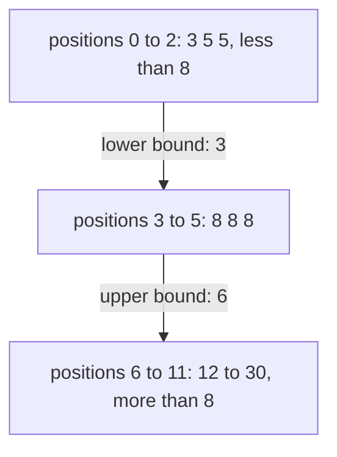
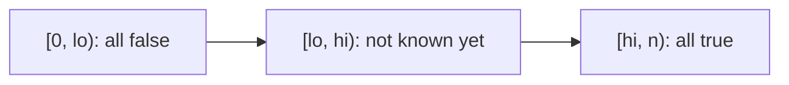

# Lower and upper bounds

## The idea

The [search of the previous guide](../searching-a-sorted-array/guide.md) asks "where is `x`?". It has no good answer when `x` appears three times, or not at all. A better question has exactly one answer every time:

> Where is the **first** position whose value is at least `x`?

Ask it of every position of a sorted array and the answers line up: no, no, no, then yes, yes, yes to the end. Once a value is at least `x`, every value after it is too, because the array is sorted. So the yes/no question, the **predicate**, is **monotone**: it switches from false to true once and never back. Its boundary, the first true position, is the **lower bound** of `x`. Ask "is the value greater than `x`?" instead and the boundary is the **upper bound** of `x`.

For the parcel weights `3 5 5 8 8 8 12 15 19 19 24 30` and `x = 8`:



<!-- text-of-mermaid sha256:53b1810669744a51a8171e6c6a3d7b9c264d7a9fe2f796a689235452d3d78a0d -->
```text
┌────────────────────────────────────────┐
│  positions 0 to 2: 3 5 5, less than 8  │
└─────────────lower─bound:─3─────────────┘
                     ▼
┌────────────────────────────────────────┐
│        positions 3 to 5: 8 8 8         │
└─────────────upper─bound:─6─────────────┘
                     ▼
┌────────────────────────────────────────┐
│positions 6 to 11: 12 to 30, more than 8│
└────────────────────────────────────────┘
```

The two bounds bracket the block of 8s: it is the half-open interval `[3, 6)`, and it holds `6 - 3 = 3` copies. For an absent value such as 10, the block is empty and both bounds are the same position, 6: exactly where 10 would be inserted.

Nearly every question about a sorted array is one of these two searches, plus at most one subtraction:

| Question | Answer, with `lower = lower_bound(x)` and `upper = upper_bound(x)` |
|----------|------------------------------------------|
| The first position with a value `>= x` | `lower` |
| The first position with a value `> x` | `upper` |
| The last position with a value `< x` | `lower - 1`, if `lower > 0` |
| The last position with a value `<= x` | `upper - 1`, if `upper > 0` |
| How many values equal `x` | `upper - lower` |
| How many values lie between `a` and `b`, both included | `upper_bound(b) - lower_bound(a)` |
| Is `x` present? | `lower < n` and the value at `lower` equals `x` |
| Where to insert `x` and keep the order | `lower`, before the equal values, or `upper`, after them |

## One loop for every boundary

Both bounds are the same loop with a different predicate. It searches positions `[lo, hi)` for the first one where `is_true` holds:

```text
first_true(lo, hi, is_true):
    while lo < hi:
        mid = lo + (hi - lo) / 2
        if is_true(mid): hi = mid        # mid may be the first true position: keep it
        else:            lo = mid + 1    # mid is false: the first true one is after it
    return lo                            # hi itself when nothing is true
```

Its invariant has three parts:



<!-- text-of-mermaid sha256:022d484019b7e768449a7a38a667351bc2d2d33f6ee44e232c052093413c4245 -->
```text
┌──────────────────┐    ┌───────────────────────┐    ┌─────────────────┐
│[0, lo): all false├───►│[lo, hi): not known yet├───►│[hi, n): all true│
└──────────────────┘    └───────────────────────┘    └─────────────────┘
```

- Before `lo`, every position is false. It holds at the start, when there is nothing before `lo`, and `lo = mid + 1` only skips past a position just seen to be false, and with it every position before it, which monotonicity makes false too.
- From `hi` on, every position is true. It holds at the start, when there is nothing from `hi = n` on, and `hi = mid` only moves `hi` to a position just seen to be true.
- Each step shrinks `[lo, hi)`: `mid` is at least `lo` and below `hi`, so both moves remove at least one position. The loop ends.

When it ends, `lo == hi`: every position before it is false and every position from it on is true, so it is the first true position. If no position is true, `hi` never moved, and the answer is `n`, "after the end". There is no separate "found" branch, and no `-1`: the answer is always a position from 0 to `n`, and the caller decides what it means.

## A worked example

The lower bound of 8 in the weights, step by step. The predicate is `weights[i] >= 8`:

| Step | Interval | `mid` | Value | `>= 8`? | Move |
|------|----------|-------|-------|---------|------|
| 1 | `[0, 12)` | 6 | 12 | yes | `hi = 6` |
| 2 | `[0, 6)` | 3 | 8 | yes | `hi = 3` |
| 3 | `[0, 3)` | 1 | 5 | no | `lo = 2` |
| 4 | `[2, 3)` | 2 | 5 | no | `lo = 3` |
| | `[3, 3)` | | | | Empty: the lower bound is 3 |

Step 2 found an 8 and kept going: a plain search would have stopped there, at whichever 8 the midpoint happened to hit. The bound search keeps narrowing until it has proved that position 3 is true and position 2 is false.

The upper bound of 8 uses `weights[i] > 8`:

| Step | Interval | `mid` | Value | `> 8`? | Move |
|------|----------|-------|-------|--------|------|
| 1 | `[0, 12)` | 6 | 12 | yes | `hi = 6` |
| 2 | `[0, 6)` | 3 | 8 | no | `lo = 4` |
| 3 | `[4, 6)` | 5 | 8 | no | `lo = 6` |
| | `[6, 6)` | | | | Empty: the upper bound is 6 |

The program below writes `first_true` and both bounds, answers the questions of the table, and checks itself against Python's `bisect`:

```python examples/bounds.py
"""Lower and upper bounds: the first position where a yes/no question about a sorted array turns true."""

from bisect import bisect_left, bisect_right
from collections.abc import Callable


def first_true(lo: int, hi: int, is_true: Callable[[int], bool]) -> int:
    """The smallest i in [lo, hi) with is_true(i), or hi when there is none.

    Assumes is_true is false, ..., false, then true, ..., true on [lo, hi).
    Invariant: is_true is false everywhere before lo, and true from hi on.
    """
    while lo < hi:
        mid = lo + (hi - lo) // 2
        if is_true(mid):
            hi = mid  # mid may be the first true position: keep it as the end
        else:
            lo = mid + 1  # mid is false, so the first true position is after it
    return lo


def lower_bound(items: list[int], x: int) -> int:
    """The first position whose value is >= x."""
    return first_true(0, len(items), lambda i: items[i] >= x)


def upper_bound(items: list[int], x: int) -> int:
    """The first position whose value is > x."""
    return first_true(0, len(items), lambda i: items[i] > x)


weights = [3, 5, 5, 8, 8, 8, 12, 15, 19, 19, 24, 30]
print("weights:  ", weights)
print("w >= 8:   ", " ".join("T" if w >= 8 else "F" for w in weights))
print("w >  8:   ", " ".join("T" if w > 8 else "F" for w in weights))
print("lower_bound(8) =", lower_bound(weights, 8), "| upper_bound(8) =", upper_bound(weights, 8))
print("how many weigh 8:", upper_bound(weights, 8) - lower_bound(weights, 8))
print("10 is absent, both bounds agree:", lower_bound(weights, 10), upper_bound(weights, 10))

# Range counts: the parcels weighing from 5 to 19, both included.
start, stop = lower_bound(weights, 5), upper_bound(weights, 19)
print(f"weights in 5..19: {stop - start}, {weights[start:stop]}")

# The neighbours of an absent value: the lightest of at least 10, the heaviest below 10.
i = lower_bound(weights, 10)
print("lightest >= 10:", weights[i] if i < len(weights) else None, "| heaviest < 10:", weights[i - 1] if i > 0 else None)

# The edges: a bound can be 0 or len(weights), so check before reading weights[i].
print("lower_bound(1) =", lower_bound(weights, 1), "| lower_bound(99) =", lower_bound(weights, 99))

# bisect computes the same bounds, for every value, present or not.
agrees = all(
    lower_bound(weights, x) == bisect_left(weights, x) and upper_bound(weights, x) == bisect_right(weights, x)
    for x in range(35)
)
print("bisect_left and bisect_right agree for 0..34:", agrees)

# key= (Python 3.10+) searches records by a field. The key is not applied to the value searched for.
parcels = [("anvil", 30), ("book", 5), ("clock", 8), ("drum", 12)]
parcels.sort(key=lambda parcel: parcel[1])
first_heavy = bisect_left(parcels, 10, key=lambda parcel: parcel[1])
print("first parcel of at least 10:", parcels[first_heavy])
```

It prints:

```output examples/bounds.py
weights:   [3, 5, 5, 8, 8, 8, 12, 15, 19, 19, 24, 30]
w >= 8:    F F F T T T T T T T T T
w >  8:    F F F F F F T T T T T T
lower_bound(8) = 3 | upper_bound(8) = 6
how many weigh 8: 3
10 is absent, both bounds agree: 6 6
weights in 5..19: 9, [5, 5, 8, 8, 8, 12, 15, 19, 19]
lightest >= 10: 12 | heaviest < 10: 8
lower_bound(1) = 0 | lower_bound(99) = 12
bisect_left and bisect_right agree for 0..34: True
first parcel of at least 10: ('drum', 12)
```

The two rows of T and F are the two predicates; each bound is where its row turns to T. Counting the weights from 5 to 19 takes two searches and a subtraction, however many values are in between. The neighbours of the absent 10 sit on both sides of its lower bound. A bound of 0 or `len(weights)` has no element on one side, which is why the code checks before reading. The last line searches records with `key=`: the key reads each record's weight, and the value searched for, 10, is already a weight.

## The standard libraries

| Language | Lower bound | Upper bound | What a plain search returns |
|----------|-------------|-------------|-----------------------------|
| Python | `bisect.bisect_left(a, x)` | `bisect.bisect_right(a, x)`, also named `bisect` | No plain search: check `a[i] == x` after `bisect_left` |
| Java | Not built in for arrays and lists: write it | Not built in | `Arrays.binarySearch` and `Collections.binarySearch`: the index of *a* match, or `-(insertion point) - 1` |
| Go | `sort.Search(n, func(i int) bool { return a[i] >= x })`; `slices.BinarySearch(a, x)` returns it with a found flag (Go 1.21) | `sort.Search` with `a[i] > x` | `slices.BinarySearch`: the earliest position of `x`, or where it would go, and whether it was found |
| Rust | `partition_point` with the predicate `*v < x` (Rust 1.52) | `partition_point` with `*v <= x` | `binary_search`: `Ok` with the index of any match, or `Err` with where it could be inserted |
| JavaScript, TypeScript | Not built in: write it | Not built in | None: `findIndex` tests one element after another |

The details that differ:

- **Python.** `bisect_left` returns the position `ip` such that every element of `a[lo:ip]` is `< x` and every element of `a[ip:hi]` is `>= x`; `bisect_right` the same with `<=` and `>`. Both take `lo` and `hi` to search part of a list. Since Python 3.10 they take `key=`, which is applied to the elements but, to allow searching records, not to `x`.
- **Java.** The insertion point is "the index of the first element greater than the key", or the length when every element is smaller. For an absent key that is both of its bounds; for a key that appears several times, the documentation promises only that some match is returned: "there is no guarantee which one will be found". A negative result means absent; `-result - 1` recovers the insertion point. Note that `-1` means "would go at position 0", not a special "not found" code. For sorted data that changes, `TreeMap.ceilingKey` returns the least key at least as large, and `floorKey` the greatest key at most as large.
- **Go.** `sort.Search(n, f)` returns the smallest `i` in `[0, n)` where `f(i)` is true, assuming `f` is false and then true, and `n` when it is never true; it calls `f` only inside `[0, n)`. It is `first_true` exactly. `slices.BinarySearch` returns the *earliest* position, so among duplicates it is the lower bound.
- **Rust.** `partition_point` has the opposite polarity: the predicate must be **true first, then false**, and it returns the first position where it is false. So the lower bound is `partition_point(|v| *v < x)`, not `>=`. `binary_search` among duplicates returns "any one of the matches", chosen deterministically but "subject to change in future versions of Rust".
- **JavaScript and TypeScript.** Arrays have no binary search, and TypeScript adds types, not a runtime library: write `first_true` and keep it with its tests.

Java shows its encoding:

```java examples/ArraysSearch.java
import java.util.Arrays;

// Arrays.binarySearch returns the index of *a* match, or encodes where an absent key would go
// as -(insertion point) - 1. Among duplicates, which match it returns is not specified.
public class ArraysSearch {
    public static void main(String[] args) {
        int[] weights = {3, 5, 5, 8, 8, 8, 12, 15, 19, 19, 24, 30};

        int found = Arrays.binarySearch(weights, 8);
        System.out.println("search 8: holds 8? " + (weights[found] == 8)
                + ", inside positions 3..5? " + (found >= 3 && found <= 5));

        for (int key : new int[] {10, 1, 99}) {
            int result = Arrays.binarySearch(weights, key);
            int insertionPoint = -result - 1;
            System.out.println("search " + key + ": " + result + ", so it would go at " + insertionPoint);
        }

        System.out.println("first 8, written by hand: " + lowerBound(weights, 8));
    }

    // The first index whose value is >= key, on the half-open interval [lo, hi).
    static int lowerBound(int[] a, int key) {
        int lo = 0;
        int hi = a.length;
        while (lo < hi) {
            int mid = (lo + hi) >>> 1;
            if (a[mid] >= key) {
                hi = mid;
            } else {
                lo = mid + 1;
            }
        }
        return lo;
    }
}
```

It prints:

```output examples/ArraysSearch.java
search 8: holds 8? true, inside positions 3..5? true
search 10: -7, so it would go at 6
search 1: -1, so it would go at 0
search 99: -13, so it would go at 12
first 8, written by hand: 3
```

The search for 8 found an 8, somewhere in the block from 3 to 5: which one is not specified, so the program checks the block instead of printing the index. The absent keys come back negative and decode to their insertion points: 6 for 10, between 8 and 12; 0 for 1, before everything; 12 for 99, after everything. The search for 1 returned -1, which here means "insert at 0", not "missing". The hand-written lower bound finds the first 8.

## When to use it

- The array may hold **duplicates**, and you need the first one, the last one, or how many.
- The question is about **order**, not equality: the first value at least `x`, the nearest value on either side, how many values fall in a range, where to insert.
- You would write a plain search anyway: a lower bound and one equality check do the same work with one comparison per step, and leave no `found` branch to get wrong.
- The data comes as **records** sorted by a field: search the field, with `key=` in Python, a comparator in Java, `BinarySearchFunc` in Go or `binary_search_by_key` in Rust.
- The data changes often: inserting into a sorted array costs O(n) per insertion, as Python's documentation warns for `insort`. A sorted map such as Java's `TreeMap` answers the same "at least" and "at most" questions with `ceilingKey` and `floorKey`.

## Common traps

- **`>=` against `>`.** The lower and upper bounds differ only in this one character, and only when `x` is present. Test with duplicates, or the bug hides.
- **Reading past the ends.** A bound is a position from 0 to `n`. `n` means "every value is smaller" and has no element; `lower - 1` is -1 when nothing is smaller. Check before indexing.
- **Taking Java's match for the first one.** `Arrays.binarySearch` returns some match. To get the first, write the lower bound.
- **Comparing Java's result with -1.** Every negative result means absent. `-1` only means its insertion point is 0.
- **Rust's polarity.** `partition_point` wants true-then-false; Go's `sort.Search` wants false-then-true. Moving code between them means negating the predicate.
- **`key=` and `x`.** Python's `bisect` applies the key to the elements and not to `x`, so search for the key's value, here a weight, not for a whole record. The list must be sorted by the same key.
- **A predicate that is not monotone.** `a[i] == x` is false, then true, then false again: there is no single boundary to find. Search for `a[i] >= x` and test equality afterwards ([common mistakes](../binary-search-mistakes/guide.md)).

## Complexity

| Operation | Time | Space |
|-----------|------|-------|
| One bound | O(log n) predicate evaluations: at most ⌊log₂ n⌋ + 1 | O(1) |
| Count of `x`, or of a range | Two bounds: O(log n) | O(1) |
| Insert while keeping the order | O(log n) to find the place, O(n) to shift the later elements | O(1) extra |
| `k` queries on data sorted once | O(n log n) to sort, then O(k log n) | Depends on the sort |

The step count has the [same proof](../searching-a-sorted-array/guide.md#complexity) as the plain search: from an interval of `s` positions, a true answer keeps `s // 2` of them and a false one `s - s // 2 - 1`, never more. The bound assumes each predicate evaluation costs O(1); a predicate that costs more, such as comparing strings of length `m`, multiplies it.

## Expert notes

- **Why "first true" is the right primitive.** A plain search has three outcomes per step and a `-1` to decode; a bound search has two outcomes, no early exit, and an answer that is always a valid position from 0 to `n`. Every search of this path is `first_true` with a different predicate: the elements of an array, [the feasibility of an answer](../binary-search-on-the-answer/guide.md), or [a position in a structure that is not sorted at all](../rotated-and-implicit-search/guide.md).
- **The block of equal values.** `[lower, upper)` is the half-open interval of every copy of `x`; its size is the count, and it is empty exactly when `x` is absent, with both ends at the insertion point.
- **Descending order.** Go's documentation spells it out: searching data sorted in descending order uses `<=` instead of `>=`. In general, for any order, the predicate is "comes at or after `x` in this order".
- **Which side to insert on.** Inserting at the upper bound puts a new value after the values equal to it, so equal values stay in the order they arrived, which matters when they are records that only share a key.
- **Two searches or one.** For an equal range, the upper bound can start from the lower bound's position, `first_true(lower, n, ...)`, instead of from 0. Both searches are logarithmic either way; the narrower start only pays off when the predicate is expensive.

## Practice

- `cstudy start search-insert-position`: where a value sits in a sorted array of distinct values, or where it would have to go.
- `cstudy start first-last-position`: the first and the last position of a value in a sorted array with duplicates, in a logarithmic number of steps.
- `cstudy start time-based-kv-store`: a store that keeps every value a key has had, each with its time, and reads a key as it was at a given time.
- `cstudy start snapshot-array`: an array that takes snapshots and can read any position as it was in any snapshot.

## Further reading

- [Python `bisect`](https://docs.python.org/3/library/bisect.html): `bisect_left`, `bisect_right` and the partition each returns; `key` since 3.10, not applied to `x`; `insort` is O(n) because of the insertion.
- [Java `Arrays.binarySearch`](https://docs.oracle.com/en/java/javase/21/docs/api/java.base/java/util/Arrays.html) and [`Collections.binarySearch`](https://docs.oracle.com/en/java/javase/21/docs/api/java.base/java/util/Collections.html): `-(insertion point) - 1`, and no guarantee which duplicate is found.
- [Java `TreeMap`](https://docs.oracle.com/en/java/javase/21/docs/api/java.base/java/util/TreeMap.html): `ceilingKey` and `floorKey`.
- [Go `sort.Search`](https://pkg.go.dev/sort#Search): the smallest index where `f` is true, `n` if none; [Go `slices.BinarySearch`](https://pkg.go.dev/slices#BinarySearch): the earliest position and a found flag; [Go 1.21 release notes](https://go.dev/doc/go1.21): the `slices` package.
- [Rust slice `binary_search` and `partition_point`](https://doc.rust-lang.org/std/primitive.slice.html#method.partition_point): any match, `Err` with the insertion index, and a predicate that is true first; `partition_point` since 1.52.
- [MDN `Array`](https://developer.mozilla.org/en-US/docs/Web/JavaScript/Reference/Global_Objects/Array): the array methods, none of them a binary search; [MDN `findIndex`](https://developer.mozilla.org/en-US/docs/Web/JavaScript/Reference/Global_Objects/Array/findIndex): one element after another, in ascending-index order; [TypeScript for the new programmer](https://www.typescriptlang.org/docs/handbook/typescript-from-scratch.html): TypeScript provides no additional runtime libraries.
