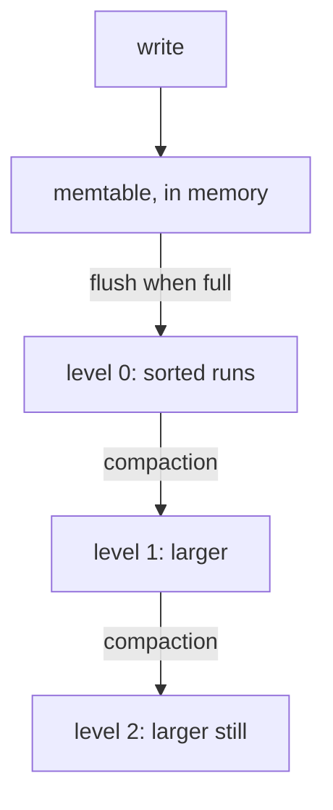

# Log-structured storage: LSM trees and compaction

## The idea

A B-tree changes its pages **in place**: to insert a key, it reads the leaf where the key belongs, changes it, and writes it back where it was. When the index is much larger than memory and keys arrive in no order, nearly every insert lands on a leaf that is not in the buffer pool, so every insert costs a random read and, sooner or later, a random write. Patrick O'Neil and his co-authors, in the 1996 paper that introduced the **log-structured merge tree** (LSM tree), estimated this for an index on a fast-growing history table: a B-tree would effectively double the I/O cost of each transaction, raising the total system cost by up to fifty percent.

The LSM tree changes data **out of place**. Chen Luo and Michael Carey, in their 2019 survey of LSM techniques, put the contrast this way: an in-place structure overwrites old records with new ones, while an out-of-place structure always stores an update in a new location. Writing out of place turns random writes into sequential ones, and leaves old data untouched, which simplifies recovery. The price is on the read side: the newest value of a key may be in any of several places, and the structure needs a background process that reorganizes its data continually.

O'Neil and others describe the tree as **components** of increasing size, C0, C1, ..., CK. C0 lives in memory; the others are on disk. An insert first writes a log record, as the next guide describes, then goes into C0, which costs no I/O at all. When C0 reaches a size threshold, a **rolling merge** moves a run of its entries out to C1, merging them with C1's entries the way merge sort merges two sorted lists, and writes the result sequentially in large blocks. Each pair of neighbouring components has its own merge, so an entry migrates outward from C0 to CK over its life. The paper summarizes the idea: the LSM tree "defers and batches index changes, cascading the changes from a memory-based component through one or more disk components in an efficient manner reminiscent of merge sort".

The survey describes how most LSM trees are built today, with different names for the same parts:

- the in-memory component, often called the **memtable**, is a sorted structure such as a skip list or a B+ tree;
- when it is full it is written to disk as one sorted, **immutable** component, a **run**, often stored as an **SSTable** (sorted string table): data blocks of key-value pairs ordered by key, plus an index block holding each data block's key range;
- runs are never changed; instead, several runs are merged into a new one and the old ones are deleted, a process called **compaction**;
- a delete writes an entry that says "this key is deleted", called here a **tombstone**: the survey calls it an anti-matter entry, and O'Neil's paper a delete node entry, which migrates outward and annihilates the entry it deletes when the two meet in a merge. An update is just a newer entry for the same key.



<!-- text-of-mermaid sha256:74d8fb8723a221ea637a90a07dd06e6977ab3c4b64908f8d8a017d2dbb9b56b5 -->
```text
┌─────────────────────┐
│        write        │
└──────────┬──────────┘
           ▼
┌─────────────────────┐
│ memtable, in memory │
└───flush─when─full───┘
           ▼
┌─────────────────────┐
│ level 0: sorted runs│
└─────compaction──────┘
           ▼
┌─────────────────────┐
│   level 1: larger   │
└─────compaction──────┘
           ▼
┌─────────────────────┐
│level 2: larger still│
└─────────────────────┘
```

Data only moves one way in the drawing: from memory to the smallest level, then outward to ever larger levels. No step rewrites a run in place; each compaction reads runs and writes a new one.

A **read** has to find the newest entry for its key, which the survey calls reconciliation. A point lookup searches the memtable, then the runs from newest to oldest, and stops at the first entry for the key; if that entry is a tombstone, the key does not exist. A range query reads all the runs at once and merges their entries through a priority queue, keeping the newest entry of each key.

How runs are merged is the **merge policy**, and the survey names the two in common use. Both group runs into levels whose sizes grow by a **size ratio** T:

- **Leveling** keeps one run per level, each level T times larger than the one before. A run arriving from above is merged into the level's run at once, so a level's run is rewritten many times, up to T − 1, before it is full and moves down. Few runs means cheap reads.
- **Tiering** keeps up to T runs per level. When a level has T runs, they are merged together into one run on the next level. Each entry is rewritten once per level, so writes are cheaper, but a read may have to search T runs on every level.

Searching run after run for a key that is not there is wasteful, so most LSM trees keep a **Bloom filter** beside each run. A Bloom filter is a bit array with k hash functions. Adding a key sets the k bits its hashes point to; testing a key checks those k bits, and if any is 0 the key is certainly absent. If all are 1, the key is probably present: a Bloom filter can report false positives but never false negatives. A lookup tests each run's filter, kept in memory, and reads only the runs whose filter says "maybe".

## A worked example

### A tiny LSM tree

This program keeps a memtable of three keys, flushes it as an immutable sorted run, deletes with a tombstone, and compacts all the runs into one:

```python examples/tiny_lsm.py
"""A tiny log-structured merge tree: a memtable, immutable sorted runs, tombstones and compaction.

Writes go to a dictionary in memory, the memtable. When it holds 3 keys it is written out as a
sorted run and emptied; runs are never changed afterwards. A delete writes a tombstone (None).
A read looks in the memtable, then in the runs from newest to oldest, and stops at the first
entry for its key. Compaction merges every run into one, keeping only the newest entry of each
key and dropping tombstones, which is safe here because the merge includes the oldest run.
"""

from bisect import bisect_left

MEMTABLE_LIMIT = 3


class TinyLSM:
    def __init__(self) -> None:
        self.memtable: dict[str, str | None] = {}
        self.runs: list[list[tuple[str, str | None]]] = []  # oldest first
        self.entries_written = 0

    def put(self, key: str, value: str | None) -> None:
        self.memtable[key] = value
        if len(self.memtable) == MEMTABLE_LIMIT:
            run = sorted(self.memtable.items())
            self.runs.append(run)
            self.entries_written += len(run)
            self.memtable = {}

    def delete(self, key: str) -> None:
        self.put(key, None)

    def get(self, key: str) -> tuple[str | None, int]:
        """The value, or None, and how many runs were searched."""
        if key in self.memtable:
            return self.memtable[key], 0
        for searched, run in enumerate(reversed(self.runs), start=1):
            i = bisect_left(run, (key,))
            if i < len(run) and run[i][0] == key:
                return run[i][1], searched
        return None, len(self.runs)

    def compact(self) -> None:
        newest: dict[str, str | None] = {}
        for run in self.runs:  # oldest first, so newer entries overwrite older ones
            newest.update(run)
        merged = sorted((k, v) for k, v in newest.items() if v is not None)
        self.runs = [merged]
        self.entries_written += len(merged)


def show(lsm: TinyLSM, label: str) -> None:
    runs = " | ".join(" ".join(f"{k}={v or '-'}" for k, v in run) for run in lsm.runs)
    print(f"{label:<17} memtable {sorted(lsm.memtable)}  runs: {runs}")


lsm = TinyLSM()
for key, value in [("lime", "3"), ("fig", "7"), ("pear", "2"), ("fig", "8"), ("kiwi", "5")]:
    lsm.put(key, value)
lsm.delete("lime")
show(lsm, "after 6 writes")
for key, value in [("pear", "4"), ("plum", "1"), ("fig", "9")]:
    lsm.put(key, value)
show(lsm, "after 9 writes")
for key in ["fig", "lime", "kiwi", "date"]:
    value, searched = lsm.get(key)
    print(f"get {key:<4} -> {value!s:<4} after searching {searched} run(s)")
print(f"entries written to runs so far: {lsm.entries_written} for 9 writes")
lsm.compact()
show(lsm, "after compaction")
for key in ["fig", "lime", "kiwi", "date"]:
    value, searched = lsm.get(key)
    print(f"get {key:<4} -> {value!s:<4} after searching {searched} run(s)")
print(f"entries written to runs in all: {lsm.entries_written} for 9 writes")
```

It prints:

```output examples/tiny_lsm.py
after 6 writes    memtable []  runs: fig=7 lime=3 pear=2 | fig=8 kiwi=5 lime=-
after 9 writes    memtable []  runs: fig=7 lime=3 pear=2 | fig=8 kiwi=5 lime=- | fig=9 pear=4 plum=1
get fig  -> 9    after searching 1 run(s)
get lime -> None after searching 2 run(s)
get kiwi -> 5    after searching 2 run(s)
get date -> None after searching 3 run(s)
entries written to runs so far: 9 for 9 writes
after compaction  memtable []  runs: fig=9 kiwi=5 pear=4 plum=1
get fig  -> 9    after searching 1 run(s)
get lime -> None after searching 1 run(s)
get kiwi -> 5    after searching 1 run(s)
get date -> None after searching 1 run(s)
entries written to runs in all: 13 for 9 writes
```

- **Flushes.** The memtable fills twice in the first six writes, and each time it becomes a run. The second `fig` and the tombstone for `lime` sit in the second run, while the first run still holds `fig=7` and `lime=3`: nothing is overwritten.
- **Reads stop at the newest entry.** `fig` is found in the newest run, so its older values are never read. `lime` is found as a tombstone in the second run, so the read stops there and reports the key as deleted, although `lime=3` is still on disk. `date` was never written, and the read has to search all three runs to be sure, which is the case Bloom filters exist for.
- **Compaction.** Merging the three runs keeps one entry per key, the newest, and drops the tombstone, which is safe only because this merge includes the oldest run: no older `lime` is left for the tombstone to hide. Every read now searches one run.
- **The cost.** The nine writes became 9 entries in runs, then 4 more when compaction wrote them again: 13 entries written for 9 writes. That ratio is the **write amplification**.

### Leveling against tiering

The second program feeds 4,096 distinct keys through both merge policies, with a memtable of 16 entries and a size ratio of 4, and counts what each writes:

```python examples/merge_policies.py
"""Leveling against tiering: how many entries each merge policy writes, and how many runs a lookup
may have to search.

4,096 distinct keys arrive; every 16 of them fill the memtable, which is flushed as a run. The size
ratio is T = 4. Leveling keeps one run per level, level i holding up to 16 * 4**(i + 1) entries:
each flush is merged into level 0, and a level pushed past its limit is merged into the next.
Tiering keeps up to 4 runs per level: a flush adds a run to level 0, and a level with 4 runs merges
them into one new run at the next level. A merge writes every entry of its inputs once.
"""

KEYS, FLUSH, T = 4096, 16, 4


def leveling() -> tuple[int, int]:
    levels: list[int] = []  # entries in the one run of each level, 0 when empty
    written = most_runs = 0
    for _ in range(KEYS // FLUSH):
        carry, i = FLUSH, 0
        while carry:
            if i == len(levels):
                levels.append(0)
            levels[i] += carry
            written += levels[i]
            carry = 0
            if levels[i] > FLUSH * T ** (i + 1):
                carry, levels[i] = levels[i], 0
                i += 1
        most_runs = max(most_runs, sum(1 for size in levels if size))
    return written, most_runs


def tiering() -> tuple[int, int]:
    levels: list[list[int]] = []  # the sizes of the runs at each level
    written = most_runs = 0
    for _ in range(KEYS // FLUSH):
        run, i = FLUSH, 0
        while run:
            if i == len(levels):
                levels.append([])
            levels[i].append(run)
            written += run
            run = 0
            if len(levels[i]) == T:
                run, levels[i] = sum(levels[i]), []
                i += 1
        most_runs = max(most_runs, sum(len(level) for level in levels))
    return written, most_runs


for name, policy in [("leveling", leveling), ("tiering", tiering)]:
    written, most_runs = policy()
    print(
        f"{name:<9} {written:>6,} entries written for {KEYS:,} keys:"
        f" {written / KEYS:.1f} writes per key, at most {most_runs} runs to search"
    )
```

It prints:

```output examples/merge_policies.py
leveling  39,616 entries written for 4,096 keys: 9.7 writes per key, at most 4 runs to search
tiering   20,480 entries written for 4,096 keys: 5.0 writes per key, at most 12 runs to search
```

Tiering writes each key five times, once on each level it passes through; leveling writes it 9.7 times on average, because a level's run is merged again with every run that arrives from above. In exchange, a lookup under leveling has at most four runs to search, one per level, and under tiering up to twelve. The four levels are what the survey's formula predicts: with N entries, a memory component of B · P entries and a size ratio T, the number of levels is about ⌈log_T((N / (B · P)) · T / (T + 1))⌉, here ⌈log_4(256 · 4 / 5)⌉ = ⌈3.84⌉ = 4.

### How good is a Bloom filter?

The survey gives the false positive rate of a Bloom filter with m bits, n keys and k hash functions as (1 − e^(−kn/m))^k, minimized when k = (m / n) · ln 2. With 10 bits per key, the best k is 10 · ln 2 ≈ 6.9; with k = 7 the rate is (1 − e^(−0.7))⁷ ≈ 0.0082, under 1%. The survey notes that most systems use 10 bits per key by default, for about 1% false positives. So a lookup for an absent key reads a run from disk about once in a hundred runs searched, for 10 bits of memory per key.

## When to use it

- **Many more writes than reads.** O'Neil and others built the LSM tree for indexes where inserts are more common than "finds that retrieve the entries": history tables and logs, for example. The batching pays off most when writes arrive fast and in no key order.
- **Reads of recent data.** Recent entries are in the memtable or the small runs, so reads that mostly concern new data rarely touch the large levels.
- **A B-tree instead** for read-mostly data with frequent point lookups and short range scans: a B-tree answers from one place, with no reconciliation and no background merging.
- **Leveling** when reads and disk space matter most; **tiering** when the write rate is the limit. The survey's analysis below gives the trade in numbers.

## Common traps

- **Dropping a tombstone too early.** A tombstone hides every older entry of its key. Dropped in a merge that does not include the oldest runs, it lets an old value come back to life. The example drops tombstones only in a merge that includes every run.
- **Reading runs oldest first, or stopping at the first run that has the key in any form.** The newest entry wins, a tombstone included; an older value found first is stale.
- **Expecting Bloom filters to speed up range scans.** A Bloom filter answers "is this key here?", not "is any key between a and b here?". A short range scan still reads every run, one per level under leveling and up to T per level under tiering, as the survey's cost analysis says.
- **Ignoring write amplification.** "Writes are sequential" does not mean "writes are cheap": under leveling each entry is written about ten times in the example. The survey adds that high write amplification also shortens the lifespan of solid-state drives.
- **Undersizing the memory component.** O'Neil and others show that, for a fixed insert rate and largest component, the I/O rate of the merges grows as the memory component shrinks.
- **Forgetting the space of dead entries.** Until compaction removes them, old versions and tombstones take disk space. The survey defines **space amplification** as the total number of entries divided by the number of unique keys; under tiering it can reach T.

## Complexity

The survey summarizes the worst-case cost of an LSM tree in disk I/Os, with T the size ratio, L the number of levels, B the number of entries per page, N the number of keys, M the total bits of the Bloom filters and s the number of keys a range query returns:

| Cost | Leveling | Tiering |
|------|----------|---------|
| Write, per entry, amortized | O(T · L / B) | O(L / B) |
| Point lookup, no Bloom filters | O(L) | O(T · L) |
| Lookup of an absent key, with Bloom filters | O(L · e^(−M/N)) | O(T · L · e^(−M/N)) |
| Lookup of an existing unique key | O(1) | O(1) |
| Short range query | O(L) | O(T · L) |
| Long range query | O(s / B) | O(T · s / B) |
| Space amplification, worst case | O((T + 1) / T) | O(T) |

The number of levels grows only logarithmically with the data, L ≈ log_T(N / (B · P)), for a memory component of B · P entries. For a B-tree of the same data the comparable numbers are one random write per update in place, O(log_B N) page reads per lookup, and no amplification of space beyond the half-empty pages.

## Expert notes

- **Older roots.** The survey traces out-of-place updates to the 1970s: **differential files** (1976) applied all updates to a separate file merged periodically into the main one. In the 1980s the Postgres research project appended all writes to a sequential log, which allowed fast recovery and queries about the past, with a background "vacuum cleaner" removing obsolete records. Those designs had no principled model of the cost of reorganizing; the LSM tree's analysis supplied one.
- **Geometric sizes.** O'Neil and others prove that, for a fixed largest component, memory component and insert rate, the total I/O rate of all the merges is smallest when every component is the same factor r larger than the one before (their Theorem 3.1). The size ratio T of today's level layouts is that factor.
- **Rolling merges against immutable runs.** The original paper merges continuously: each step merges one page-sized leaf of the larger component, read and written in multi-page blocks, while today's implementations, the survey notes, usually exploit the immutability of disk components instead: merges write new components and never modify existing ones, which simplifies concurrency control and recovery.
- **Partitioning.** A commonly adopted optimization, the survey says, splits each level into many small SSTables with disjoint key ranges. Compaction then merges one SSTable with only the SSTables of the next level whose ranges overlap it, which bounds the time and temporary space of each merge.
- **Recovery comes from the log.** Entries in C0 are lost in a crash. O'Neil and others recover them from the log records written before each insert, which they treat as logical log records: replaying them rebuilds C0.

## Practice

No problem in the catalog builds an LSM tree yet. The ideas reappear elsewhere in this course: the guide on [table formats](../table-formats-and-snapshots/guide.md) keeps a table as immutable files, merges small files by compaction and keeps old versions until no snapshot needs them, and the next guide, on write-ahead logging, explains the log that protects the memtable.

## Further reading

- [P. O'Neil, E. Cheng, D. Gawlick and E. O'Neil, *The Log-Structured Merge-Tree (LSM-Tree)*, Acta Informatica 33(4), 1996, pages 351 to 385](https://www.cs.umb.edu/~poneil/lsmtree.pdf): the motivation, the two-component and multi-component trees, rolling merges, deletes and Theorem 3.1.
- [C. Luo and M. J. Carey, *LSM-based Storage Techniques: A Survey*, The VLDB Journal 29(1), 2020 (online 2019), pages 393 to 418](https://arxiv.org/abs/1812.07527): in-place and out-of-place updates, today's structure, leveling and tiering, Bloom filters, partitioning and the cost analysis.
