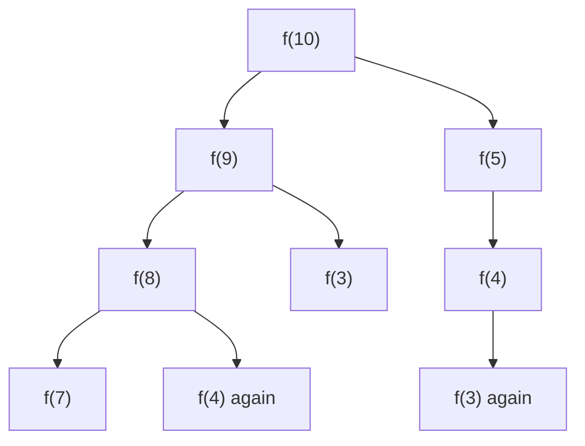
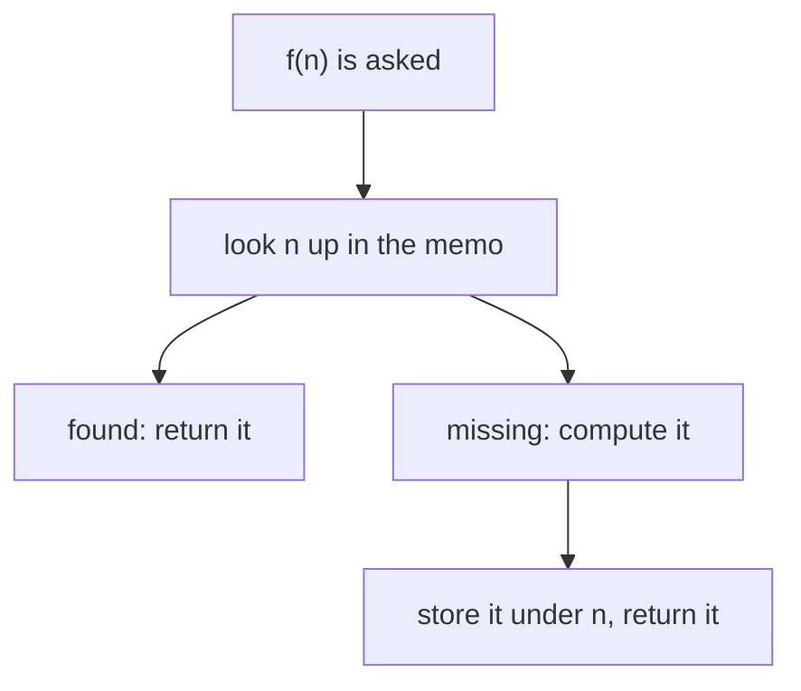

# From recursion to memoization

## The idea

Some recursions are correct and hopelessly slow, because they ask the same smaller question over and over. Take this puzzle: bring a number `n` down to 1 in as few operations as possible, where one operation either subtracts 1, halves an even number, or divides a multiple of 3 by 3. The recursion writes itself. Let `f(n)` be the fewest operations from `n`. Then `f(1) = 0`, and for a larger `n`, try every operation and keep the best:

```text
f(n) = 1 + the smallest of f(n - 1), f(n / 2) when n is even, f(n / 3) when 3 divides n
```

From 10, the first operation leads to 9 or to 5. From 9, to 8 or 3; from 5, only to 4. From 8, to 7 or 4, and 4 has been reached before; from 4, to 3 or 2, and 3 has been reached before too:



<!-- text-of-mermaid sha256:82b3b474b0484a9723db7b996556e748b8b5b113cc77fe49ec0a2ded5df21345 -->
```text
┌─────┐
│f(10)│
└─────┘
   ▼─────────────▼
┌─────┐    ┌──────────┐
│ f(9)│    │   f(5)   ├──────────┐
└─────┘    └──────────┘          │
   ▼─────────────▼               ▼
┌─────┐    ┌──────────┐    ┌──────────┐
│ f(8)│    │   f(3)   │    │   f(4)   │
└─────┘    └──────────┘    └─────┬────┘
   ▼─────────────▼               ▼
┌─────┐    ┌──────────┐    ┌──────────┐
│ f(7)│    │f(4) again│    │f(3) again│
└─────┘    └──────────┘    └──────────┘
```

Each repeat is not one wasted call but a whole subtree of them, recomputed from scratch. Starting from 10, the recursion makes 47 calls to answer 10 distinct questions: it asks `f(3)` 5 times, `f(2)` 9 times and `f(1)` 23 times. Questions that recur inside one recursion are called **overlapping subproblems**.

The cure is to answer each question once. Keep a table, the **memo**, from question to answer. Before computing an answer, look it up; after computing it, store it. The second time a question comes up, it costs one lookup.



<!-- text-of-mermaid sha256:402b2a705d2fdfb7206fd1614876b97f02ef3a0b17c9ae48c95d2a0466ed349c -->
```text
┌───────────────────────────┐
│       f(n) is asked       │
└─────────────┬─────────────┘
              ▼
┌───────────────────────────┐
│   look n up in the memo   │
└───────────────────────────┘
              ▼────────────────────────────▼
┌───────────────────────────┐    ┌───────────────────┐
│      found: return it     │    │missing: compute it│
└───────────────────────────┘    └─────────┬─────────┘
                                           │
┌───────────────────────────┐              │
│store it under n, return it│◄─────────────┘
└───────────────────────────┘
```

What you look up by is the **cache key**, and it must name the question exactly: everything the answer depends on, and nothing else. Here the answer depends only on `n`, so `n` is the key. Choosing the key is the real design decision of memoization, and the worked example shows what happens when it is wrong.

A recursion with a memo is **top-down dynamic programming**: it starts from the question you asked and works down to the smaller questions it needs, solving each once. Dynamic programming is the general method of solving a problem through the answers to its subproblems; the [next guide](../one-dimensional-tables/guide.md) fills the same answers bottom-up, smallest first, in a loop.

## A worked example

```python examples/fewest_steps.py
"""Fewest operations that bring n down to 1, where one operation subtracts 1, halves an even number
or divides a multiple of 3 by 3: plain recursion, then the same recursion with a memo."""

from collections import Counter
from functools import cache


def moves(n: int) -> list[int]:
    """The numbers one operation can reach from n."""
    reachable = [n - 1]
    if n % 2 == 0:
        reachable.append(n // 2)
    if n % 3 == 0:
        reachable.append(n // 3)
    return reachable


def plain(n: int, asked: Counter[int]) -> int:
    asked[n] += 1
    if n == 1:
        return 0
    return 1 + min(plain(m, asked) for m in moves(n))


def with_memo(n: int, memo: dict[int, int], asked: Counter[int]) -> int:
    asked[n] += 1
    if n == 1:
        return 0
    if n not in memo:  # first time this question is asked: answer it once and store it
        memo[n] = 1 + min(with_memo(m, memo, asked) for m in moves(n))
    return memo[n]


asked: Counter[int] = Counter()
plain(10, asked)
print("plain recursion from 10 asks:", ", ".join(f"f({n}) {asked[n]}x" for n in sorted(asked)))

for n in (10, 20, 40, 80, 160):
    plain_asked, memo_asked = Counter[int](), Counter[int]()
    answer = plain(n, plain_asked)
    assert with_memo(n, {}, memo_asked) == answer
    print(f"n = {n:3}: {answer} steps", end=" | ")
    print(f"plain: {plain_asked.total():6} calls | memo: {memo_asked.total():3} calls")


@cache
def fewest(n: int) -> int:
    return 0 if n == 1 else 1 + min(fewest(m) for m in moves(n))


print("fewest(10) =", fewest(10), "|", fewest.cache_info())

path = [10]
while path[-1] > 1:  # read the steps back: always move to a number whose answer is one less
    path.append(next(m for m in moves(path[-1]) if fewest(m) == fewest(path[-1]) - 1))
print("best path from 10:", " -> ".join(map(str, path)))
greedy = [10]
while greedy[-1] > 1:  # divide whenever you can: the biggest drop first
    greedy.append(min(moves(greedy[-1])))
print("dividing whenever possible:", " -> ".join(map(str, greedy)))

# A new rule: at most `threes` divisions by 3. The answer now depends on n AND on threes left.
memo_by_n: dict[int, int] = {}


def wrong_key(n: int, threes: int) -> int:
    if n == 1:
        return 0
    if n not in memo_by_n:  # bug: the key forgets how many divisions by 3 are left
        options = [wrong_key(n - 1, threes)]
        if n % 2 == 0:
            options.append(wrong_key(n // 2, threes))
        if n % 3 == 0 and threes > 0:
            options.append(wrong_key(n // 3, threes - 1))
        memo_by_n[n] = 1 + min(options)
    return memo_by_n[n]


@cache
def right_key(n: int, threes: int) -> int:
    if n == 1:
        return 0
    options = [right_key(n - 1, threes)]
    if n % 2 == 0:
        options.append(right_key(n // 2, threes))
    if n % 3 == 0 and threes > 0:
        options.append(right_key(n // 3, threes - 1))
    return 1 + min(options)


print("9 with at most one division by 3:", end=" ")
print("key n ->", wrong_key(9, 1), "| key (n, threes) ->", right_key(9, 1))

fewest.cache_clear()
try:
    fewest(5000)
except RecursionError:
    print("fewest(5000) from an empty cache: RecursionError")
table = [0, 0]  # table[k] = fewest steps from k, filled from small k up; table[0] is unused
for k in range(2, 5001):
    table.append(1 + min(table[m] for m in moves(k)))
print("the same answers filled from 2 up to 5000 with a loop: fewest(5000) =", table[5000])
```

It prints:

```output examples/fewest_steps.py
plain recursion from 10 asks: f(1) 23x, f(2) 9x, f(3) 5x, f(4) 3x, f(5) 2x, f(6) 1x, f(7) 1x, f(8) 1x, f(9) 1x, f(10) 1x
n =  10: 3 steps | plain:     47 calls | memo:  18 calls
n =  20: 4 steps | plain:    247 calls | memo:  36 calls
n =  40: 5 steps | plain:   1942 calls | memo:  73 calls
n =  80: 6 steps | plain:  23371 calls | memo: 146 calls
n = 160: 7 steps | plain: 462956 calls | memo: 293 calls
fewest(10) = 3 | CacheInfo(hits=8, misses=10, maxsize=None, currsize=10)
best path from 10: 10 -> 9 -> 3 -> 1
dividing whenever possible: 10 -> 5 -> 4 -> 2 -> 1
9 with at most one division by 3: key n -> 2 | key (n, threes) -> 3
fewest(5000) from an empty cache: RecursionError
the same answers filled from 2 up to 5000 with a loop: fewest(5000) = 13
```

- **The first line** counts the repeats of the diagram: 47 calls from 10, for 10 distinct questions.
- **The next five lines** double `n` each time. The plain recursion's calls grow far faster than `n`: each doubling multiplies them by about 5, then 8, 12 and 20, up to 462,956 calls from 160. With the memo, each doubling of `n` doubles the calls: 293 from 160. Each number is computed once and asks at most three smaller questions, so the calls are at most about three times the number of distinct questions.
- **`functools.cache`** is the same memo written for you: a decorator that stores each result under the function's arguments. `cache_info()` reports 10 misses, one per distinct question, each computed once, and 8 hits, the repeats answered from the cache.
- **Reading the answer back.** The memo holds more than the count: from 10, step to a number whose answer is exactly one less, and repeat. That gives `10 -> 9 -> 3 -> 1`. Dividing whenever you can, the biggest drop first, gives `10 -> 5 -> 4 -> 2 -> 1`, one step longer: a choice that looks best now can be worse later, which is why the recursion tries every choice.
- **The cache key.** Change the rule: at most `threes` divisions by 3 in total. Now the answer from a number depends on how many divisions by 3 are left, so the question is `(n, threes)`, not `n`. `wrong_key` stores answers under `n` alone. While working out 9 with one division allowed, it first follows the subtractions `9 -> 8 -> 7 -> ... -> 3`, where the division is still unused, and stores that 3 needs one step (`3 -> 1`). Later, trying `9 -> 3`, which uses the division, it asks for 3 again with no division left, gets the stored 1 and answers 2. The real answer is 3 steps (`9 -> 3 -> 2 -> 1`), which the function keyed by `(n, threes)` finds.
- **The depth.** `fewest(5000)` from an empty cache fails with `RecursionError`. The memo removes repeated work, not depth: the first chain of calls subtracts 1 again and again, thousands of frames deep, before any answer is stored. Filling the answers from 2 upwards in a loop needs no recursion at all, and that is the next guide.

## When to use it

- A recursion is **correct but slow**, and counting its calls shows the **same arguments coming back**.
- The number of **distinct questions is small** compared with the number of calls: polynomial in the input, while the calls are exponential.
- The answer depends **only on the arguments**. A function that reads something else that changes, or that has side effects, must not be cached.
- **Use something else** when the subproblems do not overlap: sorting the two halves of a list never asks the same question twice, and a memo there only costs memory. And when you will need every answer from the smallest up anyway, or the recursion is too deep for the stack, fill a [table bottom-up](../one-dimensional-tables/guide.md) instead.

## Common traps

- **A key that leaves something out.** If the answer depends on anything that is not in the key, a stored answer is reused for a different question, as `wrong_key` does. Nothing crashes; the answers are just wrong. Write the key by asking: "what would I need to know to answer this from scratch?"
- **A key that holds too much.** Putting the path taken so far into the key makes every call a different question, and nothing is ever reused. The key should describe what is left to solve, not how you got there.
- **Unhashable arguments.** `functools.cache` stores results in a dictionary, so every argument must be hashable: a list argument raises `TypeError`. Pass a tuple, or an index into data the function does not change.
- **Hidden inputs.** A cached function that reads a global list, or a variable of an enclosing function, keeps the answers it computed for the old data after the data changes. Clear the cache with `cache_clear()`, or define the cached function inside the function that owns the data, so each run gets a fresh cache.
- **A cache that forgets.** `functools.lru_cache()` with no arguments keeps only the 128 most recent results. A memo with more distinct questions than that evicts answers it will need again and recomputes them. Use `functools.cache` or `lru_cache(maxsize=None)`, which never evict.
- **Depth.** Memoization does not make a deep recursion shallow, as `fewest(5000)` shows.

## Complexity

| Version | Calls from `n` | Time | Extra space |
|---------|----------------|------|-------------|
| Plain recursion | 47 from 10, 462,956 from 160 | exponential-like growth in `n` | the depth, up to `n` frames |
| With a memo | at most about `3n` | O(n) on average | O(n) for the memo, plus up to `n` frames |

The rule behind the second row is general: a memoized recursion costs **the number of distinct questions times the work of one question**, where the calls it makes to smaller questions count as lookups. Here there are at most `n` questions, each trying at most 3 operations, so O(n). The time is an average because each lookup is a hash table operation, constant on average; a memo that is a plain array indexed by `n` makes each lookup constant in the worst case too.

## Expert notes

- **`functools.cache` and `lru_cache`.** `cache`, added in Python 3.9, is `lru_cache(maxsize=None)`: an unbounded cache, smaller and faster than one with a size limit because it never evicts. `lru_cache` (Python 3.2) defaults to 128 entries. `typed=True` stores arguments of different types separately, and argument patterns that differ only in keyword order, `f(a=1, b=2)` and `f(b=2, a=1)`, may get separate entries. `cache_info()` returns hits, misses, maxsize and current size.
- **Threads.** The cache's data structure stays coherent under concurrent calls, but the wrapped function may run more than once for the same arguments, if another thread asks before the first call has finished and been stored.
- **The cache keeps things alive.** It holds references to the arguments and the results until they leave the cache or it is cleared, so caching a function of large objects keeps those objects in memory.
- **Java: do not memoize with `computeIfAbsent` recursively.** `HashMap.computeIfAbsent` is documented as a way to store a memoized result, but its mapping function should not modify the map, and a recursive mapping function that stores smaller answers in the same map does exactly that. The method then throws `ConcurrentModificationException` on a best-effort basis: on Java 21, a recursive count written this way threw it. Use `get`, compute, then `put`.
- **Top-down computes only what it reaches.** A memoized recursion answers only the questions the original question leads to, which can be far fewer than every question up to `n` when the steps jump, as division does. A bottom-up table computes all of them, but in a simple loop, with no recursion and no hashing.
- **The words.** Donald Michie wrote about "memo" functions in Nature in 1968, under the title "Memo Functions and Machine Learning". The term "dynamic programming" is Richard Bellman's: his publisher describes him as the scientist who coined it.

## Practice

- `cstudy start climbing-stairs`: count the different sequences of moves that reach the top of a staircase.
- `cstudy start word-break`: decide whether a text written without spaces can be cut into dictionary words.

## Further reading

- [Python `functools.cache` and `functools.lru_cache`](https://docs.python.org/3/library/functools.html#functools.cache): hashable arguments, keyword order, `maxsize`, `typed`, `cache_info()`, `cache_clear()`, threads, and which functions not to cache.
- [Java `HashMap.computeIfAbsent`, Java 21](https://docs.oracle.com/en/java/javase/21/docs/api/java.base/java/util/HashMap.html#computeIfAbsent(K,java.util.function.Function)): the mapping function must not modify the map.
- Donald Michie, ["Memo" Functions and Machine Learning](https://doi.org/10.1038/218019a0), Nature 218, 1968, pages 19 to 22.
- Richard E. Bellman, [Dynamic Programming](https://press.princeton.edu/books/paperback/9780691146683/dynamic-programming), Princeton University Press, reissued in the Princeton Landmarks in Mathematics and Physics in 2010.
