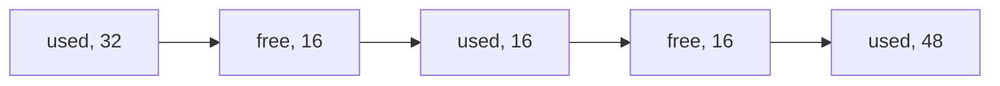
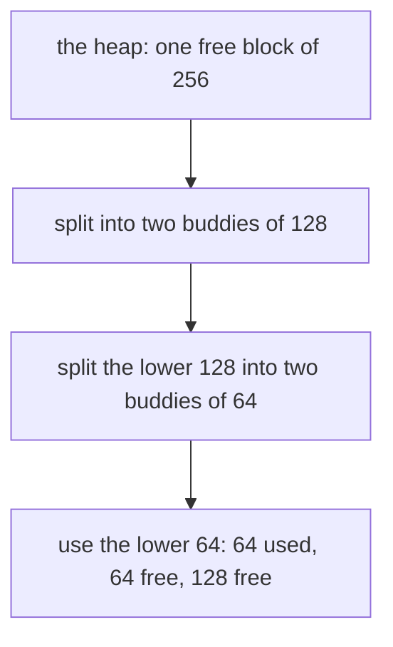

# Memory allocators: free lists, fragmentation and buddies

## The idea

A program often needs memory whose size or lifetime it only learns while running: a string read from a file, a node added to a tree. It asks an **allocator**, the code behind C's `malloc` and `free`, behind every `new` and behind a language runtime's objects. The allocator owns a large region, the **heap**, and its contract is short: `allocate(n)` returns the address of at least `n` bytes that nobody else is using, and `free(address)` gives them back. It must answer quickly, and it must not waste much memory.

The allocator divides the heap into **blocks**, each **used** (handed out and not yet freed) or **free**. To remember sizes, a block usually begins with a small **header** holding its size and whether it is used; the program gets the bytes after it. The free blocks are found through a **free list**, a list that links them together, often through pointers stored inside the free blocks themselves, since nobody else is using those bytes.

Two operations keep the heap usable:

- **Splitting**: a request served from a larger free block takes what it needs, and the rest stays free as a smaller block.
- **Coalescing**: a freed block is merged with free neighbors, so that free memory does not crumble into small pieces.

What makes allocation hard is waste, which the survey by Wilson, Johnstone, Neely and Boles (1995) splits in two:

- **Internal fragmentation** is memory wasted inside a used block: the block is larger than the request, because of the header, alignment, or rounding to a standard size.
- **External fragmentation** is free memory that cannot serve the requests a program actually makes, usually because it is scattered in blocks too small for them.



<!-- text-of-mermaid sha256:6dea01201d817ca040aa08ee0e2fabe9699eea4ed42b45d656790e6bcb149269 -->
```text
┌────────┐    ┌────────┐    ┌────────┐    ┌────────┐    ┌────────┐
│used, 32├───►│free, 16├───►│used, 16├───►│free, 16├───►│used, 48│
└────────┘    └────────┘    └────────┘    └────────┘    └────────┘
```

The drawing shows 32 free bytes that cannot serve a request for 32: they are in two pieces, separated by a used block that cannot move, because the program holds its address. The survey makes the same assumption: a conventional allocator cannot compact memory by moving blocks, as a copying garbage collector does.

## A worked example

Internal fragmentation comes from rounding. An allocator that keeps one free list per block size wants few sizes, so that a freed block of a popular size is easy to reuse; but the coarser the sizes, the more a request is rounded up. The program below rounds ten requests three ways: to a multiple of 16 bytes, to a power of two, and to classes four per doubling (16, 20, 24, 28, then 32, 40, 48, 56, then 64, 80, 96, 112, and so on). It prints the bytes wasted inside the blocks, and how many distinct block sizes each rule needs up to 8192 bytes.

```python examples/size_classes.py
"""Internal fragmentation: the bytes a block holds beyond the request, under three rounding rules.

Ten requests from an imagined program are rounded up three ways: to a multiple of 16 bytes, to a
power of two, and to one of four classes per power of two (16, 20, 24, 28, then 32, 40, 48, 56,
then 64, 80, ...). The program prints the bytes wasted inside the blocks, and how many distinct
block sizes up to 8192 bytes each rule needs, since an allocator keeps a free list per size.
"""

REQUESTS = [24, 40, 100, 130, 200, 600, 1000, 1500, 3000, 5000]
LIMIT = 8192


def multiple_of_16(size: int) -> int:
    return -(-size // 16) * 16


def power_of_two(size: int) -> int:
    block = 16
    while block < size:
        block *= 2
    return block


def quarter_classes(size: int) -> int:
    """Between 2**k and 2**(k + 1), classes are 2**(k - 2) apart: four per doubling."""
    if size <= 16:
        return 16
    low = power_of_two(size) // 2  # the power of two just below the size
    step = low // 4
    return -(-size // step) * step


rules = {
    "multiple of 16": multiple_of_16,
    "power of two": power_of_two,
    "four per doubling": quarter_classes,
}
asked = sum(REQUESTS)
print(f"{asked} bytes asked in {len(REQUESTS)} requests")
for name, rule in rules.items():
    wasted = sum(rule(size) - size for size in REQUESTS)
    classes = len({rule(size) for size in range(1, LIMIT + 1)})
    print(
        f"{name:<18} wasted {wasted:>5} bytes ({100 * wasted / asked:4.1f}%), "
        f"{classes:>3} block sizes up to {LIMIT}"
    )
```

It prints:

```output examples/size_classes.py
11594 bytes asked in 10 requests
multiple of 16     wasted    86 bytes ( 0.7%), 512 block sizes up to 8192
power of two       wasted  5526 bytes (47.7%),  10 block sizes up to 8192
four per doubling  wasted   358 bytes ( 3.1%),  37 block sizes up to 8192
```

Read the trade-off.

1. **A multiple of 16** wastes almost nothing, but needs 512 sizes up to 8192. Few blocks of each size are freed, so a freed block rarely fits the next request, and the free memory scatters: external fragmentation.
2. **A power of two** needs only 10 sizes, but a request just above a power of two wastes almost half its block: 130 bytes take 256, 5000 take 8192. Almost half of all bytes are wasted here.
3. **Four classes per doubling** sits between them: 37 sizes, and no block more than a quarter larger than its request needs. The survey describes an allocator with exactly such closely spaced classes, dividing each power of two into four ranges.

## Choosing a free block

When several free blocks are large enough, the allocator's **placement policy** chooses. The survey's classic three:

- **First fit** takes the first free block that is large enough, searching from the start of the list. With the list kept in address order, it tends to pack used blocks at one end.
- **Next fit** keeps a **roving pointer** where the last search ended and starts the next search there, wrapping around; the survey credits it to Knuth. It spreads searches over the heap, which was meant to shorten them, but the survey reports that in several experiments, with real and synthetic traces, next fit caused more fragmentation.
- **Best fit** takes the smallest free block that is large enough, which leaves the smallest leftover; it needs an index of free blocks by size to be fast.

Coalescing needs to know whether the block just before a freed block is free, and blocks have different sizes, so it cannot be found by arithmetic. **Boundary tags**, which the survey credits to Knuth, store the size and the used flag at both ends of each block: in the header and in a **footer**. Freeing a block reads the footer just before it, to find and check its left neighbor, and the header just after it, for its right neighbor, and merges each one that is free, in constant time. The survey also describes the refinement, attributed to Standish, that only free blocks need a footer.

## Buddies

The **buddy system** restricts sizes so that a block's partner can be found by arithmetic. In a **binary buddy** allocator, every block size is a power of two, and the heap is split in halves, the halves in halves, as far as needed. Each block's other half is its **buddy**. Because blocks of size s sit at multiples of s from the start of the heap, a block's buddy is found by flipping the bit of its offset that corresponds to s; and when both buddies are free, they merge back into the block they came from, which can merge with its own buddy, and so on up.



<!-- text-of-mermaid sha256:d271b2183aca18b5e0d2cd535e678b7c61eb127715c5d7404650ad7566e4b003 -->
```text
┌────────────────────────────────────────────┐
│      the heap: one free block of 256       │
└──────────────────────┬─────────────────────┘
                       ▼
┌────────────────────────────────────────────┐
│       split into two buddies of 128        │
└──────────────────────┬─────────────────────┘
                       ▼
┌────────────────────────────────────────────┐
│ split the lower 128 into two buddies of 64 │
└──────────────────────┬─────────────────────┘
                       ▼
┌────────────────────────────────────────────┐
│use the lower 64: 64 used, 64 free, 128 free│
└────────────────────────────────────────────┘
```

The survey cites Knowlton's 1965 paper as the first on the binary buddy system, and notes its price: since every request is rounded up to a power of two, the expected internal fragmentation is, very roughly, 28%. It also reports that buddy systems generally fragment more than segregated fits and boundary-tag schemes, mostly in studies with synthetic traces. What they buy is speed and simplicity: finding a buddy is one bitwise operation, and merging needs no search and no footer.

## When to use it

- **The general-purpose allocator** of your language is the default, and should stay so until a measurement shows that allocation is the problem.
- **A pool of one size** suits many objects of the same type, allocated and freed often: no size classes, no fragmentation inside the pool, and constant-time operations, as the second example shows.
- **An arena**, or region, suits objects that all die together, such as everything built while handling one request: allocate by moving a pointer forward, and free the whole region at once.
- **Buddies** suit memory handed out in power-of-two units, such as pages. Linux's `/proc/buddyinfo` reports, for each memory zone, how many free chunks the kernel's binary buddy allocator holds of each order, a chunk of order k being 2^k pages; the file exists to diagnose fragmentation.
- **Object caches** suit kernel objects whose initialization costs more than their memory. Bonwick's slab allocator (1994) keeps freed objects in their constructed state, initialized and ready, between uses.

The second example is a pool: its free list lives inside the free slots themselves.

```python examples/object_pool.py
"""A pool of equal-sized slots whose free list is kept inside the free slots themselves.

A free slot holds the number of the next free slot, and `head` names the first one, so taking a
slot and giving one back each change one or two numbers, whatever the pool's size. Every slot has
the same size, so no request is ever too large for a free slot: the pool cannot fragment.
"""

END = -1  # marks the last free slot


class Pool:
    def __init__(self, slots: int) -> None:
        # Slot i starts free and points at slot i + 1; the last one ends the list.
        self.slots: list[int | str] = [*range(1, slots), END]
        self.head = 0
        self.used = [False] * slots

    def take(self, value: str) -> int:
        if self.head == END:
            raise MemoryError("the pool is full")
        slot = self.head
        self.head = self.slots[slot]  # the next free slot becomes the head
        self.slots[slot] = value
        self.used[slot] = True
        return slot

    def give_back(self, slot: int) -> None:
        if not self.used[slot]:
            raise ValueError(f"slot {slot} is already free")
        self.slots[slot] = self.head  # the freed slot points at the old head...
        self.head = slot  # ...and becomes the head
        self.used[slot] = False

    def free_list(self) -> list[int]:
        order, slot = [], self.head
        while slot != END:
            order.append(slot)
            slot = self.slots[slot]
        return order


pool = Pool(5)
taken = [pool.take(name) for name in ("a", "b", "c", "d")]
print("taken:", taken, " free list:", pool.free_list())
pool.give_back(1)
pool.give_back(3)
print("after giving back 1 and 3, free list:", pool.free_list())
print("next two takes get slots", pool.take("e"), "and", pool.take("f"))
try:
    pool.give_back(0)
    pool.give_back(0)
except ValueError as error:
    print("double free refused:", error)
```

It prints:

```output examples/object_pool.py
taken: [0, 1, 2, 3]  free list: [4]
after giving back 1 and 3, free list: [3, 1, 4]
next two takes get slots 3 and 1
double free refused: slot 0 is already free
```

The free list is a stack: the slot given back last is taken first. The pool also catches a double free, which a C allocator need not do: Linux's manual for `malloc` says that freeing memory that was already freed is undefined behavior.

## Common traps

- **Forgetting the header and the alignment.** A request for `n` bytes needs a block larger than `n`. Code that computes block sizes must add the header and round up the same way everywhere, or blocks overlap.
- **Freeing twice, or freeing what was not allocated.** For C's `free`, both are undefined behavior: the allocator's own records are corrupted, and the damage shows up later, elsewhere.
- **Judging fragmentation by the total.** Free bytes in total say nothing about whether a request fits. What matters is the largest free block, and how the free memory is spread.
- **Mixing lifetimes.** Short-lived and long-lived blocks allocated side by side leave holes when the short ones die. Allocating long-lived data together, or in an arena of its own, keeps the heap compact.
- **Expecting freed memory to go back to the system.** Linux's manual for `mallopt` notes that the heap can be trimmed only when memory is freed at its top end, while blocks the allocator obtained with `mmap` can each be returned on their own.
- **Splitting off slivers.** A leftover too small for any request, or for a header and a link, only lengthens the free list. The survey describes the common variation of a splitting threshold: a block is not split when the rest would be too small, and the whole block is handed out, accepting the internal waste.

## Complexity

For `b` blocks in the heap, `f` of them free, and a heap of 2^k times the smallest block:

| Operation | Cost | Conditions |
|-----------|------|------------|
| First fit or next fit, allocate | O(f) with a list of free blocks, O(b) if used blocks are walked too | Often much less: the search stops at the first fit |
| Best fit, allocate | O(f) by scanning, O(log f) with a balanced tree of free blocks by size | |
| Free with boundary tags | O(1) to find and merge both neighbors | Plus the cost of updating the free list's index |
| Segregated free lists of exact sizes | O(1) per allocate and free | When the list for the size is not empty |
| Buddy, allocate | O(k) splits | Searching up for the smallest free block that is large enough |
| Buddy, free | O(k) merges | Each merge finds the buddy by arithmetic |

## Expert notes

- **Large blocks skip the heap.** Linux's manual for `malloc` says the C library's allocator serves requests larger than a threshold, 128 kB by default and adjustable with `mallopt`, as a private anonymous mapping from `mmap`; smaller ones come from the heap, whose end, the **program break**, `brk` and `sbrk` move.
- **Deferred coalescing.** The survey notes that Knowlton also suggested deferring coalescing, to avoid needless merging in the common case where objects of the same size are used again and again.
- **Simple segregated storage.** In the survey's simplest variant, each size class gets whole pages from the system, split into equal blocks, and blocks are never split or merged; the size can then be recorded once per page instead of in a header on every block. It is fast; the survey notes that in the worst case its memory use is proportional to the live data times the number of size classes, since memory freed in one class never serves another.
- **Object caching.** Bonwick's paper observes that constructing an object can cost much more than allocating its memory, and builds its kernel allocator on object caches that keep an object's constructed state between uses. Its unit is the **slab**: one or more pages of contiguous memory carved up into equal-size chunks, with a count of how many are allocated.
- **The kernel's physical pages are buddies.** `/proc/buddyinfo` shows the Linux kernel's binary buddy allocator at work: it splits a chunk into two chunks of half the size, or combines two contiguous chunks into one of twice the size, to serve requests and to counter fragmentation.

## Practice

- `cstudy start memory-allocator`: build an allocator over a fixed heap, with headers and alignment, then coalescing, then three placement policies compared on one trace, then a buddy allocator. Every rule that decides a block, such as when to split and where a search starts, is given exactly; this guide's examples use other rules on purpose.

## Further reading

- [Wilson, Johnstone, Neely and Boles, *Dynamic storage allocation: a survey and critical review* (International Workshop on Memory Management, 1995)](https://doi.org/10.1007/3-540-60368-9_19): internal and external fragmentation, splitting and coalescing, first, next and best fit, boundary tags, segregated free lists, buddy systems, and a history of the field.
- [Knowlton, *A fast storage allocator* (Communications of the ACM, 1965)](https://doi.org/10.1145/365628.365655): the binary buddy system.
- [Bonwick, *The Slab Allocator: An Object-Caching Kernel Memory Allocator* (USENIX Summer 1994 Technical Conference)](https://www.usenix.org/legacy/publications/library/proceedings/bos94/full_papers/bonwick.a): object caches and constructed state.
- Linux manual pages: [`malloc(3)`](https://man7.org/linux/man-pages/man3/malloc.3.html), [`mallopt(3)`](https://man7.org/linux/man-pages/man3/mallopt.3.html), [`brk(2)`](https://man7.org/linux/man-pages/man2/brk.2.html) and [`proc_buddyinfo(5)`](https://man7.org/linux/man-pages/man5/proc_buddyinfo.5.html).
