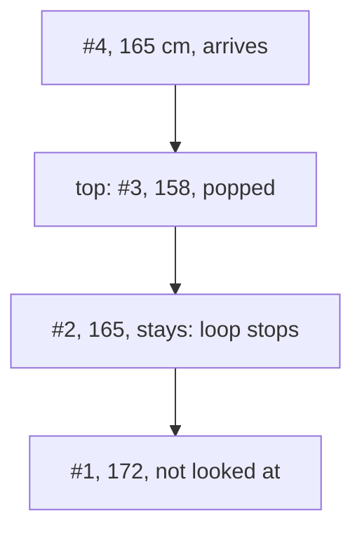

# Monotonic stacks

## The idea

A **monotonic stack** is a stack whose items stay in order from bottom to top: never increasing, say, or never decreasing. Nothing gets sorted. Before a new item is pushed, every item on top that would break the order is popped, and that popping is the whole point: an item is popped at the moment the sequence produces the item that settles its question.

The question it answers best is: **for each item of a sequence, which is the first later item that beats it?** Beats can mean "is greater", "is smaller", or any comparison you choose. Scanning ahead from every item answers it, but on unlucky input each scan runs to the end, and n scans cost O(n²) comparisons.

A monotonic stack answers every item in one pass. Walk through the sequence keeping a stack of the items that are still waiting for their answer. When a new item arrives:

1. While the item on top of the stack is beaten by the new one, pop it: its answer is the new item.
2. Push the new item. It waits for its own answer.

When the sequence ends, the items still on the stack have no answer.

Two facts make this right and fast:

- **The order holds by itself.** An item stays on the stack only as long as nothing after it has beaten it. So with "beats" meaning "is taller", every waiting item is at least as tall as everything pushed after it: from bottom to top, the heights never increase. That is why, once the new item fails to beat the top, it cannot beat anything below the top either, and the loop may stop there without missing an answer.
- **Each item is pushed once and popped at most once.** One arrival may pop many items, so the inner loop looks expensive, but every pop removes an item that was pushed earlier and never comes back. Over the whole sequence, there are n pushes and at most n pops: O(n) work in total, O(1) amortized per item.

## A worked example

Seven people stand in a line, all facing right, each looking over the heads of the people in front. For each person, who is the first person in front of them who is **strictly taller**, and so blocks the view?

| Position | 0 | 1 | 2 | 3 | 4 | 5 | 6 |
|----------|---|---|---|---|---|---|---|
| Height, cm | 160 | 172 | 165 | 158 | 165 | 180 | 170 |

The stack holds the positions of the people whose blocker has not turned up yet. Positions, not heights: from a position the program can read the height, and the answer is a position too.

```python examples/next_taller.py
"""For each person in a line, the first person in front who blocks the view, with a monotonic stack.

Everyone faces right and looks over the people in front of them. The first one who is strictly
taller blocks the view. The stack holds the people whose blocker has not turned up yet.
"""

from collections.abc import Callable

HEIGHTS = [160, 172, 165, 158, 165, 180, 170]


def taller(new: int, waiting: int) -> bool:
    return new > waiting


def first_in_front(
    heights: list[int], beats: Callable[[int, int], bool] = taller, show: bool = False
) -> tuple[list[int | None], int]:
    """For each position, the first position in front whose height beats it, and the stack work."""
    answer: list[int | None] = [None] * len(heights)
    waiting: list[int] = []  # positions whose answer is unknown, the most recent on top
    operations = 0
    for position, height in enumerate(heights):
        answered = []
        while waiting and beats(height, heights[waiting[-1]]):
            earlier = waiting.pop()
            answer[earlier] = position
            answered.append(earlier)
        waiting.append(position)
        operations += len(answered) + 1
        if show:
            stack = " ".join(f"#{p}:{heights[p]}" for p in waiting)
            print(f"#{position} {height} cm answers {answered!s:<9} stack, bottom to top: {stack}")
    return answer, operations


answer, _ = first_in_front(HEIGHTS, show=True)
blockers = ["nobody" if a is None else f"#{a}" for a in answer]
print("blocked by:", ", ".join(f"#{p}->{blocker}" for p, blocker in enumerate(blockers)))
print("if equal heights blocked too:", first_in_front(HEIGHTS, lambda new, old: new >= old)[0])
print("first shorter in front:     ", first_in_front(HEIGHTS, lambda new, old: new < old)[0])


def first_taller_by_scanning(heights: list[int]) -> tuple[list[int | None], int]:
    answer: list[int | None] = [None] * len(heights)
    comparisons = 0
    for position, height in enumerate(heights):
        for ahead in range(position + 1, len(heights)):
            comparisons += 1
            if heights[ahead] > height:
                answer[position] = ahead
                break
    return answer, comparisons


line = [*range(2_000, 0, -1), 2_001]  # a long run of ever shorter people, then a giant
by_stack, operations = first_in_front(line)
by_scan, comparisons = first_taller_by_scanning(line)
print(f"{len(line):,} people: same answers: {by_stack == by_scan}")
print(f"scanning ahead: {comparisons:,} comparisons; the stack: {operations:,} pushes and pops")
```

It prints:

```output examples/next_taller.py
#0 160 cm answers []        stack, bottom to top: #0:160
#1 172 cm answers [0]       stack, bottom to top: #1:172
#2 165 cm answers []        stack, bottom to top: #1:172 #2:165
#3 158 cm answers []        stack, bottom to top: #1:172 #2:165 #3:158
#4 165 cm answers [3]       stack, bottom to top: #1:172 #2:165 #4:165
#5 180 cm answers [4, 2, 1] stack, bottom to top: #5:180
#6 170 cm answers []        stack, bottom to top: #5:180 #6:170
blocked by: #0->#1, #1->#5, #2->#5, #3->#4, #4->#5, #5->nobody, #6->nobody
if equal heights blocked too: [1, 5, 4, 4, 5, None, None]
first shorter in front:      [3, 2, 3, None, None, 6, None]
2,001 people: same answers: True
scanning ahead: 2,001,000 comparisons; the stack: 4,001 pushes and pops
```

Walk through the first seven lines, one person each:

- **#0, 160 cm.** Nobody is waiting, so #0 waits.
- **#1, 172 cm.** It is taller than #0, the top, so #0 is answered: blocked by #1. Then #1 waits.
- **#2, 165 cm, and #3, 158 cm.** Each is shorter than the top, so nothing is popped, and each waits. The stack is now 172, 165, 158 from bottom to top: never increasing.
- **#4, 165 cm.** It is taller than #3, at 158, so #3 is answered. The new top is #2, at 165, which is not strictly shorter: the loop stops. It does not need to look at #1 below, because #1 is at least as tall as #2. #4 waits.



<!-- text-of-mermaid sha256:6870b25c5707e32fa8b28ef281fa7ec184bce58491c5a00b8deede421b1b1cf9 -->
```text
┌──────────────────────────┐
│   #4, 165 cm, arrives    │
└─────────────┬────────────┘
              ▼
┌──────────────────────────┐
│   top: #3, 158, popped   │
└─────────────┬────────────┘
              ▼
┌──────────────────────────┐
│#2, 165, stays: loop stops│
└─────────────┬────────────┘
              ▼
┌──────────────────────────┐
│  #1, 172, not looked at  │
└──────────────────────────┘
```

- **#5, 180 cm.** Taller than everyone waiting, so it pops #4, #2 and #1 in turn: all three are blocked by #5. Then #5 waits.
- **#6, 170 cm.** Shorter than #5, so it waits.

The line ends with #5 and #6 still waiting: nobody blocks them. Seven pushes and five pops in all.

The next two lines change only the comparison. If an equal height also blocked the view, #2 would be answered by #4 instead of #5. And with "beats" meaning "is shorter", the same loop finds the first shorter person in front: the order kept by the stack flips to never decreasing.

The last lines show what the stack saves. In a line of 2,000 people who get shorter one by one, followed by one giant, scanning ahead from each person walks all the way to the giant: 2,001,000 comparisons. The stack does 4,001 pushes and pops: everybody is pushed once and popped once, by the giant, who is pushed but never popped.

## When to use it

- **"For each item, the first one after it that is greater"**, or smaller, or that beats it by any comparison. The sign is a nested loop that scans ahead from every item and stops at the first match.
- **Items that become hopeless.** Whenever a later item makes an earlier one irrelevant for the rest of the scan, the earlier one can be popped. The window deque of the [queues and deques](../queues-and-deques/guide.md) guide is built on that idea.
What to use instead: the stack knows about the **first** item that beats each one, and nothing about the ones after it. To count or list every later item that is greater, not only the nearest, you need a different structure. To keep the largest or smallest value of a window as it slides, use the deque, which can also drop items from the old end.

## Common traps

- **Believing it is quadratic.** The `while` inside the `for` looks like O(n²). Count pushes and pops instead of loop iterations: n and at most n.
- **Not deciding what an equal value does.** "Taller" and "at least as tall" give different answers, as the output shows for #2. The comparison in the loop is that decision; write it on purpose.
- **Forgetting the items left at the end.** They have no answer. Give them an explicit default, such as `None`, and make sure your caller expects it.
- **Popping an empty stack.** The loop must test that the stack is not empty before it reads the top.
- **Pushing before popping.** The new item must first answer the items it beats, then wait. Pushed first, it sits on top and the loop compares it with itself.

## Complexity

| | Time | Space |
|-|------|-------|
| Scanning ahead from every item | O(n²) in the worst case, as with an ever-shorter line | O(1) besides the answers |
| Monotonic stack | O(n): n pushes and at most n pops | O(n) in the worst case: a line that never gets taller keeps everyone waiting |

Both assume a comparison costs O(1).

## Expert notes

- **The amortized argument, made exact.** Count the cost of an arrival as the pops it makes plus its one push, and let the stack's size be a reserve. An arrival that pops k items costs k + 1 and changes the size by 1 − k, so cost plus change in size is always 2. Summed over n arrivals, the total cost is 2n minus the final size, so at most 2n.
- **Answers about later items arrive late and out of order.** An item's first later beater is known only when that beater arrives, so the answers fill in out of order: in the example, #3 was answered before #2. For a whole array that does not matter; for a stream, it means the question about an item is settled some time after the item itself.
- **The same shape elsewhere.** The operator stack of the [two-stack expression evaluator](../evaluating-expressions/guide.md) keeps its precedences rising from bottom to top between parentheses, and Dijkstra's 1961 report on his ALGOL 60 translator remarks that its priority numbers "increased monotonically". The window deque of the queues guide is a monotonic stack that also loses items at its bottom, when they get too old.
- **A name in the literature.** Finding the nearest smaller value of every position of an array is studied as the "all nearest smaller values" problem. O. Berkman, B. Schieber and U. Vishkin, for example, built optimal doubly logarithmic parallel algorithms on finding them (Journal of Algorithms, 1993).

## Practice

- `cstudy start daily-temperatures`: how long, for every day, until a warmer day comes.
- `cstudy start stock-span`: a measure of a price's run-up, asked once per day as prices arrive.
- `cstudy start car-fleet`: cars on a road where nobody can overtake: how many groups arrive.
- `cstudy start remove-k-digits`: the smallest number left after deleting k digits.
- `cstudy start sum-of-subarray-minimums`: the minimums of all subarrays, added up.
- `cstudy start trapping-rain-water`: the water held between bars after rain.
- `cstudy start largest-rectangle-histogram`: the largest rectangle that fits under a histogram.
- `cstudy start maximal-rectangle`: the largest rectangle of ones in a grid of ones and zeros.

## Further reading

- O. Berkman, B. Schieber and U. Vishkin, ["Optimal Doubly Logarithmic Parallel Algorithms Based On Finding All Nearest Smaller Values"](https://doi.org/10.1006/jagm.1993.1018), Journal of Algorithms 14(3), 1993.
- E. W. Dijkstra, ["ALGOL-60 Translation"](https://ir.cwi.nl/pub/9251), Mathematisch Centrum, 1961: the translator stack whose priorities increase monotonically, in "Making a Translator for ALGOL 60".
- [Python tutorial: using lists as stacks](https://docs.python.org/3/tutorial/datastructures.html#using-lists-as-stacks), the stack the example uses.
