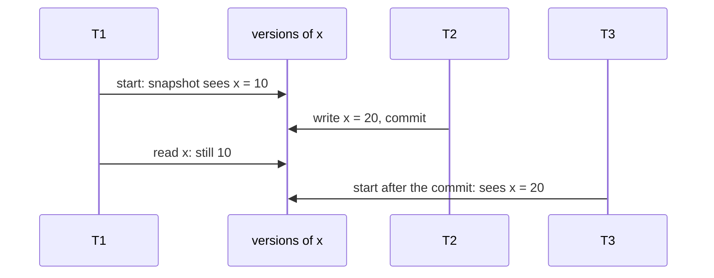

# MVCC and snapshot isolation: versions, snapshots and write skew

## The idea

Under locking, a report that reads a whole table holds read locks that make every writer wait, and a writer holds write locks that make the report wait. **Multiversion concurrency control** (MVCC) removes most of that waiting by never overwriting data in place: a write adds a new **version** of the row, and the old versions stay for a while. Each transaction, or each statement, reads a **snapshot**, the data as it was at some moment, choosing for every row the version that was current then. PostgreSQL's documentation states the main advantage: locks taken for reading do not conflict with locks taken for writing, so reading never blocks writing and writing never blocks reading.

**Snapshot isolation** is the transaction level built on this, defined by Berenson and others in 1995:

- a transaction reads from a snapshot of the committed data as of the moment it started, its **start timestamp**, and sees its own writes on top of that snapshot;
- it is never blocked when it reads, and changes committed by others after its start are invisible to it;
- when it is ready to commit, it gets a **commit timestamp** larger than every timestamp so far, and it commits only if no other transaction that committed between its start and its commit wrote data it also wrote; otherwise it aborts. They call this rule **first-committer-wins**, and it prevents lost updates;
- once it commits, its changes are visible to every transaction that starts later.



<!-- text-of-mermaid sha256:a8ad92b01d9be45ce772b9e33dc14baf1acb199b8988e2d95da31aa70f430fd4 -->
```text
┌────┐                      ┌───────────────┐              ┌────┐                ┌────┐
│ T1 │                      │ versions of x │              │ T2 │                │ T3 │
└──┬─┘                      └───────┬───────┘              └──┬─┘                └──┬─┘
   │                                │                         │                     │
   │  start: snapshot sees x = 10   │                         │                     │
   │────────────────────────────────▶                         │                     │
   │                                │                         │                     │
   │                                │  write x = 20, commit   │                     │
   │                                ◀─────────────────────────│                     │
   │                                │                         │                     │
   │       read x: still 10         │                         │                     │
   │────────────────────────────────▶                         │                     │
   │                                │                         │                     │
   │                                │      start after the commit: sees x = 20      │
   │                                ◀───────────────────────────────────────────────│
   │                                │                         │                     │
┌──┴─┐                      ┌───────┴───────┐              ┌──┴─┐                ┌──┴─┐
│ T1 │                      │ versions of x │              │ T2 │                │ T3 │
└────┘                      └───────────────┘              └────┘                └────┘
```

Both values of x exist at once: the version of 10 for T1's snapshot and the version of 20 for everyone who starts after T2's commit. T1 is not blocked, and T2 did not wait for T1.

Reading from one instant is strong: a transaction never sees part of another's changes, never reads a value that is later rolled back, and gets the same answer when it repeats a read. Berenson and others show that snapshot isolation forbids every strict phenomenon of the SQL standard, dirty and fuzzy reads and phantoms included, and that it is stronger than read committed. But it is not serializable, and they say why in one sentence: "a transaction's Reads come at one instant and the Writes at another." First-committer-wins only compares what two transactions *write*. Two transactions that each read what the other is about to change, and write different items, both commit.

That is **write skew**. Fekete, O'Neil and O'Neil give the standard example: x and y are the checking balances of a married couple, the bank allows either to go negative as long as x + y stays positive, and x = 70, y = 80. T1 reads both, sees 150, and takes 100 from x. T2, at the same time, reads both, sees 150, and takes 100 from y. They wrote different rows, so both commit, and x + y = −50. Run one after the other, the second would have seen a sum of 50 and refused.

The same thing happens with rows that do not exist yet. Berenson and others' example: tasks matching some condition may add up to 8 hours at most; T1 sums them, finds 7, and inserts a 1-hour task; T2 does the same at the same time. They insert different rows, first-committer-wins sees no conflict, and the total is 9. In a serial order, the second would see the first one's task, a row matching its condition, and refuse.

Even a transaction that writes nothing can see an impossible state. Fekete, O'Neil and O'Neil found that under snapshot isolation a read-only transaction can observe a history that no serial order explains, although the update transactions on their own run serializably: in their example, a customer's statement shows a deposit already made and a balance without the overdraft charge that, in the final data, the bank applied because the deposit had not yet arrived. PostgreSQL's documentation gives its own example of the effect at its repeatable read level: a read-only transaction that sees a control record marking a batch complete but not a detail record that belongs to the batch.

## A worked example

This program implements snapshot isolation by its definition: each transaction copies the committed state when it starts, keeps its writes to itself, and checks first-committer-wins against the transactions that committed after its start. Copying everything is not how a database does it, but it makes the rules easy to watch.

```python examples/write_skew.py
"""Snapshot isolation by the definition: each transaction reads the committed state as of its start,
keeps its writes to itself, and commits only if no transaction that committed after its start
wrote an item it also wrote (first committer wins).

Copying the whole committed state at each start is the definition made literal, not how a store
does it; it is enough to watch what snapshot isolation allows and what it refuses.
"""


class SnapshotStore:
    def __init__(self, data: dict[str, int]) -> None:
        self.committed = dict(data)
        self.clock = 0
        self.history: list[tuple[int, set[str]]] = []  # (commit time, items written)

    def begin(self) -> dict:
        self.clock += 1
        return {"start": self.clock, "snapshot": dict(self.committed), "writes": {}}

    def read(self, t: dict, item: str) -> int:
        return t["writes"].get(item, t["snapshot"][item])

    def write(self, t: dict, item: str, value: int) -> None:
        t["writes"][item] = value

    def commit(self, t: dict) -> str:
        for when, items in self.history:
            if when > t["start"] and items & t["writes"].keys():
                return "aborted: first committer wins"
        self.clock += 1
        self.committed.update(t["writes"])
        self.history.append((self.clock, set(t["writes"])))
        return "committed"


def withdraw(store: SnapshotStore, t: dict, account: str, amount: int, cover: bool) -> str:
    """Withdraw if the couple's two balances stay positive in total, as this snapshot shows them."""
    x, y = store.read(t, "x"), store.read(t, "y")
    if x + y - amount <= 0:
        return "refused"
    store.write(t, account, store.read(t, account) - amount)
    if cover:  # also write the balance it only read, so a concurrent withdrawal conflicts
        other = "y" if account == "x" else "x"
        store.write(t, other, store.read(t, other))
    return "ok"


def skew(cover: bool) -> str:
    store = SnapshotStore({"x": 70, "y": 80})
    t1, t2 = store.begin(), store.begin()
    w1, w2 = withdraw(store, t1, "x", 100, cover), withdraw(store, t2, "y", 100, cover)
    c1, c2 = store.commit(t1), store.commit(t2)
    total = store.committed["x"] + store.committed["y"]
    return f"T1 {w1}, {c1} | T2 {w2}, {c2} | x + y = {total}"


print("lost update: two transactions add 1 to a counter of 5")
store = SnapshotStore({"counter": 5})
t1, t2 = store.begin(), store.begin()
for t in (t1, t2):
    store.write(t, "counter", store.read(t, "counter") + 1)
print("    T1:", store.commit(t1), "| T2:", store.commit(t2))
t2 = store.begin()
store.write(t2, "counter", store.read(t2, "counter") + 1)
print("    T2 again:", store.commit(t2), "| counter =", store.committed["counter"])


print("write skew: x = 70, y = 80, each transaction withdraws 100 from one account")
print("    " + skew(cover=False))

print("one after the other: T1 commits before T2 begins")
store = SnapshotStore({"x": 70, "y": 80})
t1 = store.begin()
w1 = withdraw(store, t1, "x", 100, False)
c1 = store.commit(t1)
t2 = store.begin()
w2 = withdraw(store, t2, "y", 100, False)
print(f"    T1 {w1}, {c1} | T2 {w2} | x + y = {store.committed['x'] + store.committed['y']}")

print("write skew, covered: each withdrawal also writes the balance it only read")
print("    " + skew(cover=True))

print("phantom: tasks may add up to 8 hours; two transactions each add a 1-hour task")
store = SnapshotStore({"task1": 4, "task2": 3})
t1, t2 = store.begin(), store.begin()
for t, new in ((t1, "task3"), (t2, "task4")):
    if sum(store.read(t, k) for k in t["snapshot"]) + 1 <= 8:  # the sum over a predicate
        store.write(t, new, 1)
c1, c2 = store.commit(t1), store.commit(t2)
print(f"    T1 {c1} | T2 {c2} | hours = {sum(store.committed.values())}")
```

It prints:

```output examples/write_skew.py
lost update: two transactions add 1 to a counter of 5
    T1: committed | T2: aborted: first committer wins
    T2 again: committed | counter = 7
write skew: x = 70, y = 80, each transaction withdraws 100 from one account
    T1 ok, committed | T2 ok, committed | x + y = -50
one after the other: T1 commits before T2 begins
    T1 ok, committed | T2 refused | x + y = 50
write skew, covered: each withdrawal also writes the balance it only read
    T1 ok, committed | T2 ok, aborted: first committer wins | x + y = 50
phantom: tasks may add up to 8 hours; two transactions each add a 1-hour task
    T1 committed | T2 committed | hours = 9
```

- **Lost update.** Both transactions read 5 and write 6. T1 commits first; T2 wrote the same item and committed later, so first-committer-wins aborts it. Retried, it reads 6 and writes 7. Nothing is lost, which is what the rule is for.
- **Write skew.** Each withdrawal checks the sum in its own snapshot, 150, and writes only its own account. The write sets do not overlap, both commit, and the couple is at −50.
- **One after the other**, T2 sees x = −30 and refuses: the outcome above matches no serial order.
- **Covered.** If each withdrawal also writes the balance it only read, rewriting the same value, the write sets overlap and first-committer-wins aborts the second. Fekete, O'Neil and O'Neil describe this fix and a second one: keep the sum in a row of its own that every withdrawal updates.
- **Phantom.** Each transaction sums the tasks in its snapshot, finds 7 hours, and adds a new task under a new key. No item is written twice, so both commit: 9 hours. Nothing here makes the two write a common row; a row holding the total, which both update, would, as the second fix above does.

## Write skew in theory, and serializable snapshot isolation

Why do these anomalies look alike? Draw the history's dependency graph, as in the guide on transactions, with one more kind of edge. Ports and Grittner define three: a **wr** edge when T2 reads a version T1 wrote, a **ww** edge when T2 writes the version after T1's, and a **rw-antidependency** when T1 writes a new version of something T2 read in its previous version, so T1 must come after T2, because T2 did not see its write. In the write skew above, T1 read y, which T2 then wrote, and T2 read x, which T1 then wrote: rw-antidependencies both ways, a cycle.

Fekete and others proved in 2005 that this shape is always there. Their Theorem 2.1: if a history produced under snapshot isolation is not serializable, every cycle in its graph contains three consecutive transactions T1, T2 and T3, where T1 and T3 may be the same transaction, with T1 and T2 running at the same time and a rw-antidependency from T1 to T2, and T2 and T3 running at the same time and a rw-antidependency from T2 to T3. The middle transaction has a rw-antidependency coming in and one going out; Ports and Grittner call two such adjacent edges a **dangerous structure**.

That theorem makes a cheap safety check possible. **Serializable snapshot isolation** (SSI), introduced by Cahill and others in 2008 and described by Ports and Grittner, runs transactions under snapshot isolation, records rw-antidependencies as they appear, and aborts one of the transactions whenever one transaction has both an incoming and an outgoing rw-antidependency. That guarantees serializability. It can abort a transaction that was harmless, since not every dangerous structure is part of a cycle, but it never has to search the graph for cycles, and it does not even need to track wr and ww edges. To notice reads that a later write will invalidate, SSI uses locks in a special SIREAD mode that never block anyone: a conflict between a SIREAD lock and a write only flags an edge. Ports and Grittner point out that SSI allows some rw-conflicts that strict two-phase locking and classic optimistic concurrency control both forbid, so it can run more transactions at once.

PostgreSQL's serializable level has used SSI since version 9.1, which Ports and Grittner describe as the first implementation of SSI in a production database release; in their benchmarks it cost less than 7% compared with snapshot isolation. Its documentation says the predicate locks it keeps for this never cause blocking and so cannot cause a deadlock.

## Old versions and their cleanup

Versions pile up. In PostgreSQL, an `UPDATE` or a `DELETE` does not remove the old version of the row, because it must not disappear while some transaction may still see it. Once no transaction can see it, its space is reclaimed by `VACUUM`, which runs automatically in the background through the autovacuum daemon. Standard `VACUUM` marks the space for reuse and runs alongside normal work, but it does not give space back to the operating system, except for pages that become entirely free at the end of a table. `VACUUM FULL` writes a new copy of the table without dead space, but needs an `ACCESS EXCLUSIVE` lock on the table for as long as it runs.

How long must an old version stay? Until the oldest transaction that could see it has ended. A single long-running transaction therefore holds back the cleanup of every table it might read. PostgreSQL's B-tree documentation names this case when it explains why deduplication helps unique indexes: a long-running transaction holds a snapshot that blocks garbage collection.

## When to use it

- **Readers that must not wait.** Long reports and backups read a consistent snapshot without blocking writers or being blocked by them. Berenson and others note that snapshot isolation even allows transactions with very old timestamps, a view of the past, but that update transactions with old timestamps abort if they write data changed since.
- **Snapshot isolation alone** when every transaction that could break a rule writes the items the rule depends on: then first-committer-wins catches the conflict. PostgreSQL's repeatable read level is snapshot isolation.
- **Serializable (SSI)** when rules span rows that different transactions write, and you would rather the database catch every anomaly than prove that none can occur. Retry on serialization failures.
- **A materialized conflict** when you stay at snapshot isolation: make transactions that must not run together write a common row, as in the covered example.

## Common traps

- **Calling repeatable read serializable.** At PostgreSQL's repeatable read, write skew and the read-only anomaly are possible; only its serializable level prevents them.
- **Checking a rule in a snapshot, then writing elsewhere.** The check and the write happen at different instants from the database's point of view; that is write skew's recipe.
- **Long-running transactions.** They hold back the cleanup of old versions everywhere, and under first-committer-wins a long update transaction is likely to lose. Berenson and others note that it is unlikely to be the first writer of everything it writes, and so will probably abort.
- **Turning off autovacuum.** PostgreSQL's documentation calls disabling it completely unwise unless the workload is extremely predictable: tables bloat with dead versions.
- **Expecting `VACUUM` to shrink the file.** Plain `VACUUM` makes space reusable inside the table; only a rewrite such as `VACUUM FULL` returns it to the operating system, at the price of an exclusive lock.
- **Forgetting transaction id wraparound.** PostgreSQL stamps row versions with 32-bit transaction ids, compared modulo 2³², so for every id two billion are older and two billion newer. A row version older than two billion transactions would suddenly look like the future; `VACUUM` prevents it by marking old versions **frozen**, and every table must be vacuumed at least once every two billion transactions.

## Complexity

| Operation | Cost |
|-----------|------|
| A read | find, among a row's versions, the one the snapshot sees; no locks, no waiting |
| A write | add a new version; under first-updater rules (below), possibly wait for a concurrent writer of the same row |
| A commit under snapshot isolation | first-committer-wins checks only the items the transaction wrote |
| SSI on top | record reads and rw-antidependencies; Ports and Grittner measured under 7% over snapshot isolation |
| Space | old versions kept for as long as the oldest snapshot that may need them |

A worked number: a row is updated 1,000 times a second while a one-hour report holds its snapshot. A cleanup that, like PostgreSQL's, removes only versions older than the oldest running snapshot keeps 1,000 × 3,600 = 3.6 million versions of that row until the report ends.

## Expert notes

- **Where it sits.** Berenson and others describe snapshot isolation as a multiversion method that extends an earlier one allowing snapshot reads for read-only transactions, and show that every snapshot isolation history can be mapped to a single-version history with the same data flow, which is how they place it among the isolation levels: stronger than read committed, incomparable with repeatable read.
- **First updater wins.** PostgreSQL detects the conflict at the write instead of at the commit: a repeatable read transaction that tries to update a row changed by a concurrent transaction waits for that transaction to finish; if it commits, the waiting transaction fails with `could not serialize access due to concurrent update` and should be retried from the beginning. Fekete and others call this variant **first updater wins**; one of the two concurrent writers of an item aborts either way.
- **Checking programs instead of runs.** Fekete and others also define a static dependency graph over the programs of an application. If it has no dangerous structure, every execution of those programs under snapshot isolation is serializable; the converse does not hold, so a dangerous structure in the graph does not prove an anomaly can occur.
- **PostgreSQL's predicate locks.** They are taken on the data a query actually accesses, so which locks a query takes depends on its plan: a sequential scan always needs a lock on the whole table, which raises the rate of serialization failures. Under memory pressure many fine-grained locks are combined into coarser ones, with the same effect.
- **SQLite.** In WAL mode, SQLite's documentation describes its readers as having snapshot isolation: each reader sees the database as it was when its read transaction started. Writers take turns, one at a time.
- **Consistency models.** Snapshot isolation also appears in the guide on consistency models in the distributed systems path, which places it among the promises replicated stores make.

## Practice

- `cstudy start mvcc-snapshot-isolation`: build a multiversion store with snapshot reads, first-committer-wins, the detection of write skew through rw-antidependencies, and the cleanup of versions no transaction can read.

## Further reading

- [H. Berenson and others, *A Critique of ANSI SQL Isolation Levels*, SIGMOD 1995](https://arxiv.org/abs/cs/0701157): the definition of snapshot isolation, first-committer-wins, write skew and the phantom with task hours.
- [A. Fekete, E. O'Neil and P. O'Neil, *A Read-Only Transaction Anomaly Under Snapshot Isolation*, ACM SIGMOD Record 33(3), 2004, pages 12 to 14](https://www.cs.umb.edu/~poneil/ROAnom.pdf): write skew with the couple's accounts, two fixes, and the read-only anomaly.
- [A. Fekete, D. Liarokapis, E. O'Neil, P. O'Neil and D. Shasha, *Making Snapshot Isolation Serializable*, ACM Transactions on Database Systems 30(2), 2005, pages 492 to 528](https://doi.org/10.1145/1071610.1071615): Theorem 2.1, dangerous structures, and static analysis of applications.
- [D. R. K. Ports and K. Grittner, *Serializable Snapshot Isolation in PostgreSQL*, Proceedings of the VLDB Endowment 5(12), 2012, pages 1850 to 1861](https://arxiv.org/abs/1208.4179): the three kinds of dependency, SSI and SIREAD locks, and their implementation.
- [PostgreSQL documentation, *Introduction* to concurrency control](https://www.postgresql.org/docs/current/mvcc-intro.html) and [*Transaction Isolation*](https://www.postgresql.org/docs/current/transaction-iso.html): snapshots, repeatable read as snapshot isolation, serializable as SSI.
- [PostgreSQL documentation, *Routine Vacuuming*](https://www.postgresql.org/docs/current/routine-vacuuming.html): dead row versions, `VACUUM` and `VACUUM FULL`, autovacuum, and transaction id wraparound.
- [SQLite, *Isolation In SQLite*](https://www.sqlite.org/isolation.html): snapshot isolation for readers in WAL mode.
