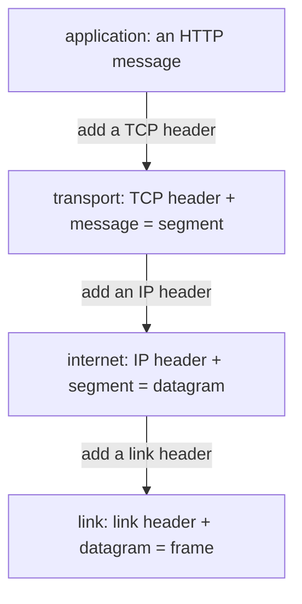
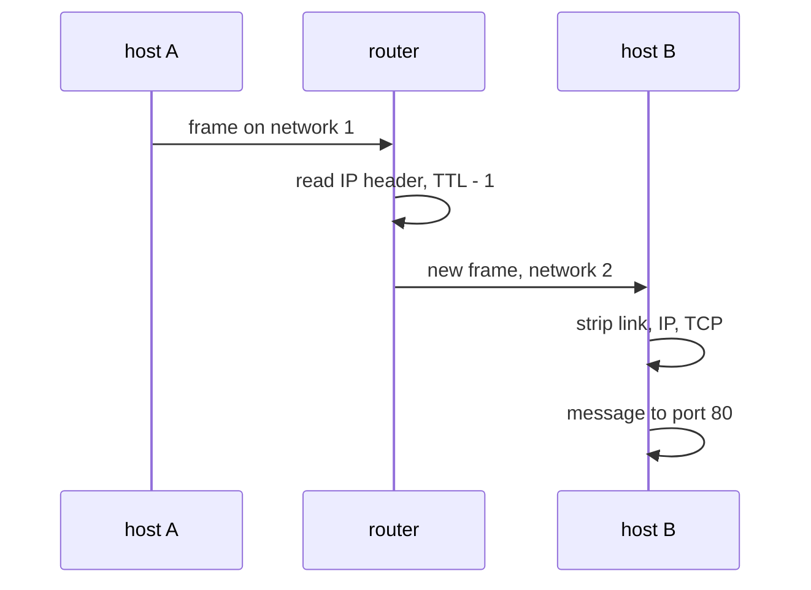

# Layers, packets and messages

## The idea

A network moves bytes from a program on one machine to a program on another. In between are cables, radio links and **routers**, machines that pass data from one network on to the next. No single program handles all of that. The work is split into **layers**: each layer does one job, uses the layer below it, and offers a simpler service to the layer above.

Two words first. A **host** is a machine at an end of the conversation, running programs. A **protocol** is a set of rules: what two parties send each other, and what each must do when something arrives.

RFC 1122, the Internet's requirements for hosts, describes four layers:

| Layer | Its job | Examples |
|-------|---------|----------|
| Application | What the programs say to each other | HTTP, DNS |
| Transport | Communication from one program to another, end to end | TCP, UDP |
| Internet | Carrying data from the source host to the destination host, across networks | IP, versions 4 and 6 |
| Link | Moving data across one directly connected network | the local network's own protocol |

Each layer has its own name for the unit it sends, and RFC 1122 defines them:

- A **frame** is the link layer's unit: a link header followed by a packet.
- A **packet** is what the internet layer hands down to the link layer: an IP header and data. It may be a whole IP datagram or a fragment of one.
- An **IP datagram** is the internet layer's unit from one end to the other: an IP header followed by a transport layer message.
- A **segment** is TCP's unit: a TCP header followed by application data, carried inside an IP datagram.
- A **message**, in RFC 1122's description of the lower layers, is the unit of any transport protocol, so a TCP segment is a message. UDP calls its unit a user datagram (RFC 768), and HTTP calls a request or a response a message (RFC 9110). When someone says "message", ask which layer they mean.

In everyday speech all of these are "packets", and that is usually fine. The names matter when you read a specification, and when you need to say which layer lost or changed something.

**Encapsulation** is how the layers fit together. A **header** is a short run of fields at fixed positions: addresses, lengths, numbers. To send, each layer puts its header in front of what the layer above handed it. The HTTP message becomes the data of a TCP segment, the segment becomes the data of an IP datagram, and the datagram becomes the data of a frame. On arrival, each layer reads and removes its own header and hands the rest up. No layer looks inside the data it carries.



<!-- text-of-mermaid sha256:a22bbfbd8d3f637cf6597922a2f1c818811c511878db555b3370f8118949efc7 -->
```text
┌─────────────────────────────────────────┐
│       application: an HTTP message      │
└────────────add─a─TCP─header─────────────┘
                     ▼
┌─────────────────────────────────────────┐
│transport: TCP header + message = segment│
└────────────add─an─IP─header─────────────┘
                     ▼
┌─────────────────────────────────────────┐
│ internet: IP header + segment = datagram│
└────────────add─a─link─header────────────┘
                     ▼
┌─────────────────────────────────────────┐
│   link: link header + datagram = frame  │
└─────────────────────────────────────────┘
```

The drawing reads from top to bottom for the sender; the receiver climbs it from the bottom, removing one header at each step.

Two kinds of address get the data to the right place:

- An **IP address** names a host's attachment to a network. It is 32 bits in IPv4, written as four numbers such as `192.0.2.10`, and 128 bits in IPv6 (RFC 8200).
- A **port** names a program's endpoint inside a host: a 16-bit number in the TCP and UDP headers. RFC 9293 says TCP uses port numbers to identify application services and to multiplex distinct flows between hosts: to carry many separate conversations between the same two hosts and keep them apart. By default a web server listens on port 80 for `http` and 443 for `https` (RFC 9110), and a DNS server on port 53 (RFC 1035). A TCP connection is defined by a pair of **sockets**, one at each end, each an address and a port.

The layers make very different promises, and the difference explains much of networking:

- **IP promises little.** RFC 1122 calls it a datagram service with no end-to-end delivery guarantees: datagrams may arrive damaged, duplicated, out of order, or not at all, and the layers above are responsible for reliable delivery when it is needed. RFC 791 lists what IP leaves out: acknowledgements, error control for the data (it checks only its own header), retransmissions and flow control. This is often called **best effort**.
- **UDP adds ports and little else.** RFC 768 calls it transaction oriented, with delivery and duplicate protection not guaranteed. Its unit is the datagram, whose header carries its length, so one datagram holds one message of the application and the boundaries between messages are kept.
- **TCP adds reliability.** RFC 9293: TCP provides a reliable, in-order, byte-stream service to applications. Every byte arrives, once and in order, for as long as the connection lasts. The price is in the last word: a **byte stream** keeps the order of the bytes, not the boundaries between the sender's writes.

## A worked example

Here is one HTTP request wrapped by hand: a TCP header in front of it, then an IPv4 header in front of that, each laid out field by field as RFC 9293 and RFC 791 define them. Then the bytes are unwrapped again, each layer reading only its own header. The addresses come from the blocks that RFC 5737 sets aside for documentation, and `example.com` is a name that RFC 2606 reserves for examples.

```python examples/encapsulation.py
"""Wrap an HTTP request in a TCP header and an IPv4 header, then unwrap it again.

Each layer puts its own header in front of what the layer above handed it, and on the way back
up each layer reads only its own header. The headers follow the field layouts of RFC 9293 (TCP)
and RFC 791 (IPv4); the checksums and control bits are left at zero, since nothing here crosses
a real wire.
"""

import struct

PROTOCOL_TCP = 6  # the IPv4 Protocol field's value for a TCP segment


def address_bytes(address: str) -> bytes:
    return bytes(int(part) for part in address.split("."))


def address_text(raw: bytes) -> str:
    return ".".join(str(part) for part in raw)


def tcp_segment(source_port: int, destination_port: int, seq: int, payload: bytes) -> bytes:
    offset_words = 5  # header length in 32-bit words: 5 * 4 = 20 bytes, no options
    header = struct.pack(
        "!HHIIBBHHH",
        source_port,
        destination_port,
        seq,
        0,  # acknowledgement number
        offset_words << 4,  # data offset in the high 4 bits
        0,  # control bits
        65535,  # window
        0,  # checksum
        0,  # urgent pointer
    )
    return header + payload


def ipv4_datagram(source: str, destination: str, payload: bytes) -> bytes:
    header_words = 5
    total_length = header_words * 4 + len(payload)
    header = struct.pack(
        "!BBHHHBBH4s4s",
        (4 << 4) | header_words,  # version 4, header length in 32-bit words
        0,  # type of service
        total_length,
        0,  # identification
        0,  # flags and fragment offset
        64,  # time to live
        PROTOCOL_TCP,
        0,  # header checksum
        address_bytes(source),
        address_bytes(destination),
    )
    return header + payload


message = b"GET / HTTP/1.1\r\nHost: example.com\r\n\r\n"
segment = tcp_segment(50000, 80, 1000, message)
datagram = ipv4_datagram("192.0.2.10", "198.51.100.80", segment)
print(f"HTTP message:  {len(message)} bytes  {message!r}")
print(f"TCP segment:   {len(segment)} bytes  (a 20-byte header, then the message)")
print(f"IPv4 datagram: {len(datagram)} bytes  (a 20-byte header, then the segment)")
print("the IPv4 header on the wire:", datagram[:20].hex(" "))

first, _, total, _, _, ttl, protocol, _, source, destination = struct.unpack(
    "!BBHHHBBH4s4s", datagram[:20]
)
ip_header = (first & 0x0F) * 4
print(
    f"IPv4 reads: version {first >> 4}, header {ip_header} bytes, total {total} bytes, "
    f"TTL {ttl}, protocol {protocol}, {address_text(source)} -> {address_text(destination)}"
)
inner = datagram[ip_header:total]
source_port, destination_port, seq, _, offset, *_ = struct.unpack("!HHIIBBHHH", inner[:20])
tcp_header = (offset >> 4) * 4
print(
    f"TCP reads: port {source_port} -> port {destination_port}, sequence number {seq}, "
    f"header {tcp_header} bytes"
)
print("HTTP reads:", inner[tcp_header:].split(b"\r\n")[0].decode("ascii"))
```

It prints:

```output examples/encapsulation.py
HTTP message:  37 bytes  b'GET / HTTP/1.1\r\nHost: example.com\r\n\r\n'
TCP segment:   57 bytes  (a 20-byte header, then the message)
IPv4 datagram: 77 bytes  (a 20-byte header, then the segment)
the IPv4 header on the wire: 45 00 00 4d 00 00 00 00 40 06 00 00 c0 00 02 0a c6 33 64 50
IPv4 reads: version 4, header 20 bytes, total 77 bytes, TTL 64, protocol 6, 192.0.2.10 -> 198.51.100.80
TCP reads: port 50000 -> port 80, sequence number 1000, header 20 bytes
HTTP reads: GET / HTTP/1.1
```

Each layer adds 20 bytes: neither header carries options here, and 20 bytes is the smallest header both protocols allow. RFC 791 counts the IPv4 header in 32-bit words with a minimum of 5, and RFC 9293 gives 20 bytes as the TCP header without options. The hex line is the IPv4 header as it travels:

| Bytes | Value | Field |
|-------|-------|-------|
| `45` | 4 and 5 | version 4, header length of 5 words |
| `00 4d` | 77 | total length of the datagram in bytes, header included |
| `40` | 64 | time to live, explained under Expert notes |
| `06` | 6 | protocol: the data is a TCP segment |
| `c0 00 02 0a` | 192.0.2.10 | source address |
| `c6 33 64 50` | 198.51.100.80 | destination address |

The receiving IP layer needs only these fields to know where its data starts and ends (`total` minus the header length), and which protocol to hand it to (6, TCP). TCP then finds port 80 and the sequence number, a number the next guides use to put bytes back in order. Only HTTP looks at `GET / HTTP/1.1`.

A router on the way reads the IP header and the frame it arrived in, and nothing above them:



<!-- text-of-mermaid sha256:7c1ba995ac4fd76cab4264e8952758aac32ceb4fab2251fa821e12482fd288c4 -->
```text
┌────────┐              ┌────────┐                ┌────────┐
│ host A │              │ router │                │ host B │
└────┬───┘              └────┬───┘                └────┬───┘
     │                       │                         │
     │  frame on network 1   │                         │
     │───────────────────────▶                         │
     │                       │                         │
     │                       ├───┐                     │
     │                       │   │ read IP header, TTL - 1
     │                       ◀───┘                     │
     │                       │                         │
     │                       │  new frame, network 2   │
     │                       │─────────────────────────▶
     │                       │                         │
     │                       │                         ├───┐
     │                       │                         │   │ strip link, IP, TCP
     │                       │                         ◀───┘
     │                       │                         │
     │                       │                         ├───┐
     │                       │                         │   │ message to port 80
     │                       │                         ◀───┘
     │                       │                         │
┌────┴───┐              ┌────┴───┐                ┌────┴───┐
│ host A │              │ router │                │ host B │
└────────┘              └────────┘                └────────┘
```

The router never reads the TCP header or the HTTP message: it moves datagrams, which is why the transport and application layers are described as end to end.

## Streams and datagrams

The difference between a datagram service and a byte stream shows up as soon as a program sends more than one message. Here the same three messages travel both ways, over channels simulated in memory:

```python examples/byte_stream.py
"""Three messages carried two ways: as datagrams, and as one byte stream.

A datagram channel delivers each message whole or not at all; this one loses the second. A stream
channel delivers every byte, in order, but in pieces of its own sizes, so the receiver's reads do
not line up with the sender's writes. The messages end with a newline, which is how the receiver
finds them again in the stream.
"""

MESSAGES = [b"PING 1\n", b"PRICE apples=3\n", b"BYE\n"]
PIECE_SIZES = [5, 9, 3]  # how many bytes each read happens to get, used in turn


def datagram_channel(datagrams: list[bytes], lost: set[int]) -> list[bytes]:
    return [datagram for number, datagram in enumerate(datagrams) if number not in lost]


def stream_channel(writes: list[bytes]) -> list[bytes]:
    stream = b"".join(writes)
    reads, position, turn = [], 0, 0
    while position < len(stream):
        size = PIECE_SIZES[turn % len(PIECE_SIZES)]
        reads.append(stream[position : position + size])
        position, turn = position + size, turn + 1
    return reads


print("datagrams sent:     ", MESSAGES)
print("datagrams received: ", datagram_channel(MESSAGES, lost={1}))
reads = stream_channel(MESSAGES)
print("stream writes:      ", MESSAGES)
print("stream reads:       ", reads)
received = b"".join(reads)
print("same bytes, in order:", received == b"".join(MESSAGES))
print("messages, cut at each newline:", [line + b"\n" for line in received.split(b"\n")[:-1]])
```

It prints:

```output examples/byte_stream.py
datagrams sent:      [b'PING 1\n', b'PRICE apples=3\n', b'BYE\n']
datagrams received:  [b'PING 1\n', b'BYE\n']
stream writes:       [b'PING 1\n', b'PRICE apples=3\n', b'BYE\n']
stream reads:        [b'PING ', b'1\nPRICE a', b'ppl', b'es=3\n', b'BYE\n']
same bytes, in order: True
messages, cut at each newline: [b'PING 1\n', b'PRICE apples=3\n', b'BYE\n']
```

The datagram channel kept each message whole, and lost one entirely. The stream lost nothing, but its reads split `PING 1` across two pieces and put the start of `PRICE` in the same piece as the end of `PING`. The receiver could find the messages again only because each one ends with a newline. That is **framing**: marking in the data itself where each message ends. Every protocol on top of a byte stream needs it. HTTP, for example, ends its header lines with a carriage return and a line feed, and gives the length of a body in a header field; the guide on HTTP messages explains how.

## Where TLS fits

TLS (Transport Layer Security) sits between TCP and the application. RFC 9846, the current specification of TLS 1.3, gives its primary goal as a secure channel between two communicating peers, and says the only thing it needs from the layer below is a reliable, in-order data stream: exactly what TCP provides. It promises three things:

| Property | What RFC 9846 says it gives |
|----------|-----------------------------|
| Authentication | The server side of the channel is always authenticated; the client side optionally |
| Confidentiality | After the channel is set up, the data is only visible to the two endpoints |
| Integrity | After the channel is set up, the data cannot be changed by attackers without detection |

TLS has two parts: a **handshake**, which authenticates the parties, negotiates how to protect the data and agrees on keys, and a **record protocol**, which uses what the handshake set up to protect the data in both directions. HTTP over TLS is `https`, on port 443 by default, and RFC 9110 says that "secured" there means the server has been authenticated as acting for the name in the address.

Encapsulation tells you what TLS cannot hide. It protects the bytes the application hands it, and the TCP and IP headers are added below it, so addresses and ports still travel in the clear for every router to read. How a client decides that a server's certificate is genuine is a subject of its own, and this guide leaves it there.

## When to use it

- **Placing a bug or a feature in a layer.** A request that never arrives, an answer cut off halfway, a name that does not resolve and a body read too short are problems of different layers, with different tools to look at them. Ask which layer's promise was broken.
- **Choosing a transport.** TCP when every byte must arrive in order: files, web pages, database protocols. UDP when a late answer is as useless as none and the application can repeat a small question itself, as a DNS client does, or for real-time audio and video. QUIC, which HTTP/3 runs over, carries its packets in UDP datagrams (RFC 9000) and adds streams, reliability and TLS 1.3 of its own (RFC 9114).
- **Designing a message format on top of TCP.** The stream gives you bytes, not messages. Decide how the receiver finds the end of each one: a delimiter, as above, or a length sent first.
- **Instead**, for most programs: use a library that speaks the application protocol. Knowing the layers is what lets you read its errors, its timeouts and its settings.

## Common traps

- **Expecting one read per write on TCP.** A write of 100 bytes can arrive as one read of 100, two reads of 50, or together with the next write. It happens because TCP promises the order of the bytes, not their grouping. Code that parses each read as a whole message works on a quiet local machine and breaks under load.
- **Expecting UDP to report loss.** A lost datagram is simply never delivered, and nobody is told. An application on UDP needs its own timeouts and repeats.
- **Mixing up the units.** "The packet was lost" may mean a frame, a datagram or a segment, and "the message" may mean a TCP segment or an HTTP request. Specifications use each word for one layer; say which one you mean.
- **Thinking TLS hides who talks to whom.** It protects the application's bytes. The IP addresses and ports are in headers outside it.
- **Assuming a delivered byte was processed.** TCP acknowledging data means the other host's TCP received it, not that the program there acted on it. Only an answer from the application says that, which matters for retries.

## Complexity

Every layer adds bytes, and opening a connection adds waiting, counted in **round trips**: a round trip is the time for a message to reach the other end and for the reply to come back.

| Cost | Size | Where it comes from |
|------|------|---------------------|
| IPv4 header | 20 bytes without options | RFC 791: at least 5 words of 32 bits |
| IPv6 header | 40 bytes without extension headers | RFC 8200: 20 octets longer than the smallest IPv4 header |
| TCP header | 20 bytes without options | RFC 9293 |
| UDP header | 8 bytes | RFC 768: the length field is at least 8, the header alone |
| Opening a TCP connection | one round trip before the connection is open at the client | the handshake of RFC 9293: the client's SYN goes out, and the server's SYN and ACK come back |

The share of overhead depends on the payload. When a host has not been told the other side's maximum segment size, RFC 9293 makes it assume 536 bytes of data for IPv4 (576 minus 40 bytes of headers) and 1,220 for IPv6 (1,280 minus 60). At those sizes headers are 40 of 576 bytes, about 7%, and 60 of 1,280, about 5%. A one-byte message costs 41 bytes on IPv4 before the link layer adds its own.

Encapsulation itself is cheap: building or removing a header is constant work per layer, and the data is never transformed. The expensive parts are the round trips, which is why the later guides count them.

## Expert notes

- **Time to live.** RFC 791's TTL field is the longest time a datagram may stay in the network, and a datagram whose TTL reaches zero is destroyed. IPv6 names it the hop limit: each node that forwards the packet lowers it by one, and the packet is discarded when it reaches zero (RFC 8200). Either way, a routing loop cannot keep a packet alive forever.
- **Sizes and fragments.** RFC 791 requires every IPv4 host to accept datagrams of up to 576 octets, whole or in fragments. IPv6 requires every link to carry packets of at least 1,280 octets, and in IPv6 only the source fragments a packet, never a router on the way (RFC 8200). The default segment sizes of the Complexity section come from these two numbers.
- **Network byte order.** RFC 791's appendix on transmission order sends the octets of a field in the order they are written and reads the leftmost bit as the most significant: big-endian. Python's `struct` module writes this order with the `!` prefix, which its documentation calls network byte order, always big-endian.
- **The Protocol field.** Its values come from the public registry of assigned Internet protocol numbers: 6 is TCP and 17 is UDP.
- **The word "message" again.** RFC 1122 uses it for transport units because it describes the lower layers; RFC 9110 uses it for HTTP requests and responses. Both are right in their own documents.
- **QUIC: streams over datagrams.** RFC 9114 describes QUIC as providing stream multiplexing, per-stream flow control and quicker connection setup, with reliability per stream and congestion control across the whole connection, and with TLS 1.3 built into the transport layer. Its packets travel in UDP datagrams (RFC 9000), so the network sees datagrams while the endpoints see streams.

## Practice

This guide has no problem of its own. Each later guide of the path practises one layer:

- [DNS: names, resolution and caching](../dns-resolution/guide.md): an application protocol, with `dns-resolver-sim`.
- [Reliable transport](../reliable-transport/guide.md) and [Congestion control](../congestion-control/guide.md): building TCP's promise on top of IP's, with `stream-reassembler` and `reliable-transport-sim`.
- [HTTP messages and connections](../http-messages/guide.md): framing messages on a byte stream, with `http-message-parser`.
- [Timeouts, retries and idempotency](../retries-and-idempotency/guide.md): what a client does when an answer does not come, with `vendor-retry-client-typescript`.

## Further reading

- [RFC 1122, Requirements for Internet Hosts: Communication Layers](https://www.rfc-editor.org/rfc/rfc1122.html): the layers (section 1.1.3) and the terms frame, packet, datagram, segment and message (section 1.3.3).
- [RFC 791, Internet Protocol](https://www.rfc-editor.org/rfc/rfc791.html): what IP leaves out (section 1.4), the header (section 3.1) and transmission order (appendix B).
- [RFC 8200, IPv6](https://www.rfc-editor.org/rfc/rfc8200.html): 128-bit addresses, the hop limit, the 1,280-octet minimum and fragmentation by sources.
- [RFC 768, User Datagram Protocol](https://www.rfc-editor.org/rfc/rfc768.html) and [RFC 9293, Transmission Control Protocol](https://www.rfc-editor.org/rfc/rfc9293.html): the two transports, their headers and ports.
- [RFC 9846, TLS 1.3](https://www.rfc-editor.org/rfc/rfc9846.html): the goals and properties of TLS (section 1).
- [RFC 9114, HTTP/3](https://www.rfc-editor.org/rfc/rfc9114.html): what QUIC offers HTTP (section 1).
- [RFC 9000, QUIC](https://www.rfc-editor.org/rfc/rfc9000.html): QUIC packets carried in UDP datagrams (section 1).
- [Assigned Internet protocol numbers](https://www.iana.org/assignments/protocol-numbers/protocol-numbers.xhtml): the values of IPv4's Protocol field.
- [Python documentation, `struct`](https://docs.python.org/3/library/struct.html): packing fields in network byte order.
