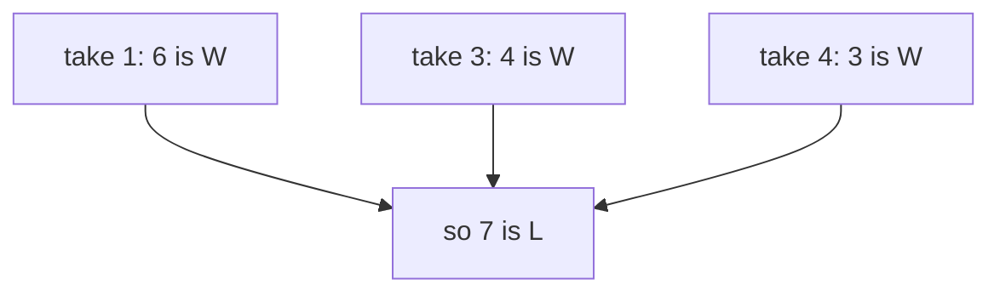

# Bottom-up tables in one dimension

## The idea

A memoized recursion computes its answers in whatever order the recursion happens to ask for them. When every answer depends only on answers for **smaller** inputs, you can choose the order yourself: compute the smallest first, store each in a list, and go up. Each answer then finds the ones it needs already computed. This is **bottom-up** dynamic programming, or **tabulation**: a loop that fills a table, with no recursion, no hashing and no depth limit.

Writing one takes four decisions, in this order:

1. **The state, in one sentence.** Say what one cell of the table means, precisely enough that someone could work out a cell by hand from the sentence alone. "`best[i]` is the answer for `i`" is not a sentence; it says nothing about which answer, or what `i` counts.
2. **The recurrence.** How a cell follows from other cells, and the **base cases**, the cells that follow from nothing and are written down directly.
3. **The order of filling.** Every cell that a cell reads must be filled before it. If the recurrence reads only smaller indices, fill from the smallest up; if it reads only larger ones, from the largest down.
4. **Space.** If a cell reads only the last few cells before it, the older cells are never read again, and only the last few need to be kept.

Many one-dimensional states take one of two shapes, and the shape fixes the order:

| Shape of the sentence | Reads | Fill | The answer is in |
|-----------------------|-------|------|------------------|
| "... using the first `i` items" (a **prefix**) | smaller `i` | from 0 up | the last cell |
| "... using the items from `i` to the end" (a **suffix**) | larger `i` | from the end down | cell 0 |

## A worked example

A game for two players. There is one pile of stones. The players take turns, and a move takes 1, 3 or 4 stones from the pile. Whoever takes the last stone wins; a player who faces an empty pile has lost. With `n` stones, can the player who moves first force a win, however well the other plays?

**The state.** `win[n]` is true when **the player about to move**, facing `n` stones, can force a win. The words "about to move" are the point of the sentence: the same pile is good or bad depending on whose turn it is, so a state that only said "with `n` stones" would be ambiguous.

**The recurrence.** A move from `n` leaves `n - m` stones, and then the other player is the one about to move. So the mover wins exactly when some move leaves the other player in a losing position:

```text
win[n] = true when some move m in {1, 3, 4}, with m <= n, has win[n - m] false
win[0] = false   (no stones: the player to move has already lost)
```

**The order.** `win[n]` reads `win[n - 1]`, `win[n - 3]` and `win[n - 4]`, all smaller, so fill `n = 1, 2, 3, ...` in order. By hand:

| `n` | Moves and what they leave | `win[n]` |
|-----|---------------------------|----------|
| 0 | none | L |
| 1 | take 1, leaving 0 (L) | W |
| 2 | take 1, leaving 1 (W); 3 and 4 do not fit | L |
| 3 | take 3, leaving 0 (L) | W |
| 4 | take 4, leaving 0 (L) | W |
| 5 | take 3, leaving 2 (L) | W |
| 6 | take 4, leaving 2 (L) | W |
| 7 | take 1, 3 or 4, leaving 6, 4 or 3: all W | L |

The row for 7 is the recurrence at work: every move hands the opponent a winning position, so 7 is lost for the player who must move.



<!-- text-of-mermaid sha256:4ff005876f607b50324be63b4e20d262c44193d97a70c4fdae539d245a90dd80 -->
```text
┌──────────────┐    ┌──────────────┐    ┌──────────────┐
│take 1: 6 is W│    │take 3: 4 is W│    │take 4: 3 is W│
└───────┬──────┘    └───────┬──────┘    └───────┬──────┘
        ▼───────────────────┴───────────────────┘
┌──────────────┐
│  so 7 is L   │
└──────────────┘
```

```python examples/take_away.py
"""A take-away game, solved with a table: a move takes 1, 3 or 4 stones from one pile, and the
player who takes the last stone wins."""

MOVES = (1, 3, 4)


def winning_table(stones: int) -> list[bool]:
    """win[n]: the player about to move, facing n stones, can force a win."""
    win = [False] * (stones + 1)  # win[0] stays False: no stones left, so no move to make
    for n in range(1, stones + 1):  # increasing n: every cell read below is already filled
        win[n] = any(move <= n and not win[n - move] for move in MOVES)
    return win


def row(label: str, cells: list[str]) -> str:
    return f"{label:10}" + "".join(f"{cell:>3}" for cell in cells)


def wins(win: list[bool]) -> list[str]:
    return ["W" if cell else "L" for cell in win]


table = winning_table(14)
print(row("n", [str(n) for n in range(15)]))
print(row("win[n]", wins(table)))

n, game = 12, []
while n > 0:  # replay: the mover always takes a move that leaves a losing position, if one exists
    move = next((m for m in MOVES if m <= n and not table[n - m]), 1)
    game.append(f"{n} -{move}")
    n -= move
print("a game from 12:", ", ".join(game), "-> 0")


def unguarded_table(stones: int) -> list[bool]:
    """The same loop without `move <= n`: win[n - move] with a negative index reads the far end."""
    win = [False] * (stones + 1)
    for n in range(1, stones + 1):
        win[n] = any(not win[n - move] for move in MOVES)
    return win


print(row("unguarded", wins(unguarded_table(14))))


def wins_with_four_cells(stones: int) -> bool:
    """The same answer for one n, keeping only the last four cells in a ring of four slots."""
    ring = [False] * 4  # ring[k % 4] holds win[k] for the four most recent k
    for n in range(1, stones + 1):
        result = any(move <= n and not ring[(n - move) % 4] for move in MOVES)
        ring[n % 4] = result  # overwrites win[n - 4], which was read just above
    return ring[stones % 4]


big = winning_table(10_000)
losing = [n for n in range(60) if not big[n]]
print("losing positions below 60:", losing)
pattern_holds = all(big[n] == (n % 7 not in (0, 2)) for n in range(10_001))
print("n loses exactly when n % 7 is 0 or 2, for every n up to 10,000:", pattern_holds)
ring_agrees = all(wins_with_four_cells(n) == big[n] for n in range(1_001))
print("ring of four slots agrees up to 1,000:", ring_agrees)
```

It prints:

```output examples/take_away.py
n           0  1  2  3  4  5  6  7  8  9 10 11 12 13 14
win[n]      L  W  L  W  W  W  W  L  W  L  W  W  W  W  L
a game from 12: 12 -3, 9 -1, 8 -1, 7 -1, 6 -4, 2 -1, 1 -1 -> 0
unguarded   L  W  W  W  W  L  W  L  W  W  W  W  L  W  L
losing positions below 60: [0, 2, 7, 9, 14, 16, 21, 23, 28, 30, 35, 37, 42, 44, 49, 51, 56, 58]
n loses exactly when n % 7 is 0 or 2, for every n up to 10,000: True
ring of four slots agrees up to 1,000: True
```

- **The table** for 0 to 14 matches the hand computation, and goes on: 9 and 14 are losses too.
- **Reading the table back** gives a strategy, not just a verdict. From 12, a win, the first player takes 3 and leaves 9, a loss for the opponent. Every move from a losing position leaves a winning one (that is what losing means), and the first player answers each with a move back to a loss: 7, then 2, then 0. The first player takes the last stone.
- **The unguarded table** drops the condition `move <= n`. For `n = 2` it reads `win[2 - 3]`, which in Python is `win[-1]`: a negative index counts from the end of the list, so it reads the last cell, still `False` because it is not filled yet. Taking 3 stones from 2 then looks like a winning move. There is no error, and the wrong cell spreads to the cells that read it: 2, 5, 9 and 12 all come out wrong.
- **The pattern.** The losing positions below 60 are 0, 2, 7, 9, 14, 16, ...: exactly the `n` whose remainder by 7 is 0 or 2, and the next line checks that up to 10,000. The expert notes prove it holds for every `n`.
- **The ring of four slots.** The recurrence never reads more than 4 cells back, so `wins_with_four_cells` keeps only 4 values, `win[k]` in slot `k % 4`. When it computes `win[n]`, slot `n % 4` still holds `win[n - 4]`, which this very step needs: it reads first and overwrites after. It agrees with the full table on every `n` up to 1,000, using constant memory.

Compare the puzzle of the [memoization guide](../memoization/guide.md), the fewest operations to bring `n` down to 1. Its table fills in the same order, from small to large, but the cell for `n` reads the cells for `n / 2` and `n / 3`, which lie arbitrarily far back. No fixed window holds them, so that table cannot shrink: whether space can be saved depends on how far back the recurrence reaches.

## When to use it

- The subproblems can be **numbered by one integer**, a count, a position or an amount, and each answer depends only on answers with smaller numbers, or only on answers with larger ones.
- You need **many or all** of the answers anyway, or the memoized recursion would be **too deep** for the stack.
- **Use a memo instead** when only a few of the states are reachable from the question you ask, or when it is hard to see an order in which every cell is ready before it is read. **Use two indices** when one number cannot describe what is left to solve; that is the [next guide](../two-dimensional-tables/guide.md).

## Common traps

- **A vague state.** "`win[n]`: I can win with `n` stones" does not say whose turn it is, and the recurrence written from it comes out wrong. If you cannot compute one cell by hand from the sentence alone, the sentence is not finished.
- **The wrong order.** A cell read before it is filled holds its initial value, `False` or `0`, which looks like a real answer. Nothing fails; the table is just wrong. Check that every index in the recurrence is smaller (or larger) than the one being filled.
- **Negative indices in Python.** `table[n - 3]` with `n < 3` reads from the end of the list instead of failing, as the unguarded table shows. Guard every index that can go below zero.
- **Off by one in the table's size.** States 0 to `n` take `n + 1` cells, and the answer for `n` is in `table[n]`.
- **A base case left out, or overwritten by the loop.** Write every cell the recurrence cannot produce before the loop, and start the loop after them. In the fewest-operations table of the memoization guide, `table[1] = 0` comes first and the loop starts at 2: run on 1, the recurrence would read `table[0]`, which means nothing, and store 1.
- **Overwriting a value that is still needed.** In the space-saving version, the slot about to be written may hold a value that the current step reads. Read everything first, then write.

## Complexity

| Version | Time for `n` | Extra space |
|---------|--------------|-------------|
| Full table | O(n · k) for `k` moves | O(n) |
| Ring of the last `w` cells, when the recurrence reads at most `w` back | O(n · k) | O(w) |
| The proved pattern | O(1) | O(1) |

Here `k = 3` and `w = 4`. The bounds are worst-case: the loop does a fixed amount of work per cell, with no hashing and no recursion. A memoized recursion has the same O(n · k) bound but pays for a function call and a hash lookup per question, and up to `n` frames of stack.

## Expert notes

- **Proving the pattern.** Claim: `n` is a loss exactly when `n % 7` is 0 or 2. It holds for 0 to 6, by the hand table. For `n` of 7 or more, every move fits, and assume the claim for every smaller number. If `n % 7` is 0, the moves leave remainders 6, 4 and 3; if it is 2, they leave 1, 6 and 5. None of these is 0 or 2, so every move leaves a winning position, and `n` is a loss. For the other remainders there is always a move to a loss: from remainder 1, take 1 to reach 0; from 3, take 3; from 4, take 4; from 5, take 3 to reach 2; from 6, take 4 to reach 2. So `n` is a win. Once proved, the formula answers in constant time; the table is how the pattern was found.
- **A table finds patterns; it does not prove them.** Computing a few hundred cells and looking for a period is how this one was found, but a pattern seen up to 10,000 is evidence, not proof: the argument above is what makes the formula safe to use.
- **Top-down or bottom-up.** Both compute each state once. Bottom-up has no recursion depth, no hashing and a simple, predictable loop; top-down computes only the states reachable from the question and needs no order worked out in advance. When most states are needed, the loop is usually the simpler program.
- **Prefix and suffix tables are mirror images.** "From the first `i` items" filled upwards and "from item `i` to the end" filled downwards solve the same problem; pick the one whose sentence is easier to say. A recursion that starts at the front and asks about the rest is the suffix form, so turning a memo into a loop often means filling backwards.

## Practice

- `cstudy start house-robber`: the most cash from a row of houses when no two neighbouring houses may both be chosen.
- `cstudy start coin-change`: the fewest coins that pay an amount exactly.
- `cstudy start longest-increasing-subsequence`: the length of the longest strictly increasing subsequence of an array.
- `cstudy start decode-ways`: count the ways a string of digits can be read back as letters.
- `cstudy start min-cost-tickets`: the cheapest set of travel passes that covers a year's travel days.

## Further reading

- [Python common sequence operations](https://docs.python.org/3/library/stdtypes.html#common-sequence-operations): a negative index `i` is relative to the end, `len(s) + i`, which is why `table[n - 3]` reads the end of the list instead of failing.
