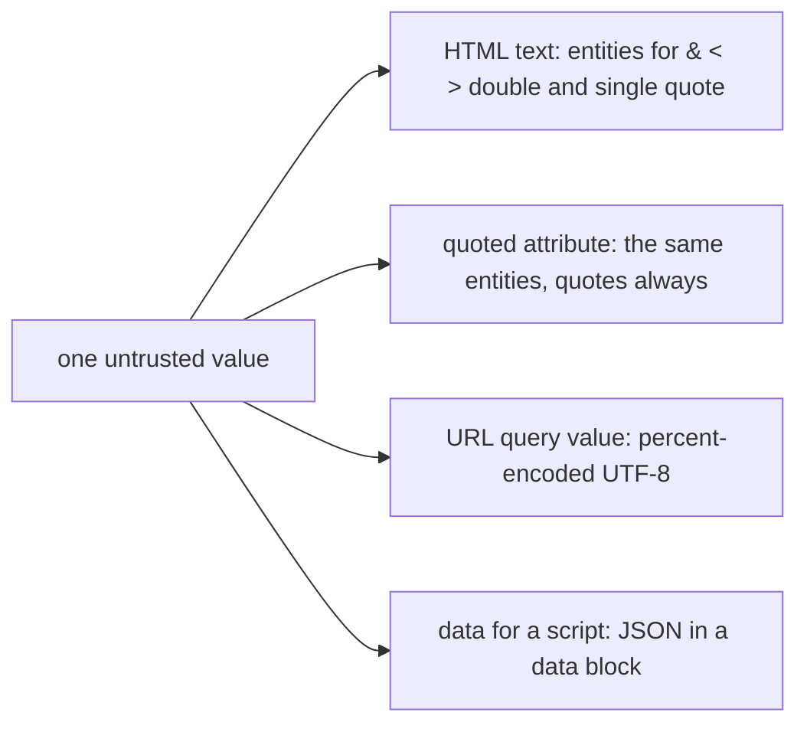

# Output encoding by context

## The idea

A web page is a program that the browser runs, and your server writes it as text. Some of that text came from people you do not control: a display name, a search term, a review. If one of them contains characters that mean something to the browser, such as `<`, the browser cannot tell your markup from theirs. Their text becomes part of your page's structure, and any script in it runs as if you had written it, with everything your page is allowed to do: read what the page shows, act as the signed-in user, send data elsewhere. This is **cross-site scripting**, XSS for short. OWASP sorts it by where the text comes from: **stored** XSS, when the input was saved on the server, in a database for example, and later shown to others; **reflected** XSS, when the input is returned at once, in an error message or a search result; and **DOM-based** XSS, when the page's own script writes the input into the page in the browser.

The defense is **output encoding**: just before the text is written into the page, replace each character that has a special meaning *at that spot* with a form that the browser shows as the character itself. Between two tags, `<` becomes `&lt;`, which the browser displays as `<` and never reads as the start of a tag. The OWASP Cross Site Scripting Prevention Cheat Sheet asks for this encoding as close as possible to where the data is rendered.

The words *at that spot* carry the whole difficulty. A page is read by more than one parser, and each one has its own special characters. The browser's HTML tokenizer reads a page one character at a time, and what a character means depends on the state it is in: between tags, inside an attribute, and so on.

| Spot, with `X` for the text | Who reads it | Characters with a meaning there |
|-----------------------------|--------------|---------------------------------|
| `<p>X</p>` | The HTML tokenizer, in its data state | `<` opens a tag, `&` starts a character reference such as `&amp;` |
| `<a title="X">` | The tokenizer, in a double-quoted attribute value | `"` ends the value, `&` starts a character reference |
| `<a title=X>` | The tokenizer, in an unquoted attribute value | A space, tab or line break ends the value, `>` ends the tag |
| `/search?q=X` | A URL parser, then the server's query parser | `&` separates parameters, `=` names from values, `#` ends the query, `+` reads as a space |
| `<script>let n = "X";</script>` | The tokenizer first, then the JavaScript engine | `</script` ends the element wherever it appears; quotes, backslashes and line breaks end or break the string |

These states are named in the HTML Standard's tokenizer. In the data state, `&` switches to the character reference state and `<` to the tag open state. In the double-quoted attribute value state, `"` ends the value and `&` again starts a reference. In the unquoted attribute value state, a tab, line feed, form feed or space ends the value, and `>` ends the tag.

So each spot gets its own encoding:

| Spot | Encoding |
|------|----------|
| HTML text and quoted attributes | Replace `&`, `<`, `>`, `"` and `'` with `&amp;`, `&lt;`, `&gt;`, `&quot;` and `&#x27;`, the five replacements the OWASP cheat sheet lists. Encoding all five covers text and attribute values in either kind of quote |
| A value in a URL's query | Percent-encoding: the text as UTF-8 bytes, and each byte that is not an unreserved character written as `%` and two hexadecimal digits. RFC 3986, an RFC being a numbered internet standard, lists the unreserved characters as the ASCII letters and digits and `-`, `.`, `_` and `~` |
| A string inside a script | Escapes of the JavaScript language, such as `\u0022` for `"`, chosen so that nothing can end the string or the element; or better, data handed to the script another way, as in the example below |
| Anywhere unquoted | Nowhere: always quote attribute values, which the cheat sheet asks for in bold |

Encoding is not enough everywhere. Some attributes are read a second time after the tokenizer has turned `&quot;` and friends back into characters: an `href` or `src` holds a URL, and a URL that starts with `javascript:` runs script when it is followed, with none of the five characters in it; an event handler such as `onclick` runs its value as JavaScript; `style` is read as CSS. The cheat sheet puts it in three sentences: "HTML attribute encoding alone does not protect JavaScript in an event-handler attribute", "URL-bearing attributes require URL validation", and "there is no universally safe list of HTML attributes." For URLs from users it advises an allowlist of the `http` and `https` schemes.

Around the encoder sit three more layers:

- **Templates that encode by default.** The cheat sheet notes that many frameworks escape every value they render, and that the escape hatches they offer for raw output bring the risk back.
- **A sanitizer for HTML that users write.** When people may format their posts with real HTML, encoding would show the tags as text. A maintained HTML sanitizer keeps a safe subset instead; the cheat sheet warns that changing its output afterwards can undo it.
- **A content security policy (CSP)**, a response header that tells the browser which scripts and other resources the page may load and run, so that it can block inline and remote scripts it was not told about. The cheat sheet calls it an additional layer of defense, and warns that it is easy to get wrong and should not be the primary one.

## A worked example

Python's standard library has an HTML parser, `html.parser`, which reports the tags and text it finds. The program feeds it pages built from untrusted text, encoded with `html.escape` or not, and does the same for a URL with `urllib.parse`:

```python examples/what_the_parser_sees.py
"""What a parser makes of untrusted text: written raw, encoded for one place, and encoded for its place."""

import html
from html.parser import HTMLParser
from urllib.parse import parse_qs, urlencode, urlsplit


class Tokens(HTMLParser):
    """Collects the tags, attributes and text that an HTML parser finds in a page."""

    def __init__(self) -> None:
        super().__init__()
        self.found: list[str] = []

    def handle_starttag(self, tag: str, attrs: list) -> None:
        self.found.append(f"<{tag}> {dict(attrs)}")

    def handle_data(self, data: str) -> None:
        self.found.append(f"text {data!r}")


def html_tokens(page: str) -> list[str]:
    parser = Tokens()
    parser.feed(page)
    parser.close()
    return parser.found


name = "Ann"
print("text, raw:          ", html_tokens(f"<p>{name}</p>"))
print("text, encoded:      ", html_tokens(f"<p>{html.escape(name)}</p>"))

title = "Ann onmouseover=steal()"
print("unquoted, encoded:  ", html_tokens(f"<a title={html.escape(title)}>"))
print("quoted, encoded:    ", html_tokens(f'<a title="{html.escape(title)}">'))

term = "fish & chips #1"
glued = urlsplit("/search?q=" + html.escape(term) + "&page=2")
print("query, HTML-encoded:", parse_qs(glued.query), "fragment:", repr(glued.fragment))
built = urlsplit("/search?" + urlencode({"q": term, "page": 2}))
print("query, URL-encoded: ", parse_qs(built.query), "as sent:", built.query)
```

It prints:

```output examples/what_the_parser_sees.py
text, raw:           ['<p> {}', "text 'Ann'", " {'src': 'x', 'onerror': 'steal()'}"]
text, encoded:       ['<p> {}', "text 'Ann'"]
unquoted, encoded:   ["<a> {'title': 'Ann', 'onmouseover': 'steal()'}"]
quoted, encoded:     ["<a> {'title': 'Ann onmouseover=steal()'}"]
query, HTML-encoded: {'q': ['fish ']} fragment: '1&page=2'
query, URL-encoded:  {'q': ['fish & chips #1'], 'page': ['2']} as sent: q=fish+%26+chips+%231&page=2
```

Line by line:

- **Text, raw.** The name ends the paragraph's text after `Ann` and adds an `` tag with an `onerror` attribute, a handler for the image's `error` event. In a browser, the attacker's script would run for everyone who views this name.
- **Text, encoded.** After `html.escape`, the whole name is one piece of text. The parser hands back the original characters, `<` included, but as text: this is how the browser shows the name.
- **Unquoted, encoded.** The same encoding fails in an attribute without quotes. The space was never special to HTML text, so `html.escape` left it alone, and here it ends the value: `onmouseover` becomes an attribute of its own. Encoding assumes quotes.
- **Quoted, encoded.** With quotes, the space is part of the value, and the value is all text.
- **Query, HTML-encoded.** HTML encoding is the wrong encoding for a URL. It turned `&` into `&amp;`, whose own `&` still splits the query, and it left `#` alone, which ends the query: the search term is cut to `fish `, the rest of it is lost, and `page=2` ends up in the fragment, which RFC 3986 leaves to the user agent alone.
- **Query, URL-encoded.** `urlencode` percent-encodes each value, `&` as `%26` and `#` as `%23`, and the query parser gets the term back whole. Python's `urlencode` writes a space as `+`, the form encoding of HTML forms, which the URL Standard's parser reads back as a space.



<!-- text-of-mermaid sha256:243a05c70a4632e477b6c521ebe805875b1cc0b1e4a5aa7c097f917a4ec7a50d -->
```text
┌───────────────────┐    ┌─────────────────────────────────────────────────────┐
│one untrusted value├───►│HTML text: entities for & < > double and single quote│
└─────────┬─────────┘    └─────────────────────────────────────────────────────┘
          │
          │              ┌─────────────────────────────────────────────────────┐
          ├─────────────►│  quoted attribute: the same entities, quotes always │
          │              └─────────────────────────────────────────────────────┘
          │
          │              ┌─────────────────────────────────────────────────────┐
          ├─────────────►│        URL query value: percent-encoded UTF-8       │
          │              └─────────────────────────────────────────────────────┘
          │
          │              ┌─────────────────────────────────────────────────────┐
          └─────────────►│       data for a script: JSON in a data block       │
                         └─────────────────────────────────────────────────────┘
```

The diagram sums up the table: one value, four places, four parsers and four encodings.

A script is the hardest place to write data into, since two parsers read it, the HTML tokenizer first. The tokenizer reads a `<script>` element's content in its **script data state**, which has no rule for `&` at all, so `&lt;` inside a script stays four characters and HTML encoding does nothing there; it only watches for `<`, so that `</script` ends the element even in the middle of a JavaScript string. Rather than escape data into JavaScript source, a page can carry it in a **data block**, a `<script>` element whose `type` is not a script type, such as `application/json`. The HTML Standard says the browser does not process a data block; the page's own script reads its text and parses it as JSON. That moves the problem from JavaScript strings to JSON, and JSON needs one more step:

```python examples/json_data_block.py
"""Handing data to a page's script as JSON in a data block, with <, > and & escaped."""

import json

profile = {"name": "Zoë</script><script>steal()</script>", "team": "R&D"}

plain = json.dumps(profile)
print("json.dumps:      ", plain)
print("closes the block:", "</script" in plain.lower())

escaped = plain.replace("<", "\\u003c").replace(">", "\\u003e").replace("&", "\\u0026")
print("escaped:         ", escaped)
print("closes the block:", "</script" in escaped.lower())
print("same data back:  ", json.loads(escaped) == profile)

page = f'<script type="application/json" id="profile">{escaped}</script>'
print(page)
```

It prints:

```output examples/json_data_block.py
json.dumps:       {"name": "Zo\u00eb</script><script>steal()</script>", "team": "R&D"}
closes the block: True
escaped:          {"name": "Zo\u00eb\u003c/script\u003e\u003cscript\u003esteal()\u003c/script\u003e", "team": "R\u0026D"}
closes the block: False
same data back:   True
<script type="application/json" id="profile">{"name": "Zo\u00eb\u003c/script\u003e\u003cscript\u003esteal()\u003c/script\u003e", "team": "R\u0026D"}</script>
```

`json.dumps` escapes `ë`, as it escapes every non-ASCII character by default, but not `<`, `>` or `/`: its output still contains `</script`, which would end the data block and start the attacker's script. JSON allows any character to be written as a `\u` escape, so replacing `<`, `>` and `&` with `\u003c`, `\u003e` and `\u0026` leaves the same data, as `json.loads` confirms, with no `</script` or `<!--` left in it.

## When to use it

- **Every time text from outside is written into a page**, on the server or by the page's own script, and every time that text is model output: an LLM's answer is untrusted text too.
- **The signs**: HTML built by string formatting, a template's raw-output escape hatch, a URL glued together from parts, data written into a `<script>` element or an attribute that is read again as a URL, JavaScript or CSS.
- **Pick by spot, not by data.** The same name gets entities in a paragraph, percent-encoding in a link's query, and JSON escapes in a data block.
- **Use a sanitizer instead** when users are meant to write HTML; encoding would show their tags as text.
- **Use validation instead, or as well,** for a whole URL from a user: check its scheme against an allowlist, then encode it for the attribute it goes into.

## Common traps

- **Encoding on the way in.** Store what the user typed, and encode on the way out, once, for the spot it goes. Text encoded for HTML at input time is wrong in a URL, a JSON response or an email, and gets encoded twice when it is finally shown. RFC 3986 says the same for URLs: a string must not be percent-encoded or decoded more than once.
- **One encoder for every spot.** The example shows HTML encoding failing in a URL, and the same goes for scripts, where entities are not decoded at all.
- **Unquoted attributes.** No HTML encoding survives them, since a plain space ends the value.
- **Encoding a whole URL with the query rule.** Encode each parameter value, not the entire URL, as the cheat sheet advises.
- **`json.dumps` alone in a script.** It leaves `</script` in place, as the example shows.
- **Changing sanitized HTML.** Editing a sanitizer's output, or sanitizing and then decoding, can rebuild what it removed.
- **Trusting a filter instead.** Removing `<script>` from input does not stop ``, an `href` with `javascript:`, or the many other ways to run script.

## Complexity

Encoding is one pass over the text, O(n) in its length, and its output is longer by a bounded factor:

| Encoding | Longest output for one input character |
|----------|----------------------------------------|
| HTML entities | 6 characters: `"` becomes `&quot;` |
| Percent-encoding | 12 characters: a character of four UTF-8 bytes becomes four `%HH` |
| A `\u` escape | 6 characters, or 12 for a character outside the Basic Multilingual Plane, written as a pair of escapes |

A sanitizer is more expensive: it parses the whole HTML fragment into elements, keeps the allowed ones and writes them out again. A content security policy costs the server one response header; the browser does the checking.

## Expert notes

- **Where entities are not decoded.** The HTML Standard sends the tokenizer into the script data state for `<script>` and into the RAWTEXT state for `<style>`; neither has a rule for `&`, so character references in them stay as literal text. Their content is JavaScript or CSS, with escape rules of their own.
- **The script element's odd rules.** The HTML Standard's section on restrictions for the contents of script elements explains that, for legacy reasons, `<!--` and `<script` inside a script must be balanced for the parser to close the element where you expect, and advises always escaping `<!--`, `<script` and `</script` in literals as `\x3C!--`, `\x3Cscript` and `\x3C/script`.
- **Where a query is split.** RFC 3986 ends a query at the first `#`. The URL Standard's form parser splits the query on `&`, splits each part at its first `=`, and turns `+` into a space. RFC 3986 also asks producers to write percent-encodings with uppercase hexadecimal digits, and to encode text as UTF-8 first.
- **Server XSS and client XSS.** OWASP also sorts XSS by where the untrusted text is joined into the page: server XSS when the server includes it in its response, client XSS when the page's own script updates the page with it through an unsafe call. DOM-based XSS is a subset of client XSS. Server-side encoding cannot help with client XSS; the page's script has to write text as text.
- **XSS undoes other defenses.** A script running in your page acts with your page's origin, the subject of the next guide. The OWASP Cross-Site Request Forgery Prevention Cheat Sheet warns that XSS can defeat all of its mitigations.
- **Dangerous spots.** The cheat sheet lists places where untrusted data does not belong even encoded, such as directly in a script, inside an HTML comment, and in a callback, and functions that run strings as code, such as `eval()`, `setTimeout()` and `setInterval()`.
- **`html.escape`.** Python's `html.escape` converts `&`, `<` and `>`, and with its default `quote=True` also `"` and `'`; `html.unescape` follows the HTML5 rules for character references.

## Practice

- `cstudy start output-encoding-by-context`: one function and four spots of a web page; encode untrusted text for exactly the spot it is written into, and refuse a spot it does not know.

## Further reading

- [OWASP Cross Site Scripting Prevention Cheat Sheet](https://cheatsheetseries.owasp.org/cheatsheets/Cross_Site_Scripting_Prevention_Cheat_Sheet.html): encoding per context, the five HTML replacements, quoting attributes, attributes that encoding does not protect, URLs, dangerous contexts, sanitizers and CSP.
- [OWASP, Types of Cross-Site Scripting](https://community.owasp.org/Types_of_Cross-Site_Scripting): stored, reflected and DOM-based XSS, and server and client XSS.
- [OWASP Content Security Policy Cheat Sheet](https://cheatsheetseries.owasp.org/cheatsheets/Content_Security_Policy_Cheat_Sheet.html): what a policy blocks, and why it is a second layer.
- [HTML Standard, 13.2.5 Tokenization](https://html.spec.whatwg.org/multipage/parsing.html#tokenization): the data state, the attribute value states, the script data and RAWTEXT states.
- [HTML Standard, the script element](https://html.spec.whatwg.org/multipage/scripting.html#the-script-element): data blocks, and the restrictions for contents of script elements.
- [RFC 3986, Uniform Resource Identifier (URI): Generic Syntax](https://www.rfc-editor.org/rfc/rfc3986): percent-encoding, unreserved characters, encoding once, UTF-8, and the query.
- [URL Standard, application/x-www-form-urlencoded parsing](https://url.spec.whatwg.org/#urlencoded-parsing): how a query is split and how `+` is read.
- [RFC 8259, The JSON Data Interchange Format](https://www.rfc-editor.org/rfc/rfc8259), section 7: any character may be escaped.
- Python [`html`](https://docs.python.org/3/library/html.html), [`urllib.parse`](https://docs.python.org/3/library/urllib.parse.html) (`urlencode`, `parse_qs`) and [`json`](https://docs.python.org/3/library/json.html) (`ensure_ascii`).
