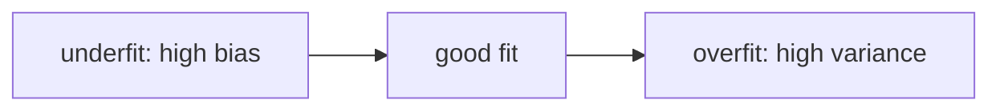

# Overfitting, regularization and early stopping

## The idea

Every label in real data carries some **noise**: the part that the features cannot explain, such as a measurement error or the luck of one day. A model with enough freedom fits the noise too. It follows the accidents of its training examples so closely that its training error keeps falling while its error on new examples rises. That is **overfitting**. A model too rigid to follow even the real pattern, a straight line through points that curve, has the opposite problem, **underfitting**: its error is high on the training set and on new data alike.

How much freedom a model has is its **capacity**: roughly, how many different shapes of function it can take. Two numbers tell the cases apart:

| | Training error | Gap to validation error | Fix |
|---|---|---|---|
| **Underfitting** | High | Small | More capacity: more features, a more flexible model, less regularization |
| **Good fit** | Low | Small | |
| **Overfitting** | Low | Large | Less capacity, more data, or regularization |

The trade-off has a name. Picture training the same kind of model many times, each time on a fresh sample of training data, and asking about one input. The model's average prediction misses the truth by its **bias**, which is large for a rigid model; its predictions scatter around that average by their **variance**, which is large for a flexible model that bends to each sample. The expected squared error is the noise plus the bias squared plus the variance, and as capacity grows the bias falls while the variance rises. The best model sits in between.

**Regularization** is any change to training that lowers the variance at the price of a little bias. Three are classic:

- **L2 regularization**, also called **ridge regression** for a linear model and **weight decay** for a neural network: add `strength * (w1^2 + ... + wd^2)` to the loss, so that large weights cost something.
- **L1 regularization**, called the **lasso** for a linear model: add `strength * (|w1| + ... + |wd|)`. It pushes some weights to exactly zero, which also chooses features.
- **Early stopping**: train by gradient descent, watch the validation error, and keep the weights from the step where it was lowest.

The bias `b` is left out of the penalty in all of them: it only shifts every prediction, and penalizing it would make the fit depend on where zero sits on the label's scale, and can cause underfitting. The **strength** is a hyperparameter, chosen on validation data, as [cross-validation](../cross-validation/guide.md) explains.



<!-- text-of-mermaid sha256:9c0fb7b6a06db14545bf3aed6f609aa96f7123f4146a3e524e5d909acb4001a6 -->
```text
┌───────────────────┐    ┌────────┐    ┌──────────────────────┐
│underfit: high bias├───►│good fit├───►│overfit: high variance│
└───────────────────┘    └────────┘    └──────────────────────┘
```

Read the drawing from left to right as capacity grows. Training error falls all the way along it; validation error falls, reaches its lowest point at the good fit, and rises again.

## A worked example

### Capacity: how many neighbours

**k-nearest-neighbour regression** predicts the average label of the `k` training examples whose features are closest. Its capacity is set by `k`, backwards: with `k = 1` it repeats the label of the nearest example, noise and all, and with `k` equal to the size of the training set it predicts the same average everywhere. The program fits 30 noisy examples of a curve and measures each `k` on 200 new ones.

```python examples/neighbours.py
"""Training error and test error as a model gets more flexible.

The model is k-nearest-neighbour regression: it predicts the average label of the k training
examples whose feature is closest. With k = 1 it repeats the nearest label, noise and all; with k
equal to the whole training set it predicts the same average everywhere.
"""

import random

rng = random.Random(5)


def truth(x: float) -> float:
    return 0.03 * (x - 2) * (x - 5) * (x - 8)


def noisy(x: float) -> float:
    return truth(x) + 3 * (rng.random() - 0.5)  # noise spread evenly between -1.5 and 1.5


train = [(x, noisy(x)) for x in (10 * rng.random() for _ in range(30))]
test = [(x, noisy(x)) for x in (10 * rng.random() for _ in range(200))]


def predict(x: float, k: int) -> float:
    nearest = sorted(range(len(train)), key=lambda i: (abs(train[i][0] - x), i))[:k]
    return sum(train[i][1] for i in nearest) / k


def mse(rows: list[tuple[float, float]], k: int) -> float:
    return sum((predict(x, k) - y) ** 2 for x, y in rows) / len(rows)


print(" k   training MSE   test MSE")
for k in [1, 3, 7, 15, 30]:
    print(f"{k:2}   {mse(train, k):12.3f}   {mse(test, k):8.3f}")
print(f"noise alone: an MSE of {3**2 / 12:.3f} that no model can remove")
```

It prints:

```output examples/neighbours.py
 k   training MSE   test MSE
 1          0.000      1.484
 3          0.887      0.871
 7          1.066      1.006
15          1.660      1.316
30          1.829      1.525
noise alone: an MSE of 0.750 that no model can remove
```

With `k = 1` the training error is 0, since each training example is its own nearest neighbour, and the test error is about twice the noise: the model copies one noisy label for each prediction. With `k = 3` the test error is lowest, 0.871, not far above the 0.750 that the noise alone guarantees. From there, larger `k` averages over examples further away, where the curve has other values, and both errors rise together: underfitting. The training error alone would have chosen `k = 1`, the worst model but one.

### A penalty: two features that agree

Two inspectors measure the size of the same flats, each with a small error, so the two features almost always agree, and the price depends on the true size. With ten training examples, least squares can fit the noise by setting a large positive weight on one measurement and a large negative one on the other, since their difference is tiny everywhere it was seen. Ridge regression adds the strength to the diagonal of the equations that least squares solves.

```python examples/ridge_shrinkage.py
"""Least squares and ridge regression on two features that almost always agree.

Two inspectors measure the size of the same flats, each with small errors, and the label depends
on the true size. With ten training examples, least squares can trade a huge weight on one
measurement against a huge negative weight on the other. Ridge regression adds a penalty on the
squared weights, which in the equations below adds the strength to the diagonal.
"""

import random

rng = random.Random(6)


def example() -> tuple[float, float, float]:
    size = 1 + 5 * rng.random()
    first = size + 0.1 * (rng.random() - 0.5)
    second = size + 0.1 * (rng.random() - 0.5)
    return first, second, 2 * size + 2 * (rng.random() - 0.5)


train = [example() for _ in range(10)]
test = [example() for _ in range(1000)]

# Centre on the training means, so that the bias is the mean label and is not penalized.
means = [sum(row[j] for row in train) / len(train) for j in range(3)]


def centred(rows):
    return [tuple(value - mean for value, mean in zip(row, means)) for row in rows]


def fit(strength: float) -> tuple[float, float]:
    rows = centred(train)
    a = sum(x1 * x1 for x1, _, _ in rows) + strength
    b = sum(x1 * x2 for x1, x2, _ in rows)
    c = sum(x2 * x2 for _, x2, _ in rows) + strength
    p = sum(x1 * y for x1, _, y in rows)
    q = sum(x2 * y for _, x2, y in rows)
    det = a * c - b * b  # solve [[a, b], [b, c]] @ [w1, w2] = [p, q]
    return (c * p - b * q) / det, (a * q - b * p) / det


def mse(rows, w1: float, w2: float) -> float:
    return sum((w1 * x1 + w2 * x2 - y) ** 2 for x1, x2, y in centred(rows)) / len(rows)


print("strength      w1      w2   training MSE   test MSE")
for strength in [0, 0.1, 1, 10]:
    w1, w2 = fit(strength)
    errors = f"{mse(train, w1, w2):12.3f}   {mse(test, w1, w2):8.3f}"
    print(f"{strength:8} {w1:7.2f} {w2:7.2f}   {errors}")
```

It prints:

```output examples/ridge_shrinkage.py
strength      w1      w2   training MSE   test MSE
       0   10.20   -8.25          0.108      0.478
     0.1    1.33    0.67          0.166      0.351
       1    1.02    0.95          0.174      0.354
      10    0.85    0.84          0.431      0.570
```

Without a penalty the weights are 10.20 and -8.25. They add up to about 2, the true effect of the size, so on the training flats the predictions are fine, but the difference between the two measurements, which is pure noise, now moves the price ten times as much as it should: the test error is more than four times the training error. A strength of 0.1 already brings the weights to 1.33 and 0.67, and a strength of 1 to about 1 each, sharing the effect; the training error rises a little and the test error falls by a quarter. At 10 the penalty dominates, both weights shrink toward zero, and both errors rise: too much bias. Somewhere between too little and too much is the strength to keep, and only validation data can say where.

## When to use it

- **Regularize by default** whenever the model has many weights for the number of examples, or features that move together. A small penalty rarely hurts and often helps.
- **L2** when you expect many features to each contribute a little; it shares the effect among correlated features, as in the example.
- **L1** when you expect only a few features to matter and want the model to tell you which.
- **Early stopping** whenever you train by gradient descent and compute a validation error anyway; it costs nothing more.
- **More data** when you can get it: it lowers the variance without adding bias, which no penalty can do.
- **Not as a cure for underfitting.** A model whose training error is already high needs more capacity, not less.

## Common traps

- **Choosing the strength on the training error.** The training error always prefers no penalty at all. Choose it on validation data.
- **Penalizing unscaled features.** The penalty sees weights, and a weight depends on its feature's units: a feature in grams gets a tiny weight that the penalty hardly touches, the same feature in tonnes a huge one that it crushes. Standardize the features first, with the training set's mean and spread.
- **Penalizing the bias.** Adding a constant to every label would no longer shift every prediction by that constant.
- **Reading a lasso's zero as "this feature does not matter".** Among strong features that move together, the lasso is somewhat indifferent to which it keeps, while ridge shrinks their weights toward each other; a zero says only that the other features covered it in this sample.
- **Early stopping on the test set.** The step chosen by the validation error is a hyperparameter like any other. Measure the final model on data that played no part in the choice.
- **Reporting the best validation error as the expected error.** It was chosen as the lowest of many, so it is optimistic; the guide on [evaluation pitfalls](../evaluation-pitfalls/guide.md) shows by how much.

## Complexity

| Method | Extra cost |
|--------|------------|
| L2 penalty with gradient descent | O(d) per step to add `2 * strength * w` to each slope |
| Ridge regression in closed form | The same O(n d² + d³) as least squares: the strength is added to the diagonal before solving |
| L1 penalty | No closed form in general; iterative methods, each step O(n d) |
| Early stopping | One validation error per step, O(v d) for `v` validation examples, plus O(d) to keep the best weights |
| Choosing the strength among `s` values | `s` trainings, times the number of folds with cross-validation |

## Expert notes

- **Capacity, underfitting and overfitting.** Goodfellow, Bengio and Courville (*Deep Learning*, §5.2) define underfitting as a training error that is not low enough and overfitting as a gap between training and test error that is too large, both controlled through a model's capacity, its ability to fit a wide variety of functions. A hyperparameter that controls capacity cannot be learned on the training set, which would always pick the most capacity (§5.3).
- **The decomposition.** *The Elements of Statistical Learning* (§7.3) writes the expected squared error at a point as irreducible error plus squared bias plus variance. For k-nearest neighbours the variance term is the noise variance divided by `k`, so `k` is inversely related to the model's complexity: a small `k` adapts to the true function better, and a large one averages over neighbours further away, which raises the bias.
- **Ridge and lasso.** ESL (§3.4.1) explains that with many correlated features a wildly large positive weight on one can be cancelled by a similarly large negative weight on its correlated cousin, and that a size constraint on the weights alleviates it. Ridge solutions change with the scale of the inputs, so the inputs are normally standardized first, and the intercept is left out of the penalty so that adding a constant to every label shifts every prediction by that constant. In closed form, ridge adds a positive constant to the diagonal of `X^T X` before inverting it, which makes the problem solvable even when `X^T X` is singular; that was the main motivation when Hoerl and Kennard introduced it in 1970. The lasso (§3.4.2), proposed by Tibshirani in 1996, replaces the squared weights by their absolute values; a strong enough constraint makes some weights exactly zero, a kind of continuous subset selection, and there is no closed form. Among strong but correlated features, the lasso is somewhat indifferent to which it keeps, while ridge shrinks their weights toward each other (§18.4).
- **Why biases go unpenalized.** *Deep Learning* (§7.1) notes that a bias controls a single variable, needs less data to fit than a weight, and adds little variance when left free, while penalizing it can cause significant underfitting.
- **Early stopping as a penalty.** Training error often falls steadily while validation error falls and then rises again, reliably (*Deep Learning*, §7.8). Early stopping stores the parameters at each new best validation error and returns them when no improvement has come for a set number of steps. For a linear model with squared error and plain gradient descent, the book shows it is equivalent to L2 regularization, the number of steps times the learning rate acting like the inverse of the strength.
- **When the curve is not a U.** Zhang and others (*Understanding deep learning requires rethinking generalization*, 2017) showed that image-classification networks trained with stochastic gradient methods easily fit randomly assigned labels, with or without explicit regularization, so capacity alone does not explain why such networks generalize. Belkin, Hsu, Ma and Mandal (2019) describe a **double descent**: past the point where a model can fit its training data exactly, test error can fall again as capacity keeps growing, a curve that contains the classic U as its first part.

## Practice

- `cstudy start gradient-descent-models`: its level 3 adds an L2 penalty that leaves the bias out and chooses its strength by cross-validation; its level 4 stops training early on a validation part.

## Further reading

- [Goodfellow, Bengio and Courville, *Deep Learning*, chapter 5](https://www.deeplearningbook.org/contents/ml.html): §5.2, capacity, overfitting and underfitting.
- [*Deep Learning*, chapter 7](https://www.deeplearningbook.org/contents/regularization.html): §7.1, parameter norm penalties; §7.8, early stopping and its equivalence to L2.
- [Hastie, Tibshirani and Friedman, *The Elements of Statistical Learning*, second edition](https://hastie.su.domains/ElemStatLearn/): §3.4, ridge and lasso; §7.3, the bias-variance decomposition.
- [Zhang, Bengio, Hardt, Recht and Vinyals, *Understanding deep learning requires rethinking generalization* (arXiv 1611.03530)](https://arxiv.org/abs/1611.03530): fitting random labels.
- [Belkin, Hsu, Ma and Mandal, *Reconciling modern machine learning practice and the bias-variance trade-off* (arXiv 1812.11118)](https://arxiv.org/abs/1812.11118): the double descent curve.
