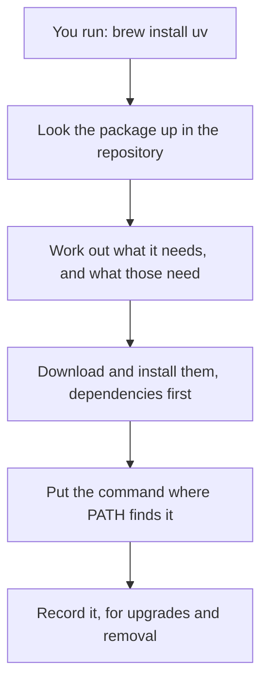

# Package managers

## The idea

cstudy runs your code with the real toolchain of each language: Python and uv, Node.js and pnpm, a JDK, Go, Rust. You install those yourself, and a **package manager** is the easy way to do it.

A package manager is a program that installs software for you. You name what you want, and it:

1. looks it up in a **repository**, a catalogue of software it knows how to install;
2. works out what that software needs to run, its **dependencies**, and what those need in turn;
3. downloads and installs each of them, dependencies first, skipping what you already have;
4. puts the commands where your shell finds them, on your [`PATH`](../using-the-terminal/guide.md#how-the-shell-finds-a-command);
5. remembers what it installed, so it can **upgrade** it later or **remove** it cleanly.



<!-- text-of-mermaid sha256:8bd2a154c700e3929d3314513e566cea36a6d101f63e895e4ebd02f822c73b09 -->
```text
┌─────────────────────────────────────────────┐
│           You run: brew install uv          │
└──────────────────────┬──────────────────────┘
                       ▼
┌─────────────────────────────────────────────┐
│    Look the package up in the repository    │
└──────────────────────┬──────────────────────┘
                       ▼
┌─────────────────────────────────────────────┐
│ Work out what it needs, and what those need │
└──────────────────────┬──────────────────────┘
                       ▼
┌─────────────────────────────────────────────┐
│Download and install them, dependencies first│
└──────────────────────┬──────────────────────┘
                       ▼
┌─────────────────────────────────────────────┐
│     Put the command where PATH finds it     │
└──────────────────────┬──────────────────────┘
                       ▼
┌─────────────────────────────────────────────┐
│     Record it, for upgrades and removal     │
└─────────────────────────────────────────────┘
```

The diagram shows the steps of one install, from the command you type to the record the package manager keeps.

Without a package manager you would download installers from websites, check versions by hand, and hunt for leftovers when you remove something. With one, the same three or four commands work for everything it knows.

There are two kinds, and cstudy uses both:

- A **system package manager** installs tools for your whole computer: Homebrew on macOS, apt on Debian and Ubuntu, dnf on Fedora. You use it to install the toolchains.
- A **language package manager** installs libraries for one project: uv for Python, pnpm for TypeScript, Gradle for Java and Kotlin, Go modules, and Cargo for Rust. You rarely run these yourself in cstudy: `cstudy doctor --fix` runs `uv sync`, `pnpm install` and the first Gradle build in your workspace for you.

## Homebrew on macOS

Homebrew is a package manager for macOS that runs on Linux too. Install it with the command on its home page, [brew.sh](https://brew.sh/), pasted into Terminal:

```bash
/bin/bash -c "$(curl -fsSL https://raw.githubusercontent.com/Homebrew/install/HEAD/install.sh)"
```

The script says what it will do and waits for you to confirm before it starts. When it finishes, it prints directions for updating your shell's config, a line like `eval "$(/opt/homebrew/bin/brew shellenv)"` to add to your config file. Follow them: Homebrew's documentation says that without them, Homebrew will not work, because the shell cannot find `brew`. Then open a new terminal.

Homebrew installs into its own directory, its **prefix**: `/opt/homebrew` on a Mac with Apple silicon, `/usr/local` on an Intel Mac, and `/home/linuxbrew/.linuxbrew` on Linux. Each package goes into a folder of its own there, and its commands are linked into the prefix's `bin`.

| Command | What it does |
|---------|--------------|
| `brew install uv` | Install a package and what it needs |
| `brew uninstall uv` | Remove it |
| `brew update` | Fetch the newest list of packages, and the newest Homebrew |
| `brew upgrade` | Upgrade every outdated package; `brew upgrade uv` upgrades one |
| `brew search jdk` | Find packages whose name contains the text |
| `brew list` | List what is installed |
| `brew deps --tree uv` | Show what a package needs, as a tree |
| `brew doctor` | Check your system for problems |

Run `brew` as yourself, never with `sudo`: Homebrew runs installs as the account that owns its prefix, so that a package's build scripts do not get full access to the system.

## apt on Debian and Ubuntu

Debian and Ubuntu come with apt, so there is nothing to install. Installing system software needs administrator rights, which `sudo` gives for one command at a time.

| Command | What it does |
|---------|--------------|
| `sudo apt update` | Refresh the list of available packages. It upgrades nothing |
| `sudo apt upgrade` | Upgrade the installed packages to their newest versions |
| `sudo apt install git` | Install a package and its dependencies |
| `sudo apt remove git` | Remove a package |
| `apt search jdk` | Search the list of packages |
| `apt show git` | Show a package's description and details |

Run `sudo apt update` before you install, so that apt knows about the current versions.

## dnf on Fedora

Fedora's package manager is dnf. Since Fedora 41, the `dnf` command runs DNF5, its newest major version, and the commands below work the same way.

| Command | What it does |
|---------|--------------|
| `sudo dnf install git` | Install a package and its dependencies |
| `sudo dnf upgrade` | Upgrade every installed package; `sudo dnf upgrade git` upgrades one |
| `sudo dnf remove git` | Remove a package, and the dependencies nothing else uses any more |
| `dnf search jdk` | Search package names and summaries |

## WSL on Windows

cstudy runs on macOS and Linux, not on Windows itself. WSL, the Windows Subsystem for Linux, runs a Linux distribution inside Windows, and from there you use that distribution's package manager.

1. You need Windows 10 version 2004 or later (build 19041 or later), or Windows 11.
2. Open PowerShell as administrator (right-click it and choose **Run as administrator**) and run:

   ```powershell
   wsl --install
   ```

3. Restart Windows. The command installs Ubuntu unless you choose another distribution with `-d`.
4. Start Ubuntu from the Start menu, wait while it unpacks, and create a Linux user name and password when it asks.

From then on you are on Ubuntu: use `apt`, and follow the Linux steps of each install guide. Microsoft recommends Windows Terminal to open it. cstudy is not tested inside WSL, so treat it as a Linux machine you set up yourself.

## A worked example

Installing a package can install many more. This program models what a package manager works out before it downloads anything, with made-up packages: `editor` needs `spellcheck` and `syntax`, `spellcheck` needs `dictionary` and `unicode`, and `syntax` needs `unicode` too.

```python examples/install_order.py
"""A package manager installs what a package needs before the package itself, each one once."""

# Made-up packages and what each one needs.
NEEDS = {
    "editor": ["spellcheck", "syntax"],
    "spellcheck": ["dictionary", "unicode"],
    "syntax": ["unicode"],
    "dictionary": [],
    "unicode": [],
}


def install_order(package: str, installed: set[str]) -> list[str]:
    """Every package to install for `package`, dependencies first, skipping what is installed."""
    order: list[str] = []

    def visit(name: str) -> None:
        if name in installed or name in order:
            return
        for dependency in NEEDS[name]:
            visit(dependency)
        order.append(name)

    visit(package)
    return order


print("install editor on an empty machine:", install_order("editor", set()))
print("install editor when unicode is there:", install_order("editor", {"unicode"}))
print("install syntax alone:", install_order("syntax", set()))


def broken_by_removing(package: str) -> list[str]:
    """Every other package that needs `package`, directly or through another package."""
    return [name for name in NEEDS if name != package and package in install_order(name, set())]


print("removing unicode would break:", broken_by_removing("unicode"))
print("removing editor would break:", broken_by_removing("editor"))
```

It prints:

```output examples/install_order.py
install editor on an empty machine: ['dictionary', 'unicode', 'spellcheck', 'syntax', 'editor']
install editor when unicode is there: ['dictionary', 'spellcheck', 'syntax', 'editor']
install syntax alone: ['unicode', 'syntax']
removing unicode would break: ['editor', 'spellcheck', 'syntax']
removing editor would break: []
```

Trace the first line. To install `editor`, the program first visits what `editor` needs, in order:

1. `spellcheck` needs `dictionary`, which needs nothing: `dictionary` goes first.
2. `spellcheck` also needs `unicode`, which needs nothing: `unicode` is second. Now `spellcheck` has all it needs and is third.
3. `syntax` needs `unicode`, which is already on the list, so it is not added twice. `syntax` is fourth.
4. Finally `editor` itself.

You asked for one package and got five. The second line shows a package manager skipping what is already installed. The last two lines show why removing is more careful than installing: three packages depend on `unicode`, directly or through `spellcheck` and `syntax`, while nothing depends on `editor`.

Real package managers do the same work with thousands of packages, and with versions too: they pick a version of every package so that all the requirements are met at once, which uv's documentation calls resolution.

Here is the real thing, the first steps of the toolchains guide for Python, on macOS and on Ubuntu. On both, uv then installs Python 3.13:

```bash
brew install uv                                   # macOS, with Homebrew
curl -LsSf https://astral.sh/uv/install.sh | sh   # macOS or Linux, uv's own installer
uv python install 3.13
```

## When to use it

- **For the toolchains**, use your system package manager, or the installer a toolchain recommends. cstudy's [toolchains guide](https://github.com/bkuberek/coding-study/blob/main/docs/guides/toolchains.md) gives the recommended way for each language, and it is not always the system package: it recommends rustup over Homebrew's Rust, the archive from go.dev over a Linux distribution's often older Go, and a JDK from 21 to 26, while Homebrew's plain `openjdk` is JDK 27, which cstudy does not support yet.
- **For a project's libraries**, use the language's package manager in that project. In a cstudy workspace, `cstudy doctor --fix` does this for you.
- **For several versions of one toolchain**, use a version manager, which installs versions side by side and switches between them: the toolchains guide uses fnm for Node.js, SDKMAN! for the JDK and rustup for Rust.
- **For an app with a window**, Homebrew installs those too, as **casks**: pre-built applications, fonts and plugins.

## Common traps

- **`brew: command not found` right after installing Homebrew.** You skipped the config line it printed, or this terminal started before you added it. Add the line, then open a new terminal.
- **`sudo brew`.** Homebrew is meant to run as you: it installs as the account that owns its prefix. Run it without `sudo`.
- **`apt install` without `apt update`.** apt installs from the list it last fetched, which can be old or missing on a fresh system.
- **Two copies of a tool.** A `python3` from Homebrew and one from the system can both be installed; the one whose directory comes first on `PATH` runs. `command -v python3` tells you which.
- **The newest version is not always the right one.** cstudy supports JDK 21 to 26 and Python 3.13. Read what the toolchains guide asks for before you upgrade, and run `cstudy doctor` after.
- **Pasting an install command you did not read.** A `curl ... | sh` line runs a script from the internet with your permissions. Use the command from the tool's official page, and read the script first when you do not know the project.

## Complexity

The cost of an install is mostly the downloads and the disk space, and both grow with the dependencies, not only with the package you asked for.

| Step | Cost | Why |
|------|------|-----|
| Working out the install order | Each package and each dependency link once | As in the example: a package already on the list is not visited again |
| Downloading and installing | One download per missing package | Already installed packages are skipped |
| Disk space | The package plus every dependency not yet installed | `editor` cost five packages on an empty machine and four with `unicode` present |
| Upgrading | Every outdated package, with old versions kept until cleaned up | After each install or upgrade, Homebrew runs `brew cleanup` for those packages, removing their old versions, and every 30 days for all packages; `brew cleanup` runs it now |

When no set of versions meets every requirement, there is nothing to install: uv, for example, stops with `No solution found when resolving dependencies`.

## Expert notes

- **Homebrew's layout.** Homebrew installs each package into its own folder, a keg, inside its Cellar, and links the files into the prefix, so one package's files never mix with another's.
- **Formulae and casks.** A formula is Homebrew's definition of a package; a cask installs pre-built upstream binaries, such as applications, fonts and plugins. Both install with `brew install`.
- **Who owns what.** apt and dnf change the system's own software, which is why they need `sudo`. Homebrew runs its installs as the account that owns its prefix, which is why it must not.
- **DNF5.** Fedora 41 made DNF5 the default and pointed the `dnf` and `yum` commands at it. By default `dnf remove` also removes dependencies that nothing else needs; `apt remove` keeps a package's configuration files, and `apt purge` removes them too.
- **WSL versions.** New installs with `wsl --install` use WSL 2. Homebrew supports WSL 2, and recommends moving off WSL 1.
- **Language package managers keep a lock file.** uv's `uv.lock` and Cargo's `Cargo.lock` hold the exact versions that were resolved, so the next install gets the same ones; both are managed by the tool and not edited by hand. A cstudy workspace has `uv.lock` in `python/` and pnpm's `pnpm-lock.yaml` in `typescript/`.

## Practice

This guide has no cstudy problem of its own. Install the toolchain of the language you want to practise, following the [toolchains guide](https://github.com/bkuberek/coding-study/blob/main/docs/guides/toolchains.md), then read the guide for that language. Each says what to learn before your first problem, where to learn it for free, and which `cstudy doctor` rows to check:

- [Learn Python first](../learn-python-first/guide.md)
- [Learn TypeScript first](../learn-typescript-first/guide.md)
- [Learn Java first](../learn-java-first/guide.md)
- [Learn Kotlin first](../learn-kotlin-first/guide.md)
- [Learn Go first](../learn-go-first/guide.md)
- [Learn Rust first](../learn-rust-first/guide.md)

Then go on to [your first problem](../your-first-problem/guide.md).

## Further reading

- [Homebrew](https://brew.sh/): the install command.
- [Homebrew installation](https://docs.brew.sh/Installation): requirements, the prefix, and the config line it prints.
- [Homebrew on Linux](https://docs.brew.sh/Homebrew-on-Linux): the Linux prefix and WSL 2.
- [Homebrew manual page](https://docs.brew.sh/Manpage): every `brew` command, and the 30-day cleanup.
- [Homebrew FAQ](https://docs.brew.sh/FAQ): why not `sudo`, the default prefixes, and updating.
- [Ubuntu Server: managing your software](https://ubuntu.com/server/docs/tutorial/managing-software/): apt's `update`, `upgrade`, `install`, `remove`, `search` and `show`, and `sudo`.
- [DNF5 commands](https://dnf5.readthedocs.io/en/latest/commands/install.8.html): `install`, with `upgrade`, `remove` and `search` beside it.
- [Fedora change: switch to DNF5](https://fedoraproject.org/wiki/Changes/SwitchToDnf5): DNF5 as `dnf` from Fedora 41.
- [Install WSL](https://learn.microsoft.com/en-us/windows/wsl/install): requirements, `wsl --install`, and the first start.
- [uv](https://docs.astral.sh/uv/), [pnpm](https://pnpm.io/motivation), [Cargo](https://doc.rust-lang.org/cargo/), [Go modules](https://go.dev/ref/mod) and [the Gradle Wrapper](https://docs.gradle.org/current/userguide/gradle_wrapper.html): the language package managers of the workspace.
- [Install the language toolchains](https://github.com/bkuberek/coding-study/blob/main/docs/guides/toolchains.md): cstudy's guide to each toolchain, for macOS and Linux.
