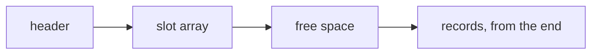
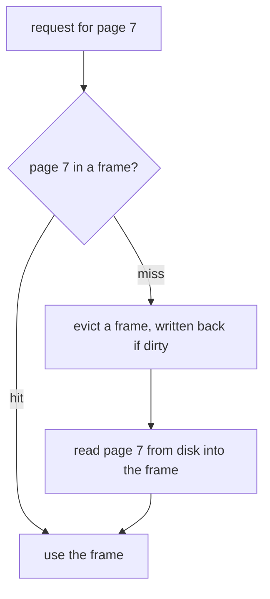

# Pages and records: how a table sits on disk

## The idea

A program keeps its data in memory, where reading any byte costs about the same. A database keeps its data in files, because the data must survive a restart and is often larger than memory. Files live on a **storage device**, a disk or a solid-state drive, and the device does not hand out single bytes: it reads and writes whole blocks. So a database divides every file into **pages**, blocks of one fixed size, and moves data between the file and memory one page at a time. PostgreSQL stores every table and every index as an array of pages, usually 8 kB each, a size chosen when the server is compiled. SQLite's page size is a power of two from 512 to 65,536 bytes, the same for every page of one database file.

A **table** is a set of **rows**, also called **records** or **tuples**, each with the same named columns. Where does a row go? In PostgreSQL's tables every page is equivalent, so a row can be stored in any page that has room. Such a file of rows in no particular order is called a **heap** (nothing to do with the heap data structure). The rows of a table therefore come back in whatever order the pages hold them, and a lookup by value has to read every page unless an index says where to look, which is the subject of the next guide.

Inside a page, rows have different lengths: a name can be 3 characters or 300, and a column can be empty. The common layout for variable-length records is the **slotted page**:

- a small **header** at the start says where the free space begins and ends;
- after it comes an array of **slots**, one per record, each holding the record's offset in the page and its length;
- the **records** themselves are packed from the end of the page backwards;
- the **free space** is the gap in the middle, which the slot array and the records grow into from opposite sides.

PostgreSQL's pages are laid out this way: a 24-byte header, then item identifiers of 4 bytes each (an offset and a length), allocated from the start of the free space, while the rows are allocated from its end. SQLite's B-tree pages have the same shape: a page header of 8 or 12 bytes, a **cell pointer array** of 2-byte offsets, unallocated space, and the cell content area, which SQLite fills from the end of the page so that the pointer array has room to grow.



<!-- text-of-mermaid sha256:af51e99c8e6febe045839240ab31323642432bbffdf7f4003edfd8fe2f17bdf2 -->
```text
┌──────┐    ┌──────────┐    ┌──────────┐    ┌─────────────────────┐
│header├───►│slot array├───►│free space├───►│records, from the end│
└──────┘    └──────────┘    └──────────┘    └─────────────────────┘
```

The drawing reads left to right as the bytes of one page do. New slots are added at the right end of the slot array and new records at the left end of the record area, so a page is full when the two meet in the middle.

The slot gives every record a stable address: the page number and the slot number. PostgreSQL calls this pair a CTID, and its documentation spells out why the indirection matters: an item identifier is never moved until it is freed, so its number keeps identifying the row even when the row's bytes move within the page to compact free space. An index can store "page 812, slot 3" and stay correct while the page is reorganized underneath it.

A record has a small header of its own before its columns. In PostgreSQL every row starts with a fixed header of 23 bytes on most machines, followed, when some column is null, by a **null bitmap** with one bit per column, and then the column values, starting at an offset aligned for the machine. A row with a single 4-byte integer column therefore takes several times its data in bookkeeping, which matters when you count how many rows fit in a page.

Memory is where work happens, so a database keeps recently used pages in a **buffer pool**: a fixed number of page-sized **frames** in memory. A request for a page is a **hit** when the page is already in a frame and a **miss** otherwise, in which case the page is read from the file into a frame, evicting another page if every frame is taken. A page changed in memory is **dirty** until it is written back to the file.



<!-- text-of-mermaid sha256:c9d5b761234bbb763861fb92aa4bb71a4ddd230b9bdc8dbdbacc0c59570445b1 -->
```text
┌────────────────────────────────────┐
│         request for page 7         │
└──────────────────┬─────────────────┘
                   ▼
◇────────────────────────────────────◇
│         page 7 in a frame?         ├─────────────────────miss
◇─────────────────hit────────────────◇                       │
                   ▼                                         ▼
┌────────────────────────────────────┐    ┌────────────────────────────────────┐
│           use the frame            │    │evict a frame, written back if dirty│
└────────────────────────────────────┘    └──────────────────┬─────────────────┘
                   ▲                                         │
┌──────────────────┴─────────────────┐                       │
│read page 7 from disk into the frame│◄──────────────────────┘
└────────────────────────────────────┘
```

On a hit nothing touches the disk. On a miss the pool may have to write a dirty page before it can read the one asked for, so one read can cost two disk operations.

## A worked example

### A slotted page in 128 bytes

This program builds a slotted page in a `bytearray` of 128 bytes, small enough to read every offset. It inserts four records, deletes one, and shows the two problems a page must handle: free bytes split into pieces, and records that move while their ids stay put.

```python examples/slotted_page.py
"""A slotted page: records at the end, a slot array at the start, and free space in between.

The page is a bytearray of 128 bytes. Its first 4 bytes hold two offsets: where the slot array
ends ("lower") and where the records start ("upper"). Each slot is 4 bytes: the record's offset
and length. A record's id is its slot number, which never changes while the record lives, even
when compaction moves the record's bytes.
"""

import struct

PAGE_SIZE = 128
HEADER = struct.Struct(">HH")  # lower, upper
SLOT = struct.Struct(">HH")  # offset, length; length 0 marks a free slot


class SlottedPage:
    def __init__(self) -> None:
        self.data = bytearray(PAGE_SIZE)
        HEADER.pack_into(self.data, 0, HEADER.size, PAGE_SIZE)

    def _bounds(self) -> tuple[int, int]:
        return HEADER.unpack_from(self.data, 0)

    def _slot(self, n: int) -> tuple[int, int]:
        return SLOT.unpack_from(self.data, HEADER.size + n * SLOT.size)

    def slot_count(self) -> int:
        lower, _ = self._bounds()
        return (lower - HEADER.size) // SLOT.size

    def free_space(self) -> int:
        lower, upper = self._bounds()
        return upper - lower

    def insert(self, record: bytes) -> int | None:
        lower, upper = self._bounds()
        reuse = next((n for n in range(self.slot_count()) if self._slot(n)[1] == 0), None)
        needed = len(record) + (0 if reuse is not None else SLOT.size)
        if needed > upper - lower:
            return None
        upper -= len(record)
        self.data[upper : upper + len(record)] = record
        n = reuse if reuse is not None else self.slot_count()
        SLOT.pack_into(self.data, HEADER.size + n * SLOT.size, upper, len(record))
        if reuse is None:
            lower += SLOT.size
        HEADER.pack_into(self.data, 0, lower, upper)
        return n

    def read(self, n: int) -> bytes | None:
        offset, length = self._slot(n)
        return bytes(self.data[offset : offset + length]) if length else None

    def delete(self, n: int) -> None:
        SLOT.pack_into(self.data, HEADER.size + n * SLOT.size, 0, 0)

    def compact(self) -> None:
        """Move the live records to the end of the page; their slot numbers stay the same."""
        lower, _ = self._bounds()
        live = [(n, self.read(n)) for n in range(self.slot_count())]
        upper = PAGE_SIZE
        for n, record in live:
            if record is not None:
                upper -= len(record)
                self.data[upper : upper + len(record)] = record
                SLOT.pack_into(self.data, HEADER.size + n * SLOT.size, upper, len(record))
        HEADER.pack_into(self.data, 0, lower, upper)


def show(page: SlottedPage, label: str) -> None:
    lower, upper = page._bounds()
    slots = []
    for n in range(page.slot_count()):
        offset, length = page._slot(n)
        slots.append(f"{n}@{offset}+{length}" if length else f"{n}:free")
    print(f"{label:<28} lower={lower:<3} upper={upper:<3} free={page.free_space():<3}", *slots)


page = SlottedPage()
show(page, "empty page")
for text in ["ada:analytical engine", "grace:compiler", "edsger:shortest paths"]:
    page.insert(text.encode())
page.insert(b"barbara:abstract data types and clu")
show(page, "after four inserts")

record = b"frances:program optimization"
print(f"insert of {len(record)} bytes -> {page.insert(record)}")
page.delete(1)
show(page, "after deleting slot 1")
print(f"insert of {len(record)} bytes -> {page.insert(record)} (the free bytes are in two pieces)")
page.compact()
show(page, "after compaction")
print(f"insert of {len(record)} bytes -> slot {page.insert(record)}")
show(page, "after the insert")
print("slot 0 still reads", page.read(0).decode(), "and slot 3", page.read(3).decode())
```

It prints:

```output examples/slotted_page.py
empty page                   lower=4   upper=128 free=124
after four inserts           lower=20  upper=37  free=17  0@107+21 1@93+14 2@72+21 3@37+35
insert of 28 bytes -> None
after deleting slot 1        lower=20  upper=37  free=17  0@107+21 1:free 2@72+21 3@37+35
insert of 28 bytes -> None (the free bytes are in two pieces)
after compaction             lower=20  upper=51  free=31  0@107+21 1:free 2@86+21 3@51+35
insert of 28 bytes -> slot 1
after the insert             lower=20  upper=23  free=3   0@107+21 1@23+28 2@86+21 3@51+35
slot 0 still reads ada:analytical engine and slot 3 barbara:abstract data types and clu
```

Read the slots as `number@offset+length`:

- **After four inserts** the slot array ends at byte 20 and the records start at byte 37, so 17 bytes are free. The records sit right to left in the order they arrived: slot 0 at byte 107, slot 3 at byte 37.
- **A 28-byte record does not fit**: it needs 28 bytes for itself and 4 for a new slot.
- **Deleting slot 1** marks the slot free but leaves a 14-byte hole between slots 0 and 2. Now 31 bytes are free in all, yet the record still does not fit, because no 28 of them are contiguous.
- **Compaction** slides the live records to the end of the page. Slot 2 moves from byte 72 to 86 and slot 3 from 37 to 51, but they keep their numbers, so anything that refers to "slot 3" still finds the same record. The free bytes are now one gap of 31.
- **The insert succeeds** and reuses the free slot 1, so it needs no new slot.

### A buffer pool with three frames

The second program puts a buffer pool of three frames, evicting the least recently used page, in front of a counting disk:

```python examples/buffer_pool.py
"""A buffer pool: a few page frames in memory in front of a disk, with least-recently-used eviction.

Every request for a page is a hit when the page is already in a frame, and a read from disk
otherwise. A changed page is "dirty": it is written back to disk only when it leaves its frame,
or when the pool is flushed.
"""

from collections import OrderedDict


class BufferPool:
    def __init__(self, frames: int) -> None:
        self.frames = frames
        self.pages: OrderedDict[int, bool] = OrderedDict()  # page number -> dirty
        self.hits = self.reads = self.writes = 0

    def get(self, page: int, *, change: bool = False) -> None:
        if page in self.pages:
            self.hits += 1
            self.pages.move_to_end(page)
        else:
            if len(self.pages) == self.frames:
                _, dirty = self.pages.popitem(last=False)  # the least recently used page
                if dirty:
                    self.writes += 1
            self.reads += 1
            self.pages[page] = False
        if change:
            self.pages[page] = True

    def flush(self) -> None:
        for page, dirty in self.pages.items():
            if dirty:
                self.writes += 1
                self.pages[page] = False


def run(label: str, requests: list[int], frames: int = 3, changes: frozenset = frozenset()):
    pool = BufferPool(frames)
    for i, page in enumerate(requests):
        pool.get(page, change=i in changes)
    pool.flush()
    print(
        f"{label:<34} {len(requests):>2} requests  {pool.hits:>2} hits"
        f"  {pool.reads:>2} reads  {pool.writes:>2} writes"
    )


run("hot pages 1 and 2, now and then 3", [1, 2, 1, 3, 1, 2, 1, 2, 3, 1, 2, 1])
run("scan of 4 pages, twice", [1, 2, 3, 4, 1, 2, 3, 4])
run("scan of 3 pages, twice", [1, 2, 3, 1, 2, 3])
run("page 7 changed 5 times", [7, 7, 7, 7, 7], changes=frozenset(range(5)))
run("5 pages changed once each", [1, 2, 3, 4, 5], changes=frozenset(range(5)))
```

It prints:

```output examples/buffer_pool.py
hot pages 1 and 2, now and then 3  12 requests   9 hits   3 reads   0 writes
scan of 4 pages, twice              8 requests   0 hits   8 reads   0 writes
scan of 3 pages, twice              6 requests   3 hits   3 reads   0 writes
page 7 changed 5 times              5 requests   4 hits   1 reads   1 writes
5 pages changed once each           5 requests   0 hits   5 reads   5 writes
```

- **Hot pages** stay in memory: twelve requests cost three reads, one per distinct page.
- **A scan of four pages, twice**, gets no hit at all. Each request evicts the page that was used longest ago, and in a repeated scan that is exactly the page needed next. With three pages, which fit, the second scan is all hits. A pool that evicts the least recently used page is a poor fit for scans larger than itself.
- **Writes are deferred and combined.** Five changes to page 7 cost one write, when the pool is flushed. Five pages changed once each cost five writes. Until that write happens, the changes exist only in memory, which is what the guide on write-ahead logging deals with.

## When to use it

Every disk-based database already stores pages; the decisions you make are about what goes in them.

- **Estimate rows per page** when you size a table or reason about a scan: subtract the page header, add the slot and the row header to each row, and divide. A full scan reads every page, so its cost follows the number of pages, not the number of rows you want.
- **Keep rows narrow** when a table is scanned often. Wide rows mean fewer rows per page and more pages per scan. Large values that are rarely read belong in a table of their own. PostgreSQL does not let a row span pages: a row wider than about 2 kB has its large values compressed or moved out of line into a separate table, a technique it calls TOAST.
- **Leave room in pages** that are updated in place. PostgreSQL's `fillfactor` storage parameter leaves part of each table page empty on insert, so that a later version of a row can go on the same page.
- **Prefer an index** when a query needs a few rows by value: a heap has no order, so without one the database reads every page.
- **Think about the buffer pool** when the same small table or index is read constantly: it stays in memory, and its cost is mostly CPU, not disk.

## Common traps

- **Expecting rows back in insertion order.** A heap has no order. PostgreSQL's documentation says that without `ORDER BY`, rows are returned in whatever order the system finds fastest to produce. A fresh table may happen to return them in the order they were inserted; nothing keeps it so once deletes free space in old pages and new rows land there.
- **Counting only the data bytes.** A row of two integers is not 8 bytes on disk: the slot, the row header and alignment come first. Estimates of table size that skip them are off by a large factor for narrow rows.
- **Treating a row's address as permanent.** The slot number survives compaction within the page, but an update in PostgreSQL writes a new version of the row, often elsewhere, as the guide on MVCC (multiversion concurrency control) shows. A stored CTID is a hint, not a key.
- **Assuming a write reached the disk.** A dirty page lives in the buffer pool, and even a page handed to the operating system may sit in its cache. Durability needs the write-ahead log, not a hope about when pages are flushed.
- **Believing a bigger buffer pool always helps.** The example's repeated scan of four pages gets nothing from three frames; it needs four. A workload that scans more than fits gains little until the whole working set fits.

## Complexity

| Operation | Cost |
|-----------|------|
| Read a row by its address (page, slot) | one page read, or none on a buffer pool hit |
| Insert a row | find a page with room (PostgreSQL keeps a free space map for this), then one page write, deferred |
| Delete a row | mark its slot free; the space is reclaimed later by compaction (PostgreSQL first keeps the deleted row for transactions, groups of reads and writes run as one unit, that may still see it, as the guide on MVCC explains) |
| Full scan of a table of n rows | ⌈n / rows per page⌉ page reads, in file order |
| Compact one page | O(page size): every live record is copied once |

A worked number: with 8,192-byte pages, a 24-byte page header, a 4-byte slot, a 24-byte row header (23 bytes, rounded up to a multiple of 8 on a machine that aligns to 8 bytes) and 100 bytes of data, each row takes 128 bytes, and (8,192 − 24) / 128 rounds down to 63 rows per page. A table of 1,000,000 such rows fills ⌈1,000,000 / 63⌉ = 15,874 pages, about 124 MiB, and a full scan reads all of them, even to return one row. This model ignores the alignment of each row's start and other details of a real page; it shows the order of magnitude.

## Expert notes

- **Files beyond one gigabyte.** PostgreSQL splits a table or index larger than 1 GB into gigabyte-sized segment files, so no single file exceeds the limits of some platforms; 1 GB is the default and can be changed when PostgreSQL is built.
- **Maps beside the heap.** PostgreSQL keeps two small companions for each table. The **free space map** records, in one byte per heap page, how much space the page has, in a tree of map pages, so an insert finds a page with room without reading the heap. The **visibility map** keeps two bits per heap page: whether every row on it is visible to all transactions, and whether every row on it is frozen, marked as written so long ago that every current and future transaction sees it; the guides on B-trees and MVCC use both.
- **Heap-only tuples.** An update in PostgreSQL adds a new version of the row. When the update changes no indexed column and the old row's page has room, PostgreSQL makes it a **heap-only tuple** (HOT): no new index entries are needed, and when old versions are removed, the item identifier the indexes point to becomes a redirect to the oldest version some transaction may still see. Lowering a table's `fillfactor` makes room for such updates more likely.
- **Rows in the index itself.** SQLite stores an ordinary table as a B-tree keyed by a 64-bit signed integer, the rowid, with all row data in the leaves; its indexes are separate B-trees with arbitrary keys and no data, and a payload too large for a page continues on overflow pages. PostgreSQL keeps every table as a heap beside its indexes. The next guide shows what each layout means for a lookup.
- **Torn pages.** A page is larger than the unit a disk writes atomically, so a power failure can leave half a page new and half old. The guide on write-ahead logging shows how PostgreSQL protects against it.

## Practice

This guide has no problem of its own. The next guides of the path build on pages:

- [B-tree indexes](../b-tree-indexes/guide.md): a tree whose nodes are pages, with `btree-index`, which counts the pages a range scan reads.
- [Write-ahead logging](../write-ahead-logging/guide.md): how changes to pages survive a crash, with `transactional-kv-store`.

## Further reading

- [PostgreSQL documentation, *Database Page Layout*](https://www.postgresql.org/docs/current/storage-page-layout.html): the page header, item identifiers, the free space in the middle, the row header and the null bitmap.
- [PostgreSQL documentation, *Database File Layout*](https://www.postgresql.org/docs/current/storage-file-layout.html): one file per table and index, split into 1 GB segments.
- [PostgreSQL documentation, *Free Space Map*](https://www.postgresql.org/docs/current/storage-fsm.html) and [*Visibility Map*](https://www.postgresql.org/docs/current/storage-vm.html): the two maps kept beside each heap.
- [PostgreSQL documentation, *Heap-Only Tuples (HOT)*](https://www.postgresql.org/docs/current/storage-hot.html): updates that need no new index entries.
- [PostgreSQL documentation, *TOAST*](https://www.postgresql.org/docs/current/storage-toast.html) and [*CREATE TABLE*, storage parameters](https://www.postgresql.org/docs/current/sql-createtable.html): large values moved out of line, and a table's `fillfactor`.
- [PostgreSQL documentation, *Reliability*](https://www.postgresql.org/docs/current/wal-reliability.html): a disk reads and writes whole sectors, and what that means for a page write.
- [SQLite, *Database File Format*](https://www.sqlite.org/fileformat2.html): the page size, table and index B-trees, the cell pointer array and overflow pages.
- [Python, `struct`](https://docs.python.org/3/library/struct.html) and [`collections.OrderedDict`](https://docs.python.org/3/library/collections.html#collections.OrderedDict): packing offsets into bytes, and a dictionary whose order makes an LRU cache easy.
