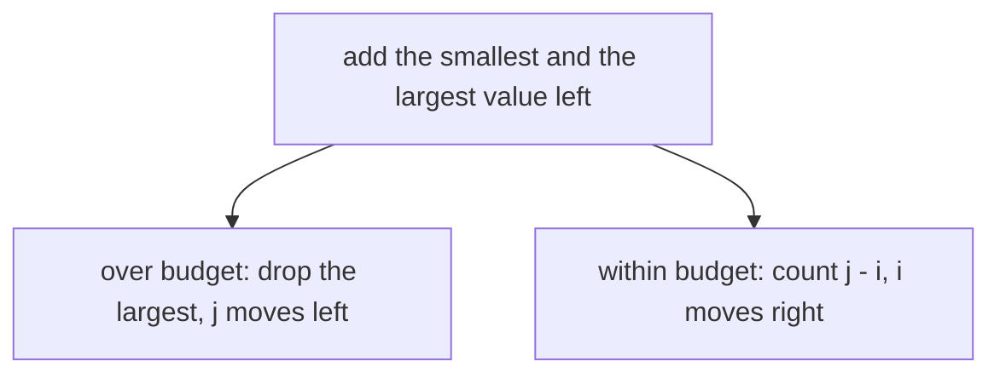
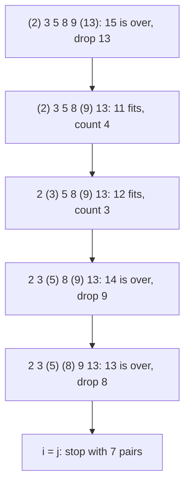

# Pairs in a sorted array

## The idea

Many questions ask about pairs of values: is there a pair that adds up to a target, how many pairs fit within a budget, which pair comes closest. An array of `n` values has `n(n - 1) / 2` pairs, and checking them all is O(n²). When the array is **sorted**, two pointers check one pair per step and still account for all of them.

Take a sorted array, `a[0] <= a[1] <= ... <= a[n - 1]`. Put `i` at the first position and `j` at the last, and look at the one sum `a[i] + a[j]`. Between the two pointers, `a[i]` is the smallest value still in play and `a[j]` the largest. So that single sum says something about a whole set of pairs:

- If `a[i] + a[j]` is **too large**, then `a[j]` is too large for every partner left. Its smallest possible partner is `a[i]`, and even that sum is too large. Every remaining pair that uses `j` fails: move `j` one place left.
- If `a[i] + a[j]` is **too small**, then `a[i]` is too small for every partner left, since its largest possible partner is `a[j]`. Every remaining pair that uses `i` fails: move `i` one place right.

Each step looks at one pair and settles every remaining pair of one value. Picture the pairs as a triangle of rows `i` and columns `j`, with `i < j`: each step crosses out a whole row or a whole column. The triangle is gone after at most `n - 1` steps.

The question decides what happens when the sum is neither too large nor too small. To find a pair with an exact target, you stop. To count pairs within a budget, the diagram shows the rule, repeated while `i < j`: when the sum fits, the smallest value left fits with every partner from `i + 1` to `j`, since each of them is at most the largest one.



<!-- text-of-mermaid sha256:1df950ce9f48002ed9340ad98bbaeafc53cfa9e43f16f745b65d9ea459f7d192 -->
```text
┌───────────────────────────────────────────┐
│add the smallest and the largest value left│
└───────────────────────────────────────────┘
                      ▼───────────────────────────────────────────────▼
┌───────────────────────────────────────────┐    ┌─────────────────────────────────────────┐
│over budget: drop the largest, j moves left│    │within budget: count j - i, i moves right│
└───────────────────────────────────────────┘    └─────────────────────────────────────────┘
```

## A worked example

Six items cost `[2, 3, 5, 8, 9, 13]`, already sorted, and you have 12 to spend. How many ways are there to buy two different items?



<!-- text-of-mermaid sha256:359f5cad192558b0893b780f07d89e9bd6fe8a5aad7a749dcbf72134abacb23a -->
```text
┌─────────────────────────────────────┐
│(2) 3 5 8 9 (13): 15 is over, drop 13│
└──────────────────┬──────────────────┘
                   ▼
┌─────────────────────────────────────┐
│  (2) 3 5 8 (9) 13: 11 fits, count 4 │
└──────────────────┬──────────────────┘
                   ▼
┌─────────────────────────────────────┐
│  2 (3) 5 8 (9) 13: 12 fits, count 3 │
└──────────────────┬──────────────────┘
                   ▼
┌─────────────────────────────────────┐
│ 2 3 (5) 8 (9) 13: 14 is over, drop 9│
└──────────────────┬──────────────────┘
                   ▼
┌─────────────────────────────────────┐
│ 2 3 (5) (8) 9 13: 13 is over, drop 8│
└──────────────────┬──────────────────┘
                   ▼
┌─────────────────────────────────────┐
│       i = j: stop with 7 pairs      │
└─────────────────────────────────────┘
```

The values in parentheses are under `i` and `j`. Five steps account for all 15 pairs: two steps counted 7 pairs at once, and three steps ruled out the other 8.

**Why it is right.** The loop keeps this invariant: every pair `(p, q)` with `p < q` that lies **outside** the range from `i` to `j`, meaning `p < i` or `q > j`, has been counted if it fits, exactly once; and no pair inside the range has been counted.

- At the start, `i = 0` and `j = n - 1`, so no pair lies outside and nothing has been counted.
- If `a[i] + a[j]` is over the budget, then for every `k` from `i` to `j - 1`, `a[k] + a[j] >= a[i] + a[j]`, so no pair `(k, j)` fits. Moving `j` left moves exactly those pairs outside the range, and none of them needed counting.
- Otherwise, for every `k` from `i + 1` to `j`, `a[i] + a[k] <= a[i] + a[j]`, which fits, so all `j - i` pairs `(i, k)` inside the range fit. Counting them and moving `i` right moves exactly those pairs outside, each counted once.
- When the loop ends, `i >= j`, no pair is left inside the range, and the invariant says every fitting pair was counted exactly once.

The gap `j - i` shrinks by 1 at every step, so the loop ends after at most `n - 1` steps.

The program below runs the trace, checks it against every pair, then checks both the pair count and a **triple** count against brute force for every sorted list of up to six values from 0 to 5 and every budget from 0 to 11. The triple count fixes the smallest of the three values and counts the pairs after it, one scan per fixed value. The last line shows how to sort an unsorted list without losing where each value came from.

```python examples/sorted_pairs.py
"""Close in from both ends of a sorted list: each step settles every remaining pair of one value."""

from itertools import combinations, combinations_with_replacement


def count_pairs_within(prices: list[int], budget: int, start: int = 0, trace: bool = False) -> int:
    """How many pairs of different positions from `start` on have a sum of at most `budget`."""
    i, j, count = start, len(prices) - 1, 0
    while i < j:
        total = prices[i] + prices[j]
        if total > budget:  # prices[j] is too dear even with the cheapest partner left
            if trace:
                print(f"  i={i} j={j}: {prices[i]} + {prices[j]} = {total} > {budget}: drop {prices[j]}")
            j -= 1
        else:  # prices[i] fits with every partner from i + 1 to j
            if trace:
                print(f"  i={i} j={j}: {prices[i]} + {prices[j]} = {total} <= {budget}: count {j - i}")
            count += j - i
            i += 1
    return count


def count_triples_within(prices: list[int], budget: int) -> int:
    """Fix the smallest of the three, then count the pairs after it."""
    return sum(
        count_pairs_within(prices, budget - prices[first], start=first + 1)
        for first in range(len(prices))
    )


prices = [2, 3, 5, 8, 9, 13]
print("pairs within 12 among", prices)
pairs = count_pairs_within(prices, 12, trace=True)
every_pair = sum(1 for a, b in combinations(prices, 2) if a + b <= 12)
print("pairs:", pairs, "| checking every pair:", every_pair)

cases = disagreements = 0
for size in range(7):
    for values in combinations_with_replacement(range(6), size):  # every sorted list
        for budget in range(12):
            cases += 1
            pairs_ok = count_pairs_within(list(values), budget) == sum(
                1 for a, b in combinations(values, 2) if a + b <= budget
            )
            triples_ok = count_triples_within(list(values), budget) == sum(
                1 for a, b, c in combinations(values, 3) if a + b + c <= budget
            )
            disagreements += not (pairs_ok and triples_ok)
print(f"pairs and triples against every combination: {cases} cases, {disagreements} disagreements")

unsorted = [9, 2, 13, 5, 3, 8]
by_value = sorted((value, position) for position, value in enumerate(unsorted))
print("sorted with original positions:", by_value)
```

It prints:

```output examples/sorted_pairs.py
pairs within 12 among [2, 3, 5, 8, 9, 13]
  i=0 j=5: 2 + 13 = 15 > 12: drop 13
  i=0 j=4: 2 + 9 = 11 <= 12: count 4
  i=1 j=4: 3 + 9 = 12 <= 12: count 3
  i=2 j=4: 5 + 9 = 14 > 12: drop 9
  i=2 j=3: 5 + 8 = 13 > 12: drop 8
pairs: 7 | checking every pair: 7
pairs and triples against every combination: 11088 cases, 0 disagreements
sorted with original positions: [(2, 1), (3, 4), (5, 3), (8, 5), (9, 0), (13, 2)]
```

The scan and the brute force agree on all 11,088 cases, including lists with repeated values, which the proof covers: it only ever uses `<=`, never `<`. In the last line, each value carries its original position: tuples compare by their first element, then by the next, so the list sorts by value, and the position comes along.

## When to use it

- The array is **sorted**, or you may sort it: the question does not depend on the original order, or you can carry the positions along.
- The question is about **pairs**, or triples, compared with a target or a budget through their sum or their difference.
- You want O(1) extra space.

When the input is unsorted and the answer needs the original positions in one pass, a [hash map](../hash-maps-and-sets/guide.md) of the values seen so far finds a pair with a given sum in O(n) on average, with O(n) space. On sorted input, a binary search for each value's partner also works, in O(n log n).

## Common traps

- **Pairing a value with itself.** With `while i <= j`, the last step looks at `a[i] + a[i]`, a pair of one position. Use `i < j` when the two positions must differ.
- **Counting one too many.** The partners of `a[i]` that fit run from `i + 1` to `j`: that is `j - i` of them, not `j - i + 1`.
- **Moving the wrong pointer.** When the sum is too large, moving `i` right can only make it larger. Say which value is ruled out, and move that value's pointer.
- **Sorting away the positions.** If the answer is a pair of original positions, sort `(value, position)` pairs, as the example does, or the positions are lost.
- **Reporting the same values twice.** When the question wants each pair of values once and the array has repeats, move past the run of equal values after recording a pair; otherwise the next step finds the same two values at other positions.
- **Overflow.** In a language with fixed-size integers, `a[i] + a[j]` can overflow before you compare it, even when both values fit.

## Complexity

| Approach | Time | Extra space |
|----------|------|-------------|
| Check every pair | O(n²) | O(1) |
| Binary search for each value's partner, sorted input | O(n log n) | O(1) |
| Close in from both ends, sorted input | O(n) | O(1) |
| Sort first, then close in | O(n log n) | What the sort needs |
| Triples: fix one value, close in on the rest | O(n²) | O(1) beyond the sort |

The scan is O(n) because the gap `j - i` starts at `n - 1` and shrinks by one at every step, and every step does a constant amount of work. With unsorted input the sort dominates: a comparison sort such as Go's `sort.Sort` makes O(n log n) comparisons. Each binary search in Python's `bisect` takes O(log n), so one per value is O(n log n). For triples, each of the `n` fixed values starts a scan of at most `n` steps: O(n²).

## Expert notes

- **What the proof needs.** The scan is right whenever every step can prove that all remaining pairs of one end are settled. On a sorted array that proof comes from order: `a[i] + a[k] <= a[i] + a[j]` for every `k <= j`. Opposite-ends scans also work on unsorted input, when the question offers another reason to settle an end. Finding that reason is the whole difficulty of `container-with-most-water` and `trapping-rain-water`.
- **The staircase.** Write the sums in a grid, row `i` and column `j`: on a sorted array the grid grows along every row and down every column. The scan starts at the corner of row 0 and column `n - 1` and walks a staircase, one row down or one column left per step. The same walk finds a value in any grid that is sorted along its rows and its columns in O(rows + columns).
- **Differences instead of sums.** To find pairs whose difference `a[q] - a[p]` equals `d >= 0`, both pointers start at the left, `p` at 0 and `q` at 1, and move right: if the difference is too small, move `q`; if it is too large, move `p`, and when `p` catches up with `q`, move `q` one place too, so that the two positions stay different. Order again rules out a whole set of pairs at each step.
- **More values.** For `k` values with a given sum, fix the first `k - 2` in nested loops and close in on the last two: O(n^(k - 1)) after sorting, so O(n²) for triples.
- **Counting is a building block.** The number of pairs with a sum of at most `B` never decreases as `B` grows. So for integer values, the smallest `B` with at least `m` pairs is the `m`-th smallest pair sum, counting repeats, and a binary search over `B` finds it with O(log R) counts of O(n) each, where `R` is the range of possible sums.

## Practice

- `cstudy start two-sum-sorted`: the exact-target version, returning the two positions.
- `cstudy start three-sum`: triples, sorting first, and values that repeat.
- `cstudy start container-with-most-water`: opposite ends on unsorted input; find what lets you give up on an end.
- `cstudy start trapping-rain-water`: opposite ends again, harder: what can be settled at each end.

## Further reading

- [Python `bisect`](https://docs.python.org/3/library/bisect.html#bisect.bisect_left): binary search in a sorted list; the search step is O(log n).
- [Go `sort.Sort`](https://pkg.go.dev/sort#Sort): documented to make O(n·log(n)) calls to `Less` and `Swap`.
- [Python value comparisons](https://docs.python.org/3/reference/expressions.html#value-comparisons): tuples and lists compare lexicographically, element by element.
