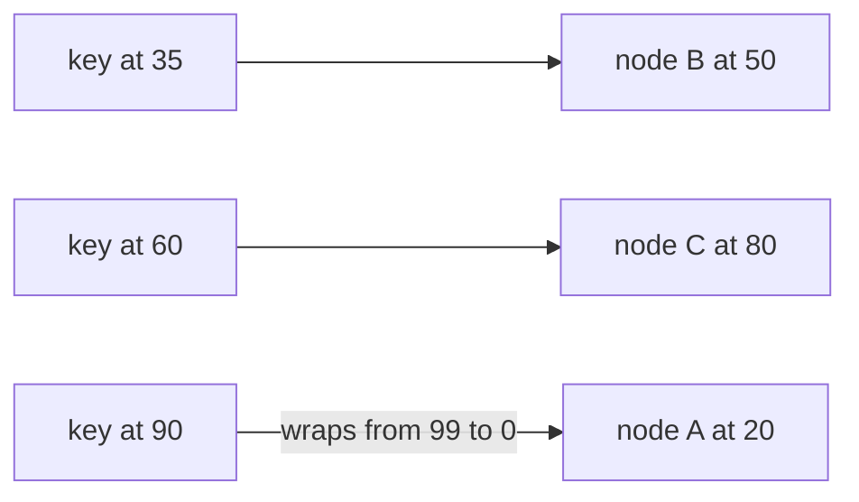
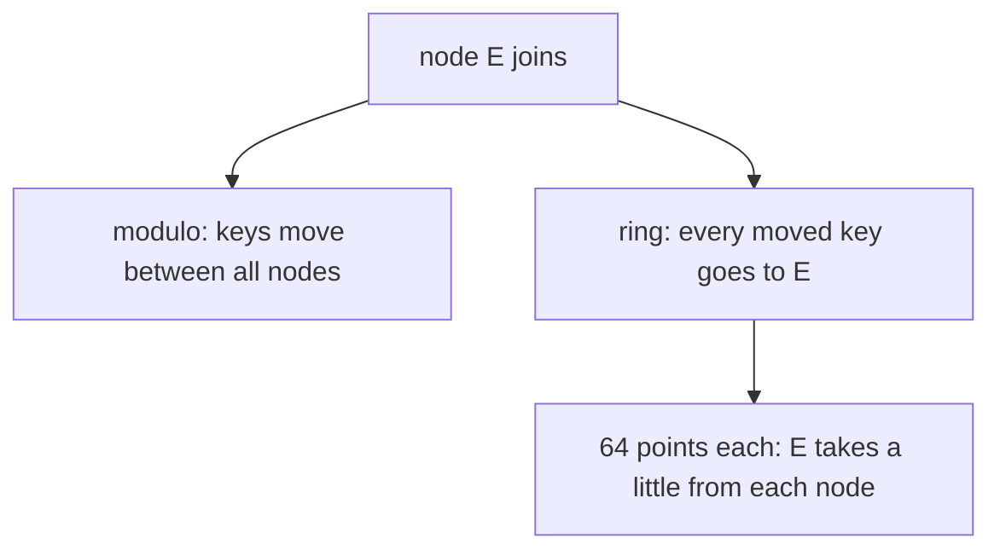

# Partitioning and consistent hashing

## The idea

When there is more data, or more traffic, than one machine can handle, the data is split across several machines. Each piece is a **partition** (also called a **shard**), each machine that holds partitions is a **node**, and the rule that decides which node holds a given record is the **placement**. A record is found by its **key**, such as `order-1729`, so the placement is a function from keys to nodes. Every client must compute it on its own, quickly, and get the same answer as every other client.

There are two classic placements.

- **By range.** Keys are sorted, and each node owns a contiguous range: `a` to `f` on the first node, `g` to `m` on the second. A query for a range of keys goes to one node or a few. The danger is uneven use: if most new keys sort together, for example keys that start with today's date, all new writes land on one node.
- **By hash.** A hash function turns each key into a number that looks random, and the number picks the node. Keys spread evenly whatever their pattern, at the price of scattering neighbouring keys, so a range query must ask every node. (The guide on hash functions covers what makes a hash function spread keys well.)

The simplest hash placement is `hash(key) mod N` for `N` nodes. It spreads keys evenly, but it breaks badly when `N` changes. A key keeps its node only when `hash mod N` equals `hash mod (N + 1)`, and for most hash values the two differ: going from 4 nodes to 5, a key stays only when its hash, taken mod 20, is 0, 1, 2 or 3, which is 4 values in 20. So about four keys in five move to a different node. Karger and his co-authors, whose 1997 paper introduced consistent hashing, describe the same failure for a cache: when the range of a classical hash function changes, almost every item is hashed to a new location, and suddenly all cached data is useless because clients look for it in a different place.

**Consistent hashing** is, in the paper's words, a hash function that changes minimally as its range changes. Picture the hash values bent into a circle, the **ring**: positions `0` to `2^32 - 1` here, with the largest followed by `0` again. Each node is hashed to a position on the ring too. A key belongs to the first node reached going clockwise from the key's position, wrapping around at the end. (The paper maps buckets and items to the unit interval and assigns each item to the closest bucket; the clockwise form is the one most descriptions use, and it moves keys just as little.)



<!-- text-of-mermaid sha256:8dcf9421494755be75ec0eb78b5789166c731d3455cc5bc43b2d83c605ef7823 -->
```text
┌─────────┐                    ┌────────────┐
│key at 35├───────────────────►│node B at 50│
└─────────┘                    └────────────┘

┌─────────┐                    ┌────────────┐
│key at 60├───────────────────►│node C at 80│
└─────────┘                    └────────────┘

┌─────────┐                    ┌────────────┐
│key at 90├wraps─from─99─to─0─►│node A at 20│
└─────────┘                    └────────────┘
```

The drawing uses a ring of 100 positions to keep the numbers small, and shows each key with the node it reaches going clockwise. Each node owns the **arc** that ends at its position: `B` owns 21 to 50, `C` owns 51 to 80, and `A` owns 81 to 99 and 0 to 20. When a node `D` joins at 65, it takes 51 to 65 from `C`, and nothing else changes; when `B` leaves, its arc goes to `C`, the next node clockwise, and nothing else changes. A key only ever moves to a joining node or away from a leaving one, never between two nodes that both stay. The paper calls this property **monotonicity**.

One position per node makes the arcs very uneven, since the positions are random. The paper's construction gives each bucket several points on the interval, about `κ log C` of them for some constant `κ` when there are at most `C` buckets. Points like these are often called **virtual nodes**: each owns a small arc, a node's share is the sum of many small arcs, and a joining node takes a little from many nodes instead of a lot from one.

## A worked example

A fifth node joins four, and the program counts how many of 1,000 keys change node, first under modulo placement, then on a ring with one point per node, then with 64. Positions come from SHA-256. To keep the code short, it finds a key's owner by trying every point, and takes the one at the smallest clockwise distance from the key:

```python examples/moves.py
"""How many of 1,000 keys change node when a fifth node joins four.

Positions come from the first four bytes of a SHA-256 digest, so they run from 0 to 2^32 - 1.
Modulo placement picks node number `position mod N`. On the ring, each node puts one or more
points, and a key belongs to the point it reaches first going clockwise: the point with the
smallest clockwise distance `(point - key) mod 2^32`, which is 0 for a point exactly at the key.
"""

import hashlib

RING = 2**32
KEYS = [f"order-{i}" for i in range(1, 1001)]


def position(text: str) -> int:
    return int.from_bytes(hashlib.sha256(text.encode()).digest()[:4], "big")


def modulo_owners(nodes: list[str]) -> dict[str, str]:
    return {key: nodes[position(key) % len(nodes)] for key in KEYS}


def ring_owners(nodes: list[str], points: int) -> dict[str, str]:
    ring = [(position(f"{node}/{i}"), node) for node in nodes for i in range(points)]
    owners = {}
    for key in KEYS:
        spot = position(key)
        owners[key] = min(ring, key=lambda point: (point[0] - spot) % RING)[1]
    return owners


def report(name: str, before: dict[str, str], after: dict[str, str]) -> None:
    moved = [key for key in KEYS if before[key] != after[key]]
    targets = " ".join(sorted({after[key] for key in moved}))
    loads = sorted(list(after.values()).count(node) for node in set(after.values()))
    print(f"{name:<16} {len(moved):>3} keys move, to {targets}; keys per node {loads}")


four = ["A", "B", "C", "D"]
five = [*four, "E"]
report("modulo", modulo_owners(four), modulo_owners(five))
report("ring, 1 point", ring_owners(four, 1), ring_owners(five, 1))
report("ring, 64 points", ring_owners(four, 64), ring_owners(five, 64))
```

It prints:

```output examples/moves.py
modulo           812 keys move, to A B C D E; keys per node [184, 191, 197, 208, 220]
ring, 1 point    103 keys move, to E; keys per node [15, 103, 181, 310, 391]
ring, 64 points  207 keys move, to E; keys per node [161, 203, 207, 213, 216]
```

Read it row by row:

- **Modulo** spreads the keys well, about 200 per node, and moves 812 of them, close to the four in five the arithmetic predicted. Keys move to every node, including between the four old ones, which had no reason to trade keys.
- **One point per node** moves only 103 keys, all to the new node `E`: monotonicity at work. But the loads are absurd. One node holds 15 keys and another 391, because five random points cut the ring into five arcs of very different lengths. `E` happened to land in a short arc.
- **64 points per node** keeps both properties: every move goes to `E`, the number of moves, 207, is close to the ideal of one fifth of the keys, which is what `E` must take to hold its share, and every node holds between 161 and 216 keys.



<!-- text-of-mermaid sha256:9722cd234de1d069286788f9aa31ef0a42d87c19376c728cab2d0060c09133be -->
```text
┌───────────────────────────────────────────────┐
│                  node E joins                 │
└───────────────────────────────────────────────┘
                        ▼────────────────────────────────────────────▼
┌───────────────────────────────────────────────┐    ┌───────────────────────────────┐
│      modulo: keys move between all nodes      │    │ring: every moved key goes to E│
└───────────────────────────────────────────────┘    └───────────────┬───────────────┘
                                                                     │
┌───────────────────────────────────────────────┐                    │
│64 points each: E takes a little from each node│◄───────────────────┘
└───────────────────────────────────────────────┘
```

## When to use it

- **The set of nodes changes**: caches added under load, machines replaced after failures, a cluster resized. Consistent hashing keeps most keys in place, so a cache keeps most of its hits and a store copies only what it must.
- **Clients place keys on their own**, without a directory to ask. Every client hashes the key and the node names the same way, so all agree, as long as they agree on the list of nodes.
- **Keys arrive in patterns**: sequential ids, dates, names that share prefixes. Hashing breaks the patterns up, where ranges would pile them onto one node.
- **Use ranges instead** when queries read ranges of keys in order, such as all orders of one day, and accept that ranges must be split and moved as they grow.
- **Use a directory instead**, a table that records which node holds each partition, when you need to place partitions by hand, for example to put a heavy one on a large machine. The table is then one more thing to keep available and consistent.

## Common traps

- **`hash(key) mod N` in a system whose `N` changes.** It works until the first node is added, then nearly every key moves at once, and a cache in front of a database sends nearly every request to the database at the same moment.
- **Too few points per node.** With one point each, shares can differ by a factor of ten or more, as the example shows. Use many points, and give a larger machine proportionally more.
- **A weak hash function.** Keys that differ only in their last characters, such as `order-1` to `order-9`, must still land far apart. A hash that mixes poorly puts them in one arc.
- **Expecting it to fix one hot key.** Consistent hashing spreads keys, not requests: if one key gets half of all traffic, its node gets half of all traffic, however many points there are.
- **Clients that disagree on the nodes.** Two clients with different lists of nodes put the same key on different nodes. The paper treats this as clients with different **views**, and designs its hash functions so that a key still lands on few different nodes across views.
- **Forgetting that moving takes time.** The placement changes the moment a node joins; the data on the old node still has to be copied, and reads during the copy must look in both places or wait.

## Complexity

For `K` keys, `N` nodes and `p` points on the ring in all:

| Operation | Cost | Condition |
|-----------|------|-----------|
| Find a key's owner, scanning every point as the example does | O(p) | Simple, and fine for a few hundred points |
| Find a key's owner, with the points in a balanced search tree | O(log p) | The paper's simple implementation |
| Find a key's owner, with the ring cut into equal segments, each with its own small tree | O(1) expected | The paper's faster implementation; segments are split as points are added |
| Add or remove a node with `v` points | O(v log p) for the tree, plus moving its keys | About one node's share of the keys moves: `K / (N + 1)` on average when an `(N + 1)`-th node joins |
| Modulo placement, find the owner | O(1) | But a change of `N` moves about `K · N / (N + 1)` keys |

Memory is O(p) for the points. More points per node give fairer shares at the cost of a larger structure, and a search that grows only with `log p`.

## Expert notes

- **The paper's properties.** Karger and his co-authors define consistency through four properties of a family of hash functions: **balance**, items spread evenly over the buckets of a view; **monotonicity**, items move only to new buckets; **spread**, across many clients' views an item lands on few different buckets; and **load**, across those views a bucket is responsible for few different items. Their smoothness property says that when a machine is added or removed, the expected fraction of objects that must move is the minimum needed to keep the load balanced.
- **Built for inconsistent views.** The paper's setting is a layer of web caches whose clients know different sets of caches. Its abstract says the protocols do not require users to have a current or even consistent view of the network, and it suggests that consistent hash functions may prove useful for distributed name servers and quorum systems.
- **Where the hot spots go.** The title's hot spots occur when a large number of clients want the same data from one server at once. Consistent hashing decides which caches serve a page; the paper's other tool, random cache trees, gives each page its own tree of caches, mapped onto machines by a hash function, so that requests for a popular page are combined on their way up the tree and no server is swamped.
- **The faster lookup.** The paper notes that a balanced search tree over `C log C` points answers a lookup in O(log C), and that dividing the interval into about `C log C` equal segments, each with its own tree, brings the expected time down to O(1), because each segment holds O(1) points on average.

## Practice

- `cstudy start consistent-hash-ring`: place keys on a ring of nodes with an exact hash, compare it with modulo placement, give nodes many points, report which keys move on a join or a leave, and keep copies and bounded loads in the later levels.

## Further reading

- [Karger, Lehman, Leighton, Panigrahy, Levine and Lewin, *Consistent Hashing and Random Trees: Distributed Caching Protocols for Relieving Hot Spots on the World Wide Web*, STOC 1997](https://cs.brown.edu/courses/csci2950-u/f09/papers/chash97stoc.pdf): section 4, the failure of classical hashing when the range changes, the four properties, the construction with several points per bucket, and its implementation.
- [Python documentation, `hashlib`](https://docs.python.org/3/library/hashlib.html): the SHA-256 used for positions in the example.
