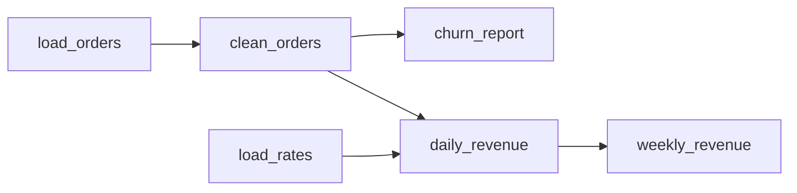
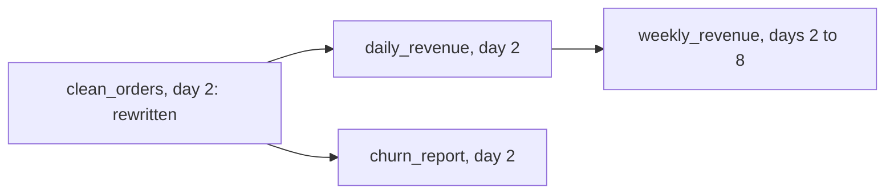

# Orchestrating batch pipelines

## The idea

A batch pipeline is rarely one job. Orders are loaded, then cleaned, then joined with exchange rates, then added up per day, then per week; each step is a **task**, and a task can only start when the tasks it reads from have finished. The tasks and their **dependencies** form a graph, and since a task must never wait, even indirectly, for itself, the graph must have no cycle: it is a **DAG**, a directed acyclic graph. An **orchestrator** is the program that runs such graphs: it decides what can run, in which order, again and again, and what to do when something fails.

Three ideas make that manageable.

**Partitions.** A pipeline does not reprocess all of history every day. Each task processes one slice of time, usually one day, and writes one **partition** of its output per slice: the orders of 3 March, the cleaned orders of 3 March, the revenue of 3 March. One **run** is one task for one partition. Most of an orchestrator's work is bookkeeping about partitions: which exist, which can be built now, and which are out of date.

**Idempotent tasks.** Every partition will be computed more than once: a task fails and is retried, a run succeeds but its success is not recorded, a bug is fixed and history is recomputed. The rule that keeps this safe is the one HTTP uses for its idempotent methods: several identical requests must have the same intended effect as one. For a task, running it again for the same partition must *replace* that partition, never add to it.

**The partition's time, not the clock's.** A run computes the partition it is given. A task that asks the clock for "yesterday" gets a different day when it is retried tomorrow or rerun next month.



<!-- text-of-mermaid sha256:31462b826dbaaed77242273dcc99edbc3e0ef738573bd3da2ed932d5c497f082 -->
```text
┌───────────┐    ┌────────────┐    ┌─────────────┐    ┌──────────────┐
│load_orders├───►│clean_orders├───►│ churn_report│    │weekly_revenue│
└───────────┘    └──────┬─────┘    └─────────────┘    └──────────────┘
                        │                                     ▲
┌───────────┐           │          ┌─────────────┐            │
│ load_rates├───────────┴─────────►│daily_revenue├────────────┘
└───────────┘                      └─────────────┘
```

The drawing is the pipeline of the examples below. An arrow points from a task to a task that reads it, so a task can run once every arrow into it comes from a finished task. `load_orders` and `load_rates` read nothing in the pipeline and can start at once, in parallel.

## A worked example

### The order of tasks

Finding an order in which every task comes after its dependencies is a **topological sort**. Python's standard library has one, `graphlib.TopologicalSorter`, added in 3.9. Given each task with the tasks it depends on, it hands out, round after round, every task whose dependencies are all done, and it refuses a graph with a cycle:

```python examples/run_order.py
"""The order in which a pipeline's tasks can run, with the standard library's graphlib.

Each task maps to the tasks it depends on. TopologicalSorter hands out, in rounds, every task whose
inputs are all done; the tasks of one round could run in parallel. A cycle has no valid order.
"""

from graphlib import CycleError, TopologicalSorter

PIPELINE = {  # task -> the tasks it depends on
    "load_orders": [],
    "load_rates": [],
    "clean_orders": ["load_orders"],
    "daily_revenue": ["clean_orders", "load_rates"],
    "churn_report": ["clean_orders"],
    "weekly_revenue": ["daily_revenue"],
}


def rounds(graph: dict[str, list[str]]) -> list[list[str]]:
    sorter = TopologicalSorter(graph)
    sorter.prepare()  # raises CycleError if the graph has a cycle
    result = []
    while sorter.is_active():
        ready = sorted(sorter.get_ready())  # sorted, so the output does not depend on insertion
        result.append(ready)
        sorter.done(*ready)
    return result


for number, tasks in enumerate(rounds(PIPELINE), start=1):
    print(f"round {number}: {', '.join(tasks)}")

broken = {**PIPELINE, "load_rates": ["weekly_revenue"]}  # rates now read the weekly report
try:
    rounds(broken)
except CycleError as error:
    print("cycle:", " -> ".join(error.args[1]))
```

It prints:

```output examples/run_order.py
round 1: load_orders, load_rates
round 2: clean_orders
round 3: churn_report, daily_revenue
round 4: weekly_revenue
cycle: daily_revenue -> weekly_revenue -> load_rates -> daily_revenue
```

The four rounds are what an orchestrator with enough workers would run at the same time. When `load_rates` is changed to read the weekly report, the graph has a cycle, and `prepare` raises `CycleError`, whose second argument lists the cycle with each task read by the next one, the first repeated at the end. A real orchestrator does not wait for a whole round: it calls `done` for each task as it finishes and asks `get_ready` again, so a fast task's dependents start early. The documentation warns that the order among tasks that are ready together may depend on the order in which they were added; the example sorts each round to stay stable.

### Retries that do not double count

A daily task adds up one day of orders and writes the total into that day's partition. Its first attempt writes, and then its success signal is lost, so the orchestrator runs it again: an ordinary retry. The program runs the same two attempts against a task that appends and one that overwrites, and then compares a task that computes "yesterday" from the clock with one that computes the day it is given:

```python examples/idempotent_writes.py
"""Why a task should replace its partition, and read the day it is run for, not the clock.

A daily task adds up one day of orders and writes the total into that day's partition. Its first
attempt writes and then loses its success signal, so the scheduler runs it again.
"""

ORDERS = {1: [5, 7], 2: [4], 3: [10, 2, 3]}  # day -> order amounts, one partition per day


class PartitionedTable:
    def __init__(self) -> None:
        self.partitions: dict[int, list[int]] = {}

    def append(self, day: int, rows: list[int]) -> None:
        self.partitions.setdefault(day, []).extend(rows)

    def overwrite(self, day: int, rows: list[int]) -> None:
        self.partitions[day] = list(rows)


for mode in ("append", "overwrite"):
    table = PartitionedTable()
    write = getattr(table, mode)
    for _attempt in (1, 2):  # attempt 1 wrote, then its success signal was lost
        write(3, [sum(ORDERS[3])])
    print(f"{mode:>9}: day 3 holds {table.partitions[3]}, a report reads {sum(table.partitions[3])}")


def total_for_yesterday(run_on_day: int) -> int:
    return sum(ORDERS.get(run_on_day - 1, []))


def total_for(day: int) -> int:
    return sum(ORDERS.get(day, []))


print("day 2, run on day 3:", total_for_yesterday(3), "and", total_for(2))
print("day 2, rerun on day 9:", total_for_yesterday(9), "and", total_for(2))
```

It prints:

```output examples/idempotent_writes.py
   append: day 3 holds [15, 15], a report reads 30
overwrite: day 3 holds [15], a report reads 15
day 2, run on day 3: 4 and 4
day 2, rerun on day 9: 0 and 4
```

The appending task doubled day 3's revenue on an ordinary retry, and every report built on it is now wrong. The overwriting task ends in the same state however many times it runs. The last two lines show the second rule: on its normal schedule, "yesterday" and "day 2" agree, but when day 2 is rerun a week later, the clock-based task reads day 8, which has no orders, and writes 0 over a correct partition.

A real overwrite must also be **atomic**: a reader should see the old partition or the new one, never half of each. Writing to a temporary location and swapping it in at the end, or committing through a table format, which the guide on table formats covers, gives that.

## Backfills and deadlines

A **backfill** reruns a task over a range of past partitions: after a bug fix, after late data arrived, or for a new task that needs history. It is only safe when the tasks are idempotent, and it is only complete when it also reruns everything downstream that read the old output.

Downstream reaches further than one partition when a task reads a **window** of its input: a weekly report for day `d` reads the seven daily partitions from `d - 6` to `d`. Rewriting one daily partition then makes seven weekly partitions out of date, or **stale**.



<!-- text-of-mermaid sha256:da3413df3187f3388c4c0fcc0c070aeb4438b1af5099931c147452e2155d4167 -->
```text
┌──────────────────────────────┐    ┌────────────────────┐    ┌───────────────────────────┐
│clean_orders, day 2: rewritten├───►│daily_revenue, day 2├───►│weekly_revenue, days 2 to 8│
└───────────────┬──────────────┘    └────────────────────┘    └───────────────────────────┘
                │
                │                   ┌────────────────────┐
                └──────────────────►│churn_report, day 2 │
                                    └────────────────────┘
```

The drawing follows one fix. The rewritten partition makes stale the partitions that read it directly, and those make stale the partitions that read them, through every window: one change on day 2 reruns nine partitions. An orchestrator finds them by recording, for every partition it writes, which partitions it read, and in which version.

A **deadline** says when a partition must be ready: the revenue of a day by 08:00 the next morning, say. It is often called an **SLA**, for service-level agreement. Measure it on the data, not on the job: "the partition for 3 March exists and passed its checks by 08:00 on 4 March". A job that finished on time but wrote nothing has not met it.

## When to use it

- **A graph and an orchestrator** whenever more than two or three scheduled jobs depend on each other. Timed jobs that "usually finish by 2 am" break the first time one is slow.
- **Daily partitions** for data that arrives and is reported by day; hourly ones when reports are hourly. Smaller partitions mean cheaper reruns and more runs to track.
- **Windows** on a dependency when a task genuinely reads a period: weekly, monthly or rolling measures. Record them, so that staleness and backfills can follow them.
- **Retries with growing waits** for failures that pass on their own, such as a timeout or a busy service. A failure that repeats every time, such as bad input, needs a person: stop retrying it after a few attempts and set it aside.

## Common traps

- **Appending instead of replacing.** The most common source of doubled numbers. Overwrite the partition, or delete it and insert in one transaction.
- **Reading the clock inside a task.** Use the partition's date everywhere, in queries and in file names. A rerun must read exactly what the first run read.
- **Half-written partitions.** A task that fails halfway through a write leaves a partition that looks done to anyone who reads it. Write elsewhere and swap, or commit atomically.
- **Backfilling one task and stopping.** The tasks downstream still hold results computed from the old data. Rerun every partition that read a rewritten one, through every window.
- **Retries without idempotency.** Retrying a task that appends, sends an email or charges a card repeats the effect. Make the task idempotent first, then let it retry.
- **Retrying forever.** A task that fails on bad input fails the same way every time, and its retries hide it. Cap the attempts, and put the failure where a person sees it.
- **Hidden dependencies.** A task that reads a table without declaring it may run before that table is ready, and gets no rerun when the table is backfilled.

## Complexity

For a pipeline of `V` tasks and `E` dependencies, run daily:

| Operation | Time |
|-----------|------|
| Check for cycles and find a run order | O(V + E), a topological sort |
| Decide what can run for one day | O(V + E) checks of "is every input partition done?", times the window lengths |
| A backfill of `D` days of one task | The `D` partitions, plus every partition downstream: up to about `D + w - 1` partitions of a task that reads a window of `w` days, for each task downstream |
| Detect a stale partition | O(inputs) per partition, comparing the versions it read with the current ones |

The state an orchestrator keeps grows with partitions, not with data: one record per task per day, plus what each partition read.

## Expert notes

- **`graphlib` in detail.** The graph is a mapping from each node to an iterable of its predecessors. `get_ready` returns every node whose predecessors are all marked done, `done` marks nodes finished, and `is_active` says whether more progress is possible. `CycleError`, a subclass of `ValueError`, reports one cycle; when there are several, which one is unspecified. `static_order` gives the whole order at once.
- **Retries and idempotency.** RFC 9110 defines an idempotent method by its intended effect, and explains why the property matters: an idempotent request can be repeated automatically after a communication failure, because repeating it has the same intended effect even if the first request succeeded. A client should not retry a non-idempotent request automatically unless it knows the request is idempotent anyway, or can tell that the original was never applied. A task retry is the same situation.
- **Idempotent writes in a table log.** The Delta Lake protocol stores, in the same atomic commit as the data, an application id and the version of progress that application has written. A writer that resumes after a failure checks that version first and skips a batch the table already holds; the protocol calls this making the writes idempotent.
- **The scheduled time and the run time.** OpenLineage, an open standard for collecting lineage metadata, gives a run a `nominalTime` facet: the time the run is scheduled for, which differs from the time it actually ran. That is the partition's time of this guide, recorded next to the run.
- **Deadlines in a contract.** The Open Data Contract Standard lists service-level properties such as `latency`, `frequency`, `retention` and `timeOfAvailability`, each with a driver: regulatory, analytics or operational. A deadline written there is one the producer has agreed to, and can be checked by the consumer.
- **Delivery is at least once.** Orchestrators and queues that resend work after a failure deliver it at least once, so a task may run twice. The MillWheel paper describes the same trade in streaming: at-least-once delivery first, then exactly-once effects by recognizing work already done.

## Practice

- `cstudy start pipeline-scheduler`: order a graph of tasks and reject cycles; run it per daily partition with lookback windows, retries and reruns; then plan and run the backfill that redoes the stale work downstream.
- `cstudy start postgres-job-queue-typescript`: the queue under the workers: each job claimed once however many workers ask, claims that run out when a worker dies, retries with a growing wait until the job is set aside, and a fair turn for every tenant.
- `cstudy start csv-upload-ingestion-typescript`: a load started by an event that may arrive twice, keep failing, or be cut short by a crash; each upload must load once, and whole.

## Further reading

- [Python `graphlib`](https://docs.python.org/3/library/graphlib.html): `TopologicalSorter`, `get_ready`, `done` and `CycleError`; new in Python 3.9.
- [RFC 9110, HTTP Semantics, §9.2.2 Idempotent Methods](https://www.rfc-editor.org/rfc/rfc9110.html#name-idempotent-methods): the definition, and when a request may be retried automatically.
- [Delta Lake transaction protocol, *Transaction Identifiers*](https://github.com/delta-io/delta/blob/master/PROTOCOL.md#transaction-identifiers): idempotent writes recorded with the data.
- [OpenLineage, *Object Model*](https://openlineage.io/docs/spec/object-model): runs and their nominal time.
- [Open Data Contract Standard, *Service-Level Agreement*](https://github.com/bitol-io/open-data-contract-standard/blob/main/docs/service-level-agreement.md): latency, frequency, retention and time of availability.
- [Akidau and others, *MillWheel: Fault-Tolerant Stream Processing at Internet Scale* (VLDB 2013)](https://www.vldb.org/pvldb/vol6/p1033-akidau.pdf): at-least-once delivery as the basis of exactly-once.
