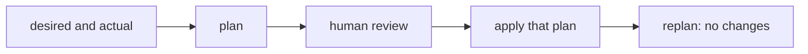

# Plan, diff and apply

## The idea

The [previous guide](../declarative-desired-state/guide.md) compared and changed each resource in one go. That is fine for a file on a server. It is not fine for a network, a database or a disk in a data centre, where a change can take minutes, cost money, cut off users or destroy data. Before anything happens, someone wants to see exactly what will happen.

So tools that manage such infrastructure split the work in two.

1. **Plan.** Read the desired state and the actual state, and compute the difference: the list of changes that would turn one into the other. Planning only reads, so it is safe to run at any time, as often as you like.
2. **Apply.** Carry out the plan, one change at a time, against the real world.

In between, a person reads the plan. That is the point: a description that looks harmless can hide a change that deletes a database, and the plan is where it shows.

Each resource in the description has an **address**, a name the description gives it, such as `server/web`. The plan gives every address in either state one **action**:

| Desired | Actual | Action |
|---------|--------|--------|
| yes | no | **create** it |
| no | yes | **delete** it |
| yes | yes, the same | **no-op** ("no operation"): leave it alone |
| yes | yes, different | **update** it in place, or **replace** it |

Next to each action, the plan shows the **diff**, the attributes that change, with their old and new values.

Some attributes cannot change on a resource that exists: the zone a disk lives in, the address range of a network, the name of some databases. Changing one means deleting the resource and creating a new one, which is a **replace**. A replace is not a bigger update. The new resource is a different object: it gets a new identifier, it starts empty unless something copies the data across, and whatever pointed at the old one must now point at the new one. A good plan marks a replace loudly and says which attribute forces it.



<!-- text-of-mermaid sha256:42fab58d689a4082c323d76a7132b0e784aa854c4f82c5e3f6ce9b27381a4304 -->
```text
┌──────────────────┐    ┌────┐    ┌────────────┐    ┌───────────────┐    ┌──────────────────┐
│desired and actual├───►│plan├───►│human review├───►│apply that plan├───►│replan: no changes│
└──────────────────┘    └────┘    └────────────┘    └───────────────┘    └──────────────────┘
```

The drawing is the cycle of one change. Its last box is the check that matters: right after an apply, a new plan should be all no-ops. If it is not, either the apply did not do what the plan said, or the description is not idempotent and will keep asking for changes forever.

## A worked example

Three resources are wanted and three exist. The program plans, applies, and plans again. Then it plans one more change, but someone resizes the server by hand before the apply:

```python examples/plan_apply.py
"""Plan the changes from what exists to what is wanted, apply them, and plan again.

Each resource has an address, `type/name`, and attributes. Some attributes cannot change on a
resource that exists: changing one replaces the resource. The plan remembers a fingerprint of
the state it was computed from, and applying it refuses when that state has changed since.
"""

import copy
import hashlib
import json

IMMUTABLE = {"disk": {"zone"}, "server": {"zone"}}

desired = {
    "bucket/logs": {"region": "eu", "versioning": "on"},
    "disk/data": {"size_gb": "100", "zone": "eu-2"},
    "server/web": {"size": "large", "zone": "eu-1"},
}
actual = {
    "disk/data": {"size_gb": "100", "zone": "eu-1"},
    "server/old": {"size": "small", "zone": "eu-1"},
    "server/web": {"size": "small", "zone": "eu-1"},
}


def fingerprint(state: dict) -> str:
    text = json.dumps(state, sort_keys=True, separators=(",", ":"))
    return hashlib.sha256(text.encode()).hexdigest()[:12]


def plan(desired: dict, actual: dict) -> dict:
    steps = []
    for address in sorted(desired.keys() | actual.keys()):
        want, have = desired.get(address), actual.get(address)
        if have is None:
            steps.append(("create", address, sorted(want.items())))
            continue
        if want is None:
            steps.append(("delete", address, []))
            continue
        changes = [(key, have.get(key), want.get(key))
                   for key in sorted(want.keys() | have.keys()) if have.get(key) != want.get(key)]
        forced = {key for key, _, _ in changes} & IMMUTABLE.get(address.split("/")[0], set())
        action = "replace" if forced else "update" if changes else "no-op"
        steps.append((action, address, changes))
    return {"based_on": fingerprint(actual), "steps": steps}


def show(the_plan: dict) -> None:
    print(f"plan based on state {the_plan['based_on']}:")
    for action, address, details in the_plan["steps"]:
        print(f"  {action:8} {address}  {details if details else ''}".rstrip())


def apply(the_plan: dict, actual: dict) -> None:
    if fingerprint(actual) != the_plan["based_on"]:
        raise RuntimeError("the state changed since this plan was made: plan again")
    for action, address, _ in the_plan["steps"]:
        if action in ("create", "update", "replace"):
            actual[address] = copy.deepcopy(desired[address])  # a replace makes a new resource
        elif action == "delete":
            del actual[address]


first = plan(desired, actual)
show(first)
apply(first, actual)
show(plan(desired, actual))

desired["server/web"]["size"] = "xlarge"
second = plan(desired, actual)
show(second)
actual["server/web"]["size"] = "medium"  # someone changes the server by hand
try:
    apply(second, actual)
except RuntimeError as refusal:
    print("apply refused:", refusal)
```

It prints:

```output examples/plan_apply.py
plan based on state 6450902c721a:
  create   bucket/logs  [('region', 'eu'), ('versioning', 'on')]
  replace  disk/data  [('zone', 'eu-1', 'eu-2')]
  delete   server/old
  update   server/web  [('size', 'small', 'large')]
plan based on state c4bb0654f4bd:
  no-op    bucket/logs
  no-op    disk/data
  no-op    server/web
plan based on state c4bb0654f4bd:
  no-op    bucket/logs
  no-op    disk/data
  update   server/web  [('size', 'large', 'xlarge')]
apply refused: the state changed since this plan was made: plan again
```

The first plan has every kind of action.

- `bucket/logs` does not exist, so it is created with every attribute listed.
- `disk/data` exists, but its zone changes, and a disk cannot move between zones: it is replaced, and the plan names `zone` as the attribute that forces it. On a real disk, the 100 GB of data would be gone.
- `server/old` exists and is no longer wanted: it is deleted.
- `server/web` changes size, which can be done in place: an update, listing only the attribute that differs.

After the apply, the second plan is all no-ops: the real world now matches the description, and the state it was based on has a new fingerprint.

The third plan asks for an `xlarge` server, but the server was resized by hand to `medium` after the plan was made. The plan was reviewed against `large`; applying it now would act on a state nobody looked at. The plan carries a **fingerprint** of the state it was computed from, a SHA-256 hash of that state written as JSON with sorted keys (a short fixed-size digest that a change anywhere in the state would alter, as the [guide on cryptographic hashes](../cryptographic-hashes/guide.md) explains), and the apply compares it with the current state and refuses. The fix is to plan again and review the new plan.

## When to use it

- **Any change that is slow, costly or destructive.** Plan, read the plan, then apply. Read the deletes and the replaces first.
- **Review in the same place as the code.** When a change to the description is proposed, attach its plan to the proposal, so the reviewers see what the change does to the real world, not only how the text changed.
- **Apply the plan that was reviewed.** Save the plan, and apply the saved plan instead of planning again at apply time, so that what runs is what was read. Refuse it when the state it was based on has changed.
- **Check that everything converged.** A plan right after an apply, or on a schedule, should be empty. A non-empty plan means something changed outside the tool, or the description fights with itself.

## Common traps

- **Applying something other than what was reviewed.** A tool that plans again at apply time can do something different from the plan people read, if the description or the world changed in between. Keep the plan with what it was based on, and refuse it when that has changed.
- **A replace that looks like an update.** Renaming a resource or changing an attribute that cannot change in place deletes the old object. If the resource holds data, that data is lost. Read every replace line, and mark resources that must never be deleted so that a plan that would delete them fails.
- **Partial failure.** An apply that fails halfway has done some steps and not others. Undoing the finished steps by hand is risky. A tool that records each change as soon as it succeeds can simply plan again: the new plan holds exactly what is left, and applying it finishes the job.
- **Values nobody knows yet.** A **provider**, the cloud or other system that creates the resources and runs them, chooses some values only when it creates a resource: its identifier, its address. A plan cannot show them, and anything that uses them cannot be known either. The guide on [resource graphs](../resource-dependency-graphs/guide.md) follows these values through the dependencies.
- **A diff that never goes away.** If the provider stores a value in a different form than the description writes it (lower case, a default filled in, a list sorted), a naive comparison sees a change on every plan, and applying it changes nothing. Compare values in the form the provider keeps them, or normalize both sides first.
- **A plan whose order is unstable.** If the same inputs can produce the steps in another order, two plans of the same change cannot be compared line by line. Sort what has no meaningful order, as the example sorts addresses and keys.

## Complexity

For `R` resources with up to `K` attributes each, kept in hash maps by address and by key:

| Step | Time | Space |
|------|------|-------|
| Classify every address | O(R) average | O(R) for the union of addresses |
| Diff the attributes of the resources in both states | O(R · K) average | O(R · K) for the plan |
| Sort the plan for a stable output | O(R log R + R · K log K) | as above |
| Fingerprint a state of total size `S` | O(S log S) to sort keys, O(S) to hash | O(S) for the text |
| Apply | one provider call per changed resource | |

In practice the apply dominates: a provider call takes seconds to minutes, and planning a few thousand resources takes far less, unless the plan first reads every resource from the provider, which is one call per resource too.

## Expert notes

- **JSON Patch.** RFC 6902 describes changes to one JSON document as a sequence of operations, `add`, `remove`, `replace`, `move`, `copy` and `test`, each with a JSON Pointer to the location it acts on. They are applied in order, each to the result of the one before, and if one fails, evaluation should stop and the patch as a whole is not successful. A `test` operation checks that a location holds a given value: put first, it plays the part of the fingerprint, refusing to apply a patch to a document that has changed. A plan is a patch of the world, but the world is not one document, and a set of provider calls cannot be applied all-or-nothing the way a patch to one document can.
- **JSON Merge Patch.** RFC 7396 describes a change differently, by example: a document shaped like the target, where each member replaces the target's, `null` removes a member, and objects are merged member by member. It cannot change part of an array, only replace it whole, and it suits documents that do not use explicit `null` values. A diff format is a choice: a list of operations says how, a merge patch says what.
- **Why sorted keys.** RFC 8259 defines a JSON object as an unordered collection of name and value pairs, and notes that parsers differ in whether they make the order of members visible. Two programs can therefore write the same state with members in different orders. Sorting the keys before hashing, as the example does, makes the fingerprint depend on the content alone.
- **Plans as data.** A plan printed for people is also data for programs: written as JSON, it can be checked by policies before anyone applies it, for example "no plan may delete a database". The guide on [layered values and templates](../templates-and-layered-values/guide.md) ends with such checks.

## Practice

- `cstudy start iac-plan-engine`: an engine that diffs desired and actual infrastructure into create, update, delete and no-op steps with attribute rows. This path's step stops at level 1; levels 2 to 4, references between resources, replacement with values nobody knows yet, and applying the plan through failures, come after the next guide.

## Further reading

- [RFC 6902, *JavaScript Object Notation (JSON) Patch*](https://www.rfc-editor.org/rfc/rfc6902): operations applied in order, `test`, and error handling.
- [RFC 7396, *JSON Merge Patch*](https://www.rfc-editor.org/rfc/rfc7396): changes described by example, and their limits for arrays and `null`.
- [RFC 8259, *The JavaScript Object Notation (JSON) Data Interchange Format*](https://www.rfc-editor.org/rfc/rfc8259): objects as unordered collections, and parsers that differ on member order.
- [Python, `json`](https://docs.python.org/3/library/json.html): `sort_keys` and `separators`, as the example writes its fingerprint.
- [Python, `hashlib`](https://docs.python.org/3/library/hashlib.html): `sha256` and `hexdigest`.
