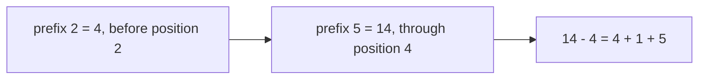
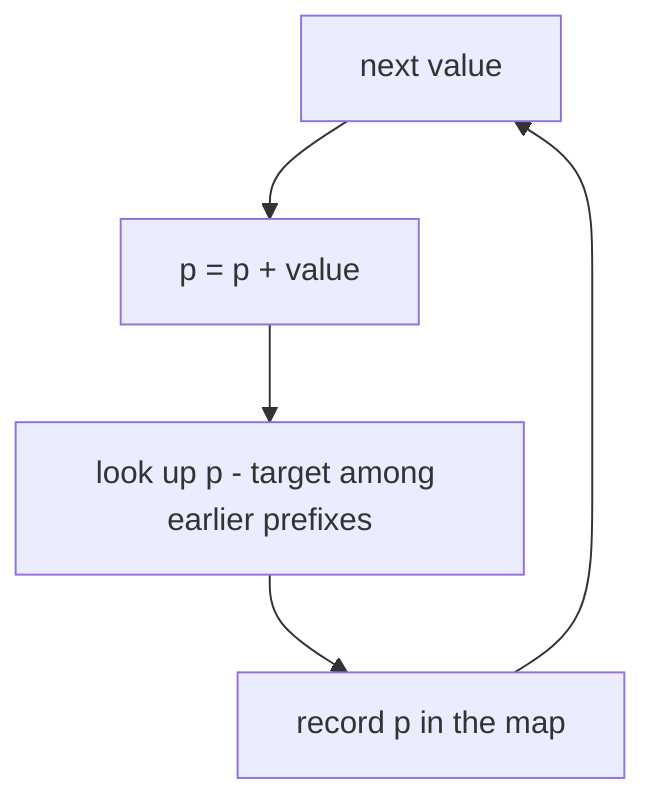

# Prefix sums with a hash map

## The idea

Many questions are about a **stretch** of consecutive values: a subarray, a window of days, a run of games. "Which stretch adds up to 10?" "How many stretches have as many wins as losses?" Checking every stretch means checking every start and every end: about `n² / 2` stretches for `n` values, and O(n²) time even when each sum is updated as the end moves.

A **prefix sum** turns a question about a stretch into a question about two points. Let `prefix[i]` be the sum of the first `i` values, with `prefix[0] = 0` for the empty start. Then the sum of the values from position `l` to position `r` is

```text
sum(l..r) = prefix[r + 1] - prefix[l]
```

because `prefix[r + 1]` adds up everything through `r`, and subtracting `prefix[l]` removes everything before `l`.



<!-- text-of-mermaid sha256:5910ee9304510a5593191b6c2227c87642dc09d3847c896b870706f1eae402dd -->
```text
┌───────────────────────────────┐    ┌─────────────────────────────────┐    ┌──────────────────┐
│prefix 2 = 4, before position 2├───►│prefix 5 = 14, through position 4├───►│14 - 4 = 4 + 1 + 5│
└───────────────────────────────┘    └─────────────────────────────────┘    └──────────────────┘
```

Now add a **hash map**. A stretch ending at position `r` has sum `k` exactly when some earlier prefix equals `prefix[r + 1] - k`. So walk the values once, keep the running sum `p`, and keep a map of the prefix sums seen so far. At each step, one lookup of `p - k` answers "how many stretches ending here add up to `k`?", or "where did the earliest one start?". Then record `p` in the map. One pass, one lookup per value: O(n) on average.



<!-- text-of-mermaid sha256:315c7059cdce0896962dde4cdc2d4e69b6c1116d2c83937fe9e89daf4c77e2ba -->
```text
┌─────────────────────────────────────────┐
│                next value               │◄┐
└────────────────────┬────────────────────┘ │
                     ▼                      │
┌─────────────────────────────────────────┐ │
│              p = p + value              │ │
└────────────────────┬────────────────────┘ │
                     ▼                      │
┌─────────────────────────────────────────┐ │
│look up p - target among earlier prefixes│ │
└────────────────────┬────────────────────┘ │
                     ▼                      │
┌─────────────────────────────────────────┐ │
│           record p in the map           ├─┘
└─────────────────────────────────────────┘
```

What the map stores depends on the question:

| Question about stretches | Map from prefix value to | Seed before the first value |
|--------------------------|--------------------------|-----------------------------|
| How many have sum `k`? | How many times that prefix has occurred | `{0: 1}` |
| What is the longest with sum `k`? | The **first** position where that prefix occurred | `{0: 0}` |
| Does any have a sum divisible by `m`? | Prefix **remainders** modulo `m`, with first positions | `{0: 0}` |

The seed stands for the empty prefix, the zero you have before reading anything. Without it, stretches that start at the very first value are never found.

## A worked example

Take the record of ten games, `WWLLWWWLWW`, and score a win as +1 and a loss as -1. A stretch with as many wins as losses has a net score of 0, so the running **balance** is the same just before it and just after it. "Find stretches with net 0" becomes "find two equal balances".

| Position | 0 (start) | 1 | 2 | 3 | 4 | 5 | 6 | 7 | 8 | 9 | 10 |
|----------|---|---|---|---|---|---|---|---|---|---|----|
| Game | | W | W | L | L | W | W | W | L | W | W |
| Balance | 0 | 1 | 2 | 1 | 0 | 1 | 2 | 3 | 2 | 3 | 4 |

- Balance 0 occurs at positions 0 and 4, so games 1 to 4, `WWLL`, are even. This stretch starts at the very first game, and only the seed at position 0 finds it.
- Balance 2 occurs at positions 2, 6 and 8. Every pair of them closes an even stretch: games 3 to 6, 3 to 8 and 7 to 8. The longest pair, 2 and 8, gives the longest even stretch: games 3 to 8, `LLWWWL`, six games.
- Counting every pair of equal balances counts every even stretch. When a balance occurs for the `c`-th time, it closes `c - 1` new stretches, one with each earlier occurrence, which is why the counting map adds the stored count before incrementing it.

```python examples/prefix_sums.py
"""Running sums turn a question about a stretch of values into a question about two points."""

from itertools import accumulate

steps = [3, 1, 4, 1, 5, 9, 2]
prefix = [0, *accumulate(steps)]  # prefix[i] = sum of the first i values
print("prefix sums:", prefix)
print("sum of steps[2..4] =", prefix[5] - prefix[2], "| check:", sum(steps[2:5]))

# Results of games: a win is +1, a loss is -1. A stretch with as many wins as losses has a net
# change of 0, so the running balance is the same before it and after it.
games = "WWLLWWWLWW"
balances = [0, *accumulate(1 if game == "W" else -1 for game in games)]
print("balances:", balances)


def longest_even_stretch(results: str) -> tuple[int, int]:
    """(length, start) of the longest stretch with as many wins as losses."""
    first_seen = {0: 0}  # balance 0 is seen before any game: the empty prefix
    balance, best = 0, (0, 0)
    for position, result in enumerate(results, start=1):
        balance += 1 if result == "W" else -1
        if balance in first_seen:
            start = first_seen[balance]
            best = max(best, (position - start, start))
        else:
            first_seen[balance] = position
    return best


def count_even_stretches(results: str, seed: bool = True) -> int:
    """How many stretches have as many wins as losses."""
    seen = {0: 1} if seed else {}
    balance = total = 0
    for result in results:
        balance += 1 if result == "W" else -1
        total += seen.get(balance, 0)  # every earlier equal balance closes one stretch
        seen[balance] = seen.get(balance, 0) + 1
    return total


length, start = longest_even_stretch(games)
print(f"longest even stretch: {length} games, {games[start:start + length]}")
brute = sum(
    1
    for left in range(len(games))
    for right in range(left + 1, len(games) + 1)
    if games[left:right].count("W") * 2 == right - left
)
print("even stretches:", count_even_stretches(games), "| checking every pair:", brute)
print("without the seed {0: 1}:", count_even_stretches(games, seed=False), "(misses those from the start)")
```

It prints:

```output examples/prefix_sums.py
prefix sums: [0, 3, 4, 8, 9, 14, 23, 25]
sum of steps[2..4] = 10 | check: 10
balances: [0, 1, 2, 1, 0, 1, 2, 3, 2, 3, 4]
longest even stretch: 6 games, LLWWWL
even stretches: 8 | checking every pair: 8
without the seed {0: 1}: 7 (misses those from the start)
```

The first two lines show a range sum answered with one subtraction. Then the longest even stretch comes from the first position of each balance, and the count from how often each balance has occurred, both in one pass. The brute force over every pair of positions agrees: 8 stretches. Removing the seed loses exactly one, the stretch `WWLL` that starts at the first game.

## When to use it

- The question is about **contiguous** stretches: subarrays, windows, runs. Not subsequences, which may skip elements.
- The stretch's property is a **sum** or something that behaves like one: a count of matches, a balance of +1 and -1, a remainder modulo `m`, a running XOR. What matters is that the property of a stretch can be computed from two prefixes, by subtraction, or by XOR, which undoes itself.
- The values may be **negative** or zero. That rules out a sliding window: a window grows while its sum is too small and shrinks while it is too big, which only works when every value is positive, so that growing always adds and shrinking always removes. With negative values, a prefix map is the tool.
- You need range sums many times on data that does not change: build the prefix array once in O(n), then answer each query in O(1).

## Common traps

- **The missing seed.** `{0: 1}` for counting and `{0: 0}` or `{0: -1}` for positions, depending on whether positions count prefixes or values. Forget it and every stretch that starts at the first value is missed, as the example shows.
- **Recording before asking.** At each step, ask about `p - k` first and record `p` second. Recording first lets a stretch of length zero match itself when `k` is 0.
- **Overwriting the first position.** For the longest stretch, store a prefix's position only the first time it appears. Updating it to the latest position makes stretches shorter.
- **Off-by-one between prefixes and positions.** `prefix[i]` is the sum of the first `i` values, so the stretch between two equal prefixes at `i < j` covers values `i` to `j - 1`. Draw the table once and the indices follow.
- **Remainders of negative numbers.** In Python, `-7 % 5` is `3`; in Java, Go and JavaScript, `-7 % 5` is `-2`. When a problem needs prefix remainders, normalize with `((p % m) + m) % m` in those languages, or equal remainders will look different.
- **Overflow.** Prefix sums grow. In a language with fixed-size integers, 10⁵ values of up to 10⁹ need 64-bit sums.
- **A minimum length.** If a stretch must hold at least two values, keep first positions and check the distance, rather than counting every pair.

## Complexity

| Approach | Time | Space |
|----------|------|-------|
| Check every stretch, extending each start's sum | O(n²) | O(1) |
| Prefix array, then answer `q` range-sum queries | O(n + q) | O(n) |
| One pass with a running sum and a hash map | O(n) on average | O(n) for up to `n + 1` distinct prefixes |

The one-pass bound is an **average**: each of the `n` steps does a constant number of hash map operations, each O(1) on average under the usual assumption of a well-spread hash. The worst case of a hash map, O(n) per operation, would make it O(n²); a sorted map instead of a hash map gives O(n log n) in the worst case. The space is O(n) because the map holds at most one entry per distinct prefix; for remainders modulo `m` it holds at most `m` entries, so O(min(n, m)).

## Expert notes

- **Any invertible running operation works.** Sums use subtraction; XOR undoes itself, so the XOR of a stretch is `prefix[j] ^ prefix[i]`; products work with division, but zeros break the inverse. Counting stretches whose XOR is `k` is the same algorithm with `p ^ k` in place of `p - k`.
- **Encode a condition as a sum.** "As many vowels as consonants" is +1 and -1. "Equal counts of three letters" is a key of two differences, `(count_a - count_b, count_b - count_c)`, stored in the map as a tuple: a [canonical key](../canonical-keys/guide.md) for "the stretch between these two points is balanced".
- **Two dimensions.** A 2D prefix table `S[i][j]`, the sum of the rectangle above and left of `(i, j)`, answers any rectangle sum with four lookups: `S[r2][c2] - S[r1][c2] - S[r2][c1] + S[r1][c1]`. Combined with a hash map over one dimension, it counts submatrices with a target sum in O(rows² × columns).
- **Difference arrays are the inverse.** To add `v` to every value in a range many times, add `v` at the start and subtract it after the end of a difference array, then take its prefix sums once at the end. Each update is O(1) instead of O(length of the range).
- **When the data changes.** A prefix array must be rebuilt after an update, which costs O(n). A Fenwick tree (binary indexed tree) or a segment tree supports both updates and prefix queries in O(log n).

## Practice

- `cstudy start subarray-sum-equals-k`: count the stretches with a given sum, with negative values allowed, so no sliding window.
- `cstudy start continuous-subarray-sum`: a sum that is a multiple of `k`, and a stretch of at least two values. Think about what the map should hold, and what the seed's position should be.

## Further reading

- [Python `itertools.accumulate`](https://docs.python.org/3/library/itertools.html#itertools.accumulate): running sums in one call; `initial=0` adds the empty prefix.
- [Python `%` on negative numbers](https://docs.python.org/3/reference/expressions.html#binary-arithmetic-operations): the result has the sign of the divisor.
- [The Go specification: integer operators](https://go.dev/ref/spec#Integer_operators): integer division truncates towards zero, so in Go, as in Java, `-7 % 5` is `-2`.
- [MDN: remainder (`%`)](https://developer.mozilla.org/en-US/docs/Web/JavaScript/Reference/Operators/Remainder): the result takes the sign of the dividend.
