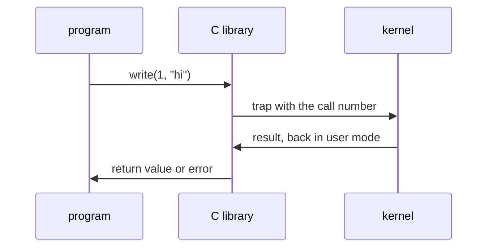
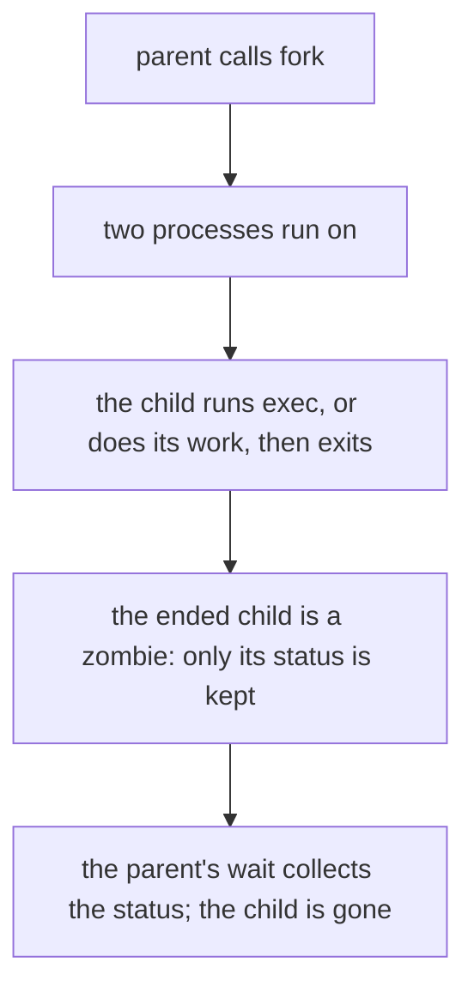

# Processes, threads and system calls

## The idea

A **program** is a file: instructions and data waiting on a disk. A **process** is a program that is running. The operating system, the software that shares one computer among many programs, keeps a record for each process, and that record is what makes a running program more than its instructions:

- an **address space**: the memory the process can see, numbered from 0 as if it were alone on the machine (the guide on virtual memory explains how);
- the processor's **registers**, small storage cells inside the processor, including the program counter, which says which instruction runs next;
- a table of **open files**, each named by a **file descriptor**: a small non-negative integer that indexes this table, so a program writes to "descriptor 1" rather than to a disk address;
- an identity, the **process id**, and the id of the process that created it, its **parent**.

The core of the operating system is the **kernel**. The processor runs in one of two modes. Ordinary programs run in **user mode**, where some instructions are forbidden: a program cannot talk to a disk or a network card directly, and if it tries, the processor raises an exception and the kernel usually ends the program. The kernel runs in **kernel mode**, where everything is allowed. This boundary is what stops one program from reading another's memory or taking over the machine.

To get anything done beyond computing, such as opening a file, sending bytes over a network or starting another program, a process asks the kernel with a **system call**: an entry point into the kernel. Linux's manual describes the usual path. A program calls an ordinary function of the C library, a **wrapper**; the wrapper puts the system call's number and arguments in the registers where the kernel expects them and executes a special **trap** instruction, which switches the processor to kernel mode and jumps to the kernel; the kernel does the work and returns to user mode, and the wrapper hands back the result, or sets an error code.



<!-- text-of-mermaid sha256:7de08e06284dd0441093031694a1caeee3241281c705f5f390001de7ff545f77 -->
```text
 ┌─────────┐               ┌───────────┐                   ┌────────┐
 │ program │               │ C library │                   │ kernel │
 └────┬────┘               └─────┬─────┘                   └────┬───┘
      │                          │                              │
      │     write(1, "hi")       │                              │
      │──────────────────────────▶                              │
      │                          │                              │
      │                          │  trap with the call number   │
      │                          │──────────────────────────────▶
      │                          │                              │
      │                          │  result, back in user mode   │
      │                          ◀──────────────────────────────│
      │                          │                              │
      │  return value or error   │                              │
      ◀──────────────────────────│                              │
      │                          │                              │
 ┌────┴────┐               ┌─────┴─────┐                   ┌────┴───┐
 │ program │               │ C library │                   │ kernel │
 └─────────┘               └───────────┘                   └────────┘
```

The drawing shows one call. From the program's side it looks like a function call; underneath, the processor changed mode twice.

A **thread** is one flow of control inside a process: its own registers and its own **stack**, the memory that holds a function's local variables. A process starts with one thread and may start more. Linux's manual on POSIX threads puts the difference in one line: the threads of a process share the same global memory, its data and its heap, but each has its own stack. Two processes share nothing unless they arrange it; two threads of one process share almost everything.

A process is not always running. The textbook *Operating Systems: Three Easy Pieces* names three states: **running** on a processor, **ready** to run while the kernel runs something else, and **blocked**, waiting for something such as a disk read. The kernel regains control from a running process through a **timer interrupt**, a signal from a hardware timer every few milliseconds, and moves from one process to another with a **context switch**: it saves the registers of the process that was running and restores those of the next one. Which ready process runs next is the subject of the guide on CPU scheduling.

## A worked example

The program below makes a second process. POSIX, the standard that Unix-like systems follow, defines the call `fork()`: it creates a new process, the **child**, that is an exact copy of the calling process, the parent, except for a few things such as its process id. Both processes then continue from the same point, just after the call, and the return value tells them apart: `fork()` returns 0 in the child and the child's process id in the parent.

```python examples/fork_and_threads.py
"""A child process gets a copy of its parent's memory; the threads of one process share it.

The parent sets a counter and forks. The child adds 1 to its copy, prints it and exits with
status 7. The parent waits for the child, reads that status, and finds its own counter unchanged.
Then two threads of the parent each append to one list, and both appends are there.
It needs os.fork, which POSIX systems have.
"""

import os
import sys
import threading

counter = 10
sys.stdout.flush()  # empty the output buffer first, or the child would inherit a copy of it

pid = os.fork()
if pid == 0:  # fork returned 0: this is the child
    counter += 1
    print(f"child:   counter = {counter}")
    sys.stdout.flush()
    os._exit(7)  # end the child now, with exit status 7

# fork returned the child's process id: this is the parent
_, status = os.waitpid(pid, 0)  # block until the child ends, and collect its status
print(f"parent:  the child exited with status {os.waitstatus_to_exitcode(status)}")
print(f"parent:  counter = {counter}")

shared: list[str] = []


def work(name: str) -> None:
    shared.append(name)


threads = [threading.Thread(target=work, args=(name,)) for name in ("t1", "t2")]
for thread in threads:
    thread.start()
for thread in threads:
    thread.join()  # wait for the thread to finish
print(f"threads: shared = {sorted(shared)}")
```

It prints:

```output examples/fork_and_threads.py
child:   counter = 11
parent:  the child exited with status 7
parent:  counter = 10
threads: shared = ['t1', 't2']
```

Follow it step by step.

1. **Before the fork** there is one process, with `counter` equal to 10.
2. **The fork** makes a second process. Linux's manual says the two now run in separate memory spaces, which at the moment of the fork have the same content; a write by one does not affect the other.
3. **The child** sees `pid == 0`, adds 1 to its own copy of `counter`, prints 11 and ends with exit status 7.
4. **The parent** sees the child's id and calls `waitpid`, which blocks until the child has ended and returns its **status**, a number that encodes how it ended. `os.waitstatus_to_exitcode` turns it into the 7 the child chose. The parent's own `counter` is still 10: the child changed a copy.
5. **The threads** are the opposite case. Both run inside the parent and append to the same list, so the parent sees both names. They were sorted before printing, because which thread runs first is up to the scheduler.

## Creating processes: fork, exec and wait

POSIX gives a process three calls to start another program and learn how it ended. A shell, the program that reads the commands you type, can run a command with them.

- **`fork`** copies the calling process, as above.
- **`exec`** (a family of calls, `execve` among them) replaces the program a process is running with a new one, read from an executable file. POSIX says there is no return from a successful `exec`: the code that called it is gone. The process keeps its id, and its open file descriptors stay open unless they were marked to close on `exec`, so a shell can point a command's output at a file or a pipe before running it.
- **`wait`** and **`waitpid`** let a parent block until a child ends and collect its status.



<!-- text-of-mermaid sha256:89181db4e79c8fe736ee15fc60bec657beab2d1c694cb995a949f30fc6949f72 -->
```text
┌────────────────────────────────────────────────────────┐
│                   parent calls fork                    │
└────────────────────────────┬───────────────────────────┘
                             ▼
┌────────────────────────────────────────────────────────┐
│                  two processes run on                  │
└────────────────────────────┬───────────────────────────┘
                             ▼
┌────────────────────────────────────────────────────────┐
│   the child runs exec, or does its work, then exits    │
└────────────────────────────┬───────────────────────────┘
                             ▼
┌────────────────────────────────────────────────────────┐
│  the ended child is a zombie: only its status is kept  │
└────────────────────────────┬───────────────────────────┘
                             ▼
┌────────────────────────────────────────────────────────┐
│the parent's wait collects the status; the child is gone│
└────────────────────────────────────────────────────────┘
```

The drawing shows why the last step matters. When a process ends, POSIX makes it a **zombie**: its memory is released, but its status stays available until the parent collects it, and Linux keeps a minimal record (its id, its status, its resource usage) for that. A parent that never waits leaves zombies behind. If the parent ends first, POSIX hands its children to a system process chosen by the system; on Linux that is `init`, the first process, or a process registered to adopt them, and Linux's manual says `init` waits for the zombies it adopts.

## When to use it

- **A separate process** when you need isolation: a crash, a memory corruption or a security bug in one process cannot reach another's memory. Running another program, or a task you may need to kill, calls for a process.
- **Threads** when the parts of a program must share a lot of data quickly: they read and write the same objects without copying. The price is that every shared object can be changed by two threads at once, which the guide on locks covers.
- **A system call** when you need the kernel: files, the network, time, other processes, more memory. Libraries make them for you, so the question is usually how many you make, not whether.

In Python specifically, the documentation of `threading` notes that a global interpreter lock lets only one thread run Python bytecode at a time, which limits what threads gain for work that only computes; as of Python 3.13, experimental free-threaded builds can turn it off.

## Common traps

- **Output printed twice after a fork.** Python collects output in a buffer and writes it in blocks when the output is not a terminal. Python's documentation says the standard output is line-buffered when interactive and block-buffered otherwise. A fork copies the buffer with the rest of memory, so text printed before the fork but not yet written can come out once from each process. Flush before forking, as the example does.
- **Zombies.** A parent that starts children and never waits for them fills the process table with zombies. Wait for every child, or arrange for the system to collect them.
- **Forking a process that has threads.** The child gets only one thread, a copy of the one that called `fork`, but a copy of all the memory, including locks that other threads held at that instant and will never release in the child. POSIX allows the child only operations safe in a signal handler until it calls `exec`, and Python 3.12 and later warn when they detect a fork in a process with several threads.
- **Assuming threads keep data apart.** Two threads that update the same counter can lose updates; nothing in the language stops them. That is the problem the next guides on locks solve.
- **Sharing a file position by accident.** After a fork, each descriptor of the child refers to the same open file as the parent's, and Linux's manual notes that they share the file offset. A parent and a child that both read from one file take turns consuming it.
- **Treating a system call as free.** A call into the kernel switches modes and does checks that a function call does not. Reading a file one byte per call, instead of in large blocks, multiplies that cost.

## Complexity

| Operation | Cost | Conditions |
|-----------|------|------------|
| A function call | A few instructions | Stays in user mode |
| A system call | A mode switch into the kernel and back, plus the work | The fixed part is paid on every call, so many small calls cost more than a few large ones |
| `fork` on Linux | Copying the parent's page tables and creating the child's record | Memory is copied lazily, page by page, only when one side writes ("copy-on-write"), so the cost grows with how much memory is mapped, not with what is later written |
| A context switch | Saving one process's registers and restoring another's | Plus the cost of a cold start: a system that invalidates the TLB, the cache of address translations, on a switch must load the new process's translations again |
| Creating a thread | Less than a process: no new address space | The thread still needs its own stack |

## Expert notes

- **Threads on Linux are processes that share.** Linux's `clone` system call creates a child "in a manner similar to fork", but lets the caller choose what the child shares: the address space, the table of file descriptors, the signal handlers. With `CLONE_VM` both run in the same memory, and with `CLONE_THREAD` the child joins the caller's thread group. Its manual names implementing threads as one use of these calls.
- **Copy-on-write makes `fork` cheap.** Linux's manual says `fork` is implemented with copy-on-write pages, so its only cost is the time and memory to duplicate the parent's page tables and create a record for the child. A page is copied only when parent or child writes to it, which is why `fork` followed by `exec` does not copy the parent's memory.
- **Some system calls never enter the kernel.** The Linux kernel maps a small shared library, the vDSO, into the address space of every user-space program. Its manual explains why: some calls, such as asking for the time, are made so often that the cost of leaving user space and entering the kernel dominates; so the kernel places the information in memory the process can read, and the call becomes an ordinary function call and a few memory reads.
- **Locks avoid the kernel when they can.** A Linux futex is an integer in ordinary memory: its manual says an operation happens entirely in user space when nobody else wants it, and the kernel is involved only to arbitrate when threads contend for it. The guide on locks builds on that.
- **The lowest free descriptor.** Linux's manual for `open` says a new file descriptor is the lowest-numbered one not currently open. So closing descriptor 1, the standard output, and then opening a file makes that file descriptor 1.

## Practice

No problem practises this guide alone: it is the vocabulary of the guides after it. The jobs of `cstudy start cpu-scheduler-sim`, which the guide on CPU scheduling links, are processes that only compute; the workers of the problems linked from the guide on locks are threads that share one object.

## Further reading

- [POSIX, `fork`](https://pubs.opengroup.org/onlinepubs/9799919799/functions/fork.html): the copy, the return values, the copied file descriptors, and the rules for a process with several threads.
- [POSIX, `exec`](https://pubs.opengroup.org/onlinepubs/9799919799/functions/exec.html), [`wait`](https://pubs.opengroup.org/onlinepubs/9799919799/functions/waitpid.html) and [`_exit`](https://pubs.opengroup.org/onlinepubs/9799919799/functions/_exit.html): replacing the program, collecting a child's status, zombies, and orphans handed to a system process.
- Linux manual pages: [`intro(2)`](https://man7.org/linux/man-pages/man2/intro.2.html) and [`syscalls(2)`](https://man7.org/linux/man-pages/man2/syscalls.2.html) on system calls and their wrappers; [`fork(2)`](https://man7.org/linux/man-pages/man2/fork.2.html), [`wait(2)`](https://man7.org/linux/man-pages/man2/wait.2.html), [`clone(2)`](https://man7.org/linux/man-pages/man2/clone.2.html), [`pthreads(7)`](https://man7.org/linux/man-pages/man7/pthreads.7.html), [`open(2)`](https://man7.org/linux/man-pages/man2/open.2.html), [`vdso(7)`](https://man7.org/linux/man-pages/man7/vdso.7.html) and [`futex(7)`](https://man7.org/linux/man-pages/man7/futex.7.html).
- Python's documentation of [`os`](https://docs.python.org/3/library/os.html#process-management) (`fork`, `waitpid`, `waitstatus_to_exitcode`, `_exit`), [`sys.stdout`](https://docs.python.org/3/library/sys.html#sys.stdout) (buffering) and [`threading`](https://docs.python.org/3/library/threading.html) (the global interpreter lock).
- [*Operating Systems: Three Easy Pieces*](https://pages.cs.wisc.edu/~remzi/OSTEP/), a free textbook: the chapters on the process abstraction and on limited direct execution cover user and kernel mode, traps, the timer interrupt and the context switch.
