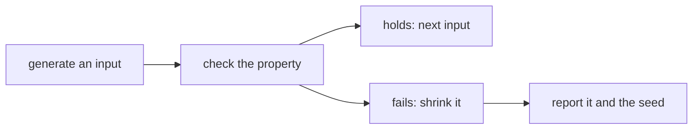

# Property-based testing: generators, properties and shrinking

## The idea

The tests of the [first guide](../what-a-test-checks/guide.md) pin one input to one expected output: "encoding `aaab` gives `3a1b`". Each such test is only as good as the imagination of whoever chose the input, and the cases that break code are often the ones nobody pictured: a run of ten letters, an empty text, a value that appears twice. A **property-based test** turns the question around. Instead of an answer for one input, you write down something that must be true of the answer for *any* input, and let the computer invent the inputs, hundreds of them. The machinery has three pieces:

1. A **generator** produces inputs of a chosen shape, for example "texts made of up to four runs of the letters `a` and `b`". Its randomness comes from a pseudo-random number generator started from a **seed**, a number that fixes the whole sequence, so a run can be repeated exactly.
2. A **property** is the statement that must hold, written as a function that takes one input and returns true or false.
3. A **runner** feeds generated inputs to the property, one after another, until the property returns false or the runs are used up. An input on which the property is false is a **counterexample**.

A fourth piece turns a counterexample into something a person can read. Generated inputs are usually long and cluttered, and most of their content has nothing to do with the bug. **Shrinking** searches for a smaller input that still makes the property false, by trying simplifications of the counterexample, keeping each one that still fails and continuing from it, until no simplification fails any more.



<!-- text-of-mermaid sha256:b20f8d3fd03df00b355310dcdad26fbff298e3bd5d29ebeccbac0df5eb2a3e21 -->
```text
┌─────────────────┐    ┌──────────────────┐    ┌─────────────────┐    ┌──────────────────────┐
│generate an input├───►│check the property├───►│holds: next input│    │report it and the seed│
└─────────────────┘    └─────────┬────────┘    └─────────────────┘    └──────────────────────┘
                                 │                                                ▲
                                 │             ┌─────────────────┐                │
                                 └────────────►│ fails: shrink it├────────────────┘
                                               └─────────────────┘
```

The drawing shows the two ways out of a check: on to the next input, or into shrinking and a report.

The hard part is finding properties. A property must be simpler than the code it checks, or it repeats the code's mistakes. These kinds come up again and again:

| Kind | The rule | For example |
|------|----------|-------------|
| Round trip | Undoing an operation gives back the input | `decode(encode(x)) == x`; parsing what was printed |
| Invariant | Something about the output always holds | A sort's output is in order and has the same elements as its input |
| Model | A slow, obviously correct version agrees | A clever search returns what a linear scan returns |
| Idempotence | Doing it twice is the same as once | `normalize(normalize(x)) == normalize(x)` |
| Algebraic law | An equation between operations | `reverse(xs + ys) == reverse(ys) + reverse(xs)` |
| Relation between runs | Changing the input in a known way changes the output in a known way | Shuffling the input of a sum leaves it unchanged; adding 1 to every value adds 1 to the mean |
| No crash | Every valid input returns, and every invalid one raises the documented error | A parser never fails with an index error |

## A worked example

### A round trip that breaks

Run-length encoding writes each run of a repeated letter as its count and the letter: `aaab` becomes `3a1b`. The decoder below reads the count as a single digit. Every short example passes, because short examples have short runs. The property is the round trip, and the generator builds texts out of runs of up to 12 letters. The shrinker tries two kinds of simpler text: one letter fewer, or one `b` turned into an `a`.

```python examples/round_trip.py
"""A property, a generator, a runner and a shrinker, in one short program.

The property: decoding what run-length encoding produced gives back the original text. The
decoder has a bug that no short example shows: it reads a count as a single digit. The runner
finds a failing text, and the shrinker cuts it down to one that shows the bug at a glance.
"""

import random


def encode(text: str) -> str:
    out, i = [], 0
    while i < len(text):
        j = i
        while j < len(text) and text[j] == text[i]:
            j += 1
        out.append(f"{j - i}{text[i]}")
        i = j
    return "".join(out)


def decode(code: str) -> str:
    out = []
    for count, letter in zip(code[0::2], code[1::2]):  # bug: assumes every count is one digit
        out.append(letter * int(count))
    return "".join(out)


def round_trips(text: str) -> bool:
    try:
        return decode(encode(text)) == text
    except (ValueError, IndexError):
        return False


def below(rng: random.Random, n: int) -> int:
    return int(rng.random() * n)


def runs_of_letters(rng: random.Random) -> str:
    """The generator: up to 4 runs, each of 1 to 12 copies of a or b."""
    return "".join("ab"[below(rng, 2)] * (1 + below(rng, 12)) for _ in range(below(rng, 5)))


def candidates(text: str):
    """Simpler texts: drop one letter, then turn one b into a."""
    for i in range(len(text)):
        yield text[:i] + text[i + 1:]
    for i, letter in enumerate(text):
        if letter == "b":
            yield text[:i] + "a" + text[i + 1:]


def shrink(text: str) -> list[str]:
    """Greedy: move to the first simpler text that still fails, until none does."""
    path = [text]
    while True:
        simpler = next((c for c in candidates(path[-1]) if not round_trips(c)), None)
        if simpler is None:
            return path
        path.append(simpler)


SEED = 2093
rng = random.Random(SEED)
for run in range(1, 101):
    text = runs_of_letters(rng)
    if not round_trips(text):
        print(f"seed {SEED}, run {run}: fails on {text!r} ({len(text)} letters)")
        path = shrink(text)
        print(f"shrunk in {len(path) - 1} steps to {path[-1]!r}: encoded {encode(path[-1])!r}, "
              f"decoded {decode(encode(path[-1]))!r}")
        break
else:
    print("passed 100 runs")
```

It prints:

```output examples/round_trip.py
seed 2093, run 3: fails on 'aaaaabbbbbbaaaaaaaaaaaaaaaaaaaa' (31 letters)
shrunk in 21 steps to 'aaaaaaaaaa': encoded '10a', decoded '0'
```

The runner found a failing text of 31 letters on its third input. That proves there is a bug but hides it in noise. Shrinking removed letters one at a time while the round trip still failed, and stopped at ten copies of one letter, the shortest text where the bug can happen at all: ten is the first count with two digits, so `10a` decodes as one `0`. A test written by hand would have needed someone to think of a run of ten; the generator only needed to allow runs that long.

Three choices in the program matter in any property-based test:

- **The generator decides what can be found.** A uniformly random string of 30 letters `a` and `b` contains ten equal letters in a row only about 2% of the time. Building texts out of runs makes long runs common. A generator is a statement about which inputs are interesting.
- **The seed is printed with the failure.** Rerunning with seed 2093 reproduces the same inputs, the same failure and the same shrink, so the bug can be debugged and the test kept as a regression test.
- **Every candidate is a valid input.** The shrinker only removes letters and turns `b` into `a`, so every candidate is still a text the property accepts. If simplification could produce texts the generator would never make, the shrinker might wander off to a failure that no real caller can trigger, and the report would mislead.

### Filters skew the inputs

A tempting way to get inputs with a shape, say sorted lists, is to generate any list and throw away those without the shape. The program compares that with building sorted lists directly:

```python examples/filter_skew.py
"""Two ways to get sorted lists for a test: filter random lists, or build sorted ones.

Filtering keeps only the random lists that happen to be sorted. It throws most draws away, and
the lists it keeps are mostly very short, because a long random list is rarely sorted. Building
a sorted list directly wastes nothing and gives every length its share.
"""

import random
from collections import Counter

rng = random.Random(7)


def random_list() -> list[int]:
    return [int(rng.random() * 10) for _ in range(int(rng.random() * 7))]  # length 0 to 6


draws = 10_000
filtered = [xs for xs in (random_list() for _ in range(draws)) if xs == sorted(xs)]
built = [sorted(random_list()) for _ in range(len(filtered))]

print(f"filtering: kept {len(filtered)} of {draws} draws, discarded {draws - len(filtered)}")
print("length   filtered   built")
by_length_filtered = Counter(len(xs) for xs in filtered)
by_length_built = Counter(len(xs) for xs in built)
for length in range(7):
    print(f"{length:>6} {by_length_filtered[length]:>10} {by_length_built[length]:>7}")
```

It prints:

```output examples/filter_skew.py
filtering: kept 4044 of 10000 draws, discarded 5956
length   filtered   built
     0       1398     588
     1       1430     577
     2        750     632
     3        323     577
     4        101     582
     5         37     551
     6          5     537
```

Filtering wasted six draws in ten, and worse, it tested the wrong inputs: almost all the lists it kept have at most two elements, and lists of six elements appear 5 times in 4,044, because a random list of six digits is sorted with probability 5,005 in 10⁶, about 1 in 200. A property about sorted lists would pass this run while barely testing a list longer than three. Building sorted lists by sorting random ones gives every length its share. The general rule: build valid inputs directly, and filter only when the condition rarely fails.

## When to use it

- **Pure functions with a large input space**: parsers and printers, encoders and decoders, serializers, numeric routines, data structure operations.
- **Two implementations that must agree**: an optimized function and a simple one, a new version and the old one during a rewrite.
- **Code with clear rules but no easy expected values**: the output is sorted, nothing is lost, the totals balance.
- **Alongside example tests, not instead of them.** Examples document specific behaviour and pin known bugs; properties explore the space between them. When a property finds a bug, keep the shrunk counterexample as an example test too.
- **Objects with state**, where a bug needs a particular sequence of calls: the guide on [stateful and model-based testing](../stateful-and-model-based-testing/guide.md) extends the same idea to sequences of commands.

## Common traps

- **Restating the implementation.** A property that computes the expected output the same way the code does agrees with every bug. Use a different route: a slower method, a law, a relation, an invariant.
- **A generator that never reaches the edges.** Integers drawn uniformly from a large range almost never hit 0 or the largest value; lists rarely come out empty or with duplicates. Make the edge cases likely on purpose.
- **Filtering too much.** Every discarded input is wasted work, and the inputs that remain are not a fair sample: short sorted lists crowd out long ones, as above. Build valid inputs directly.
- **No seed in the report.** A failure that cannot be replayed cannot be debugged. Print the seed, and the counterexample itself, which survives changes to the generator.
- **Exact equality on floating point.** Many algebraic laws hold for integers and not for floats: addition is associative on integers, but `(0.1 + 0.2) + 0.3` and `0.1 + (0.2 + 0.3)` differ in the last digit. Compare with a tolerance, or test the law on integers.
- **Properties that are too weak.** "The output is a list" passes for almost any bug. Combine properties: in order *and* the same elements; round trip *and* a known encoding for a few examples.
- **Too few runs, or too many.** A hundred runs, the original QuickCheck default, is a convention, not a law. Run more when inputs are cheap and the space is large, and keep the suite fast enough to run on every change.

## Complexity

A property test costs about `R · (g + p)`: `R` runs, each generating an input in time `g` and checking the property in time `p`. With a fixed seed it costs the same on every run.

Shrinking costs more per step but takes few steps. Each step generates the candidates of the current input and checks them in order until one fails; each accepted step makes the input strictly simpler by some measure (here: fewer letters, or fewer `b`s at the same length), so the loop ends. For the text shrinker, an input of `n` letters has at most `2n` candidates and the loop takes at most `2n` steps, so a shrink makes `O(n²)` property checks at worst; in the example, 21 steps from 31 letters.

A filter multiplies the generation cost by the inverse of its acceptance rate: about 2.5 draws per kept list in the example, and about 200 draws per sorted list of six digits.

## Expert notes

- **Where it comes from.** Claessen and Hughes introduced QuickCheck in *QuickCheck: a lightweight tool for random testing of Haskell programs* (ICFP 2000): properties written as ordinary functions of their inputs, checked on random inputs from generators the programmer can define, serving also as checkable documentation of the code. Their first examples are laws about `reverse`, among them the one in the table above; a deliberately wrong version of that law was reported false after one test, with the counterexample `[2]` and `[-2,1]`.
- **A hundred tests, and conditions.** The paper's checker ran 100 tests by default, "a rather arbitrary number" that could be changed. A conditional property, one that only applies when a precondition holds, discarded candidates that failed the precondition; to avoid running forever, the checker tried a limited number of candidates, 1000 by default, and reported how many tests passed when it ran out.
- **Watching the distribution.** The same paper showed the filter trap: checking insertion into an ordered list with "the list is ordered" as a precondition gave mostly empty and one-element lists, because every list of length 0 or 1 is ordered but only half of those of length 2. Its tools for watching the distribution, labelling cases and collecting statistics, exist to catch that, and its recommended fix was a generator that builds ordered lists directly.
- **Size grows during a run.** The paper's generators take a size bound, and the checker starts with small inputs and increases the bound as testing proceeds, which gives more variety and makes it more likely to find a small counterexample if there is one.
- **The first shrinking.** The paper reports an extension by one user that added a method returning a list of smaller, similar values for any value, tried whenever a counterexample was found; in some cases much smaller counterexamples were found, greatly reducing the time to understand the bug. That is the candidate list of a shrinker.
- **Delta debugging.** Zeller and Hildebrandt's *Simplifying and Isolating Failure-Inducing Input* (IEEE Transactions on Software Engineering, 2002) automates the same simplification for any failing input, such as a file or a list of user actions. A test case is *minimal* when no part of it can be removed without the failure disappearing, which can take exponentially many tests to establish; their algorithm settles for *1-minimal*, where removing any single part makes the failure disappear. In one case study it reduced 95 user actions that crashed a web browser to 3, and 896 lines of HTML to one line, in 139 automated test runs. A greedy shrinker like the example's stops at a 1-minimal input too: no single letter can be removed, which does not mean that no shorter failing text exists.
- **Random against systematic.** The QuickCheck paper chose random testing as the simplest method and notes that it competes surprisingly favourably with systematic methods in practice, with the caveat that random testing works best when the distribution of test data matches the real data, which is why control over the generators matters.

## Practice

- `cstudy start property-test-runner`: build a property-based testing engine with seeded generators, a runner that finds a counterexample, a shrinker, and generators composed from smaller ones. This path's step stops at level 3; level 4, stateful testing, comes after the next guide.

## Further reading

- [K. Claessen and J. Hughes, *QuickCheck: a lightweight tool for random testing of Haskell programs*, ICFP 2000, pages 268 to 279](https://doi.org/10.1145/351240.351266): properties, generators, conditional properties, test data distribution, sizes, and the first shrinking.
- [A. Zeller and R. Hildebrandt, *Simplifying and Isolating Failure-Inducing Input*, IEEE Transactions on Software Engineering 28(2), 2002, pages 183 to 200](https://doi.org/10.1109/32.988498): delta debugging and 1-minimal test cases.
- [Python, `random`](https://docs.python.org/3/library/random.html): seeded generators of your own, and which results stay the same across Python versions.
- [Python tutorial, *Floating-Point Arithmetic: Issues and Limitations*](https://docs.python.org/3/tutorial/floatingpoint.html): why float sums depend on their order.
