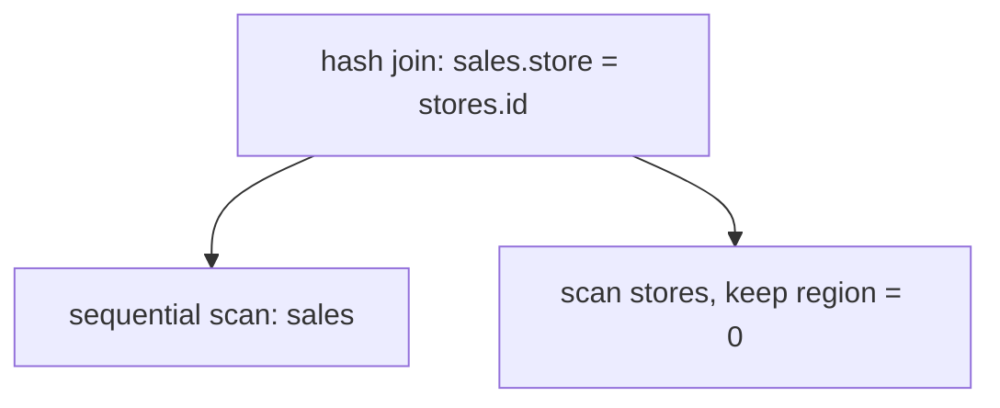
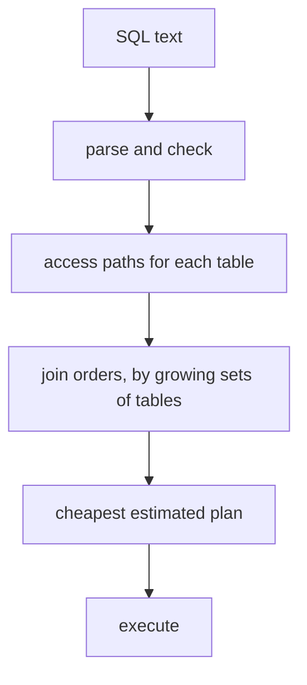

# Query planning: estimates, join algorithms and join order

## The idea

SQL says what result you want, not how to compute it. `SELECT ... FROM sales JOIN stores ON ... JOIN regions ON ... WHERE regions.name = 'north'` can be computed in many ways: which table to read first, whether to read it whole or through an index, which algorithm joins each pair, in which order. On large tables the best way can be faster than the worst by orders of magnitude. The part of the database that chooses is the **planner**, or optimizer, and what it produces is a **plan**: a tree of operators, each taking rows from its children and passing rows to its parent. PostgreSQL's documentation describes the finished tree: sequential or index scans of the base tables at the leaves, nested-loop, merge or hash join nodes above them, and sort or aggregate steps where needed.



<!-- text-of-mermaid sha256:cc7048791ad9b355e59fe912798f63bc2502cbfb49575740e6af431a8cd2d97f -->
```text
┌──────────────────────────────────┐
│hash join: sales.store = stores.id│
└──────────────────────────────────┘
                  ▼────────────────────────────────────▼
┌──────────────────────────────────┐    ┌────────────────────────────┐
│      sequential scan: sales      │    │scan stores, keep region = 0│
└──────────────────────────────────┘    └────────────────────────────┘
```

This plan answers a two-table query, the sales of the stores in region 0. Rows flow upward: the scan of `stores` keeps the stores of region 0, the scan of `sales` reads every sale, and the hash join pairs them. A third table, such as `regions` to filter by the region's name, adds one more join to the tree, and the planner must choose which pair to join first.

The planner cannot run every plan to see which is fastest, so it **estimates** the cost of each, and the method planners still build on was published in 1979 by Selinger and colleagues for System R, an experimental relational database system. Their cost of a plan is a weighted sum, `page fetches + W × RSI calls`: the pages read from disk plus a factor W times the number of rows the storage layer returns, a measure of CPU time. To estimate both, the optimizer keeps **statistics** in the catalog: for each table its number of rows and of pages, and for each index its number of distinct keys and of pages. System R refreshed them only when a user ran a command, not on every insert, because updating them constantly would have serialized every write behind the catalog.

The key quantity is how many rows a condition keeps, its **selectivity factor** F, which Selinger and colleagues estimated with a short table of rules:

| Condition | F |
|-----------|---|
| `column = value` | 1 / (distinct keys of an index on the column), assuming values are evenly spread; 1/10 without an index |
| `column1 = column2` | 1 / (the larger of the two columns' distinct key counts), assuming every key of the smaller has a match in the other |
| `column > value` | the share of the range between the lowest and highest key, by linear interpolation; 1/3 when that is not possible |
| `column BETWEEN a AND b` | the share of the range; 1/4 when that is not possible |
| `column IN (list)` | the number of items times the factor for `=`, at most 1/2 |

The estimated size of a result is the product of the sizes of its tables times the product of the factors of all its conditions. Multiplying the factors assumes the conditions are **independent**: knowing that a row satisfies one tells nothing about the other. The defaults are guesses, and the paper says so: 1/3 has "no significance" beyond being less selective than the guess for an equality without an index, and less than 1/2.

For each table the planner considers its **access paths**: a full scan, which is always possible, and each index whose key matches a condition. Each path has a cost and produces rows in some order, and an order matters when a later step can use it: Selinger and colleagues call an order **interesting** when the query's `GROUP BY` or `ORDER BY` names it, or when it is a join column. For each table they keep the cheapest path for every interesting order, plus the cheapest path overall.

Then come the **joins**. System R had two methods, chosen because a study by Blasgen and Eswaran had found that, for all but very small relations, one of the two was always optimal or nearly so:

- **Nested loops**: for each row of the outer input, scan the inner input for rows that satisfy the join condition. It works for any join condition.
- **Merging scans**, today's **sort-merge join**: read both inputs in join column order, sorting them first unless an index already gives that order, and walk them side by side, so the inner input is not rescanned for every outer row. System R used it for equality joins only.

PostgreSQL's planner adds a third, the **hash join**: read the right input into a hash table keyed on the join columns, then look up each row of the left input. Like the merge join it reads each input once, and it needs no order, but it works only for equality.

Last, the **join order**. A query of n tables has n! orders in which to join them. Selinger and colleagues observed that once the first k tables are joined, the best way to join the next one does not depend on the order in which those k were joined: the applicable conditions, the interesting orders and the possible methods are the same. So they search by **dynamic programming over subsets**: find the best plan for every set of two tables, then build the best plan for every set of three from those, and so on, keeping for each set the cheapest plan for each interesting order. Their plans join a composite result, as the outer input, with one more table as the inner input, the shape now called **left-deep**. And they consider only orders in which each new table has a join condition with the tables already joined, unless there is no choice, so that Cartesian products, every row paired with every row, come as late as possible.



<!-- text-of-mermaid sha256:a5d9ce27bcbdf820f30dccb23ed1228c740f3d35b7c22d3b6c607cb457b5cb63 -->
```text
┌──────────────────────────────────────┐
│               SQL text               │
└───────────────────┬──────────────────┘
                    ▼
┌──────────────────────────────────────┐
│           parse and check            │
└───────────────────┬──────────────────┘
                    ▼
┌──────────────────────────────────────┐
│     access paths for each table      │
└───────────────────┬──────────────────┘
                    ▼
┌──────────────────────────────────────┐
│join orders, by growing sets of tables│
└───────────────────┬──────────────────┘
                    ▼
┌──────────────────────────────────────┐
│       cheapest estimated plan        │
└───────────────────┬──────────────────┘
                    ▼
┌──────────────────────────────────────┐
│               execute                │
└──────────────────────────────────────┘
```

Everything before "execute" is estimation; no row has been read. A plan is only as good as the estimates that chose it.

## A worked example

### Three join methods

This program computes the same join three ways, on six customers and fourteen orders, and counts the work:

```python examples/join_methods.py
"""Three ways to compute the same equi-join, and the work each one does.

The query pairs each order with its customer: orders.customer = customers.id. The nested loop
reads every customer again for each order. The hash join puts the customers in a hash table once,
then looks up each order. The sort-merge join sorts both inputs on the join key, then walks them
side by side. All three return the same rows.
"""

customers = [(3, "ana"), (1, "bo"), (6, "cy"), (2, "di"), (5, "ed"), (4, "flo")]  # (id, name)
CUSTOMER_OF_ORDER = [2, 5, 2, 7, 1, 5, 3, 2, 6, 1, 4, 5, 2, 3]
orders = list(zip(range(101, 115), CUSTOMER_OF_ORDER, strict=True))  # (id, customer)


def nested_loop() -> tuple[list, int]:
    out, compared = [], 0
    for order_id, customer in orders:
        for cid, name in customers:
            compared += 1
            if customer == cid:
                out.append((order_id, name))
    return out, compared


def hash_join() -> tuple[list, int]:
    table: dict[int, list[str]] = {}
    for cid, name in customers:  # build
        table.setdefault(cid, []).append(name)
    out = [(order_id, name) for order_id, customer in orders for name in table.get(customer, [])]
    return out, len(customers) + len(orders)  # inserts plus lookups


def sort_merge() -> tuple[list, int]:
    left, right = sorted(orders, key=lambda o: o[1]), sorted(customers)
    out, steps, i, j = [], 0, 0, 0
    while i < len(left) and j < len(right):
        steps += 1
        if left[i][1] < right[j][0]:
            i += 1
        elif left[i][1] > right[j][0]:
            j += 1
        else:  # customer ids are unique, so each order matches at most this one
            out.append((left[i][0], right[j][1]))
            i += 1
    return out, steps


results = {}
for name, method, unit in [
    ("nested loop", nested_loop, "comparisons"),
    ("hash join", hash_join, "inserts and lookups"),
    ("sort-merge", sort_merge, "merge steps, after sorting 14 and 6 rows"),
]:
    rows, work = method()
    results[name] = sorted(rows)
    print(f"{name:<12} {len(rows)} rows  {work:>3} {unit}")
print("same rows from all three:", len({tuple(r) for r in results.values()}) == 1)
print("order 104 names customer 7, who does not exist, so no method returns it")
```

It prints:

```output examples/join_methods.py
nested loop  13 rows   84 comparisons
hash join    13 rows   20 inserts and lookups
sort-merge   13 rows   19 merge steps, after sorting 14 and 6 rows
same rows from all three: True
order 104 names customer 7, who does not exist, so no method returns it
```

The nested loop compares every order with every customer, 14 × 6 = 84 comparisons. The hash join inserts the 6 customers into a table and makes 14 lookups, 20 operations. The sort-merge join walks the two sorted lists in 19 steps, after sorting them. All three find the same 13 pairs, and none returns order 104, whose customer does not exist. On large tables the gap widens: a nested loop over inputs of R and S rows does R × S comparisons, a hash join about R + S operations.

### Join orders and estimates

The second program runs the query of the drawing in every left-deep order and counts the rows each join produces, then estimates the result with System R's rules:

```python examples/join_orders.py
"""The same three-table join in every left-deep order, and how many rows each order produces.

The query: the sales of the stores in the region named "north".
  regions: 4 rows (id, name); stores: 40 rows (id, region); sales: 4,000 rows (id, store).
  sales.store = stores.id AND stores.region = regions.id AND regions.name = 'north'
Each order starts from one table, with its filter applied, and joins one table at a time, using
only tables that share a join condition with what is already joined (no Cartesian product). The
estimate follows the 1979 System R rules: a filter keeps 1 / (distinct values) of the rows, and a
join keeps 1 / (the larger number of distinct values of its two columns) of the pairs.
"""

from itertools import permutations

NAMES = ["north", "south", "east", "west"]


def tables(skewed: bool) -> dict[str, list[dict]]:
    regions = [{"id": r, "name": NAMES[r]} for r in range(4)]
    stores = [{"id": s, "region": s % 4} for s in range(40)]
    north = [s for s in range(40) if s % 4 == 0]
    others = [s for s in range(40) if s % 4 != 0]
    if skewed:  # 7 sales in 10 go to the 10 northern stores
        sales = [
            {"store": north[(k // 10) % 10] if k % 10 < 7 else others[(k // 10) % 30]}
            for k in range(4000)
        ]
    else:
        sales = [{"store": k % 40} for k in range(4000)]
    return {"regions": regions, "stores": stores, "sales": sales}


JOINS = {
    frozenset({"sales", "stores"}): ("sales", "store", "stores", "id"),
    frozenset({"stores", "regions"}): ("stores", "region", "regions", "id"),
}


def keep(table: str, row: dict) -> bool:
    return table != "regions" or row["name"] == "north"


def run(order: tuple[str, ...], data: dict) -> list[int] | None:
    rows = [{order[0]: r} for r in data[order[0]] if keep(order[0], r)]
    sizes = []
    for i, table in enumerate(order[1:], start=1):
        links = [JOINS[frozenset({table, t})] for t in order[:i] if frozenset({table, t}) in JOINS]
        if not links:
            return None  # would be a Cartesian product
        a, ca, b, cb = links[0]
        index: dict[int, list[dict]] = {}
        for r in data[table]:
            if keep(table, r):
                index.setdefault(r[ca] if table == a else r[cb], []).append(r)
        rows = [
            {**row, table: r}
            for row in rows
            for r in index.get(row[b][cb] if table == a else row[a][ca], [])
        ]
        sizes.append(len(rows))
    return sizes


for skewed in (False, True):
    data = tables(skewed)
    print("skewed data: 70% of the sales are northern" if skewed else "uniform data")
    for order in permutations(["regions", "stores", "sales"]):
        sizes = run(order, data)
        if sizes is None:
            print(f"  {' > '.join(order):<26} skipped: needs a Cartesian product")
        else:
            print(f"  {' > '.join(order):<26} rows after each join {sizes}, total {sum(sizes):,}")
    north = 4 // 4  # 4 regions, 4 distinct names
    with_stores = 40 * north // max(4, 4)  # stores.region and regions.id: 4 distinct each
    estimate = 4000 * with_stores // max(40, 40)  # sales.store and stores.id: 40 distinct each
    print(f"  estimated: {north} region, {with_stores} stores, {estimate:,} sales")
```

It prints:

```output examples/join_orders.py
uniform data
  regions > stores > sales   rows after each join [10, 1000], total 1,010
  regions > sales > stores   skipped: needs a Cartesian product
  stores > regions > sales   rows after each join [10, 1000], total 1,010
  stores > sales > regions   rows after each join [4000, 1000], total 5,000
  sales > regions > stores   skipped: needs a Cartesian product
  sales > stores > regions   rows after each join [4000, 1000], total 5,000
  estimated: 1 region, 10 stores, 1,000 sales
skewed data: 70% of the sales are northern
  regions > stores > sales   rows after each join [10, 2800], total 2,810
  regions > sales > stores   skipped: needs a Cartesian product
  stores > regions > sales   rows after each join [10, 2800], total 2,810
  stores > sales > regions   rows after each join [4000, 2800], total 6,800
  sales > regions > stores   skipped: needs a Cartesian product
  sales > stores > regions   rows after each join [4000, 2800], total 6,800
  estimated: 1 region, 10 stores, 1,000 sales
```

- **Order matters.** Starting from the one northern region, the first join produces 10 stores and the second 1,000 sales: 1,010 rows in all. Starting from `stores` and joining `sales` first produces 4,000 rows before the region filter removes three quarters of them: 5,000 rows in all. The result is the same either way.
- **Two orders are never considered**, because `regions` and `sales` share no condition: joining them first would pair every region with every sale.
- **On uniform data the estimate is exact.** Each region has 10 stores and each store 100 sales, which is what the rules assume.
- **On skewed data it is not.** When 70% of the sales are northern, the rules still say 1,000, because they assume every value is equally common; the real answer is 2,800. The plan stays the same here, but in a larger query a factor of 2.8 at one join can change which order looks cheapest.

With three tables there are 3! = 6 orders. With ten there are 3,628,800, while there are only 2¹⁰ = 1,024 subsets of ten tables, which is why the search by subsets scales where trying every order does not.

## When to use it

You rarely plan by hand; you read the planner's choices and fix what misleads it.

- **Read the plan of a slow query.** `EXPLAIN` shows the plan with its estimated costs and rows; `EXPLAIN ANALYZE` actually runs the query and shows the true row count and time of every node beside the estimates. PostgreSQL's documentation says the most important thing to look for is whether the estimated row counts are reasonably close to reality.
- **Refresh statistics after large changes.** In PostgreSQL the counts of rows and pages and the per-column statistics are not updated on the fly; `ANALYZE` (and `VACUUM ANALYZE`) refreshes them, and they are approximate even then.
- **Give the planner access paths.** An index on a column used to filter or join gives the planner a path it otherwise lacks.
- **Pick the join method by the inputs**, when you write the loop yourself: a nested loop when the outer side is tiny or the condition is not an equality, a hash join for large equality joins with memory for one side, a merge join when both sides already come sorted on the key.
- **Force an order only as a last resort.** PostgreSQL lets advanced users set `join_collapse_limit` to 1 and write the joins in the order they want, because the planner does not always choose the best one; the plan then stops adapting as the data changes.

## Common traps

- **Stale or missing statistics.** An estimate made from yesterday's row counts can be off by any factor after a bulk load. System R assumed that a table without statistics is small, a guess that is wrong for a table that has just been filled.
- **Correlated conditions.** `city = 'Paris' AND country = 'France'` is estimated as if the two were independent, so the factors multiply and the estimate is far too small. The independence assumption is built into the product of factors.
- **Skewed values.** Rules that assume an even spread mis-estimate a common value, as the second example shows.
- **Reading costs as milliseconds.** PostgreSQL's costs are in arbitrary units, conventionally the cost of reading one page sequentially; `EXPLAIN ANALYZE` reports milliseconds of real time, and the two are not comparable.
- **Joining too many tables.** Below `geqo_threshold`, 12 tables by default, PostgreSQL searches the join orders almost exhaustively, within the collapse limits, 8 by default; from there on it uses a genetic algorithm that finds a reasonable plan, not necessarily the best.
- **Assuming an index is always used.** A plan that reads a large share of a scattered table through an index costs more than a full scan, and the planner, if its estimates are right, avoids it; the guide on B-trees shows why.

## Complexity

| Quantity | Cost |
|----------|------|
| Join orders of n tables | n!; with only left-deep plans and no Cartesian products, fewer, but still exponential |
| Dynamic programming over subsets | one entry per subset of tables: O(2ⁿ) entries, each built from at most n smaller ones |
| Nested loop join of R and S rows | R × S condition checks, without an index |
| Hash join | about R + S operations on average, plus memory for the build side |
| Sort-merge join | sorting, O(R log R + S log S) when the inputs are not already ordered, then one pass over both |
| Every join | plus the size of its output, which no algorithm avoids |

Selinger and colleagues report that planning took a few thousand bytes of storage and a few tenths of a second of CPU time for typical queries on their machine, and that joins of 8 tables were optimized in a few seconds.

## Expert notes

- **The cost of a join in System R.** The cost of a nested loop is the cost of scanning the outer input plus N times the cost of scanning the inner input, where N is the estimated number of outer rows that satisfy the conditions so far. A merge join has the same form, with the inner scan reading only the group of rows matching one join value, plus the cost of any sorts. Intermediate results were stored only when the next join needed them sorted; otherwise rows went from one join to the next one at a time.
- **Interesting orders in classes.** To keep fewer plans, System R grouped interesting orders into equivalence classes: with `E.DNO = D.DNO` and `D.DNO = F.DNO`, all three columns give the same order.
- **PostgreSQL's planner** generates a sequential scan for every table, an index scan for each index matching a condition, then plans every join pair it considers with every join method, preferring pairs linked by a join condition. Above `geqo_threshold` its **genetic query optimizer** chooses join sequences by heuristics. The cost constants are settings: a sequential page costs 1.0 and a random page 4.0 by default, less than a random read of durable storage really costs, because most random reads, such as index reads, are assumed to be cached.
- **SQLite's planner** computes every join as nested loops, one per table, each loop reading its table whole or through an index; planning chooses the order of the loops and the indexes. Since version 3.8.0 (2013), its **next generation query planner** searches orders with an algorithm it calls N nearest neighbors, keeping the N best partial paths at each step instead of the single best.
- **Estimates in practice.** PostgreSQL's documentation, after showing an example in which every estimate matched the actual rows, adds that this is quite unusual in practice.

## Practice

- `cstudy start query-planner`: parse a small SQL subset into a plan, estimate rows from statistics, choose the cheapest left-deep join order by dynamic programming over subsets, then pick access paths and join methods.
- `cstudy start triple-store`: a store of facts whose queries join patterns on shared variables; matching the most selective pattern first, and the patterns that share its variables next, works through far fewer candidates.

## Further reading

- [P. G. Selinger, M. M. Astrahan, D. D. Chamberlin, R. A. Lorie and T. G. Price, *Access Path Selection in a Relational Database Management System*, SIGMOD 1979, pages 23 to 34](https://doi.org/10.1145/582095.582099): the cost formula, statistics, selectivity factors, interesting orders, the two join methods and the search over subsets.
- [PostgreSQL documentation, *Planner/Optimizer*](https://www.postgresql.org/docs/current/planner-optimizer.html): access paths, the three join methods and the search strategy.
- [PostgreSQL documentation, *Using EXPLAIN*](https://www.postgresql.org/docs/current/using-explain.html) and [*Statistics Used by the Planner*](https://www.postgresql.org/docs/current/planner-stats.html): reading plans, cost units, `EXPLAIN ANALYZE`, and `ANALYZE`.
- [PostgreSQL documentation, *Query Planning* settings](https://www.postgresql.org/docs/current/runtime-config-query.html): cost constants, `geqo_threshold` and `join_collapse_limit`.
- [SQLite, *The Next-Generation Query Planner*](https://www.sqlite.org/queryplanner-ng.html) and [*The SQLite Query Optimizer Overview*](https://www.sqlite.org/optoverview.html): nested loops and the N nearest neighbors search.
