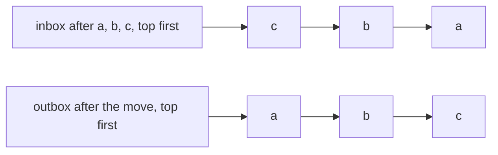
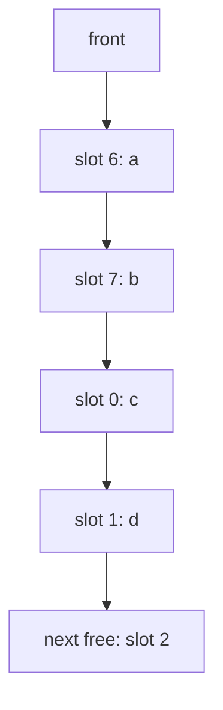
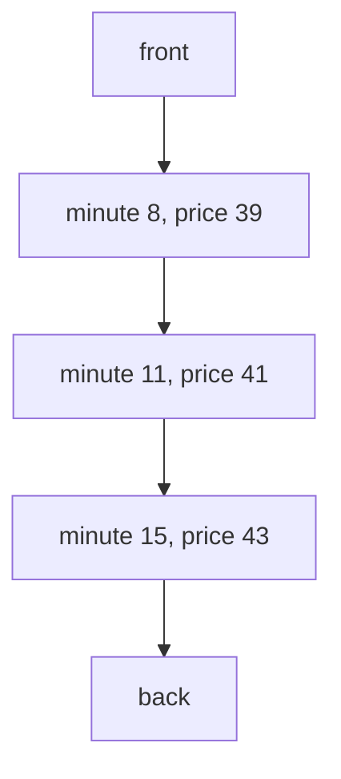

# Queues and deques

## The idea

A **queue** is a line: items join at the back and leave from the front, so the item that leaves is always the one that has waited longest. That rule is **first in, first out**, or FIFO. Its operations are **enqueue** (join at the back), **dequeue** (leave from the front) and **peek** (look at the front).

A **deque**, short for double-ended queue and pronounced "deck", lets items join and leave at **both** ends. Used from one end only, it is a [stack](../stacks/guide.md); used at the back for joining and the front for leaving, it is a queue. Most languages give you a deque and let you pick: Python's `collections.deque`, Java's `ArrayDeque`, Rust's `VecDeque`.

A plain array is the wrong base for a queue. Removing its first element shifts every other element down by one place, so each dequeue costs O(n). There are three ways around it, and this guide builds or draws each:

1. **Two stacks**, which turn the order around once per item.
2. **A ring buffer**: an array whose front moves forward and wraps around, so nothing has to shift.
3. **Linked blocks**: small arrays chained together, adding and dropping whole blocks at the ends.

Then it uses a deque for something a queue alone cannot do: keeping the smallest value of a window that slides over a stream.

## A worked example

### A queue from two stacks

Keep two stacks. `inbox` receives every new item. `outbox` hands items out. To dequeue, pop from `outbox`; if `outbox` is empty, first move every item of `inbox` across, one pop and one push at a time. Moving reverses the order, so the oldest item, which was at the bottom of `inbox`, ends up on top of `outbox`.



<!-- text-of-mermaid sha256:22624569c5b7b5f56d07960c2abf9be67c37e0067cb8f4aafb52477ad99960b4 -->
```text
┌────────────────────────────────┐    ┌─┐    ┌─┐    ┌─┐
│ inbox after a, b, c, top first ├───►│c├───►│b├───►│a│
└────────────────────────────────┘    └─┘    └─┘    └─┘

┌────────────────────────────────┐    ┌─┐    ┌─┐    ┌─┐
│outbox after the move, top first├───►│a├───►│b├───►│c│
└────────────────────────────────┘    └─┘    └─┘    └─┘
```

The example traces a few operations, prints each stack from bottom to top, and then measures the cost over 100,000 items.

```python examples/two_stack_queue.py
"""A first-in, first-out queue made of two stacks, and what it costs.

New items are pushed on `inbox`. `outbox` holds items in queue order, the oldest on top. Only when
`outbox` is empty does a dequeue move all of `inbox` across, which reverses it: the oldest on top.
"""

from collections import deque


class TwoStackQueue:
    def __init__(self) -> None:
        self.inbox: list[object] = []
        self.outbox: list[object] = []
        self.stack_operations = 0  # every push and pop on either stack, to measure the cost

    def enqueue(self, item: object) -> None:
        self.inbox.append(item)
        self.stack_operations += 1

    def dequeue(self) -> object:
        if not self.outbox:
            while self.inbox:
                self.outbox.append(self.inbox.pop())
                self.stack_operations += 2
        self.stack_operations += 1
        return self.outbox.pop()  # IndexError when both stacks are empty


class EagerQueue(TwoStackQueue):
    """A broken variant: it moves `inbox` across even when `outbox` still holds older items."""

    def dequeue(self) -> object:
        while self.inbox:
            self.outbox.append(self.inbox.pop())
        return self.outbox.pop()


queue = TwoStackQueue()
for step in ["enqueue a", "enqueue b", "enqueue c", "dequeue", "enqueue d", "dequeue", "dequeue"]:
    if step == "dequeue":
        step += f" -> {queue.dequeue()}"
    else:
        queue.enqueue(step.split()[1])
    print(f"{step:<12} inbox {queue.inbox!s:<17} outbox {queue.outbox}")

eager = EagerQueue()
eager.enqueue("a")
eager.enqueue("b")
first = eager.dequeue()
eager.enqueue("c")
print("eager variant serves:", first, eager.dequeue(), eager.dequeue())

ITEMS = 100_000
queue, reference = TwoStackQueue(), deque()
for item in range(ITEMS):
    queue.enqueue(item)
    reference.append(item)
before = queue.stack_operations
served = [queue.dequeue()]
print(f"first dequeue after {ITEMS:,} enqueues: {queue.stack_operations - before:,} operations")
served += [queue.dequeue() for _ in range(ITEMS - 1)]
print("same order as collections.deque:", served == [reference.popleft() for _ in range(ITEMS)])
print(f"stack operations per item, over its whole life: {queue.stack_operations / ITEMS:.2f}")

queue, served = TwoStackQueue(), []
for item in range(ITEMS):
    queue.enqueue(item)
    if item % 3 == 2:  # two arrivals out of every three are served at once
        served += [queue.dequeue(), queue.dequeue()]
served += [queue.dequeue() for _ in range(ITEMS - len(served))]
print("interleaved, in order:", served == list(range(ITEMS)))
print(f"interleaved, stack operations per item: {queue.stack_operations / ITEMS:.2f}")
```

It prints:

```output examples/two_stack_queue.py
enqueue a    inbox ['a']             outbox []
enqueue b    inbox ['a', 'b']        outbox []
enqueue c    inbox ['a', 'b', 'c']   outbox []
dequeue -> a inbox []                outbox ['c', 'b']
enqueue d    inbox ['d']             outbox ['c', 'b']
dequeue -> b inbox ['d']             outbox ['c']
dequeue -> c inbox ['d']             outbox []
eager variant serves: a c b
first dequeue after 100,000 enqueues: 200,001 operations
same order as collections.deque: True
stack operations per item, over its whole life: 4.00
interleaved, in order: True
interleaved, stack operations per item: 4.00
```

Read the trace. The first dequeue finds `outbox` empty and moves `a`, `b` and `c` across, leaving `c, b` with `b` on top once `a` is served. When `d` arrives, it waits in `inbox`: the next two dequeues serve `b` and `c` straight from `outbox`, and only the dequeue after that would move `d`. That is the one rule of the design: **move only when `outbox` is empty**. The eager variant moves on every dequeue, so `c` lands on top of `b` and is served first: `a c b` instead of `a b c`.

Now the cost. One dequeue can be expensive: after 100,000 enqueues, the first dequeue moves all of them, 200,001 stack operations. But count per item instead of per call. Every item is pushed on `inbox` once, popped from it at most once, pushed on `outbox` at most once, and popped from it once. Items only ever move from `inbox` to `outbox`, never back, so no item is moved twice. That is at most **4 stack operations per item over its whole life**, whatever the order of the calls, which the measurement confirms at 4.00 for both patterns. So n enqueues and n dequeues cost at most 4n stack operations in total: O(1) per operation **amortized**, even though a single dequeue may cost O(n).

### A ring buffer

A ring buffer is an array plus two numbers: where the front is, and how many items there are. Enqueue writes after the last item, dequeue reads at the front and moves the front forward by one, and both positions wrap around to slot 0 at the end of the array. Nothing ever shifts. When the array is full, a growable ring buffer allocates a larger one and copies the items over, in queue order.



<!-- text-of-mermaid sha256:3de39955b79959edc64bdc8fc23300fcf4bc2f3b0457c13abd64c98ac91b20af -->
```text
┌─────────────────┐
│      front      │
└────────┬────────┘
         ▼
┌─────────────────┐
│    slot 6: a    │
└────────┬────────┘
         ▼
┌─────────────────┐
│    slot 7: b    │
└────────┬────────┘
         ▼
┌─────────────────┐
│    slot 0: c    │
└────────┬────────┘
         ▼
┌─────────────────┐
│    slot 1: d    │
└────────┬────────┘
         ▼
┌─────────────────┐
│next free: slot 2│
└─────────────────┘
```

Rust's `VecDeque` is "a double-ended queue implemented with a growable ring buffer", and Java's `ArrayDeque` is a "resizable-array implementation of the `Deque` interface". Because the items can wrap around the end, they are not always contiguous in memory: Rust's documentation says so, and offers `make_contiguous` to rotate them into one slice.

### A deque for the minimum of a window

Offers for the same item arrive over time, as (minute, price). After each one, you want the cheapest offer of the last 10 minutes. Recomputing the minimum over the window every time costs as many steps as the window holds offers. A deque does it in O(1) amortized time per offer, because of one observation:

**An offer that costs at least as much as a later offer can never be the cheapest again.** The later one is no more expensive, and it stays in the window at least as long. So when an offer arrives, pop from the back every offer that costs as much or more, then push the new one at the back. And when the offer at the front is 10 minutes old or more, pop it from the front.

What stays in the deque are the offers that could still be the cheapest one, oldest first. Their prices rise from front to back, since every offer removed the more expensive ones before it. So the cheapest offer in the window is always at the front.

```python examples/window_minimum.py
"""After every new offer, the cheapest offer of the last 10 minutes, kept up to date with a deque.

Offers arrive in time order as (minute, price). An offer counts while it is less than 10 minutes
old. The deque holds only the offers that could still be the cheapest one, the oldest in front.
"""

from collections import deque

WINDOW = 10
OFFERS = [(0, 42), (1, 38), (3, 40), (4, 45), (8, 39), (11, 41), (12, 44), (15, 43), (19, 47)]


def cheapest_in_window(offers: list[tuple[int, int]], show: bool = False):
    candidates: deque[tuple[int, int]] = deque()  # prices rise from front to back
    answers, pushes, pops = [], 0, 0
    for minute, price in offers:
        while candidates and candidates[-1][1] >= price:
            candidates.pop()  # never the cheapest again: the new offer costs no more, lasts longer
            pops += 1
        candidates.append((minute, price))
        pushes += 1
        while candidates[0][0] <= minute - WINDOW:
            candidates.popleft()  # too old to count
            pops += 1
        answers.append(candidates[0][1])
        if show:
            shown = " ".join(f"{m}:{p}" for m, p in candidates)
            print(f"minute {minute:>2}, price {price}: cheapest {answers[-1]}, deque {shown}")
    return answers, pushes, pops


def cheapest_by_scanning(offers: list[tuple[int, int]]) -> list[int]:
    answers = []
    for index, (minute, _) in enumerate(offers):
        start = index
        while start > 0 and offers[start - 1][0] > minute - WINDOW:
            start -= 1
        answers.append(min(price for _, price in offers[start : index + 1]))
    return answers


cheapest_in_window(OFFERS, show=True)

generated = [(index * 2 // 3, 30 + index * 37 % 41) for index in range(20_000)]
answers, pushes, pops = cheapest_in_window(generated)
agrees = answers == cheapest_by_scanning(generated)
print(f"{len(generated):,} offers: same answers as a scan: {agrees}")
print(f"pushes {pushes:,}, pops {pops:,}: never more than one of each per offer")
```

It prints:

```output examples/window_minimum.py
minute  0, price 42: cheapest 42, deque 0:42
minute  1, price 38: cheapest 38, deque 1:38
minute  3, price 40: cheapest 38, deque 1:38 3:40
minute  4, price 45: cheapest 38, deque 1:38 3:40 4:45
minute  8, price 39: cheapest 38, deque 1:38 8:39
minute 11, price 41: cheapest 39, deque 8:39 11:41
minute 12, price 44: cheapest 39, deque 8:39 11:41 12:44
minute 15, price 43: cheapest 39, deque 8:39 11:41 15:43
minute 19, price 47: cheapest 41, deque 11:41 15:43 19:47
20,000 offers: same answers as a scan: True
pushes 20,000, pops 19,997: never more than one of each per offer
```

Follow two lines. At minute 8 the price 39 arrives, and the back of the deque holds 45 and 40, both at least 39: they are popped, because for as long as either of them stays in the window, 39 does too, and 39 is cheaper. The 38 of minute 1 is cheaper and stays. At minute 11, the 38 of minute 1 is 10 minutes old and leaves from the front, and 39 becomes the cheapest. At minute 15, the deque holds three offers:



<!-- text-of-mermaid sha256:09ed966de178e52c49cf396fe00806c8722bef00355db4e7cd6b1a64a38b942c -->
```text
┌───────────────────┐
│       front       │
└─────────┬─────────┘
          ▼
┌───────────────────┐
│ minute 8, price 39│
└─────────┬─────────┘
          ▼
┌───────────────────┐
│minute 11, price 41│
└─────────┬─────────┘
          ▼
┌───────────────────┐
│minute 15, price 43│
└─────────┬─────────┘
          ▼
┌───────────────────┐
│        back       │
└───────────────────┘
```

Why is it O(1) amortized? Every offer is pushed exactly once and popped at most once, from the back or from the front. The inner loops pop at most as many offers, over the whole stream, as were ever pushed: the measurement on 20,000 offers shows 20,000 pushes and 19,997 pops. A single offer may pop many, but the total is at most 2n deque operations for n offers.

## When to use it

- **Serve in arrival order.** Tasks, requests, messages, print jobs, events to process: anything fair, where waiting longest means going first. Breadth-first search in graphs is a queue too, and the graphs path covers it.
- **Both ends at once.** A history with a cap, where new entries push out the oldest; a window that gains items at one end and loses them at the other; a list of work that one side adds to and another takes from.
- **A window that must report its smallest or largest value**, as items enter and leave: a deque of candidates, as above.

What to use instead: when the most recent item must come out first, a [stack](../stacks/guide.md). When the item with the highest priority must come out first, whatever its arrival, a heap. When you need to reach items in the middle, an array or a list.

## Common traps

- **Dequeuing from the front of a Python list.** The Python tutorial calls lists "not efficient" as queues: `pop(0)` and `insert(0, x)` shift every other element by one. Use `collections.deque`, with `append` and `popleft`.
- **Shifting a JavaScript array in a loop.** MDN describes `shift()` as shifting all values to the left by one. For a long-lived queue, keep a head index into the array, or a ring buffer, instead of shifting.
- **Mixing up the ends of a Java `Deque`.** As a queue, `offer` and `add` work at the back and `poll` and `remove` at the front; as a stack, `push` and `pop` both work at the front. `push` followed by `poll` gives you a stack, not a queue.
- **`null` in a Java `ArrayDeque`.** It is prohibited and throws `NullPointerException`, because `poll` and `peek` return `null` to say the deque is empty.
- **Re-slicing a Go slice as a queue.** `q = q[1:]` drops the front without copying anything, so the items in front stay in the underlying array, and "the full array will be kept in memory until it is no longer referenced", as the Go blog on slices puts it. What those items point to cannot be reclaimed either, until `append` next moves the slice to a new array.
- **Refilling the outbox too early.** In the two-stack queue, moving items while `outbox` still holds older ones lets newer items jump the line, as the eager variant shows.
- **Expiring by the wrong rule.** Decide whether an item exactly at the edge of the window is in or out, and write the comparison once. In the example, an offer made 10 minutes ago is out.
- **Forgetting that a bounded deque drops items.** A Python `deque` with `maxlen` that is full discards an item from the opposite end on every append, silently.

## Complexity

| Structure | Operation | Time | Condition |
|-----------|-----------|------|-----------|
| Deque (ring buffer or linked blocks) | add or remove at either end, peek | O(1), amortized when the array has to grow | Python documents "approximately the same O(1) performance in either direction"; Java, "amortized constant time" for most operations |
| Deque | read or write by index | O(1) at both ends, O(n) in the middle for Python's `deque`; O(1) anywhere for a ring buffer | |
| Two-stack queue | enqueue | O(1) amortized | |
| Two-stack queue | dequeue | O(1) amortized, O(n) for one call | At most 4 stack operations per item over its life |
| Window minimum | each new item | O(1) amortized | Each item pushed once and popped at most once |
| Memory | | O(n) for a queue of n items; O(w) for the window deque | w is the number of items in the window |

## Expert notes

- **CPython's `deque` is made of linked blocks.** Its source says "Data for deque objects is stored in a doubly-linked list of fixed length blocks", of 64 items each (`BLOCKLEN`). Blocks need fewer calls to `malloc` than one node per item, keep neighbours close in memory for the cache, and never need `realloc`. The documentation gives indexed access as O(1) at both ends, but it "slows to O(n) in the middle".
- **Java's `ArrayDeque`** has "no capacity restrictions" and is "likely to be faster than `Stack` when used as a stack, and faster than `LinkedList` when used as a queue". It is not thread-safe, unlike Python's `deque`, whose documentation promises "thread-safe, memory efficient appends and pops from either side".
- **Rust's `VecDeque`** is a growable ring buffer. Its "default" usage as a queue is `push_back` to add and `pop_front` to remove; `pop_front` and `pop_back` return `Option<T>`, `None` when it is empty.
- **Go** has no queue type. Its `container/list` package "implements a doubly linked list", which works as a deque, with each item in an element of its own; or use a slice, with the care described in the traps.
- **Bounded deques.** `deque(maxlen=n)` keeps the last n items: "once a bounded length deque is full, when new items are added, a corresponding number of items are discarded from the opposite end", which the documentation compares to the Unix `tail` filter.
- **Amortized is not always good enough.** The two-stack queue's average is excellent, but one dequeue in a while moves everything. A program that must answer every call quickly, such as one serving requests with a deadline, is better served by a ring buffer, whose worst case is O(1) except when it grows, or by one sized up front so that it never grows.
- **The window deque is a monotonic stack with a second exit.** At the back, it pops whatever the new item makes hopeless, exactly like the [monotonic stacks](../monotonic-stacks/guide.md) of the next guide; at the front, items leave because they get too old. Each item enters once and leaves once, which is where the amortized O(1) comes from in both.

## Practice

- `cstudy start sliding-window-maximum`: the largest value of every window of a fixed width as it slides over an array.

## Further reading

- [Python tutorial: using lists as queues](https://docs.python.org/3/tutorial/datastructures.html#using-lists-as-queues): why `pop(0)` is slow, and `collections.deque` instead.
- [Python `collections.deque`](https://docs.python.org/3/library/collections.html#collections.deque): O(1) at either end, O(n) in the middle, `maxlen`, and `IndexError` from an empty deque.
- [CPython `Modules/_collectionsmodule.c`](https://github.com/python/cpython/blob/main/Modules/_collectionsmodule.c): the deque's linked blocks and `BLOCKLEN`.
- [Java `Deque`](https://docs.oracle.com/en/java/javase/21/docs/api/java.base/java/util/Deque.html): the queue and stack methods and their ends, and why `null` is discouraged.
- [Java `ArrayDeque`](https://docs.oracle.com/en/java/javase/21/docs/api/java.base/java/util/ArrayDeque.html): resizable array, amortized constant time, no `null`, not thread-safe.
- [Rust `VecDeque`](https://doc.rust-lang.org/std/collections/struct.VecDeque.html): the growable ring buffer, its queue usage and `make_contiguous`.
- [Go `container/list`](https://pkg.go.dev/container/list) and [Go Slices: usage and internals](https://go.dev/blog/slices-intro): the doubly linked list, and why a re-sliced slice keeps its whole array.
- [MDN: `Array.prototype.shift`](https://developer.mozilla.org/en-US/docs/Web/JavaScript/Reference/Global_Objects/Array/shift): what `shift` does to the other elements.
