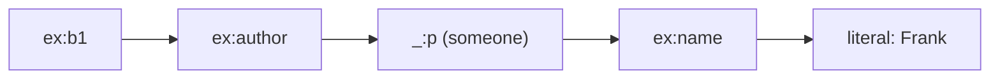

# Triples and RDF graphs

## The idea

Most databases ask you to design tables before you store anything. Facts about books, people and places, gathered from many sources, rarely fit one design: one source knows a book's page count, another its translator, a third the city its publisher is in. A **triple** stores one fact in three parts, with no table to design:

- a **subject**, what the fact is about: a book;
- a **predicate**, the kind of relation: "has author";
- an **object**, what the subject is related to: a person.

A set of triples is a **graph**. Draw each subject and object as a node, and each triple as an arrow from its subject to its object, labelled with its predicate. Facts connect where they share a node: "the book has an author" and "the author is named Frank" meet at the author.



<!-- text-of-mermaid sha256:5935a587807e34d56b9e202a295350622348c21886bd3de9cc17bd47ddc48f89 -->
```text
┌─────┐    ┌─────────┐    ┌─────────────┐    ┌───────┐    ┌──────────────┐
│ex:b1├───►│ex:author├───►│_:p (someone)├───►│ex:name├───►│literal: Frank│
└─────┘    └─────────┘    └─────────────┘    └───────┘    └──────────────┘
```

The drawing shows two triples from the example below, with each predicate in the middle of its arrow: the book has an author, and that author is named Frank. The author has no name of its own in the data, only a local label, `_:p`.

**RDF**, the W3C's Resource Description Framework, makes this precise. In RDF 1.1, an RDF graph is a set of RDF triples, and each part of a triple is a **term** of one of three kinds.

- An **IRI** (Internationalized Resource Identifier, a generalization of web addresses that permits a wider range of Unicode characters; every absolute URL is one) names a thing: `<https://ex.org/b1>`. IRIs have global scope: the same IRI anywhere means the same thing. Predicates are IRIs too, so vocabularies such as SKOS, from the [previous guide](../taxonomies-and-skos/guide.md), can be shared across datasets.
- A **literal** is a value: `"Sea Charts"@en`, a string in English, or `"412"^^<http://www.w3.org/2001/XMLSchema#integer>`, the integer 412. It has a **lexical form** (the characters), a **datatype IRI** that says how to read them, and, for a string in a natural language, a **language tag**.
- A **blank node** stands for something that exists without being named: "the book has an author, who is named Frank". Its label, such as `_:p`, is local to the file or store it appears in.

RDF limits where each kind may appear: the subject is an IRI or a blank node, the predicate is an IRI, and the object is any of the three. A literal can never be a subject.

To group graphs, RDF has **datasets**: one unnamed **default graph** plus any number of **named graphs**, each paired with an IRI or a blank node as its name. Naming a graph is the usual way to say where its facts came from: put the facts of each source in a graph named after the source.

Two common ways to write a graph down are **N-Triples**, one triple per line, each ended by a full stop, and **Turtle**, which abbreviates. The example's data in Turtle reads:

```turtle
@prefix ex: <https://ex.org/> .
@prefix xsd: <http://www.w3.org/2001/XMLSchema#> .

ex:b1 ex:title "Sea Charts"@en ;
      ex:pages "412"^^xsd:integer, "0412"^^xsd:integer ;
      ex:author _:p .
_:p ex:name "Frank" .
```

`@prefix` lets `ex:b1` stand for the full IRI, a `;` repeats the subject with a new predicate, and a `,` repeats the subject and the predicate with a new object.

## A worked example

The program reads two small N-Triples documents with a regular expression for each kind of term, counts the triples, compares two literals, and merges the documents twice, once naively and once with the blank nodes renamed apart:

```python examples/ntriples.py
"""Read two small N-Triples documents into sets of triples, and merge them without mixing blank nodes.

A term is an IRI `<...>`, a blank node `_:label`, or a literal `"text"` with an optional
`@language` or `^^<datatype>`. A graph is a set, so a repeated line adds nothing. Two literals
with different lexical forms are different terms even when they denote the same number. Blank
node labels are local to their document, so a merge renames them apart.
"""

import re

TERM = r'<[^>]*>|_:[A-Za-z0-9]+|"[^"]*"(?:@[a-z-]+|\^\^<[^>]*>)?'
LINE = re.compile(rf"({TERM})\s+({TERM})\s+({TERM})\s*\.")
XSD = "http://www.w3.org/2001/XMLSchema#"

library = f"""
<https://ex.org/b1> <https://ex.org/title> "Sea Charts"@en .
<https://ex.org/b1> <https://ex.org/pages> "412"^^<{XSD}integer> .
<https://ex.org/b1> <https://ex.org/pages> "0412"^^<{XSD}integer> .
<https://ex.org/b1> <https://ex.org/author> _:p .
_:p <https://ex.org/name> "Frank" .
<https://ex.org/b1> <https://ex.org/title> "Sea Charts"@en .
"""
shop = """
<https://ex.org/b2> <https://ex.org/author> _:p .
_:p <https://ex.org/name> "Ursula" .
"""


def parse(document: str) -> set[tuple[str, str, str]]:
    triples = set()
    for line in document.strip().splitlines():
        match = LINE.fullmatch(line.strip())
        if match is None:
            raise ValueError(f"not a triple: {line}")
        triples.add(match.groups())
    return triples


def rename_blanks(triples: set, suffix: str) -> set:
    def term(t: str) -> str:
        return f"{t}{suffix}" if t.startswith("_:") else t
    return {(term(s), p, term(o)) for s, p, o in triples}


first, second = parse(library), parse(shop)
print("lines in the first document:", len(library.strip().splitlines()), "| triples:", len(first))
pages = sorted(o for s, p, o in first if p == "<https://ex.org/pages>")
print("pages terms:", pages)
print("pages values:", sorted({int(o.split('"')[1]) for o in pages}))


def names_per_author(graph: set) -> dict[str, list[str]]:
    names: dict[str, list[str]] = {}
    for s, p, o in sorted(graph):
        if p == "<https://ex.org/name>":
            names.setdefault(s, []).append(o)
    return names


print("naive union:", names_per_author(first | second))
merged = rename_blanks(first, "a") | rename_blanks(second, "b")
print("renamed apart:", names_per_author(merged))
```

It prints:

```output examples/ntriples.py
lines in the first document: 6 | triples: 5
pages terms: ['"0412"^^<http://www.w3.org/2001/XMLSchema#integer>', '"412"^^<http://www.w3.org/2001/XMLSchema#integer>']
pages values: [412]
naive union: {'_:p': ['"Frank"', '"Ursula"']}
renamed apart: {'_:pa': ['"Frank"'], '_:pb': ['"Ursula"']}
```

- **A set.** The first document has six lines and five triples: the title line appears twice, and a graph holds a triple at most once.
- **Terms and values.** `"412"` and `"0412"` with the datatype `xsd:integer` are different literals, so the graph holds both triples, yet both mean the integer 412. RDF 1.1 compares terms character by character; whether two terms denote the same value is a separate question.
- **Blank nodes.** Both documents call an author `_:p`. Taken together naively, the two `_:p` become one node, and one author ends up with two names, Frank and Ursula. Since a blank node label means something only inside its document, a correct merge gives each document's blank nodes new labels first; then the two authors stay two.

## When to use it

- **Data from many sources**, about the same things, with no agreed table design: each source adds triples, and shared IRIs join them.
- **Vocabularies and taxonomies** that many systems refer to, such as SKOS concept schemes.
- **Knowledge graphs** behind search or question answering, where facts are followed from one entity to the next; the [next guide](../graph-patterns-and-sparql/guide.md) queries them.
- **Not for** large volumes of uniform records, such as sensor readings or orders, where a table with typed columns stores and scans far more cheaply.

## Common traps

- **Confusing a term with its value.** `"1"^^xsd:integer` and `"01"^^xsd:integer` are different terms with the same value, and `"Sea Charts"@en` and `"Sea Charts"` are different terms altogether. Decide which comparison your code needs.
- **Merging blank nodes by label.** Labels from two files that happen to agree do not name the same thing. Rename blank nodes apart before merging, or give the things IRIs.
- **Unstable IRIs.** An IRI that changes when a record is renamed or moved breaks every reference to it. Mint IRIs in a namespace you control, from identifiers that do not change.
- **Expecting a count of statements.** A graph is a set, so a fact stated by three sources is one triple. To keep who said what, use one named graph per source, or describe the statements themselves.
- **Facts with more than two participants.** "Ada worked at the bakery from 2019 to 2022" relates a person, an employer and two dates. RDF can express it only indirectly, through a node for the employment itself, which then has a person, an employer, a start and an end.
- **Writing RDF by string concatenation.** A literal containing a quote or a newline, pasted into a line of N-Triples, breaks the line or injects triples. Escape it as the syntax requires, or use a library to serialize.

## Complexity

For a graph of `n` triples kept in memory:

| Operation | Time | Space |
|-----------|------|-------|
| Add, remove or test one triple, in a hash set | O(1) average | O(n) for the set |
| Every triple with a given subject, by scanning | O(n) | none |
| The same with an index from subject to triples | O(k) for `k` answers, average | O(n) per index |
| Merge two graphs, renaming blank nodes | O(n + m) average | O(n + m) |

A store answers questions such as "everything about this subject" or "everyone with this predicate and object" from indexes rather than scans. One table per position answers the questions with one known position, and a table per pair of positions answers those with two; another layout keeps the triples sorted in three orders, such as subject-predicate-object, predicate-object-subject and object-subject-predicate, so that every question with known positions is a prefix of one of them.

## Expert notes

- **Resources and denotation.** In RDF 1.1, any IRI or literal denotes a **resource**, and anything can be one: physical things, documents, abstract concepts, numbers and strings. A predicate denotes a **property**, a resource that can be thought of as a binary relation. Relations that involve more than two entities can only be expressed indirectly.
- **Literals in detail.** A literal's lexical form should be in Unicode Normal Form C. A literal has a language tag exactly when its datatype is `rdf:langString`, and language tags may be converted to lower case. A literal with no datatype in a concrete syntax, a **simple literal**, is shorthand for one with the datatype `xsd:string`.
- **Blank nodes and IRIs.** Blank node identifiers are not part of the abstract syntax; they are local to a file or a store. Where stronger identification is needed, RDF 1.1 allows systems to replace some or all blank nodes with IRIs. Two graphs that differ only in how their blank nodes are labelled are **isomorphic**, the notion RDF uses for "the same graph".
- **Named graphs.** A graph name is unique within a dataset, blank nodes can be shared between the graphs of one dataset, and RDF does not require the name to denote the graph: it is only paired with it. Some implementations do not keep empty named graphs, so applications should not depend on them.
- **Generalized triples.** A non-normative section of RDF 1.1 allows a generalized triple, in which each position can be an IRI, a blank node or a literal, for example to show more easily that the RDF Schema entailment rules are complete.
- **N-Triples and Turtle.** N-Triples is a line-based, plain text format and a subset of Turtle: a sequence of subject, predicate and object, separated by white space and ended by a `.` and a new line. In Turtle, the token `a` in the predicate position stands for `rdf:type`.
- **RDF 1.2.** A revision, RDF 1.2, lets a triple appear as a term in the object position of another triple, adds a base direction to language-tagged strings, and gives data a way to announce which version of RDF it uses. On 13 November 2026 it was a Candidate Recommendation Draft, not yet a Recommendation; this guide follows RDF 1.1.

## Practice

- `cstudy start triple-store`: an in-memory store of triples with indexes for every pattern of known positions. This path's step stops at level 1; joined queries, paths and history come after the next guide.

## Further reading

- [W3C, *RDF 1.1 Concepts and Abstract Syntax*, Recommendation, 25 February 2014](https://www.w3.org/TR/rdf11-concepts/): triples, graphs, IRIs, literals, blank nodes and datasets.
- [W3C, *RDF 1.1 N-Triples*, Recommendation, 25 February 2014](https://www.w3.org/TR/n-triples/): the line-based syntax of the example.
- [W3C, *RDF 1.1 Turtle*, Recommendation, 25 February 2014](https://www.w3.org/TR/turtle/): prefixes, predicate and object lists, and `a`.
- [W3C, *RDF 1.2 Concepts and Abstract Data Model*](https://www.w3.org/TR/rdf12-concepts/): the revision in progress, with triple terms.
