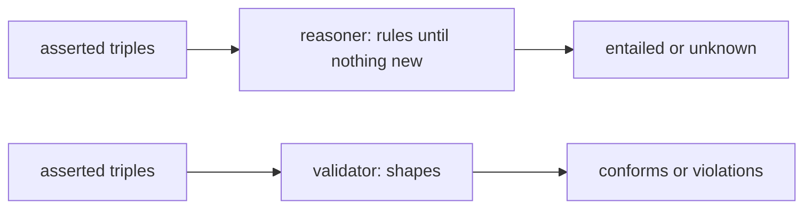

# Reasoning and validation: open and closed worlds

## The idea

A graph says that Kim's mother is Ann, and elsewhere that "has mother" is a kind of "has parent". Does the graph say that Ann is Kim's parent? Not in so many words, but it follows. A **reasoner** is a program that works out such consequences: the triples that must also be true, given the triples you stated and the meaning of a vocabulary.

Now ask a different question of the same graph: does every book have a title? The graph lists a book, Atlas, with no title. A **validator** answers this kind of question: does the data meet a list of requirements?

The two read a missing fact in opposite ways.

- Under the **open-world assumption**, a fact that is not in the data is **unknown**: it may be true and simply not written down. A reasoner works this way. Given no title for Atlas, it concludes nothing about Atlas's title.
- Under the **closed-world assumption**, a fact that is not in the data is **false**. A validator works this way, because a required field that is missing has to be reported, whatever the world looks like.

RDF is built for the open world: anyone can add triples about anything, and no one graph holds the whole truth. A triple is **entailed** by a graph when it must be true whenever the graph is, and RDF entailment is **monotonic**: RDF 1.1 Semantics states that what a graph entails, any larger graph containing it entails too, so adding triples never takes a conclusion back.

**RDF Schema** (RDFS) is the small vocabulary that gives classes and properties a meaning reasoners can use. `rdf:type` says a resource is an instance of a class. `rdfs:subClassOf` says all instances of one class are instances of another, and `rdfs:subPropertyOf` that all resources related by one property are also related by another. `rdfs:domain` and `rdfs:range` say that the subjects, or the objects, of a property are instances of a class. RDF 1.1 Semantics lists **entailment patterns** for them; six of them do most of the work:

| Rule | If the graph has | it entails |
|------|------------------|------------|
| rdfs2 | `p rdfs:domain C` and `x p y` | `x rdf:type C` |
| rdfs3 | `p rdfs:range C` and `x p y` | `y rdf:type C` |
| rdfs5 | `p rdfs:subPropertyOf q` and `q rdfs:subPropertyOf r` | `p rdfs:subPropertyOf r` |
| rdfs7 | `p rdfs:subPropertyOf q` and `x p y` | `x q y` |
| rdfs9 | `C rdfs:subClassOf D` and `x rdf:type C` | `x rdf:type D` |
| rdfs11 | `C rdfs:subClassOf D` and `D rdfs:subClassOf E` | `C rdfs:subClassOf E` |

A simple reasoner applies the rules again and again, adding what they produce, until a pass adds nothing new: the result is the **closure**. It must stop, because the rules only combine terms already in the graph, and there are finitely many triples to build from them.

**SHACL**, the Shapes Constraint Language, is the W3C's language for validating RDF graphs. A **shape** names its **targets**, for example every instance of a class with `sh:targetClass`; the targeted terms are the **focus nodes**. For each focus node, a property constraint takes the values of one property (its `sh:path`) and checks them: at least `sh:minCount` values, at most `sh:maxCount`, each an instance of `sh:class`. The result is a **validation report** that either conforms or lists the violations.



<!-- text-of-mermaid sha256:5d053efc3b60f95fd713708826a2c9e4f8124372abb521bfbe3fc6d173759146 -->
```text
┌────────────────┐    ┌─────────────────────────────────┐    ┌──────────────────────┐
│asserted triples├───►│reasoner: rules until nothing new├───►│ entailed or unknown  │
└────────────────┘    └─────────────────────────────────┘    └──────────────────────┘

┌────────────────┐    ┌─────────────────────────────────┐    ┌──────────────────────┐
│asserted triples├───►│        validator: shapes        ├───►│conforms or violations│
└────────────────┘    └─────────────────────────────────┘    └──────────────────────┘
```

The drawing shows the two readers side by side. The reasoner never reports an error about a missing fact; the validator never adds a fact.

## A worked example

Eight asserted triples: a small family vocabulary, a domain for `:hasISBN`, two books (one without a title), and a conference talk given an ISBN by mistake. The program computes the closure with rdfs2, rdfs5 and rdfs7, asks two questions in the open world, then checks a shape, "every book has at least one title", against the asserted triples:

```python examples/open_and_closed.py
"""Read the same triples two ways: entailment that adds what must be true, and a closed-world check.

The reasoner applies three RDFS entailment patterns until a pass adds nothing: rdfs5 (a
sub-property of a sub-property is a sub-property), rdfs7 (a triple with a sub-property also
holds with its super-property) and rdfs2 (the subject of a property with a domain is an
instance of the domain). It never concludes that something is false. The check reads the asserted
triples only and treats what is not written as missing.
"""

SUB_PROPERTY, DOMAIN, TYPE = "rdfs:subPropertyOf", "rdfs:domain", "rdf:type"

asserted = {
    (":hasMother", SUB_PROPERTY, ":hasParent"),
    (":hasParent", SUB_PROPERTY, ":hasRelative"),
    (":hasISBN", DOMAIN, ":Book"),
    (":kim", ":hasMother", ":ann"),
    (":charts", TYPE, ":Book"), (":charts", ":title", '"Sea Charts"'),
    (":atlas", TYPE, ":Book"),
    (":talk42", ":hasISBN", '"978-0-00-000000-0"'),  # a data-entry mistake: a talk got an ISBN
}


def entail(graph: set) -> tuple[set, int]:
    closure, passes = set(graph), 0
    while True:
        passes += 1
        new = set()
        for s, p, o in closure:
            for s2, p2, o2 in closure:
                if p == SUB_PROPERTY and p2 == SUB_PROPERTY and o == s2:
                    new.add((s, SUB_PROPERTY, o2))  # rdfs5
                if p == SUB_PROPERTY and p2 == s:
                    new.add((s2, o, o2))  # rdfs7
                if p == DOMAIN and p2 == s:
                    new.add((s2, TYPE, o))  # rdfs2
        if new <= closure:
            return closure, passes
        closure |= new


closure, passes = entail(asserted)
print(f"{len(asserted)} asserted, {len(closure)} in the closure, after {passes} passes")
for triple in sorted(closure - asserted):
    print("  entailed:", " ".join(triple))


def ask(triple: tuple[str, str, str]) -> str:
    return "entailed" if triple in closure else "unknown"


print("kim hasRelative ann?", ask((":kim", ":hasRelative", ":ann")))
print("kim hasRelative bob?", ask((":kim", ":hasRelative", ":bob")), "(not false)")

# A shape: every asserted Book has at least one title. It reads `asserted`, never `closure`.
for book in sorted(s for s, p, o in asserted if p == TYPE and o == ":Book"):
    titles = [o for s, p, o in asserted if s == book and p == ":title"]
    if not titles:
        known = any(s == book and p == ":title" for s, p, o in closure)
        print(f"validator: {book} has 0 :title values, needs at least 1"
              f" | reasoner on {book} :title: {'entailed' if known else 'unknown'}")
print("validator targets :talk42?", (":talk42", TYPE, ":Book") in asserted,
      "| reasoner says :talk42 is a Book:", ask((":talk42", TYPE, ":Book")))
```

It prints:

```output examples/open_and_closed.py
8 asserted, 12 in the closure, after 3 passes
  entailed: :hasMother rdfs:subPropertyOf :hasRelative
  entailed: :kim :hasParent :ann
  entailed: :kim :hasRelative :ann
  entailed: :talk42 rdf:type :Book
kim hasRelative ann? entailed
kim hasRelative bob? unknown (not false)
validator: :atlas has 0 :title values, needs at least 1 | reasoner on :atlas :title: unknown
validator targets :talk42? False | reasoner says :talk42 is a Book: entailed
```

- **Entailment.** rdfs5 makes `:hasMother` a sub-property of `:hasRelative`. rdfs7 turns `:kim :hasMother :ann` into `:kim :hasParent :ann`, and, in the next pass, `:kim :hasRelative :ann`. The third pass adds nothing, and the loop stops.
- **Domain infers, it does not check.** `:hasISBN rdfs:domain :Book` was meant as "only books have ISBNs". But rdfs2 does not reject the talk: it makes `:talk42` a book. The mistake disappears into a new fact.
- **Unknown is not false.** "Is Bob Kim's relative?" is not entailed, so the answer is "unknown". The reasoner has no way to say "no" here.
- **The validator sees what is missing.** `:atlas` is an asserted book with no title: a violation. About the same triple, the reasoner can only say "unknown".
- **Which graph is validated matters.** The shape reads the asserted triples, where `:talk42` is not a book, so the talk is not a focus node and has no missing title to report. In the closure it is a book, and would be.

## When to use it

- **A reasoner** when queries should see what follows: every relative, not only the mothers; every instance of a class, through its subclasses. Also to connect vocabularies: declaring one vocabulary's property a sub-property of another's lets queries in the second find data written in the first.
- **A validator** at the boundary where data enters: an import, a form, a feed from a partner. Missing and malformed data should be refused there, with a report that says what and where, as the [guide on data quality](../data-quality-and-contracts/guide.md) does for tables.
- **Both**, in a known order: decide whether the validator checks the asserted triples or the closure, and write it down, since the two can give different reports.

## Common traps

- **Using `rdfs:domain` and `rdfs:range` as constraints.** They never report bad data; they add types to it. Use a validator to check.
- **Expecting a reasoner to answer "no".** In the open world, a triple that is not entailed is unknown. Code that treats "not in the closure" as false has silently switched to the closed world.
- **Forgetting that rules feed each other.** A type added by rdfs3 can be climbed through rdfs9, and a link added by rdfs7 can trigger rdfs2. Stop only when a whole pass adds nothing, not after one round of each rule.
- **Validating a graph nobody chose.** The same shapes give different reports on the asserted triples and on the closure. Choose one, deliberately.
- **A closure that grows large.** Every class and property hierarchy multiplies the triples: an instance of a class ten levels deep gets ten types. Compute the closure for the questions you need, or let the query engine apply the rules as it goes.
- **Reading the open world into a form.** "The customer has an email address, we just don't know it" is not useful when sending a receipt. Requirements of the form "must be present" belong to a validator.

## Complexity

For a graph whose closure has `T` triples:

| Step | Time | Space |
|------|------|-------|
| One pass of the naive loop, every pair of triples | O(T²) | O(T) for the new triples |
| The whole closure, naively | O(P · T²) for `P` passes | O(T) |
| Validate `S` shapes over `F` focus nodes, `c` constraints each | O(S · F · c · v) for `v` values per path, with an index by subject | O(violations) |

`P` grows with the longest chain of rules feeding one another: three passes in the example. The closure itself can be much larger than the asserted graph, since each instance gets one type for every class above its own.

## Expert notes

- **More RDFS patterns.** RDF 1.1 Semantics lists RDFS entailment patterns numbered rdfs1 to rdfs13, informatively. Besides the six above, rdfs4a and rdfs4b make every subject and object an `rdfs:Resource`, rdfs6 and rdfs10 make every property a sub-property of itself and every class a subclass of itself, and rdfs8 makes every class a subclass of `rdfs:Resource`. So even the empty graph has many RDFS entailments, such as `aaa rdf:type rdfs:Resource` for every IRI `aaa`, which is one reason a reasoner applies only the patterns its questions need.
- **Several domains.** When a property has more than one `rdfs:domain`, the subjects of its triples are instances of all of them, and likewise for `rdfs:range`. RDF Schema states that `rdfs:subClassOf` and `rdfs:subPropertyOf` are transitive.
- **What RDFS leaves open.** RDF Schema provides a way to describe the meaningful use of classes and properties "but does not say whether or how an application should use it": a data-checking tool might use a range to find errors, an editor to suggest values, a reasoning application to infer.
- **RDFS can still find contradictions** involving datatypes. RDF 1.1 Semantics gives a graph that is unsatisfiable when `xsd:integer` and `xsd:boolean` are recognized: a property with the domain `xsd:boolean`, a resource typed `xsd:integer`, and a triple that uses the property on that resource.
- **Monotonicity.** RDF 1.1 Semantics states that if a graph simply entails another, any graph that contains it does too, and requires every entailment regime to be a monotonic extension of simple entailment: a semantic extension cannot cancel an entailment made by a weaker regime, though it can treat the result as a syntax error.
- **SHACL and inference.** SHACL uses the RDF and RDFS vocabularies but does not require full RDFS inference. Its notion of a node's types is the node's `rdf:type` values plus every class reached from them through chains of `rdfs:subClassOf` triples in the data graph, so a type that a domain or a range would add does not count. A processor may validate a graph that includes entailments, and a shapes graph can ask for an entailment regime with `sh:entailment`; a processor that does not support the requested regime must signal a failure.
- **SHACL reports.** A report's `sh:conforms` is true if and only if validation produced no results. Each result has a severity: `sh:Violation`, `sh:Warning` or `sh:Info`. A `sh:minCount` of 0 is always satisfied.

## Practice

- `cstudy start reasoner-vs-validator`: an open-world reasoner over subclasses, domains, ranges, transitive and inverse properties and disjoint classes, answering entailed, unknown or contradicted; then a closed-world validator with shapes, and a contrast of what each says about the same requirement.

## Further reading

- [W3C, *RDF 1.1 Semantics*, Recommendation, 25 February 2014](https://www.w3.org/TR/rdf11-mt/): entailment, monotonicity, and the RDFS entailment patterns of section 9.2.1.
- [W3C, *RDF Schema 1.1*, Recommendation, 25 February 2014](https://www.w3.org/TR/rdf11-schema/): classes, properties, domains and ranges, and what the vocabulary leaves to applications.
- [W3C, *Shapes Constraint Language (SHACL)*, Recommendation, 20 July 2017](https://www.w3.org/TR/shacl/): shapes, targets, focus nodes, constraint components and validation reports.
