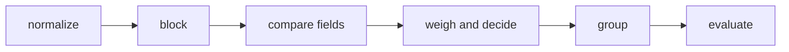

# Entity resolution and record linkage

## The idea

A clinic and a national registry each keep a list of people. Neither list carries an identifier the other knows. The clinic has "Aiko Nakamura, born 1984, postcode 40210"; the registry has "Aiko Nakamura, born 1984, postcode 40211". Is it the same person who moved one street, or two people? A person reading the two lists can usually tell. A program has to decide it from the fields alone, for millions of records.

Finding the records that describe the same real-world thing has several names. **Record linkage** joins two lists; **deduplication** finds repeats within one list; **entity resolution** is the general task, and in a knowledge graph it decides when two nodes stand for one entity. The work usually runs in the same steps.



<!-- text-of-mermaid sha256:4274f7f8806bd6ea632d0023bacf460ce07cb697853c4bc547af4c5b9e372af9 -->
```text
┌─────────┐    ┌─────┐    ┌──────────────┐    ┌────────────────┐    ┌─────┐    ┌────────┐
│normalize├───►│block├───►│compare fields├───►│weigh and decide├───►│group├───►│evaluate│
└─────────┘    └─────┘    └──────────────┘    └────────────────┘    └─────┘    └────────┘
```

The drawing is that sequence. Each step is a place to make mistakes, and a later step cannot repair what an earlier one lost.

1. **Normalize**: write the same thing the same way. Case, punctuation, "Smith, John" against "John Smith", titles, spaces.
2. **Block**: comparing every record of one list with every record of the other is the product of their sizes, far too many pairs for large lists. **Blocking** gives each record one or more cheap keys, such as the first letter of the surname and the year of birth, and compares only records that share a key. It trades some missed matches for an enormous saving.
3. **Compare** each pair field by field: agree or disagree, or, with a **string comparator**, a degree of agreement between 0 and 1 that forgives a typo.
4. **Weigh and decide** whether the pair is a match.
5. **Group** the matching pairs into entities.
6. **Evaluate** the result against a sample whose true answers are known.

The classic theory of step 4 is Fellegi and Sunter's, from 1969. Compare two records, and write down the outcome for each field: the **comparison vector**. Then ask two questions about that outcome.

- **m**: how likely is this outcome if the two records really are the same person? Names agree for the same person most of the time, but not always, because of typing errors.
- **u**: how likely is it if they are not? Two different people agree on a surname by chance, often for "Smith", rarely for "Lindqvist".

The ratio m / u measures the evidence. Fellegi and Sunter prove that the best rule ranks pairs by that ratio and cuts the ranking with two thresholds: above the upper one, a **link**; below the lower one, a **non-link**; in between, a **possible link**, for a person to review. "Best" has a precise meaning: for fixed rates of the two errors (linking different people, and failing to link the same person), it leaves the fewest pairs for review. And if the fields are assumed to agree or disagree independently of each other, the logarithm of the ratio is a sum of one **weight** per field: log(m / u) when a field agrees, log((1 − m) / (1 − u)) when it disagrees. Agreement adds evidence, disagreement subtracts it, and a missing field adds nothing.

## A worked example

Five people in each list, with a surname, a first name, a year of birth and a postcode. The program blocks on the first letter of the surname and the year, gives each field an m and a u (for the surname, u is how common the surname is), adds the weights in bits (base-2 logarithms) and decides with two thresholds:

```python examples/fellegi_sunter.py
"""Link two lists of people the Fellegi-Sunter way: block, compare fields, add weights, decide.

For each field, m is the chance that the field agrees when the two records are the same person,
and u the chance that it agrees when they are not. Agreement adds log2(m / u) to a pair's
weight, disagreement adds log2((1 - m) / (1 - u)). A surname's u is how common the surname is,
so agreeing on a rare one counts for more. Two thresholds split the pairs into links, possible
links for a person to review, and non-links. Only pairs that share a blocking key are compared.
"""

import math
from itertools import product

clinic = [  # id, surname, first name, birth year, postcode
    ("c1", "nakamura", "aiko", 1984, "40210"), ("c2", "smith", "john", 1990, "10115"),
    ("c3", "smith", "joan", 1990, "10117"), ("c4", "okafor", "chidi", 1975, "50667"),
    ("c5", "lindqvist", "maja", 1988, "80331"),
]
registry = [
    ("r1", "nakamura", "aiko", 1984, "40211"), ("r2", "smith", "john", 1990, "10115"),
    ("r3", "smith", "jon", 1990, "20095"), ("r4", "okafor", "chidi", 1957, "50667"),
    ("r5", "lindqvist", "maja", 1988, "80331"),
]
SURNAME_SHARE = {"smith": 0.01, "nakamura": 0.0005, "okafor": 0.0002, "lindqvist": 0.0001}
FIELDS = {"first": (1, 0.90, 0.005), "year": (2, 0.95, 0.02), "postcode": (3, 0.85, 0.001)}
UPPER, LOWER = 12.0, 4.0


def weight(a: tuple, b: tuple) -> tuple[float, list[str]]:
    total, notes = 0.0, []
    m, u = 0.95, SURNAME_SHARE[a[1]]
    agree = a[1] == b[1]
    total += math.log2(m / u) if agree else math.log2((1 - m) / (1 - u))
    notes.append(f"surname {'=' if agree else '!='}")
    for name, (index, m, u) in FIELDS.items():
        agree = a[index + 1] == b[index + 1]
        total += math.log2(m / u) if agree else math.log2((1 - m) / (1 - u))
        notes.append(f"{name} {'=' if agree else '!='}")
    return total, notes


def blocking_key(record: tuple) -> tuple[str, int]:
    return record[1][0], record[3]  # first letter of the surname, birth year


for surname, share in sorted(SURNAME_SHARE.items(), key=lambda item: -item[1]):
    print(f"agreeing on {surname} adds {math.log2(0.95 / share):5.2f}")
for name, (_, m, u) in FIELDS.items():
    print(f"{name}: agreeing adds {math.log2(m / u):5.2f}, disagreeing adds"
          f" {math.log2((1 - m) / (1 - u)):5.2f}")

pairs = [(a, b) for a, b in product(clinic, registry) if blocking_key(a) == blocking_key(b)]
print(f"pairs compared: {len(pairs)} of {len(clinic) * len(registry)}")
for a, b in pairs:
    total, notes = weight(a, b)
    decision = "link" if total >= UPPER else "possible" if total > LOWER else "non-link"
    print(f"{a[0]}-{b[0]}: {total:6.2f}  {decision:8}  {', '.join(notes)}")
missed = [(a[0], b[0]) for a, b in product(clinic, registry)
          if a[1:3] == b[1:3] and blocking_key(a) != blocking_key(b)]
print("same name, never compared:", missed)
```

It prints:

```output examples/fellegi_sunter.py
agreeing on smith adds  6.57
agreeing on nakamura adds 10.89
agreeing on okafor adds 12.21
agreeing on lindqvist adds 13.21
first: agreeing adds  7.49, disagreeing adds -3.31
year: agreeing adds  5.57, disagreeing adds -4.29
postcode: agreeing adds  9.73, disagreeing adds -2.74
pairs compared: 6 of 25
c1-r1:  21.22  link      surname =, first =, year =, postcode !=
c2-r2:  29.36  link      surname =, first =, year =, postcode =
c2-r3:   6.09  possible  surname =, first !=, year =, postcode !=
c3-r2:   6.09  possible  surname =, first !=, year =, postcode !=
c3-r3:   6.09  possible  surname =, first !=, year =, postcode !=
c5-r5:  36.01  link      surname =, first =, year =, postcode =
same name, never compared: [('c4', 'r4')]
```

- **Rare values weigh more.** Agreeing on "smith" adds 6.57 bits; agreeing on "lindqvist", which a hundred times fewer people share, adds 13.21. Agreeing on a postcode adds a lot, because two strangers rarely share one; disagreeing on it subtracts little, because people move.
- **Blocking** compared 6 pairs instead of 25.
- **Decisions.** `c2-r2` agrees on everything: a link. `c1-r1` disagrees only on the postcode, which costs 2.74 bits, and still clears the upper threshold. The Smiths are the hard case: same surname, same year, different first names and postcodes. John against Jon, Joan against John and Joan against Jon all score 6.09, between the thresholds, so a person decides. An exact comparison sees "john" and "jon" as simply different; a string comparator would give them partial agreement.
- **What blocking lost.** `c4` and `r4` are the same name, but one record has the birth year 1975 and the other 1957, a typing error. They never shared a block, so they were never compared. The loss is silent: nothing in the output says a pair was missed, except a check like the last line.

## When to use it

- **Deduplicating customer or patient lists**, where the same person was entered several times.
- **Joining two datasets without a shared key**, such as a survey and a register, or two companies' customer lists after a merger.
- **Building a knowledge graph** from several sources, where each source has its own identifiers for the same people, places and organizations, and the [triples](../rdf-triples/guide.md) of all of them should meet at one node.
- **Not when a reliable identifier exists.** If both sides carry the same tax number or the same email address, verified, join on it; the [guide on canonical keys](../canonical-keys/guide.md) shows how to group by a key that you compute. Entity resolution is for when no single field can be trusted.

## Common traps

- **Comparing every pair.** Fellegi and Sunter already noted that two files of 10^5 records each would mean 10^10 comparisons. Block, and measure what blocking costs you.
- **One strict blocking key.** A typo in the field you block on hides the match completely, as with `c4` and `r4`. Use several keys, built from different fields, and compare a pair if it shares any of them.
- **Correlated fields counted as independent evidence.** A postcode and a city name usually agree or disagree together. Adding both weights counts the same evidence twice and overstates the score.
- **Thresholds chosen by hand.** Choose them from a sample where the true answers are known, by looking at how many wrong links and missed links each choice makes.
- **Treating matches as transitive.** If A matches B and B matches C, A and C may still be different people: a chain of small differences can lead from one name to another. Grouping by following every match, as [union-find](../union-find/guide.md) would, merges such chains into one entity. Check a group as a whole before merging it.
- **Normalizing away information.** Removing spaces makes "Le Roux" and "LeRoux" one name, which is good, but removing a whole field because it is often wrong loses evidence that was right most of the time, and folding every accented letter to a plain one can merge names that differ.
- **Common placeholder values.** "unknown", "n/a" and a shared office mailbox agree across many unrelated records. Treat them as missing, or weigh agreement on a value by how common it is, as the surname weights do.

## Complexity

For lists of `n` and `m` records, `F` fields per record, and blocks of sizes `aᵢ` and `bᵢ` on the two sides:

| Step | Time | Space |
|------|------|-------|
| Every pair | O(n · m · F) | O(1) per pair |
| Blocking: group by key, then pairs within blocks | O(n + m) average to group, plus O(Σ aᵢ · bᵢ · F) to compare | O(n + m) |
| A field compared exactly | O(length) | O(1) |
| A string comparator such as Jaro's | O(length · window), at most O(length²) | O(length) |
| Grouping the links into entities with union-find | almost O(links) | O(n + m) |

With one key per record, blocking costs the sum, over blocks, of the product of their sizes, which is small when keys are spread out and returns to `n · m` when one key covers everything, such as a common surname with an unknown year.

## Expert notes

- **The decisions.** Fellegi and Sunter call the three decisions a positive link, a possible link and a positive non-link, and define a linkage rule as a mapping from each comparison vector to a probability for each decision. The optimal rule, at given levels of the two errors, minimizes the probability of a possible link; they note that possible links "will require expensive manual linkage operations". They show the rule is equivalent to a likelihood ratio test, the uniformly most powerful test for either hypothesis.
- **Conditional independence.** Their simplifying assumption is about each of the two conditional distributions, not the overall one: for matched pairs, errors in names are independent of errors in addresses, and for unmatched pairs, an accidental agreement on name is independent of an accidental agreement on address. Under it, the weights of the fields add, and only one weight per outcome of each field needs to be estimated, not one per combination.
- **Frequencies and missing values.** With weights from value frequencies, they observe that an agreement on name gives a positive weight, the larger the rarer the name; a disagreement gives a negative weight; and a name missing on either record gives zero.
- **Blocking and error levels.** Pairs in different blocks are never compared, which makes them implicit non-links. Fellegi and Sunter work out the effect: the rate of wrong links goes down by the u-probabilities of the pairs that would have been links, and the rate of missed links goes up by the m-probabilities of the pairs that would have been links or possible links, had they been compared. Their example blocks files on a phonetic code of the surname.
- **History.** They write that their rule is "quite similar" to the intuitively appealing approach of Newcombe, whose 1959 paper with Kennedy, Axford and James in *Science* is titled *Automatic Linkage of Vital Records*.
- **String comparators.** Winkler (1990) defines a string comparator as a map from a pair of strings to the interval [0, 1], not necessarily a metric. The comparator introduced by Jaro counts the characters two strings have in common, no further apart than half the longer length minus one, and the transpositions among them, and accounts for the lengths of the strings. Winkler's version raises the value when the first few characters, up to four, agree. In his table, a difference at the first character scores lower than one further along: "abroms" and "abrams" score 0.9333, "lampley" and "campley" 0.9048. Winkler reports that the comparators were used in production matching software for the post-enumeration survey of the 1990 United States census.

## Practice

- `cstudy start entity-resolution`: exact normalization of names and emails, blocking keys and candidate pairs, Jaro-Winkler and token overlap scores with a match threshold, clusters with union-find and a guard against chains, canonical records, and grading a grouping with pairwise and B-cubed scores.

## Further reading

- [I. P. Fellegi and A. B. Sunter, *A Theory for Record Linkage*, Journal of the American Statistical Association 64(328), 1969, pages 1183 to 1210](https://doi.org/10.1080/01621459.1969.10501049): m and u, the optimal rule, weights and blocking; [a reprint](https://cs.cornell.edu/~shmat/courses/cs6434/fellegi-sunter.pdf).
- [W. E. Winkler, *String Comparator Metrics and Enhanced Decision Rules in the Fellegi-Sunter Model of Record Linkage*, Proceedings of the Section on Survey Research Methods, American Statistical Association, 1990, pages 354 to 359](http://www.asasrms.org/Proceedings/papers/1990_056.pdf): Jaro's comparator and its prefix adjustment.
- [H. B. Newcombe, J. M. Kennedy, S. L. Axford and A. P. James, *Automatic Linkage of Vital Records*, Science 130(3381), 1959, pages 954 to 959](https://doi.org/10.1126/science.130.3381.954): the earlier approach the theory formalized.
