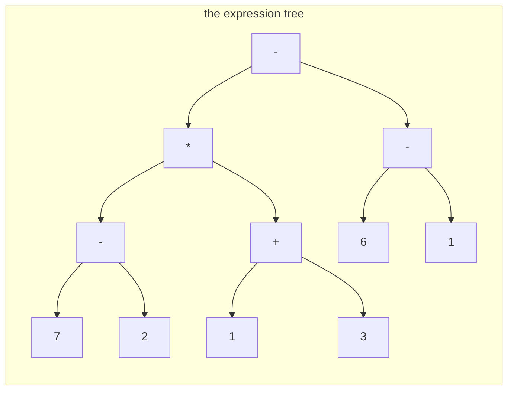

# Recursion on trees: values up, state down

## The idea

A binary tree is either empty, or a root with a left subtree and a right subtree, and each subtree is a binary tree again. A function on trees can follow that definition exactly: handle the empty tree directly, and handle any other tree by calling itself on the two subtrees and combining what comes back. That is **structural recursion**, and most tree problems are solved with it.

The hard part is not the code, which is often five lines, but deciding what the function means. Before writing it, answer three questions:

1. **What does a call return for a subtree?** Write it as one precise sentence, the function's **contract**: "returns the value of the expression in this subtree", not "helps compute the value".
2. **What is the answer for the smallest trees?** The empty tree, or a leaf. This is the **base case**, and it stops the recursion.
3. **How does a node combine its children's answers with its own data?** This is the only real work.

Then comes the step that feels like cheating: **trust the recursive calls**. When you write the combining step, assume the calls on the subtrees already return exactly what the contract promises. You do not trace them in your head. If the base case is right and the combining step is right, the function is right for every tree, by the same argument as a proof by induction: correct for the smallest trees, and correct for a tree whenever it is correct for its subtrees.

Information can travel in two directions through such a function:

| Direction | Carried by | Known | Typical content |
|-----------|-----------|-------|-----------------|
| **Up**, from children to parent | return values | after the calls on the children return, so post-order | a total, a count, a value, a yes or no about the subtree |
| **Down**, from parent to children | arguments | before the calls on the children start, so pre-order | the depth, a setting decided higher up, what the ancestors were |

A function may use either direction or both. Up is for questions a subtree can answer about itself. Down is for what a node cannot see from its own subtree, because it depends on where the subtree sits.

## A worked example

An arithmetic expression is a binary tree: each operator is an internal node whose two children are its operands, and each number is a leaf. Here is `(7 - 2) * (1 + 3) - (6 - 1)`.



<!-- text-of-mermaid sha256:e1bbc1001596a9119d9440639232e1f04f8c255c0f1c15b9eebc9973f8c87912 -->
```text
┌──────────────────────────┐
│   the expression tree    │
│                          │
│                          │
│ ┌─┐                      │
│ │-├─────┐                │
│ └┬┘     │                │
│  ▼      ▼                │
│ ┌─┐    ┌─┐               │
│ │*├──┐ │-├────┬┐         │
│ └┬┘  │ └─┘    └┼──────┐  │
│  ▼   └──▼      ▼      ▼  │
│ ┌─┐    ┌─┐    ┌─┐    ┌─┐ │
│ │-├──┐ │+├──┐ │6│    │1│ │
│ └┬┘  │ └─┘  │ └─┘    └─┘ │
│  ▼   └──▼   └──▼──────▼  │
│ ┌─┐    ┌─┐    ┌─┐    ┌─┐ │
│ │7│    │2│    │1│    │3│ │
│ └─┘    └─┘    └─┘    └─┘ │
│                          │
└──────────────────────────┘
```

The tree needs no parentheses: its shape already says that `7 - 2` happens before the multiplication. Evaluating it is a pure "values up" function. The three questions get these answers:

1. Contract: `evaluate(node)` returns the value of the expression in the subtree at `node`.
2. Base case: a leaf returns its number.
3. Combining: an operator node evaluates its left subtree and its right subtree, trusting each to return its value, and applies its operator to the two values.

Follow the calls on this tree. Each operator can only finish after both of its subtrees have, so the operators finish in post-order:

| Step | Node finishes | Left returned | Right returned | Returns |
|------|---------------|---------------|----------------|---------|
| 1 | `-` over 7 and 2 | 7 | 2 | 5 |
| 2 | `+` over 1 and 3 | 1 | 3 | 4 |
| 3 | `*` | 5 | 4 | 20 |
| 4 | `-` over 6 and 1 | 6 | 1 | 5 |
| 5 | `-` at the root | 20 | 5 | 15 |

The root's call started first and finished last: it waited for the whole left subtree, then the whole right subtree, and combined their answers in one line.

### Sending state down

Now print the tree as text, with as few parentheses as correct reading needs. Whether a subtree needs parentheses does not depend on the subtree alone. `3 - 1` needs none under a `+`, since `8 + 3 - 1` means the same as `8 + (3 - 1)`, but it needs them under a `*`, and on the right side of a `-`, since `8 - 3 - 1` is not `8 - (3 - 1)`. A subtree cannot see its parent, so the parent tells it: `to_text` takes the parent's operator and the side as arguments. That is state going down. The text of each subtree comes back up as the return value, so this function uses both directions.

The rule, for an operator node below another operator:

- It needs parentheses if its operator binds more weakly than its parent's: a `+` or `-` below a `*`.
- It also needs them if both bind equally, the parent is `-`, and the node is on the right side, because subtraction does not regroup.

In the tree above, the root has no parent and gets no parentheses. Its left child `*` binds more tightly than the root's `-`, so it gets none either. Below the `*`, both `7 - 2` and `1 + 3` bind more weakly and get parentheses. The root's right child `6 - 1` binds as tightly as its parent `-`, but sits on its right, so it gets parentheses too.

```python examples/expression_tree.py
"""An arithmetic expression as a binary tree: operators inside, numbers at the leaves.

evaluate() sends values up: each operator combines the values its two subtrees return.
to_text() also sends state down: each call is told its parent's operator and which side of
it the call is on, which decides whether it needs parentheses."""

from dataclasses import dataclass


@dataclass
class Node:
    token: str  # "+", "-", "*" or a whole number
    left: "Node | None" = None
    right: "Node | None" = None


PRECEDENCE = {"+": 1, "-": 1, "*": 2}


def evaluate(node: Node, trace: list[str]) -> int:
    if node.token not in PRECEDENCE:  # a leaf: the answer is the number itself
        return int(node.token)
    left = evaluate(node.left, trace)  # trust the subtrees to answer for themselves
    right = evaluate(node.right, trace)
    value = {"+": left + right, "-": left - right, "*": left * right}[node.token]
    trace.append(f"{left} {node.token} {right} = {value}")
    return value


def to_text(node: Node, parent: str | None = None, side: str = "") -> str:
    if node.token not in PRECEDENCE:
        return node.token
    text = f"{to_text(node.left, node.token, 'left')} {node.token} "
    text += to_text(node.right, node.token, "right")
    if parent is None:
        return text
    weaker = PRECEDENCE[node.token] < PRECEDENCE[parent]
    # a - (b - c) and a - (b + c) need their parentheses; a + (b - c) does not
    regrouped = PRECEDENCE[node.token] == PRECEDENCE[parent] and parent == "-" and side == "right"
    return f"({text})" if weaker or regrouped else text


def leaf(number: int) -> Node:
    return Node(str(number))


# (7 - 2) * (1 + 3) - (6 - 1)
tree = Node(
    "-",
    Node("*", Node("-", leaf(7), leaf(2)), Node("+", leaf(1), leaf(3))),
    Node("-", leaf(6), leaf(1)),
)

steps: list[str] = []
result = evaluate(tree, steps)
for number, step in enumerate(steps, start=1):
    print(f"step {number}: {step}")
print("value:", result)
print("text: ", to_text(tree))
print("check:", eval(to_text(tree)) == result)  # Python's own parser agrees

# The same subtree, 3 - 1, below three different parents.
for operator in "+-*":
    print(f"under {operator}: {to_text(Node(operator, leaf(8), Node('-', leaf(3), leaf(1))))}")
```

It prints:

```output examples/expression_tree.py
step 1: 7 - 2 = 5
step 2: 1 + 3 = 4
step 3: 5 * 4 = 20
step 4: 6 - 1 = 5
step 5: 20 - 5 = 15
value: 15
text:  (7 - 2) * (1 + 3) - (6 - 1)
check: True
under +: 8 + 3 - 1
under -: 8 - (3 - 1)
under *: 8 * (3 - 1)
```

The last three lines show the downward state at work: the same subtree, `3 - 1`, prints three ways, depending only on what its parent passed down. The check hands the printed text to Python's own parser, which agrees with the tree.

## When to use it

- **Values up** when a node's answer depends only on its own subtree: totals and counts, the value of an expression, whether the subtree has some property. Ask: "if I knew the answer for both children, could I answer for the node?" If yes, return that answer.
- **State down** when a node's answer depends on where it sits: its depth, a setting chosen by its ancestors, the operator above it in the example. Ask: "what would this node need to be told that it cannot see below itself?" Pass that as an argument, and give each child its own updated copy.
- **Both** when the parent needs the children's answers and the children need the parent's context, like `to_text`.
- **Not a subtree question.** When the question is about levels, or about distance from the root across the whole tree, a [level-order walk](../tree-traversals/guide.md) is often more direct than recursion.

## Common traps

- **A vague contract.** Most bugs in tree recursion are a mismatch between what a call returns and what its caller thinks it returns. Write the contract as a sentence, then check every `return` against it.
- **Two base cases that disagree.** Handle the empty tree, or handle leaves and never call on an empty child; mixing the two styles invites double counting or a call on `None`. Whatever you choose, test a single node and an empty tree.
- **Recomputing below every node.** A helper that walks a whole subtree, called once from each node, does O(n) work at the root, O(n) again for a child on a path-shaped tree, and O(n²) in total. Count how often each node is visited before you trust the complexity you had in mind.
- **Building strings by concatenation on the way up.** Python strings are immutable, so gluing two subtrees' text into a new string copies both. Along a long path that copying adds up to O(n·h) characters; collect the pieces in a list and join them once when output is large.
- **A mutable default argument.** `def walk(node, out=[])` creates the list once, when the function is defined, and every call that leaves out `out` shares it, as Python's tutorial warns. Pass the list in, or default to `None` and create it inside.
- **Forgetting the call stack.** A recursive function on a path of 100,000 nodes fails in CPython at the default limit of 1000 frames. [Tree traversals](../tree-traversals/guide.md) shows how to walk with your own stack.

## Complexity

If the combining step at each node takes O(1), the whole function takes **O(n)** time, since each node is called exactly once, and **O(h)** extra memory for the call stack, where h is the height: O(log n) for a balanced tree, O(n) for a path.

| Function shape | Time | Extra memory |
|----------------|------|--------------|
| Each node combines its children's results in O(1) | O(n) | O(h) |
| Each node passes O(1) state down | O(n) | O(h) |
| Each node calls a helper that walks its whole subtree | O(n·h), O(n²) on a path | O(h) |
| Results are strings concatenated on the way up | O(n·h) characters copied in the worst case | O(n) for the result |

## Expert notes

- **The proof is the recursion.** To show a tree function correct, show the base case right and the combining step right, assuming correct answers from the children. That is structural induction, and it is the same reasoning you used when you "trusted the calls". If the proof needs something the children do not return, the function must return more: change the contract, for example to return a pair.
- **Returning more than one value.** A contract can promise several facts about a subtree at once: a tuple in Python, a small record in Java, multiple return values in Go. One walk that returns everything the parent needs is usually better than several walks that each return one thing.
- **Shared subtrees turn a tree into a graph.** If the same node object hangs below two parents, as when a program reuses a common subexpression, a tree recursion evaluates it once per path that reaches it, which can grow exponentially with the depth. Remembering each node's result in a dictionary keyed by the node, and returning it on later visits, brings the work back to once per node.
- **Recursion to iteration.** A values-up function becomes a loop with the post-order stack of the [traversals guide](../tree-traversals/guide.md), plus a place to keep each finished child's result until its parent is handled. A state-down function is simpler: push each child together with the state it should receive.

## Practice

- `cstudy start max-depth-binary-tree`: count how many levels a tree has.
- `cstudy start same-tree`: decide whether two trees are identical, in shape and values.
- `cstudy start subtree-of-another-tree`: decide whether one tree appears, complete, inside another.
- `cstudy start balanced-binary-tree`: decide whether, at every node, the two subtrees' heights differ by at most one.
- `cstudy start diameter-binary-tree`: find the length of the longest path between any two nodes.
- `cstudy start lowest-common-ancestor`: find the deepest node that has two given nodes below it.
- `cstudy start tree-path-sum-count`: count the downward paths whose values add up to a target.
- `cstudy start tree-from-preorder-inorder`: rebuild a tree from two of its walks.
- `cstudy start org-chart-outline`: turn a flat list of who reports to whom into a chart you can query and print, over four levels.
- `cstudy start max-path-sum`: find the largest sum of any path, with negative values allowed.
- `cstudy start serialize-binary-tree`: turn any tree into a string and back into the same tree.

## Further reading

- [NIST: binary tree](https://xlinux.nist.gov/dads/HTML/binarytree.html): the recursive definition the functions follow.
- [Python tutorial: default argument values](https://docs.python.org/3/tutorial/controlflow.html#default-argument-values): the warning that a default is evaluated only once.
- [Python `sys.setrecursionlimit`](https://docs.python.org/3/library/sys.html#sys.setrecursionlimit): the depth limit on recursion.
