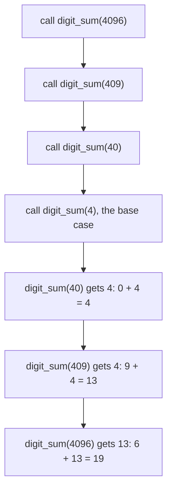
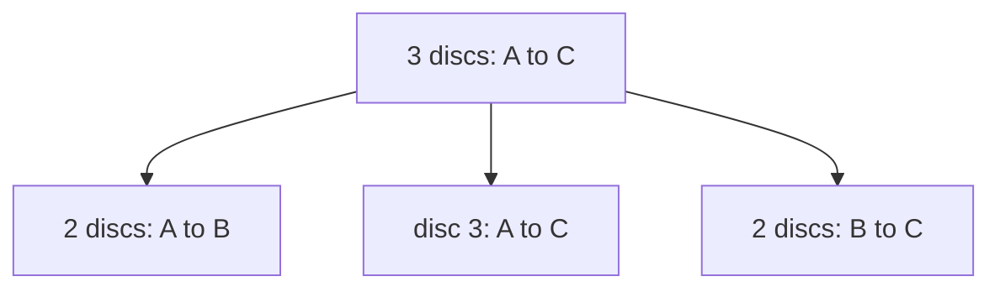

# Recursion and the call stack

## The idea

A **recursive** function answers a question by asking itself the same question about something smaller. It has two parts:

- A **base case**: an input so small that the answer is known without asking anything. The base case is what stops the recursion.
- A **recursive case**: turn the input into a smaller one, call the function on it, and build this answer from that answer.

Take the sum of the digits of a number. The digit sum of a single digit is the digit itself: that is the base case. The digit sum of `4096` is its last digit, `6`, plus the digit sum of `409`, the number with that digit removed: that is the recursive case. `409` is smaller than `4096`, every call removes one digit, and so the calls must reach a single digit.

The step that feels like cheating is to **trust the smaller call**. While writing the recursive case, you assume the call on `409` returns the right answer and only check that `6 +` that answer is right for `4096`. That trust is justified the way a proof by induction is: the base case is right, and each case is right whenever the smaller ones are, so every case is right.

### The call stack

When a function calls another, the caller stops where it is and waits. The program keeps what the caller needs to carry on, its arguments, its local variables and the place to resume, in a **frame**, and the frames of all the calls that are waiting form the **call stack**. A recursive call is an ordinary call that happens to be to the same function, so each level of the recursion has its own frame with its own `n`.



<!-- text-of-mermaid sha256:1fa56e06356508462a10b24f9887b21bcb837c83ae5d26891dbde21648d8daaf -->
```text
┌────────────────────────────────────┐
│        call digit_sum(4096)        │
└──────────────────┬─────────────────┘
                   ▼
┌────────────────────────────────────┐
│        call digit_sum(409)         │
└──────────────────┬─────────────────┘
                   ▼
┌────────────────────────────────────┐
│         call digit_sum(40)         │
└──────────────────┬─────────────────┘
                   ▼
┌────────────────────────────────────┐
│  call digit_sum(4), the base case  │
└──────────────────┬─────────────────┘
                   ▼
┌────────────────────────────────────┐
│  digit_sum(40) gets 4: 0 + 4 = 4   │
└──────────────────┬─────────────────┘
                   ▼
┌────────────────────────────────────┐
│ digit_sum(409) gets 4: 9 + 4 = 13  │
└──────────────────┬─────────────────┘
                   ▼
┌────────────────────────────────────┐
│digit_sum(4096) gets 13: 6 + 13 = 19│
└────────────────────────────────────┘
```

The calls go down one level at a time, four frames deep at the bottom; then each frame gets its answer, finishes its addition and is removed, newest first. The number of frames on the stack at the same time is the **depth** of the recursion. It is bounded: every language gives the stack a limited amount of memory or a limited number of frames, and a recursion that goes deeper fails.

## A worked example

The first part of the example prints every call and every return of `digit_sum(4096)`, indented by depth, which is the diagram above in text.

```python examples/call_stack.py
"""A recursive function, the calls waiting on the stack, and the limit on how deep they go."""

import sys


def traced_digit_sum(n: int, depth: int = 0) -> int:
    """The sum of the decimal digits of n >= 0, printing every call and every return."""
    indent = "  " * depth
    print(f"{indent}call digit_sum({n})")
    result = n  # base case: one digit is its own sum
    if n >= 10:  # smaller case: the last digit, plus the digit sum of the number without it
        result = n % 10 + traced_digit_sum(n // 10, depth + 1)
    print(f"{indent}return {result} from digit_sum({n})")
    return result


traced_digit_sum(4096)


def hanoi(discs: int, source: str, spare: str, target: str, moves: list[str]) -> None:
    """Move a tower of discs from source to target, never putting a disc on a smaller one."""
    if discs == 0:  # base case: an empty tower needs no moves
        return
    hanoi(discs - 1, source, target, spare, moves)  # clear the way: the smaller tower to spare
    moves.append(f"disc {discs}: {source} -> {target}")  # the largest disc goes straight across
    hanoi(discs - 1, spare, source, target, moves)  # the smaller tower back on top of it


moves: list[str] = []
hanoi(3, "A", "B", "C", moves)
print("3 discs:", "; ".join(moves))
counts = []
for discs in range(1, 11):
    moves = []
    hanoi(discs, "A", "B", "C", moves)
    counts.append(len(moves))
print("moves for 1 to 10 discs:", counts)
print("2^n - 1 for 1 to 10:     ", [2**discs - 1 for discs in range(1, 11)])


def digit_sum(n: int) -> int:
    return n if n < 10 else n % 10 + digit_sum(n // 10)


def digit_sum_loop(n: int) -> int:
    total = 0
    while n >= 10:
        total, n = total + n % 10, n // 10
    return total + n


print("recursion limit:", sys.getrecursionlimit())
nines = 10**5000 - 1  # 5000 digits, so the recursion would be 5000 calls deep
try:
    print(digit_sum(nines))
except RecursionError:
    print("digit_sum of 5000 nines: RecursionError")
print("digit_sum_loop of 5000 nines:", digit_sum_loop(nines))
```

It prints:

```output examples/call_stack.py
call digit_sum(4096)
  call digit_sum(409)
    call digit_sum(40)
      call digit_sum(4)
      return 4 from digit_sum(4)
    return 4 from digit_sum(40)
  return 13 from digit_sum(409)
return 19 from digit_sum(4096)
3 discs: disc 1: A -> C; disc 2: A -> B; disc 1: C -> B; disc 3: A -> C; disc 1: B -> A; disc 2: B -> C; disc 1: A -> C
moves for 1 to 10 discs: [1, 3, 7, 15, 31, 63, 127, 255, 511, 1023]
2^n - 1 for 1 to 10:      [1, 3, 7, 15, 31, 63, 127, 255, 511, 1023]
recursion limit: 1000
digit_sum of 5000 nines: RecursionError
digit_sum_loop of 5000 nines: 45000
```

Read the first eight lines as the stack: each call is indented one step more than its caller, and a frame's `return` line sits at the same indentation as its `call` line, after every deeper line. Nothing returns until the base case, `digit_sum(4)`, and then the returns come back in the opposite order of the calls.

The second part is the puzzle of the **towers of Hanoi**: three pegs, `A`, `B` and `C`, and a tower of discs on `A`, each smaller than the one below it. Move the tower to `C`, one disc at a time, never putting a disc on a smaller one. It looks hard until you think about the largest disc. It must move from `A` to `C` at some point, and at that moment every other disc must be out of the way, stacked on `B`. So moving `n` discs from `A` to `C` is three steps:

1. Move the top `n - 1` discs from `A` to `B`, using `C` as the spare peg. This is the same puzzle, one disc smaller.
2. Move disc `n` from `A` to `C`.
3. Move the `n - 1` discs from `B` to `C`, using `A` as the spare. The same puzzle again.

The base case is a tower of no discs, which needs no moves.



<!-- text-of-mermaid sha256:d5f033e5c47bf130a5507c220787e7ec1f17d0558d6087349cb1b2cd082c2980 -->
```text
┌───────────────┐
│3 discs: A to C│
└───────────────┘
        ▼────────────────────▼───────────────────▼
┌───────────────┐    ┌──────────────┐    ┌───────────────┐
│2 discs: A to B│    │disc 3: A to C│    │2 discs: B to C│
└───────────────┘    └──────────────┘    └───────────────┘
```

The three-disc solution in the output has seven moves, and the counts for 1 to 10 discs are 1, 3, 7, 15, and so on, `2ⁿ - 1`. That follows from the three steps: if `M(n)` is the number of moves for `n` discs, then `M(0) = 0` and `M(n) = M(n - 1) + 1 + M(n - 1) = 2·M(n - 1) + 1`. If `M(n - 1) = 2ⁿ⁻¹ - 1`, then `M(n) = 2·(2ⁿ⁻¹ - 1) + 1 = 2ⁿ - 1`, so by induction the formula holds for every `n`. The depth is small even though the number of moves is not: the stack holds one frame per disc still being moved, `n + 1` frames at most, counting the empty tower at the bottom.

The last part shows the limit. CPython's recursion limit is 1000 frames when it starts, and a 5000-digit number needs 5000 nested calls to `digit_sum`, so the recursion fails with a `RecursionError`. The loop, which keeps its running total in one variable instead of in 5000 waiting frames, has no such limit.

## How deep each language lets you go

The limit is not part of the idea of recursion; it comes from each language's runtime, and it differs a lot:

| Language | What bounds the depth | What happens beyond it |
|----------|-----------------------|------------------------|
| Python (CPython) | A count of frames, the **recursion limit**: `sys.getrecursionlimit()` reads it (1000 when CPython 3.13 starts) and `sys.setrecursionlimit()` changes it. The limit is there to stop the C stack underneath from overflowing, and the documentation warns that a limit set too high can crash Python | `RecursionError`, since Python 3.5 (before, a plain `RuntimeError`) |
| Java | The thread's stack size in bytes, set by `java -Xss`. JDK 21's defaults include 1024 KB on Linux and macOS on x64 and 2048 KB on Linux and macOS on AArch64. A thread can ask for its own size through a `Thread` constructor, which the virtual machine may round up or down, or ignore | `StackOverflowError`, an `Error`, not an `Exception` |
| JavaScript | The engine's stack. The language sets no number | `RangeError: Maximum call stack size exceeded` in Chrome, Safari and Node.js, `InternalError: too much recursion` in Firefox |
| Go | A goroutine's stack starts at a few kilobytes and grows (and shrinks) as needed, up to a maximum of 1 GB on 64-bit systems and 250 MB on 32-bit ones, which `debug.SetMaxStack` changes | The program crashes with `fatal error: stack overflow` |
| Rust | A spawned thread's stack, currently 2 MiB on all Tier-1 platforms, changed by `thread::Builder::stack_size` or the `RUST_MIN_STACK` environment variable. The main thread's stack is not set by Rust | The process aborts, saying the thread has overflowed its stack |

Go's growing stacks are something Python cannot show, so here is the same kind of chain of calls, a million deep:

```go examples/deep_recursion.go
// A goroutine's stack starts small and grows, so Go runs a recursion a million calls deep.
package main

import "fmt"

// sumTo returns 1 + 2 + ... + n with one call per number, so the stack is n + 1 calls deep.
func sumTo(n int) int {
	if n == 0 {
		return 0
	}
	return n + sumTo(n-1)
}

func main() {
	for _, n := range []int{1_000, 100_000, 1_000_000} {
		fmt.Printf("sumTo(%d) = %d, %d calls deep\n", n, sumTo(n), n+1)
	}
}
```

```output examples/deep_recursion.go
sumTo(1000) = 500500, 1001 calls deep
sumTo(100000) = 5000050000, 100001 calls deep
sumTo(1000000) = 500000500000, 1000001 calls deep
```

Every call adds a frame, and the last line has a million and one of them on the stack at once. Python with its default limit stops at a thousand; Go grows the stack as the calls arrive.

## When to use it

- **The data is recursive.** A folder holds files and smaller folders; a tree's node holds smaller trees; an expression holds smaller expressions. A function that follows the shape of the data is short and clearly right.
- **The problem splits into smaller copies of itself.** Hanoi is one copy smaller; sorting halves of a list and merging them is two copies half the size.
- **You must try choices one after another and back out of the bad ones.** That is backtracking, the [next guide](../backtracking/guide.md), and recursion is its natural shape.
- **Use a loop instead** when each call makes only one recursive call, as in `digit_sum`: a running total in a variable replaces the waiting frames, as `digit_sum_loop` shows. When the input can be large, such as a linked chain of 100,000 records, a loop or an explicit stack (see the expert notes) avoids the depth limit altogether.

## Common traps

- **A base case the input never reaches.** Counting down by 2 from an odd number skips 0; a negative input never meets a base case written as `n == 0`. Write the base case as a range (`n <= 0`, `n < 10`) when in doubt, and check that every recursive call is on a strictly smaller input.
- **Forgetting to return the result.** In Python, `digit_sum(n // 10) + n % 10` computed but not returned makes the function return `None`, and the caller fails one level up with a confusing `TypeError`.
- **Copying the input on every call.** Recursing on `values[1:]` copies the rest of the list each time, which turns a linear recursion into a quadratic one. Pass the list and an index instead.
- **Raising the limit and hoping.** `sys.setrecursionlimit(10**6)` lets Python try deeper calls, but the documentation warns that a limit set too high can lead to a crash, and the highest safe limit depends on the platform. Set it with care, or turn the recursion into a loop.
- **Assuming the depth is the number of calls.** Hanoi makes `2ⁿ - 1` moves but is only `n + 1` frames deep. The depth is the longest chain of calls waiting at once, and it is what the limit counts.

## Complexity

| Function | Calls | Deepest stack | Time |
|----------|-------|---------------|------|
| `digit_sum` on a `d`-digit number | `d` | `d` frames | O(d) when each step takes constant time |
| Hanoi with `n` discs | `2ⁿ⁺¹ - 1`, counting the empty towers | `n + 1` frames | O(2ⁿ) |
| Split into two halves, then O(n) work to combine | about `2n` | about `log₂ n` frames | O(n log n) |

The time of a recursion is the number of calls times the work each call does besides calling; its extra space is the deepest stack times the size of a frame, plus whatever the calls allocate. To count the calls, write the recurrence: `T(n) = T(n - 1) + O(1)` is O(n), `T(n) = 2·T(n - 1) + O(1)` is O(2ⁿ), as the Hanoi count shows, and `T(n) = 2·T(n / 2) + O(n)` is O(n log n), because each of the `log₂ n` levels of halving does O(n) work in total.

For `digit_sum` in Python, "constant time per step" holds only while the number fits in a machine word: on a 5000-digit integer, `n // 10` itself takes time proportional to the number of digits, so the whole loop is quadratic in `d`.

## Expert notes

- **Any recursion can become a loop with an explicit stack.** Replace each frame with a record of what that call still has to do, push records on a list instead of calling, and pop them instead of returning. The list lives on the heap, so the depth is limited by memory instead of by the call stack: a depth-first search over a large graph written this way cannot hit the recursion limit.
- **Python 3.12 changed what the limit counts.** Since 3.12 the recursion limit applies only to Python code; built-in functions do not use it and are protected by a different mechanism against crashing the virtual machine.
- **A Java thread's stack size is a request.** The documentation of `Thread(ThreadGroup, Runnable, String, long)` calls the effect of `stackSize` highly platform dependent: the virtual machine may treat it as a suggestion, round it, or ignore it completely. `-Xss` sets the default for every thread.
- **An optimizing compiler may remove the recursion, or not.** A Rust function returning `1 + down(n - 1)` overflowed its stack when built without optimizations, and returned the right answer for `n = 2⁴⁰` when built with `rustc -O` (rustc 1.92). No stack holds 2⁴⁰ frames, so the optimizer had replaced the recursion with a loop. An optimization is not a promise: code that is only safe once optimized is not safe.
- **Go pays for growing stacks.** The Go FAQ puts the cost at about three cheap instructions per function call on average, which is what lets a program hold hundreds of thousands of goroutines, each starting with a few kilobytes of stack.
- **Two functions can recurse through each other.** `is_even(n)` asking `is_odd(n - 1)`, which asks `is_even(n - 2)`, is mutual recursion: the same rules apply, with a base case somewhere on the cycle and every step smaller.

## Practice

This guide has no problem of its own: recursion is practised through the techniques built on it. Continue with [backtracking](../backtracking/guide.md), which uses recursion to try every arrangement, and [memoization](../memoization/guide.md), which makes a slow recursion fast by remembering its answers.

## Further reading

- [Python `sys.getrecursionlimit` and `sys.setrecursionlimit`](https://docs.python.org/3/library/sys.html#sys.getrecursionlimit): the limit on the depth of the interpreter stack, and why setting it too high can crash Python.
- [Python `RecursionError`](https://docs.python.org/3/library/exceptions.html#RecursionError): raised when the limit is exceeded, since 3.5.
- [What's New in Python 3.12, `sys`](https://docs.python.org/3/whatsnew/3.12.html): the recursion limit applies only to Python code.
- [The `java` command, JDK 21: `-Xss`](https://docs.oracle.com/en/java/javase/21/docs/specs/man/java.html): the thread stack size and its default per platform.
- [Java `Thread(ThreadGroup, Runnable, String, long)`](https://docs.oracle.com/en/java/javase/21/docs/api/java.base/java/lang/Thread.html): asking for a stack size, and why the request may have no effect.
- [Java `StackOverflowError`](https://docs.oracle.com/en/java/javase/21/docs/api/java.base/java/lang/StackOverflowError.html): thrown when an application recurses too deeply.
- [MDN: too much recursion](https://developer.mozilla.org/en-US/docs/Web/JavaScript/Reference/Errors/Too_much_recursion): the error each JavaScript engine raises, and the missing base case behind many of them.
- [The Go FAQ: why goroutines instead of threads?](https://go.dev/doc/faq#goroutines): stacks that start at a few kilobytes and grow and shrink.
- [Go `runtime/debug.SetMaxStack`](https://pkg.go.dev/runtime/debug#SetMaxStack): the 1 GB and 250 MB maximums.
- [Rust `std::thread`, stack size](https://doc.rust-lang.org/std/thread/index.html#stack-size): 2 MiB for spawned threads, `RUST_MIN_STACK`, and the main thread.
