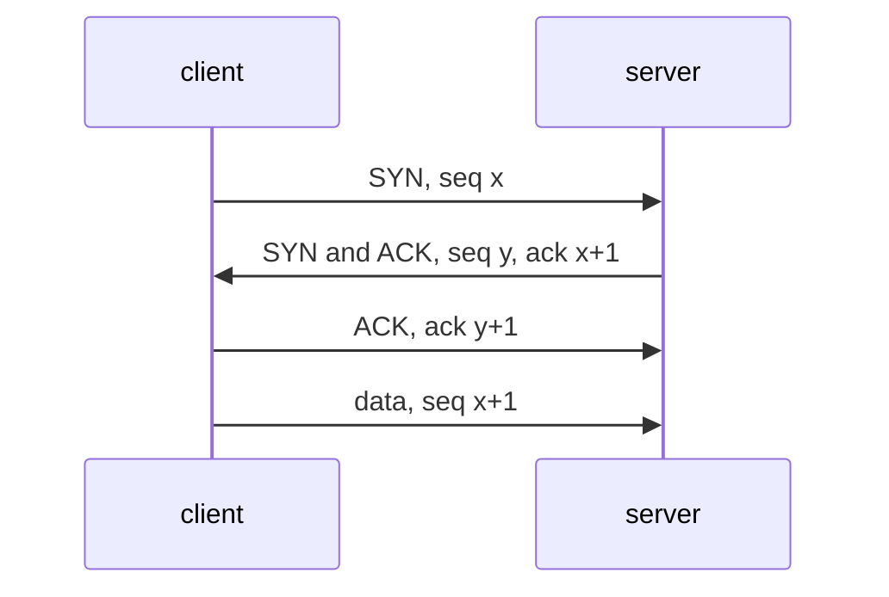
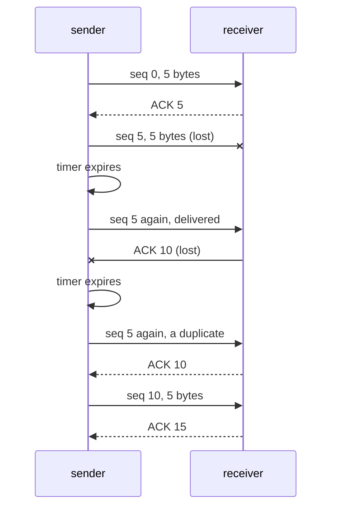
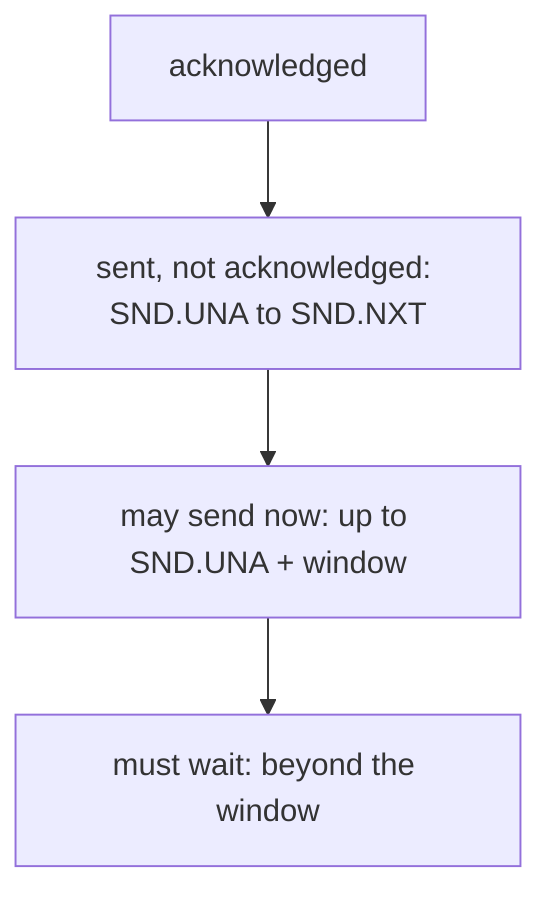

# Reliable transport: sequence numbers, acknowledgements and retransmission

## The idea

The internet layer makes no promise about delivery. RFC 1122 puts it plainly: IP datagrams may arrive damaged, duplicated, out of order, or not at all. A program that sends a file wants the opposite: every byte, exactly once, in order. A **reliable transport** protocol builds that promise at the two ends, on top of a network that keeps none of it. TCP is the classic one; RFC 9293 describes its service as a reliable, in-order byte stream.

Each kind of failure has its own remedy:

| The network may | The remedy |
|-----------------|------------|
| damage a packet | a **checksum** over the segment, which the sender must compute and the receiver must check (RFC 9293), so damage is caught instead of delivered |
| lose a packet | **acknowledgements** from the receiver, and **retransmission**: sending again what was not acknowledged in time |
| duplicate a packet | **sequence numbers**, so the receiver can recognize data it already has |
| reorder packets | sequence numbers again, so the receiver can hold early data and put it back in order |
| deliver faster than the receiver can consume | **flow control**: the receiver says how much more it can take |

**Sequence numbers.** RFC 9293: every octet of data sent over a TCP connection has a sequence number. A segment is described by the number of its first byte and its length: the segment `[seq 1000, length 500]` carries bytes 1000 to 1499. The numbers do not start at 0 on the wire. Each side picks an **initial sequence number** when the connection opens, chosen, in RFC 9293's words, to be unique over a period of time and unpredictable to attackers. This guide counts from 0 to keep the arithmetic readable.

**Acknowledgements.** The receiver answers with an **ACK**, carrying a number. TCP's acknowledgement is **cumulative**: an ACK of `X` means "I have every byte before `X`; send me `X` next". RFC 9293 names the receiver's side of this `RCV.NXT`, the next sequence number it expects, and the sender's `SND.UNA`, the oldest byte not yet acknowledged. One number sums up everything received in order, so a lost ACK costs nothing once a later one arrives.

**Retransmission.** RFC 9293: TCP uses retransmission to ensure delivery of every segment. The sender starts a timer when it sends; if the timer expires before the data is acknowledged, it sends the data again. The receiver throws away any copy of bytes it has already delivered, which the sequence numbers make easy: RFC 9293 notes that they allow straightforward duplicate detection in the presence of retransmission.

**Setting up and closing.** Before any data, the two sides agree on their initial sequence numbers in a **three-way handshake**: a segment with the SYN control bit carrying one side's number, a reply with SYN and ACK carrying the other's and acknowledging the first, and a final ACK. A side that has no more to send sets the FIN bit, which RFC 9293 describes as "no more data from sender"; each direction is closed on its own.



<!-- text-of-mermaid sha256:758d4aa65a44b94ebdb4eaea5da3f9ef01506b63eb4914ca2f7392690061f2c2 -->
```text
┌────────┐                       ┌────────┐
│ client │                       │ server │
└────┬───┘                       └────┬───┘
     │                                │
     │          SYN, seq x            │
     │────────────────────────────────▶
     │                                │
     │  SYN and ACK, seq y, ack x+1   │
     ◀────────────────────────────────│
     │                                │
     │         ACK, ack y+1           │
     │────────────────────────────────▶
     │                                │
     │         data, seq x+1          │
     │────────────────────────────────▶
     │                                │
┌────┴───┐                       ┌────┴───┐
│ client │                       │ server │
└────────┘                       └────────┘
```

RFC 9293 counts the SYN as if it came before the first data byte, so it uses up one sequence number, which is why the server acknowledges `x+1` and the client's first data byte carries `x+1`.

## A worked example

The simplest reliable protocol sends one segment and waits for its ACK before sending the next: **stop-and-wait**. Here it is, with a network simulated in memory by a list of fates, one for each packet in either direction. Packets take 50 ms each way and the timer is a fixed 300 ms.

```python examples/stop_and_wait.py
"""A stop-and-wait sender and its receiver, over a network simulated in memory.

The sender numbers every byte, sends one segment, and waits for the acknowledgement. If none
comes back before its timer expires, it sends the same segment again. The receiver acknowledges
cumulatively: its ACK carries the number of the next byte it expects. The network is a list of
fates, one per packet in either direction, so every run is the same.
"""

ONE_WAY_MS = 50  # time for a packet to cross the network
TIMEOUT_MS = 300  # fixed here; the guide's next example computes it from measurements


class Network:
    def __init__(self, fates: list[str]) -> None:
        self.fates = fates

    def carries(self) -> bool:
        return self.fates.pop(0) == "ok"


class Receiver:
    def __init__(self) -> None:
        self.next_seq = 0
        self.delivered = b""

    def on_segment(self, seq: int, data: bytes) -> tuple[int, str]:
        if seq == self.next_seq:
            self.delivered += data
            self.next_seq += len(data)
            return self.next_seq, "delivers it"
        # with one segment in flight nothing arrives early: this is a copy of an old one
        return self.next_seq, "drops a duplicate"


def send(message: bytes, size: int, network: Network) -> tuple[bytes, int]:
    receiver, now, seq = Receiver(), 0, 0
    while seq < len(message):
        data = message[seq : seq + size]
        line = f"{now:>5} ms  send seq {seq:>2} {data!r:<9} -> "
        if not network.carries():
            print(line + f"lost; timer expires at {now + TIMEOUT_MS} ms")
            now += TIMEOUT_MS
            continue
        ack, action = receiver.on_segment(seq, data)
        if not network.carries():
            print(
                line + f"receiver {action}, ACK {ack} lost; timer expires at {now + TIMEOUT_MS} ms"
            )
            now += TIMEOUT_MS
            continue
        now += 2 * ONE_WAY_MS
        print(line + f"receiver {action}, ACK {ack} back at {now} ms")
        seq = ack
    return receiver.delivered, now


fates = ["ok", "ok", "lost", "ok", "lost", "ok", "ok", "ok", "ok"]
delivered, finished = send(b"Hello, network!", 5, Network(fates))
print(f"delivered {delivered!r} by {finished} ms; without losses it takes {3 * 2 * ONE_WAY_MS} ms")
```

It prints:

```output examples/stop_and_wait.py
    0 ms  send seq  0 b'Hello'  -> receiver delivers it, ACK 5 back at 100 ms
  100 ms  send seq  5 b', net'  -> lost; timer expires at 400 ms
  400 ms  send seq  5 b', net'  -> receiver delivers it, ACK 10 lost; timer expires at 700 ms
  700 ms  send seq  5 b', net'  -> receiver drops a duplicate, ACK 10 back at 800 ms
  800 ms  send seq 10 b'work!'  -> receiver delivers it, ACK 15 back at 900 ms
delivered b'Hello, network!' by 900 ms; without losses it takes 300 ms
```

The run shows both kinds of loss:

- At 100 ms the segment `, net` is lost. Nothing comes back, the timer expires at 400 ms, and the sender sends the same bytes with the same sequence number.
- At 400 ms the segment arrives, but its ACK is lost. The sender cannot tell this from the first case, so it sends the segment once more at 700 ms. The receiver already has bytes 5 to 9: it drops the copy, and acknowledges 10 again, which is what lets the sender move on.



<!-- text-of-mermaid sha256:756ee9a199ba35d3b564c981c8c61fd3f2c6540634db7bd3592ddb96a1e5baf4 -->
```text
┌────────┐                   ┌──────────┐
│ sender │                   │ receiver │
└────┬───┘                   └─────┬────┘
     │                             │
     │       seq 0, 5 bytes        │
     │─────────────────────────────▶
     │                             │
     │            ACK 5            │
     ◀╌╌╌╌╌╌╌╌╌╌╌╌╌╌╌╌╌╌╌╌╌╌╌╌╌╌╌╌╌│
     │                             │
     │    seq 5, 5 bytes (lost)    │
     │─────────────────────────────▶
     │                             │
     ├───┐                         │
     │   │ timer expires           │
     ◀───┘                         │
     │                             │
     │   seq 5 again, delivered    │
     │─────────────────────────────▶
     │                             │
     │        ACK 10 (lost)        │
     ◀─────────────────────────────│
     │                             │
     ├───┐                         │
     │   │ timer expires           │
     ◀───┘                         │
     │                             │
     │  seq 5 again, a duplicate   │
     │─────────────────────────────▶
     │                             │
     │           ACK 10            │
     ◀╌╌╌╌╌╌╌╌╌╌╌╌╌╌╌╌╌╌╌╌╌╌╌╌╌╌╌╌╌│
     │                             │
     │       seq 10, 5 bytes       │
     │─────────────────────────────▶
     │                             │
     │           ACK 15            │
     ◀╌╌╌╌╌╌╌╌╌╌╌╌╌╌╌╌╌╌╌╌╌╌╌╌╌╌╌╌╌│
     │                             │
┌────┴───┐                   ┌─────┴────┐
│ sender │                   │ receiver │
└────────┘                   └──────────┘
```

The message arrived intact, once, in order. The cost is time: 900 ms instead of 300, and even without losses the sender spends most of its time waiting.

## How long to wait

The timer is the hard part. Too short, and the sender resends data that was only slow, adding load to a network that may already be struggling. Too long, and one lost segment stalls the stream. Round-trip times differ from path to path and change over time, so TCP measures them. RFC 6298 sets the rules:

1. Before any measurement, the **retransmission timeout** (RTO) is 1 second. (The version before it used 3 seconds.)
2. On the first round-trip sample `R`: `SRTT = R`, `RTTVAR = R/2`.
3. On each later sample: first `RTTVAR = (1 - β) · RTTVAR + β · |SRTT - R|`, then `SRTT = (1 - α) · SRTT + α · R`, with `α = 1/8` and `β = 1/4`.
4. After each: `RTO = SRTT + max(G, 4 · RTTVAR)`, where `G` is the clock's granularity. An RTO below 1 second should be rounded up to 1 second. A maximum may be placed on RTO if it is at least 60 seconds.
5. When the timer expires: retransmit the earliest unacknowledged segment and double RTO, which RFC 6298 calls backing off the timer.

`SRTT`, the smoothed round-trip time, follows the typical round trip; `RTTVAR` follows how much it varies. A steady path gets a timeout close to its round trip, and a jittery one gets a margin.

```python examples/rto_estimator.py
"""RFC 6298's retransmission timeout, computed over a run of round-trip samples.

SRTT follows the typical round trip and RTTVAR how much it varies; the timeout, RTO, is SRTT plus
four times RTTVAR, and never less than one second. An expiry doubles RTO, and the next sample
brings it back down. Times are in seconds.
"""

ALPHA, BETA, K = 1 / 8, 1 / 4, 4
G = 0.001  # clock granularity: a 1 ms clock
MIN_RTO, MAX_RTO = 1.0, 60.0  # 60 s is the lowest cap that RFC 6298 allows


class Estimator:
    def __init__(self) -> None:
        self.srtt: float | None = None
        self.rttvar = 0.0
        self.rto = 1.0  # before any sample

    def sample(self, r: float) -> None:
        if self.srtt is None:
            self.srtt, self.rttvar = r, r / 2
        else:
            self.rttvar = (1 - BETA) * self.rttvar + BETA * abs(self.srtt - r)  # old SRTT here
            self.srtt = (1 - ALPHA) * self.srtt + ALPHA * r
        self.rto = min(max(self.srtt + max(G, K * self.rttvar), MIN_RTO), MAX_RTO)

    def back_off(self) -> None:
        self.rto = min(2 * self.rto, MAX_RTO)


EVENTS = [0.80, 0.82, 0.79, 0.81, 0.80, 1.60, 0.81, "expiry", "expiry", 0.85]
estimator = Estimator()
print("event     SRTT    RTTVAR  RTO")
print(f"start     -       -       {estimator.rto:.3f}")
for event in EVENTS:
    if event == "expiry":
        estimator.back_off()
        label = "expiry"
    else:
        estimator.sample(float(event))
        label = f"R={event:.2f}"
    print(f"{label:<9} {estimator.srtt:.3f}   {estimator.rttvar:.3f}   {estimator.rto:.3f}")
```

It prints:

```output examples/rto_estimator.py
event     SRTT    RTTVAR  RTO
start     -       -       1.000
R=0.80    0.800   0.400   2.400
R=0.82    0.803   0.305   2.023
R=0.79    0.801   0.232   1.728
R=0.81    0.802   0.176   1.507
R=0.80    0.802   0.133   1.332
R=1.60    0.902   0.299   2.098
R=0.81    0.890   0.247   1.879
expiry    0.890   0.247   3.758
expiry    0.890   0.247   7.515
R=0.85    0.885   0.195   1.667
```

The first sample sets a wide margin, 2.4 seconds. Steady samples shrink `RTTVAR` and the timeout falls toward the one-second floor. One slow sample, 1.6 seconds, pushes it up again: a late answer is a sign the path is less predictable than it seemed. Two expiries double the timeout twice, to 7.5 seconds, and the next sample brings it back down at once.

**Karn's algorithm.** Once a segment has been sent twice, an ACK for it cannot say which copy it answers, so its round trip is unknown. RFC 6298 requires Karn's algorithm: samples must not be taken from segments that were retransmitted. In the example, the sample after the two expiries comes from a segment sent only once, as Karn's algorithm requires.

## Keeping more than one segment in flight

Stop-and-wait sends one segment per round trip. On a path with a 100 ms round trip and 1,000-byte segments, that is 10 segments, 10,000 bytes, a second, however fast the link. The fix is to keep several segments **in flight**: sent, not yet acknowledged. With `W` bytes in flight, the sender moves `W` bytes per round trip.

The receiver bounds `W`. Each ACK carries a **window**: RFC 9293 defines it as the number of data octets, beginning with the one the ACK names, that the receiver is willing to accept. The sender may send up to the window's right edge and must wait at it. As ACKs move the left edge forward, the window slides with it: a **sliding window**.



<!-- text-of-mermaid sha256:1e3a54f5d6e4848572bb4ca8221efe16a729f41ae1799c0e7959d5f88dbfda8d -->
```text
┌──────────────────────────────────────────┐
│               acknowledged               │
└─────────────────────┬────────────────────┘
                      ▼
┌──────────────────────────────────────────┐
│sent, not acknowledged: SND.UNA to SND.NXT│
└─────────────────────┬────────────────────┘
                      ▼
┌──────────────────────────────────────────┐
│   may send now: up to SND.UNA + window   │
└─────────────────────┬────────────────────┘
                      ▼
┌──────────────────────────────────────────┐
│       must wait: beyond the window       │
└──────────────────────────────────────────┘
```

The drawing is the sender's byte stream, from its oldest bytes at the top to bytes it has not sent at the bottom. `SND.NXT` is, in RFC 9293's words, the next sequence number the sender will use, and the window is measured from `SND.UNA`, the oldest unacknowledged byte, not from `SND.NXT`.

This is **flow control**: it protects the receiver, whose buffer holds what has arrived but has not been read yet. With several segments in flight, two new things happen:

- **Data can arrive early.** If one segment is lost and the next three arrive, the receiver has bytes beyond a gap. RFC 9293 says segments with higher sequence numbers than expected should be held for later processing, and RFC 5681 says the receiver should send an immediate duplicate ACK when an out-of-order segment arrives. That ACK repeats the number of the missing byte; the guide on congestion control shows how a sender reads a run of them.
- **The window can close.** A receiver whose buffer is full advertises a window of zero. If the ACK that reopens it is lost, both sides would wait forever, so RFC 9293 says the sender must keep probing a zero window regularly.

## When to use it

- **Use TCP, or QUIC, when you need a reliable stream.** They implement every mechanism of this guide, tuned and tested. These ideas are for reading their behavior, tuning their settings, and building on them.
- **Build your own reliability on UDP** only for a protocol with needs TCP does not meet, such as messages that may be dropped once they are too old to be useful. You then need every mechanism of this guide: numbering, acknowledgements, timers that adapt, and limits on what is in flight.
- **Use the same ideas above the transport.** An application that streams numbered pieces through a relay, or replays a log after a reconnect, faces the same duplicates, gaps and reordering, and the same remedies apply: a number per piece, and a receiver that holds early pieces and drops copies.
- **Do not add retransmission on top of TCP for the transport's sake.** TCP already resends lost segments. What an application may need is to repeat a request after the connection itself failed, which is the subject of the guide on retries.

## Common traps

- **A fixed timeout.** A value tuned on one network is too short on another and too long on a third. Measure and adapt, as RFC 6298 does.
- **Measuring a retransmitted segment.** Its ACK may answer the first copy, giving a round trip far too short, or the second, giving one too long. Karn's algorithm skips those samples.
- **Not backing off.** Resending at the same pace into a path that is down or congested only adds load. Double the timeout on each expiry.
- **Delivering a duplicate.** The receiver must compare sequence numbers with what it has already delivered, including copies that overlap the edge of what it holds.
- **Treating an ACK as proof of processing.** A transport ACK says the bytes reached the other side's buffer. The application there may still crash before it reads them.
- **Measuring the window from the wrong place.** The window starts at the oldest unacknowledged byte. Measured from the next byte to send, a sender would keep a full window of new data in flight beyond everything outstanding.

## Complexity

| Quantity | Value |
|----------|-------|
| Stop-and-wait throughput | one segment per round trip |
| Sliding window throughput | at most one window per round trip, and never more than the link carries |
| Window needed to fill a link | about the link's rate times the round trip, the bandwidth-delay product |
| Receiver memory | up to one window of bytes held behind a gap |
| Sender memory | everything sent and not yet acknowledged, kept for retransmission |
| Work per segment | constant, apart from searching for where held data fits |

A worked number: on a 100 ms round trip, a window of 64 KiB moves at most 64 KiB every 100 ms, about 5.2 megabits a second, whatever the link. Filling a 1 gigabit link on the same path needs about 12.5 megabytes in flight. RFC 7323 calls such paths long, fat networks.

## Expert notes

- **The window field.** It has 16 bits, so RFC 7323 notes that the largest window it can express is 2^16 bytes, 64 KiB. Its window scale option extends the window to 30 bits, with a maximum shift of 14, for up to 1 GiB.
- **Wrapping sequence numbers.** Sequence numbers are 32 bits, so on a fast, long connection they wrap around, and an old duplicate can carry a number that is valid again. RFC 7323's timestamps option adds PAWS, which protects against old duplicates from the same connection, and lets the sender measure the round trip of almost every packet acknowledged.
- **Retransmitting past the window.** RFC 9293 lets a sender retransmit old data beyond the right edge of the window, and strongly discourages a receiver from shrinking the window, moving its right edge to the left.
- **Timer management.** RFC 6298 starts the timer when a segment is sent and the timer is not running, stops it when everything is acknowledged, restarts it on an ACK of new data, and requires at least one round-trip measurement per round trip.
- **Default segment size.** Without an MSS option from the other side, RFC 9293 makes a sender assume 536 bytes of data per segment for IPv4 and 1,220 for IPv6.
- **Selective acknowledgements.** RFC 2018 defines a TCP option, SACK, that extends the cumulative acknowledgements of this guide.

## Practice

- `cstudy start stream-reassembler`: put numbered fragments of a streamed answer back in order, drop the copies, and tell a finished stream from one that was cut off.
- `cstudy start reliable-transport-sim`: a receiver that reorders and deduplicates bytes, then a sender with RFC 6298's timer and a sliding window under flow control; its last level adds congestion control, the subject of the next guide.

## Further reading

- [RFC 9293, Transmission Control Protocol](https://www.rfc-editor.org/rfc/rfc9293.html): the service (section 2.2), the header (section 3.1), sequence numbers and cumulative acknowledgement (section 3.4), retransmission and windows (section 3.8), and the glossary of `SND.UNA`, `SND.NXT` and `RCV.NXT`.
- [RFC 6298, Computing TCP's Retransmission Timer](https://www.rfc-editor.org/rfc/rfc6298.html): the estimator (section 2), Karn's algorithm (section 3) and managing the timer (section 5).
- [RFC 1122, Requirements for Internet Hosts](https://www.rfc-editor.org/rfc/rfc1122.html): what IP does not guarantee (section 1.1.3).
- [RFC 5681, TCP Congestion Control](https://www.rfc-editor.org/rfc/rfc5681.html): immediate ACKs for out-of-order segments (section 3.2).
- [RFC 7323, TCP Extensions for High Performance](https://www.rfc-editor.org/rfc/rfc7323.html): window scaling, timestamps and PAWS.
- [RFC 2018, TCP Selective Acknowledgment Options](https://www.rfc-editor.org/rfc/rfc2018.html): the selective acknowledgement option.
