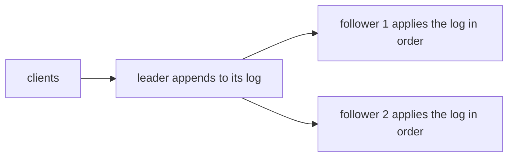
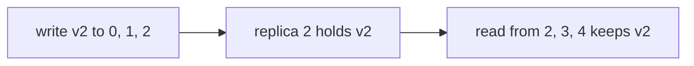

# Replication: leaders, logs and quorums

## The idea

**Replication** keeps copies of the same data on several machines. Each copy is a **replica**. David Gifford's 1979 paper on replicated data gives the reasons that still hold: copies can sit close to where the data is used, several machines can serve requests for the same data in parallel, and the data stays available when some machines fail. Replicas also bring the central problem of this path: when the data changes, every copy must change too, and the network between them loses and delays messages.

Daniel Abadi's 2012 article on consistency tradeoffs observes that there are only three ways to send an update to the replicas: to all of them at the same time, to an agreed-upon node first, or to whichever node received it first. This guide starts with the second way, a leader. Quorums, covered after it, decide how many replicas a write and a read must reach. As the example shows, they do not order concurrent writes on their own.

**A leader and a log.** One replica, the **leader** (also called the primary or master), receives every change and puts it in a **log**, a list of changes in the order it decided. The other replicas, the **followers**, receive the log and apply its entries in order. The Raft paper, in its section on replicated state machines, states why this works: each log contains the same commands in the same order, and since the replicas are **deterministic**, always producing the same result from the same state and command, each computes the same state. A follower that has applied fewer entries is behind, not different.



<!-- text-of-mermaid sha256:9bb81bef175db935bf76b391045582cf348920abfe2c92bf9143f852cf730b71 -->
```text
┌───────┐    ┌─────────────────────────┐    ┌───────────────────────────────────┐
│clients├───►│leader appends to its log├───►│follower 1 applies the log in order│
└───────┘    └────────────┬────────────┘    └───────────────────────────────────┘
                          │
                          │                 ┌───────────────────────────────────┐
                          └────────────────►│follower 2 applies the log in order│
                                            └───────────────────────────────────┘
```

The drawing is the whole design. Its weak points are the edges: when is a change safe to report as done, and what happens when the leader fails?

**Synchronous or asynchronous.** Abadi's article describes the choice. With **synchronous** replication, the leader waits until the change has reached the replicas before telling the client it is done: the replicas stay consistent, but every write waits for the slowest replica it must reach. With **asynchronous** replication, the leader reports the change as done before it has been copied: writes are fast, but a read served by a follower can return an older version, and if the leader fails, a change the client saw confirmed may exist nowhere else. Many systems copy synchronously to some replicas and asynchronously to the rest.

**Quorums.** Gifford's weighted voting gives every replica a number of votes. A read must collect a **read quorum** of `r` votes and a write a **write quorum** of `w` votes, chosen so that `r + w` is greater than the total number of votes. Then every read quorum and every write quorum have at least one replica in common, and version numbers on the copies tell which one is current. With one vote per replica and `n` replicas, the rule is `r + w > n`. For example, with `n = 5`, writes that reach 3 replicas and reads that ask 3 always meet; so do writes to all 5 and reads from any 1. Gifford's third example uses that last rule on three servers: read from any server, apply every update to all copies.

## A worked example

### The log keeps replicas identical

Each replica here is a tiny state machine over one number, and the log is a list of commands:

```python examples/replicated_log.py
"""Replicas that apply the same log of commands, in the same order, end in the same state.

Each replica is a deterministic state machine over one number. The leader's log orders the
commands; a follower that has applied only a prefix of the log is behind, not different. Two
replicas that apply the same commands in different orders disagree.
"""

LOG = ["set 5", "add 3", "double", "add 1"]


def apply(state: int, command: str) -> int:
    op, *arg = command.split()
    if op == "set":
        return int(arg[0])
    if op == "add":
        return state + int(arg[0])
    return state * 2  # double


def run(commands: list[str]) -> int:
    state = 0
    for command in commands:
        state = apply(state, command)
    return state


print("leader, whole log:     ", run(LOG))
print("follower, whole log:   ", run(LOG))
print("follower, first 2 only:", run(LOG[:2]), "(behind, and catches up by applying the rest)")
print("other order:           ", run(["set 5", "double", "add 3", "add 1"]), "(a different state)")
```

It prints:

```output examples/replicated_log.py
leader, whole log:      17
follower, whole log:    17
follower, first 2 only: 8 (behind, and catches up by applying the rest)
other order:            14 (a different state)
```

`add` and `double` do not commute: adding 3 then doubling gives 16, doubling then adding 3 gives 13. So the order matters, and the leader's single log is what fixes it for everyone. A follower reading at the third line answers 8, an older state that the leader has already passed. That is the stale read of asynchronous replication, in its simplest form.

### Quorums that overlap, and one thing they do not do

Five replicas each hold a version number and a value. The program counts, for three choices of `w` and `r`, how many pairs of a write set and a read set share no replica, then performs a write and a read, and then two writes at once:

```python examples/quorums.py
"""Read and write quorums over five replicas, each holding a (version, value) pair.

A write goes to w replicas and a read asks r replicas and keeps the highest version. When
r + w > 5, every read set shares a replica with every write set, so a read always meets the
latest write. The last part shows what a quorum does not do: order two writes made at once.
"""

from itertools import combinations

N = 5
REPLICAS = range(N)

for w, r in [(3, 3), (5, 1), (2, 2)]:
    pairs = [(ws, rs) for ws in combinations(REPLICAS, w) for rs in combinations(REPLICAS, r)]
    missed = sum(1 for ws, rs in pairs if not set(ws) & set(rs))
    print(f"w={w} r={r}: r + w = {w + r}, {missed} of {len(pairs)} read sets miss a write set")

store = {i: (1, "blue") for i in REPLICAS}


def write(replicas: tuple[int, ...], version: int, value: str) -> None:
    for i in replicas:
        store[i] = (version, value)


def read(replicas: tuple[int, ...]) -> list[tuple[int, str]]:
    newest = max(store[i][0] for i in replicas)
    return sorted({store[i] for i in replicas if store[i][0] == newest})


write((0, 1, 2), 2, "green")
print("after one write to 0, 1, 2; read from 2, 3, 4:", read((2, 3, 4)))

# Two clients both read version 2, then both write version 3, to overlapping quorums.
write((0, 1, 2), 3, "red")
write((2, 3, 4), 3, "white")  # replica 2 keeps the write that reached it last
print("after two writes at once; read from 0, 3, 4:  ", read((0, 3, 4)))
```

It prints:

```output examples/quorums.py
w=3 r=3: r + w = 6, 0 of 100 read sets miss a write set
w=5 r=1: r + w = 6, 0 of 5 read sets miss a write set
w=2 r=2: r + w = 4, 30 of 100 read sets miss a write set
after one write to 0, 1, 2; read from 2, 3, 4: [(2, 'green')]
after two writes at once; read from 0, 3, 4:   [(3, 'red'), (3, 'white')]
```



<!-- text-of-mermaid sha256:87711a38b3a222fa5165e4cff6dd6d1968a6d01c1ce8fb8409abe1402e2b07a7 -->
```text
┌───────────────────┐    ┌──────────────────┐    ┌──────────────────────────┐
│write v2 to 0, 1, 2├───►│replica 2 holds v2├───►│read from 2, 3, 4 keeps v2│
└───────────────────┘    └──────────────────┘    └──────────────────────────┘
```

With `r + w = 6 > 5`, no read misses a write: the read from replicas 2, 3 and 4 finds version 2 on replica 2 and ignores the older copies, as the drawing shows. With `r + w = 4`, 30 of the 100 pairs miss, and such a read returns old data with no sign that it is old.

The last line is the warning. Two clients both read version 2, and both write version 3 with different values to quorums that overlap. Each write is a valid quorum write, yet a later read finds version 3 holding two different values and cannot tell which is newer. The overlap makes a read meet the latest write; it does not decide which of two concurrent writes is the latest. Gifford's algorithm runs every read and write inside a **transaction**, a group of reads and writes that takes effect completely or not at all, in a file system that has transactions and locks, and his appendix shows that it keeps the copies **serially consistent**: the outcome is one that the transactions could have produced running one at a time; Abadi's article puts it directly: simply using a quorum protocol is not sufficient to guarantee the strongest consistency. Something must still order the writes, and that something is a leader, a lock, or the consensus of the guide on Raft.

## When to use it

- **One leader with followers**: the simplest way to give every replica the same order of changes. Use it when one machine can take every write and you mainly need copies for reads and for failover.
- **Synchronous copies** to at least one other replica when losing a confirmed write is unacceptable; **asynchronous copies** to replicas far away or used only for reads, when a delay is acceptable.
- **Quorums** when no single replica should be needed for every write or read, and you can tune `r` and `w` to the mix: a small `r` and a large `w` for data read far more than written, as in Gifford's third example.
- **Reading from followers** to spread read load, when the application tolerates reads that are a little behind, or when it can route a user's reads to a replica that has that user's writes.
- **Log-based copying to other systems**: the same idea, a log applied in order, keeps a search index or an analytics store in step with a database, as the guide on change data capture shows.

## Common traps

- **Confirming before copying, and calling it durable.** With asynchronous replication, a write confirmed to the client can be lost with the leader. Know which writes can be lost, and how many.
- **Reading your own write from a follower.** A user updates a profile and the next page, served by a follower that is behind, shows the old one. Route such reads to the leader, or to a replica known to have the write.
- **Two leaders after a partition.** If the old leader is cut off but alive, and the others elect a new one, both accept writes. Electing a leader safely needs a majority to agree, which is the subject of the Raft guide.
- **Trusting `r + w > n` to order concurrent writes.** It guarantees overlap, as the example shows, not an order.
- **Applying a log out of order, or twice.** A follower must apply entries in log order and recognize an entry it already applied, or its state drifts from the leader's.
- **Even-numbered majorities.** Four replicas need three for a majority, the same as five, while surviving one fewer failure.

## Complexity

For `n` replicas:

| Scheme | Write | Read | Survives |
|--------|-------|------|----------|
| Leader, asynchronous | One write at the leader; copies follow later | One replica; possibly behind unless it is the leader | Any number of follower failures; the leader's failure can lose recent writes |
| Leader, synchronous to all | Waits for all `n` | Any replica | Writes stop when any replica is unreachable |
| Quorum, `r + w > n` | Waits for the `w` fastest of the replicas it asks | Waits for `r` replies, keeps the highest version | Writes need `w` reachable replicas and reads `r` |
| Majority quorums, `r = w = ⌊n/2⌋ + 1` | Waits for a majority | Waits for a majority | `⌊(n − 1)/2⌋` failures: 2 of 5 |

Each write is sent to every replica either way, so the network carries O(n) messages per write; the schemes differ in how many replies the client waits for. Waiting for `w` of `n` replies costs the time of the `w`-th fastest one, so a larger quorum is slower and fails sooner, and a smaller one risks reads that miss writes.

## Expert notes

- **Votes, not just replicas.** Gifford's replicas can carry different numbers of votes, as in his second example, where the server on the local network has two votes and two remote servers one each, so that writes must reach the local server and one remote one. A replica with no votes, a weak representative, can serve as a local cache: the paper notes that a write quorum of other replicas always holds current data, so a weak representative found to be in error can simply be invalidated.
- **Version numbers find the current copy.** In Gifford's algorithm the first write of a transaction increments the version numbers of its write quorum, and a read quorum is guaranteed to contain a current copy, which its version number identifies.
- **Abadi's three options, in detail.** Sending updates to all replicas at once lets replicas apply concurrent updates in different orders unless an agreement protocol or a preprocessing layer orders them, which adds latency; sending them to an agreed-upon node first forces every update, wherever it starts, to travel to that node; and sending them to an arbitrary node first lets two updates of the same item start at two different places at once. He argues that this tradeoff between consistency and latency is present all the time, partitions or not.
- **Reads from any replica.** Abadi notes that serving reads from any node gives better read latency but inconsistent reads while updates propagate, and that update sequence numbers can bound the damage, for example to give **read-your-writes**: a user always sees their own earlier writes.
- **A log is a stronger tool than a quorum.** A log orders every change, so replicas agree on concurrent writes as well as on the latest one. Electing the leader that owns the log, and replacing it safely, is consensus; the guide on Raft builds it from majorities and terms.

## Practice

- `cstudy start cdc-apply`: be the follower: apply an ordered change log to a copy of a table, keep the position you have applied up to so that redelivered entries change nothing, start from a snapshot, and check the copy against the source.

## Further reading

- [Gifford, *Weighted Voting for Replicated Data*, SOSP 1979](https://none.cs.umass.edu/~shenoy/courses/fall04/readings/gifford.pdf): read and write quorums with `r + w` greater than the total votes, version numbers, the three example configurations, and weak representatives.
- [Abadi, *Consistency Tradeoffs in Modern Distributed Database System Design*, IEEE Computer 45(2), 2012](https://www.cs.umd.edu/~abadi/papers/abadi-pacelc.pdf): the three ways to send updates to replicas, synchronous and asynchronous replication, quorums, and the consistency/latency tradeoff.
- [Ongaro and Ousterhout, *In Search of an Understandable Consensus Algorithm (Extended Version)*, 2014](https://raft.github.io/raft.pdf): section 2, replicated state machines and replicated logs.
