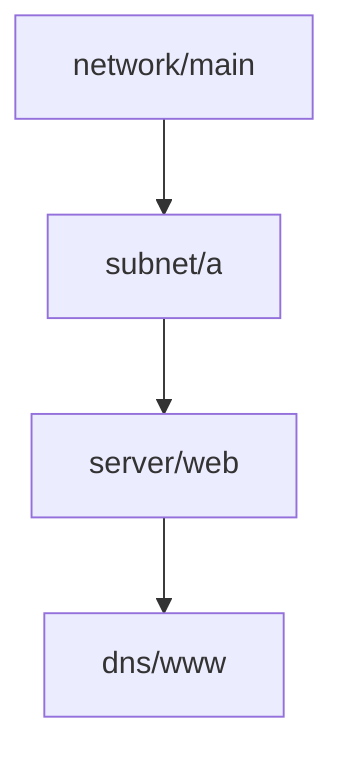

# Resource graphs and dependency order

## The idea

A subnet lives inside a network. A server lives in a subnet and is guarded by a firewall group. A DNS record points at the server's address. None of these can be created before the thing it lives in, and the network cannot be deleted while a subnet still uses it.

A description says this with **references**: instead of copying the network's identifier into the subnet by hand, the subnet's `network_id` attribute refers to the `id` attribute of the network. The identifier does not exist yet when the description is written; the provider (the cloud or system that creates resources) chooses it when it creates the network. The reference says "whatever that turns out to be".

Every reference is a **dependency**: the resource that refers needs the one it refers to. Draw each resource as a node and each dependency as an arrow from the resource that is needed to the resource that needs it, and you get the **dependency graph**, which the [guide on graphs](../graph-representations/guide.md) shows how to store.



<!-- text-of-mermaid sha256:b019aaf5165531bbf5c339bfa91a0131f86a74625feb9df419a728170953ec8c -->
```text
┌────────────┐
│network/main│
└──────┬─────┘
       ▼
┌────────────┐
│  subnet/a  │
└──────┬─────┘
       ▼
┌────────────┐
│ server/web │
└──────┬─────┘
       ▼
┌────────────┐
│  dns/www   │
└────────────┘
```

The drawing shows the longest chain of the example below: each resource needs the one above it. The full graph also has a second subnet and a firewall group under the network, the firewall above the server, and a bucket that needs nothing.

Three orders follow from the graph.

- **Creates and updates** go in a **topological order**: every resource after everything it needs, so that each reference can be filled in with a real value. Such an order exists exactly when the graph has no cycle; the [guide on topological order](../topological-order/guide.md) builds one.
- **Deletes** go in the reverse order: the DNS record first, then the server, then the subnet, then the network. A provider usually refuses to delete something that is still in use, and even when it does not, what depends on it would be left pointing at nothing.
- **Side by side.** Resources that do not depend on each other, directly or through others, can be changed at the same time. Grouping the graph into **waves**, where each wave holds the resources whose dependencies are all in earlier waves, shows how much can run in parallel.

One more consequence matters for planning. When a resource is about to be created, the values its provider will choose are **unknown** at plan time, and so is every attribute that refers to them. The plan can only say "known after apply". An unknown value is treated as different from every value: the resource that holds it will change, whatever it holds today. And when an existing resource is replaced, its identifier becomes unknown again, so everything that refers to it changes too, and is itself replaced if that attribute cannot change in place. A single replacement can ripple down the graph.

## A worked example

Seven resources, with references as `Ref(address, key)` values. The program builds the dependency graph from the references, lets Python's `graphlib` hand out the resources wave by wave, prints the delete order, and then adds one reference that closes a loop:

```python examples/resource_graph.py
"""Find the dependencies of resources from their references, and order creates and deletes.

A value `Ref(address, key)` stands for an attribute of another resource, known only once that
resource exists. Each reference is an edge of the dependency graph: the referring resource
needs the other one first. graphlib hands out the resources whose dependencies are all done,
one wave at a time; the waves are sorted so that the output is the same on every run.
"""

from dataclasses import dataclass
from graphlib import CycleError, TopologicalSorter


@dataclass(frozen=True)
class Ref:
    address: str
    key: str


resources = {
    "network/main": {"cidr": "10.0.0.0/16"},
    "subnet/a": {"network_id": Ref("network/main", "id"), "cidr": "10.0.1.0/24"},
    "subnet/b": {"network_id": Ref("network/main", "id"), "cidr": "10.0.2.0/24"},
    "firewall/web": {"network_id": Ref("network/main", "id"), "ports": "443"},
    "server/web": {"subnet_id": Ref("subnet/a", "id"), "firewall_id": Ref("firewall/web", "id")},
    "dns/www": {"target": Ref("server/web", "ip")},
    "bucket/logs": {"region": "eu"},
}


def dependencies(resources: dict) -> dict[str, set[str]]:
    return {address: {value.address for value in attributes.values() if isinstance(value, Ref)}
            for address, attributes in resources.items()}


def waves(needs: dict[str, set[str]]) -> list[list[str]]:
    sorter = TopologicalSorter(needs)
    sorter.prepare()  # raises CycleError if the graph has a cycle
    result = []
    while sorter.is_active():
        ready = sorted(sorter.get_ready())
        result.append(ready)
        sorter.done(*ready)
    return result


create = waves(dependencies(resources))
for number, wave in enumerate(create, 1):
    print(f"create wave {number}: {wave}")
deletes = [address for wave in reversed(create) for address in sorted(wave, reverse=True)]
print("delete order:", deletes)

resources["network/main"]["gateway"] = Ref("subnet/b", "gateway_ip")  # this closes a loop
try:
    waves(dependencies(resources))
except CycleError as error:
    print("cycle through:", sorted(set(error.args[1])))
```

It prints:

```output examples/resource_graph.py
create wave 1: ['bucket/logs', 'network/main']
create wave 2: ['firewall/web', 'subnet/a', 'subnet/b']
create wave 3: ['server/web']
create wave 4: ['dns/www']
delete order: ['dns/www', 'server/web', 'subnet/b', 'subnet/a', 'firewall/web', 'network/main', 'bucket/logs']
cycle through: ['network/main', 'subnet/b']
```

- **Wave 1** holds what needs nothing: the network and the bucket. The bucket is unrelated to everything else, so it could be created at any time.
- **Wave 2** holds the two subnets and the firewall group, which all need only the network, so they could be created at the same time.
- **Wave 3** is the server, which needs a subnet and the firewall; **wave 4** is the DNS record.
- **Deletes** are the waves in reverse. The DNS record goes first and the network last; within a wave the order does not matter, and the example sorts it only so that the output is stable.
- **The cycle.** Giving the network an attribute that refers to the second subnet's gateway makes each of the two need the other: no order can create both. `graphlib` raises `CycleError` and names the nodes of the loop.

Four waves is also the length of the longest chain, network to subnet to server to DNS: however many workers are available, that chain cannot be done in fewer than four steps.

## When to use it

- **Ordering a plan.** Every create and update after what it needs, every delete before what it needs, so that each step finds the world it expects.
- **Applying in parallel.** The waves show what can run side by side. When a step fails, everything that depends on it, directly or through others, cannot run, while the rest of the graph can carry on.
- **Seeing the effect of a change.** Walking the arrows forward from a resource lists everything built on it: what a replacement would ripple into, or what a deletion would break.
- **Splitting a large description.** Parts of the graph with no arrows between them can be planned and applied separately, by separate teams, with smaller plans to read.

## Common traps

- **Dependencies nobody wrote down.** A server that needs a firewall rule to start, but never refers to any of the rule's attributes, has a dependency the graph cannot see. The tool may then create the server first. Declare such dependencies explicitly, or make the server refer to the rule.
- **Two resources that refer to each other.** Two firewall groups that each allow traffic from the other form a cycle. Break it by splitting the resources: create both groups first, then the two rules as resources of their own that refer to both groups.
- **Deleting everything at once.** Without the reverse order, the provider refuses to delete the network while subnets remain, or deletes it and leaves the subnets broken.
- **Treating an unknown value as empty or as the old value.** A plan that shows the old identifier where the new one is not known yet misleads the reader, and one that shows nothing at all hides a change. Mark unknown values as unknown, and treat them as differing from every value.
- **A replacement nobody expected downstream.** Replacing a network gives it a new identifier, so every subnet that refers to it changes; if a subnet cannot change its network in place, it is replaced too, and so on down. Read the whole plan, not only the line you meant to change.
- **An order that changes from run to run.** Many topological orders can be valid. If ties are broken by whatever order a hash map returns, two plans of the same graph print their steps differently. Break ties by a rule, such as sorting by address.

## Complexity

For `R` resources and `E` references:

| Step | Time | Space |
|------|------|-------|
| Build the graph from the references | O(R + E) | O(R + E) |
| A topological order, or a cycle | O(R + E), plus O(R log R) to sort ties | O(R) |
| Waves | O(R + E), plus sorting within each wave | O(R) |
| The resources affected by changing one | O(R + E) at worst, a walk with a visited set | O(R) |
| Which values are unknown | O(R + E), resolving resources in topological order | O(R · K) for `K` attributes each |

The number of waves is the number of resources on the longest chain of dependencies, which bounds how fast even an unlimited number of workers can apply the graph.

## Expert notes

- **`graphlib`.** Python's `graphlib.TopologicalSorter`, added in Python 3.9, takes a mapping from each node to its predecessors, the nodes it needs. `prepare()` marks the graph as finished and raises `CycleError` if it has a cycle; `get_ready()` returns every node whose predecessors are all marked done, and `done()` marks nodes as processed, which is how the example forms waves. `static_order()` gives one order, and the documentation warns that it can depend on the order in which nodes were inserted, which is why the example sorts each wave.
- **What `CycleError` reports.** When there are several cycles, it reports one of them, an undefined choice, as the second element of the exception's `args`: a list in which each node is an immediate predecessor of the next, and the first and last nodes are the same. The example prints the set of nodes, which is the same whichever end the list starts at.
- **Why reversing works.** Reversing every arrow of a graph with no cycle gives a graph with no cycle, and the reverse of a topological order of the first is a topological order of the second. That is all the delete order needs.
- **Replacing with the create first.** A replacement can delete the old object and then create the new one, which leaves a moment when neither exists, or create the new one first and delete the old one afterwards, which avoids the gap. The choice changes the order of steps around the replaced resource, and what depends on it has to move to the new object before the old one goes.
- **Not just infrastructure.** The same graph orders the tasks of a batch pipeline, as the [guide on orchestration](../pipeline-orchestration/guide.md) shows, and the same reverse walk answers "what is built from this?" in data lineage.

## Practice

- `cstudy start iac-plan-engine`: references between resources that resolve in dependency order and report unknown references and cycle groups; steps placed under rules that put creates after what they need and deletes before; replacement, values nobody knows until a resource exists and create-before-destroy; then applying the plan against a simulated cloud whose calls fail, until a new plan converges.

## Further reading

- [Python, `graphlib`](https://docs.python.org/3/library/graphlib.html): `TopologicalSorter`, `get_ready`, `done`, `static_order` and `CycleError`.
