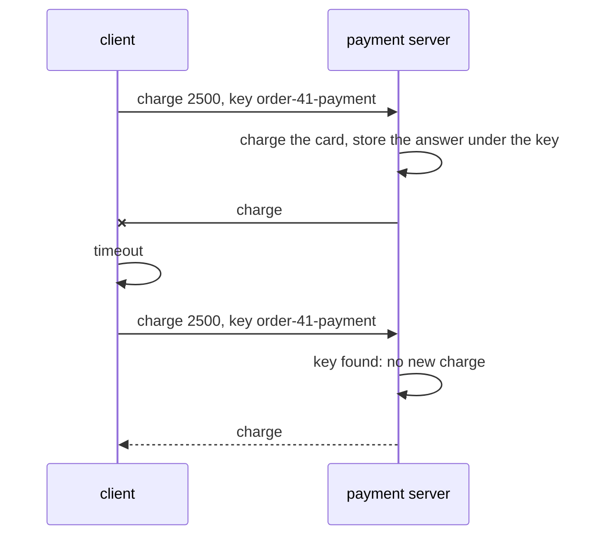
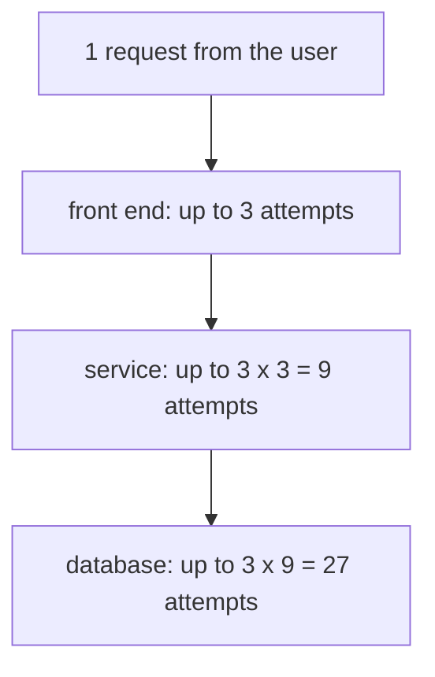

# Timeouts, retries and idempotency

## The idea

A call to another machine has three possible outcomes, not two. It succeeds, it fails, or you do not know. A **timeout**, the moment a client stops waiting for an answer, is the third kind. The request may never have arrived. It may have arrived, been carried out, and had its answer lost on the way back. It may still be running. From the client's side all three look the same: silence.

A **retry** sends the request again. It is how a client gets past a lost packet, a restarted server or a moment of overload, and it is also how one payment becomes two. Whether a retry is safe depends on the request.

RFC 9110 gives HTTP's vocabulary for this:

- A method is **safe** if its defined meaning is essentially read-only. `GET`, `HEAD`, `OPTIONS` and `TRACE` are safe.
- A method is **idempotent** if the intended effect on the server of several identical requests is the same as the effect of one. `PUT`, `DELETE` and the safe methods are idempotent. `POST` is neither.

The definition is about the effect on the server, not about the answer. Setting a price to 30 twice leaves it at 30; deleting an order twice leaves it deleted, even if the second answer differs from the first. Adding 30 to a price twice, or placing an order twice, does not.

RFC 9110 draws the consequence. An idempotent request can be repeated automatically if a communication failure happens before the client can read the server's response. A client should not automatically retry a request with a non-idempotent method unless it knows that the request is idempotent anyway, or has some way to detect that the original request was never applied. A **proxy**, a program the client chose to forward its requests, must not automatically retry non-idempotent requests at all. And a client should not automatically retry a failed automatic retry.

The backoff schedules in the rest of this guide go beyond that advice. RFC 9110 speaks of automatic retries, the kind a client or proxy makes on its own after a connection fails; several attempts spaced out by growing waits are a deliberate retry policy, which a client chooses for requests it knows are safe to repeat.

That second way out is the usual fix for operations that are not idempotent by nature. The client attaches an **idempotency key**, a unique value it generates once per operation and sends again with every retry of that operation. The server records the outcome under the key the first time, and when the key comes back it returns that outcome instead of doing the work again. The operation is not idempotent, but the request now is.

## A worked example

A payment server, a network that loses one answer, and a client that retries after its timeout:

```python examples/duplicate_charge.py
"""Why a retry can charge a card twice, and how an idempotency key prevents it.

The server does the work and answers, and the network loses the answer. The client sees only a
timeout: it cannot tell a request that never arrived from an answer that never came back, so it
retries. Without a key the server charges again. With a key it finds the answer it gave the
first time and sends that again, without charging.
"""


class PaymentServer:
    def __init__(self) -> None:
        self.charges: list[int] = []
        self.answers: dict[str, str] = {}  # idempotency key -> the answer first given

    def charge(self, cents: int, key: str | None) -> str:
        if key is not None and key in self.answers:
            return self.answers[key]
        self.charges.append(cents)
        answer = f"charge #{len(self.charges)} of {cents} cents ok"
        if key is not None:
            self.answers[key] = answer
        return answer


def call_with_retries(server: PaymentServer, cents: int, key: str | None, lost: set[int]) -> None:
    for attempt in range(1, 4):
        answer = server.charge(cents, key)
        if attempt in lost:
            print(f"  attempt {attempt}: no answer before the timeout")
            continue
        print(f"  attempt {attempt}: {answer}")
        return


for key in (None, "order-41-payment"):
    server = PaymentServer()
    print(f"key {key}:")
    call_with_retries(server, 2500, key, lost={1})
    print(f"  the card was charged {len(server.charges)} time(s): {server.charges}")

server = PaymentServer()
server.charge(2500, "order-41-payment")
print("same key, different amount:", server.charge(9900, "order-41-payment"))
```

It prints:

```output examples/duplicate_charge.py
key None:
  attempt 1: no answer before the timeout
  attempt 2: charge #2 of 2500 cents ok
  the card was charged 2 time(s): [2500, 2500]
key order-41-payment:
  attempt 1: no answer before the timeout
  attempt 2: charge #1 of 2500 cents ok
  the card was charged 1 time(s): [2500]
same key, different amount: charge #1 of 2500 cents ok
```

Without a key, the first attempt charged the card and its answer was lost; the retry charged it again. The client saw one success and the customer paid twice. With a key, the retry found the outcome of the first attempt and returned it: one charge, and the client still got its answer.



<!-- text-of-mermaid sha256:be0a30af78edd7234215785d7c50ab3c921e99868a75268268a93a43cf213f82 -->
```text
┌────────┐                         ┌────────────────┐
│ client │                         │ payment server │
└────┬───┘                         └────────┬───────┘
     │                                      │
     │  charge 2500, key order-41-payment   │
     │──────────────────────────────────────▶
     │                                      │
     │                                      ├───┐
     │                                      │   │ charge the card, store the answer under the key
     │                                      ◀───┘
     │                                      │
     │         charge #1 ok (lost)          │
     ◀──────────────────────────────────────│
     │                                      │
     ├───┐                                  │
     │   │ timeout                          │
     ◀───┘                                  │
     │                                      │
     │  charge 2500, key order-41-payment   │
     │──────────────────────────────────────▶
     │                                      │
     │                                      ├───┐
     │                                      │   │ key found: no new charge
     │                                      ◀───┘
     │                                      │
     │  charge #1 ok (the stored answer)    │
     ◀╌╌╌╌╌╌╌╌╌╌╌╌╌╌╌╌╌╌╌╌╌╌╌╌╌╌╌╌╌╌╌╌╌╌╌╌╌╌│
     │                                      │
┌────┴───┐                         ┌────────┴───────┐
│ client │                         │ payment server │
└────────┘                         └────────────────┘
```

The last line of the output is a trap. The same key arrived with a different amount, and this server returned the old answer without noticing. A real server compares the request with the one it stored under the key and refuses a mismatch, since a key reused for different work is a bug in the client, not a retry.

## Backing off

When to retry matters as much as whether. A server that fails because it is overloaded gets more load from every immediate retry: the same spiral that RFC 896 called congestion collapse for packets, one layer up. So clients wait between attempts, and wait longer each time: **exponential backoff**, often doubling, up to a cap. TCP's own timer does the same: RFC 6298 doubles the retransmission timeout each time it expires.

Doubling alone is not enough when many clients fail together. They all saw the same outage at the same moment, so with identical waits they come back at the same moment, again and again. **Jitter** makes each client's wait partly random. RFC 8085 recommends slight random variations in the timing of keep-alive messages for the same reason: to reduce persistent synchronization between the transmissions of different hosts. Here a hundred clients each retry four times, with waits whose ceilings are 1, 2, 4 and 8 seconds:

```python examples/backoff_and_jitter.py
"""A hundred clients retrying against a server that is down, with three ways to wait.

Every client's first attempt fails at second 0, and so do its four retries. The waits between
attempts have ceilings of 1, 2, 4 and 8 seconds. Without jitter every client waits exactly the
ceiling, so all hundred retry in the same instant, four times. Full jitter waits a random share
of the ceiling; half jitter waits half the ceiling plus a random share of the other half. The
random numbers come from a seeded generator, whose random() sequence Python keeps the same from
version to version.
"""

import random

CLIENTS, CEILINGS = 100, [1, 2, 4, 8]


def wait(ceiling: float, schedule: str, rng: random.Random) -> float:
    if schedule == "no jitter":
        return ceiling
    if schedule == "full jitter":
        return rng.random() * ceiling
    return ceiling / 2 + rng.random() * ceiling / 2  # half jitter


def retry_times(schedule: str) -> list[float]:
    rng = random.Random(2026)
    times = []
    for _ in range(CLIENTS):
        now = 0.0
        for ceiling in CEILINGS:
            now += wait(ceiling, schedule, rng)
            times.append(now)
    return times


def busiest_tenth(times: list[float]) -> int:
    counts: dict[int, int] = {}
    for time in times:
        tenth = int(time * 10)
        counts[tenth] = counts.get(tenth, 0) + 1
    return max(counts.values())


print("schedule     retries  busiest 0.1 s  earliest retry (s)  last retry (s)")
for schedule in ("no jitter", "full jitter", "half jitter"):
    times = retry_times(schedule)
    print(
        f"{schedule:<11}  {len(times):>7}  {busiest_tenth(times):>13}  "
        f"{min(times):>18.2f}  {max(times):>14.2f}"
    )
```

It prints:

```output examples/backoff_and_jitter.py
schedule     retries  busiest 0.1 s  earliest retry (s)  last retry (s)
no jitter        400            100                1.00           15.00
full jitter      400             16                0.01           14.06
half jitter      400             27                0.51           14.53
```

Every schedule sends the same 400 retries. Without jitter, all hundred clients retry in the same instant, four times: a server that comes back up meets a wall of requests. **Full jitter**, a random share of the whole ceiling, spreads them most, so the busiest tenth of a second holds 16 retries; but some clients retry almost at once, after 0.01 seconds. **Half jitter**, half the ceiling plus a random share of the other half, keeps a minimum wait and spreads a little less. All three finish within the same 15 seconds: jitter changes when the retries come, not how many there are or how long they take.

## When the server says how long

A server that knows when it will be ready can say so. RFC 9110's `Retry-After` field tells the client how long it ought to wait before its follow-up request, as a date or as a number of seconds:

```text
Retry-After: Fri, 31 Dec 1999 23:59:59 GMT
Retry-After: 120
```

Two status codes carry it most often:

| Status | Meaning | `Retry-After` |
|--------|---------|---------------|
| `503 Service Unavailable` | RFC 9110: the server is currently unable to handle the request, because of a temporary overload or scheduled maintenance | The server may send it to suggest how long to wait |
| `429 Too Many Requests` | RFC 6585: the user has sent too many requests in a given amount of time ("rate limiting") | The response may include it |

RFC 6585 leaves it to each server how it identifies a user and counts requests. A client that receives a wait should honor it over its own backoff, and for every request it sends to that server, not only the one that was refused: the server asked the client to stay away, not one call.

Other codes say different things about a retry. Most 4xx codes say the request was at fault, so sending it again unchanged gets the same answer; 408 and 429 are exceptions, about timing. RFC 9110 defines `408 Request Timeout` as the server not receiving a complete request within the time it was prepared to wait, and says a client may repeat a request that was in transit. A **gateway** is a server that receives requests as if it were the origin and forwards them to another server behind it. RFC 9110 defines `502 Bad Gateway` as a gateway or proxy receiving an invalid response from the server behind it, and `504 Gateway Timeout` as a gateway or proxy not receiving a timely response from it. A 502 or 504 says the server behind may or may not have done the work: for a request that is not idempotent, it is an unknown outcome like a timeout.

## Deadlines, budgets and layers

Every request has a caller who will not wait forever, so retries need a **deadline**: a time after which nothing more is worth trying. Each attempt's timeout should be no longer than what remains of it, and a wait that would end after it is time wasted for everyone.

Retries also multiply. When each layer of a system retries on its own, the attempts at the bottom are the product of the attempts at every layer:



<!-- text-of-mermaid sha256:b8dc81e0cfdb98dc81f5f71c98dc04912abad997280dc92512ff02b69e26145b -->
```text
┌───────────────────────────────────┐
│      1 request from the user      │
└─────────────────┬─────────────────┘
                  ▼
┌───────────────────────────────────┐
│    front end: up to 3 attempts    │
└─────────────────┬─────────────────┘
                  ▼
┌───────────────────────────────────┐
│ service: up to 3 x 3 = 9 attempts │
└─────────────────┬─────────────────┘
                  ▼
┌───────────────────────────────────┐
│database: up to 3 x 9 = 27 attempts│
└───────────────────────────────────┘
```

The drawing follows one request down three layers. Under an outage, the database gets up to 27 times its normal load from the clients that are failing, exactly when it can least take it. Two common limits are a **retry budget**, a cap on retries as a share of all requests, and a **circuit breaker**, which stops calling a dependency that keeps failing for a cool-down period, then lets one trial request through to see whether it has recovered.

## When to use it

- **Retry** transient failures: timeouts, connection resets, `503`, `429`, and the gateway errors, for requests that are idempotent or carry an idempotency key.
- **Back off with jitter** every time, and honor `Retry-After` when the server sends it.
- **Use idempotency keys** for operations with effects, such as payments, orders and messages, whenever a client may retry.
- **Do not retry** requests the server rejected as wrong, such as `400`, `403` or `404`: the answer will not change.
- **Give up and report** an unknown outcome when a non-idempotent request timed out without a key, and let the caller, who knows what the operation means, decide.

## Common traps

- **Treating a timeout as a failure.** It is an unknown. Report it as one, and never assume the work was not done.
- **Retrying a `POST` without a key.** Each retry can repeat the effect: two orders, two charges, two emails.
- **No jitter.** Clients that failed together retry together, and keep doing it.
- **Counting only your own retries.** Every layer's retries multiply with the others', as the drawing shows.
- **Ignoring `Retry-After`.** The server said when; retrying earlier is refused again and adds load.
- **Timeouts longer than the caller's deadline.** An attempt that cannot finish in time cannot help.
- **Reusing a key for different work.** A server that does not compare the request returns the wrong answer, as the example's last line shows.
- **Forgetting that keys expire.** A server keeps keys for some time; a retry after that window looks like a new request.

## Complexity

A retry schedule costs time, load and storage:

| Cost | Value |
|------|-------|
| Worst-case time of one call | the sum of every attempt's timeout and every wait: 5 attempts with a 1-second timeout and waits of 1, 2, 4 and 8 seconds take up to 5 + 15 = 20 seconds |
| Load during an outage | each failing request becomes up to `k` attempts; with `k` attempts at each of `n` layers, up to `k^n` at the bottom |
| Waits under doubling | the `i`-th wait is the first wait times `2^(i-1)` until the cap, so the total waiting time grows exponentially with the number of retries |
| Idempotency keys | one stored outcome per operation for as long as retries may come, so storage grows with the request rate times that retention time |

Jitter costs nothing in total load: it moves attempts in time, which lowers the peak.

## Expert notes

- **Automatic retries in HTTP/1.1.** RFC 9112 notes that idempotent methods matter for pipelining because they can be retried automatically after a connection failure, and says a user agent should not pipeline requests after a non-idempotent method. RFC 9110 also warns that some clients retry a `POST` anyway when the connection closed during the request: a guess that can repeat its effect.
- **TCP retries beneath you.** Within one connection, TCP resends lost segments by itself, with its own backoff. An application's retry is for when the connection, or the server behind it, failed.
- **Early data can be replayed.** When client and server already share a key, from an earlier connection or agreed in advance, TLS 1.3 lets the client send data on its first flight, called early data, and RFC 9846 says there are no guarantees of non-replay between connections. The question this guide asks, what if this request happens twice, applies there too.
- **Seeded randomness.** The example draws its jitter from `random.Random(2026)`. Python's documentation guarantees that `random()` produces the same sequence for the same seed across versions, which keeps the example's output stable, and warns that this module's generators should not be used for security purposes.
- **Rate limits are a policy, not a protocol.** RFC 6585 defines what `429` means and nothing about how a server counts. Clients learn a server's limits from its documentation and from its `Retry-After` values, not from the standard.

## Practice

- `cstudy start vendor-retry-client-typescript`: grow a client for an unreliable service, level by level: exponential backoff, jitter you can test, retrying only what is safe to repeat, `Retry-After`, a deadline budget, and a circuit breaker.

## Further reading

- [RFC 9110, HTTP Semantics](https://www.rfc-editor.org/rfc/rfc9110.html): safe and idempotent methods and the failed automatic retry (section 9.2), `Retry-After` (section 10.2.3), and the status codes 408, 502, 503 and 504 (section 15).
- [RFC 6585, Additional HTTP Status Codes](https://www.rfc-editor.org/rfc/rfc6585.html): `429 Too Many Requests` (section 4).
- [RFC 9112, HTTP/1.1](https://www.rfc-editor.org/rfc/rfc9112.html): pipelining and automatic retries (section 9.3).
- [RFC 6298, Computing TCP's Retransmission Timer](https://www.rfc-editor.org/rfc/rfc6298.html): doubling the timeout on each expiry (section 5).
- [RFC 8085, UDP Usage Guidelines](https://www.rfc-editor.org/rfc/rfc8085.html): exponential backoff (section 3.1.3) and jitter against synchronization (section 3.5).
- [RFC 9846, TLS 1.3](https://www.rfc-editor.org/rfc/rfc9846.html): early data and replay (section 2.3).
- [Python documentation, `random`](https://docs.python.org/3/library/random.html): reproducibility and the security warning.
