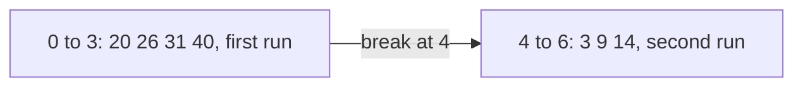
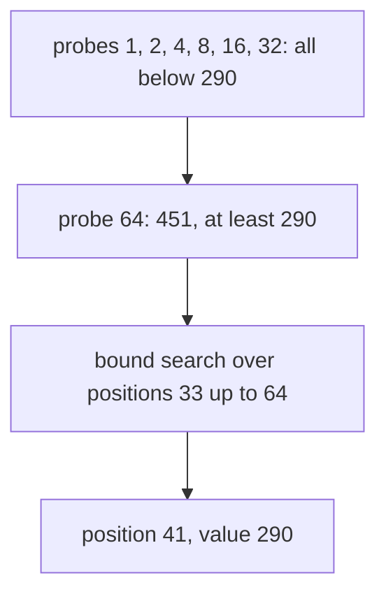

# Searching rotated and implicit structures

## The idea

Binary search never needed a sorted array. Looking back at [`first_true`](../lower-and-upper-bounds/guide.md#one-loop-for-every-boundary), it needs only two things:

1. A yes/no question about any position `i` that can be answered cheaply.
2. Answers that switch once across the positions: false, then true.

A sorted array supplies both with "is the value at `i` at least `x`?". Other structures supply them in other ways, and recognizing them is most of the work.

**Implicit arrays.** The values need not be stored in one array; it is enough to compute the value at a position when the search asks for it. A sorted sequence split into chunks of different sizes, a sorted file of fixed-size records reached by seeking to `i × size`, a sequence that can be read by position but whose length is unknown, the [candidate answers of a feasibility check](../binary-search-on-the-answer/guide.md): each is a sorted "array" behind a function from positions to values. Write that function, and search as usual.

**Structures that are not sorted but still switch once.** Take a sorted array of distinct values and move some elements from its front to its back, keeping their order: `3 9 14 20 26 31 40` becomes `20 26 31 40 3 9 14`. The result, a **rotated** sorted array, is not sorted, and "is the value at least 14?" now switches twice. But it is made of two increasing runs, and every value of the second run is smaller than every value of the first. So a different question, "is position `i` in the second run?", switches exactly once: no for the first run, yes for the second.



<!-- text-of-mermaid sha256:2ef18fe712dcd28decd075211b28cfac915f47afe9ccedf12937a2f1d0de30bc -->
```text
┌──────────────────────────────┐            ┌──────────────────────────┐
│0 to 3: 20 26 31 40, first run├break─at─4─►│4 to 6: 3 9 14, second run│
└──────────────────────────────┘            └──────────────────────────┘
```

The value at a position answers that question by itself, if you compare it with an element whose run you already know. Once the break is found, each run is a sorted array, and a [bound search](../lower-and-upper-bounds/guide.md) works on either one; some searches skip finding the break and decide, at each midpoint, which half of the interval is in order. Either way, the search is still a search for the boundary of a question that switches once.

The general method: before writing the loop, find a yes/no question about a position whose answer switches once, and say in words why it cannot switch back. If there is none, as in an arbitrary unsorted array, binary search does not apply and a scan is the right tool.

## A worked example

A sorted sequence of 300 codes can be read one position at a time, `read(i)`, but its length is not known: past the end, `read` returns nothing. Find the first code that is at least 290.

Without the length there is no `hi` to start from. **Galloping**, also called exponential search, finds one: probe positions 1, 2, 4, 8, ..., doubling each time, until a probe answers yes. A position past the end counts as yes, as if the sequence went on with values larger than everything; that keeps the question monotone. The last "no" and the first "yes" then bracket the answer, and a bound search finishes inside them.

The codes are 3, 10, 17, ..., 2096, seven apart, so the value at position `i` is `3 + 7i`:

| Probe | Value | At least 290? |
|-------|-------|---------------|
| 1 | 10 | no |
| 2 | 17 | no |
| 4 | 31 | no |
| 8 | 59 | no |
| 16 | 115 | no |
| 32 | 227 | no |
| 64 | 451 | yes: the answer is in `[33, 64]` |



<!-- text-of-mermaid sha256:36c4a1d437b1f3b50b7e749605f151d7e66e83067cd540e8a0c01f094044c368 -->
```text
┌────────────────────────────────────────┐
│probes 1, 2, 4, 8, 16, 32: all below 290│
└────────────────────┬───────────────────┘
                     ▼
┌────────────────────────────────────────┐
│      probe 64: 451, at least 290       │
└────────────────────┬───────────────────┘
                     ▼
┌────────────────────────────────────────┐
│bound search over positions 33 up to 64 │
└────────────────────┬───────────────────┘
                     ▼
┌────────────────────────────────────────┐
│         position 41, value 290         │
└────────────────────────────────────────┘
```

The bound search over `[33, 64)` reads positions 48 (339, yes), 40 (283, no), 44 (311, yes), 42 (297, yes) and 41 (290, yes), and ends at 41: 12 reads in all. Searching for 5000, larger than every code, the probes run past the end at 512, and the bound search over `[257, 512)` finds where the sequence stops: position 300, the length nobody gave.

The program runs both searches, then a chunked sequence, a rotated array and the case where a rotated array cannot be searched:

```python examples/implicit_search.py
"""Binary search without a sorted array in memory: a sequence of unknown length, a sorted sequence split
into chunks of different sizes, a rotated array, and why equal values defeat a rotated array."""

from bisect import bisect_left, bisect_right
from collections.abc import Callable
from itertools import accumulate


def first_true(lo: int, hi: int, is_true: Callable[[int], bool]) -> int:
    """The smallest i in [lo, hi) with is_true(i), or hi when there is none."""
    while lo < hi:
        mid = lo + (hi - lo) // 2
        if is_true(mid):
            hi = mid
        else:
            lo = mid + 1
    return lo


# 1. A sorted sequence read one position at a time, whose length is not known in advance.
class Reader:
    """read(i) returns the value at position i, or None past the end, and counts the reads."""

    def __init__(self, values: list[int]) -> None:
        self._values = values
        self.reads = 0

    def read(self, i: int) -> int | None:
        self.reads += 1
        return self._values[i] if i < len(self._values) else None


def first_at_least(reader: Reader, x: int) -> int:
    """The first position whose value is >= x, or the length if there is none. Past the end counts
    as true, as if the sequence went on with values larger than every x."""
    lo, probe = 0, 1
    while (value := reader.read(probe)) is not None and value < x:  # gallop: 1, 2, 4, 8, ...
        print(f"  probe {probe:3}: {value}, below {x}")
        lo, probe = probe + 1, probe * 2
    print(f"  probe {probe:3}: {value}, so the answer is in [{lo}, {probe}]")
    return first_true(lo, probe, lambda i: (v := reader.read(i)) is None or v >= x)


codes = list(range(3, 3 + 7 * 300, 7))  # 300 sorted values: 3, 10, 17, ...
for x in (290, 5000):
    reader = Reader(codes)
    print(f"first value >= {x}:")
    position = first_at_least(reader, x)
    agrees = position == bisect_left(codes, x)
    print(f"  -> position {position} after {reader.reads} reads; bisect_left agrees: {agrees}")

# 2. A sorted sequence split into chunks of different sizes, searched as if it were one array.
chunks = [[2, 3, 5], [7, 11, 13, 17, 19], [23], [29, 31, 37, 41]]
starts = [0, *accumulate(len(chunk) for chunk in chunks)][:-1]  # where each chunk begins: [0, 3, 8, 9]
total = sum(len(chunk) for chunk in chunks)


def element(i: int) -> int:
    chunk = bisect_right(starts, i) - 1  # the last chunk that starts at or before position i
    return chunks[chunk][i - starts[chunk]]


print("chunk starts:", starts, "| the virtual array:", [element(i) for i in range(total)])
i = first_true(0, total, lambda i: element(i) >= 20)
print("first value >= 20 is at virtual position", i, "and is", element(i))

# 3. A rotated sorted array: two increasing runs. "Is position i in the second run?" switches once.
ordered = [3, 9, 14, 20, 26, 31, 40]
moved = 3
rotated = ordered[moved:] + ordered[:moved]  # the first 3 values moved to the back
second_run = [i >= len(ordered) - moved for i in range(len(rotated))]  # known from how it was built
print("rotated:", rotated, "| in the second run:", " ".join("T" if t else "F" for t in second_run))

# 4. With equal values, the first, middle and last elements can look the same for different arrays.
for values in ([2, 2, 2, 0, 2], [2, 0, 2, 2, 2]):
    print(values, "first, middle, last:", values[0], values[len(values) // 2], values[-1], end=" ")
    print("| the smallest is at", values.index(min(values)))
```

It prints:

```output examples/implicit_search.py
first value >= 290:
  probe   1: 10, below 290
  probe   2: 17, below 290
  probe   4: 31, below 290
  probe   8: 59, below 290
  probe  16: 115, below 290
  probe  32: 227, below 290
  probe  64: 451, so the answer is in [33, 64]
  -> position 41 after 12 reads; bisect_left agrees: True
first value >= 5000:
  probe   1: 10, below 5000
  probe   2: 17, below 5000
  probe   4: 31, below 5000
  probe   8: 59, below 5000
  probe  16: 115, below 5000
  probe  32: 227, below 5000
  probe  64: 451, below 5000
  probe 128: 899, below 5000
  probe 256: 1795, below 5000
  probe 512: None, so the answer is in [257, 512]
  -> position 300 after 18 reads; bisect_left agrees: True
chunk starts: [0, 3, 8, 9] | the virtual array: [2, 3, 5, 7, 11, 13, 17, 19, 23, 29, 31, 37, 41]
first value >= 20 is at virtual position 8 and is 23
rotated: [20, 26, 31, 40, 3, 9, 14] | in the second run: F F F F T T T
[2, 2, 2, 0, 2] first, middle, last: 2 2 2 | the smallest is at 3
[2, 0, 2, 2, 2] first, middle, last: 2 2 2 | the smallest is at 1
```

Both gallops agree with `bisect_left` on the full list, which a reader of unknown length could not have called. The chunked sequence is the next section. The rotated array shows the question of the drawing above, computed here from how the array was built. The last two lines are two rotated arrays that look the same at the first, middle and last positions, with the smallest value in different places; the [complexity](#complexity) section explains why that matters.

## Values computed from their position

A sorted sequence of 13 primes is stored as four chunks of different sizes, `[2 3 5] [7 11 13 17 19] [23] [29 31 37 41]`. Searching it as one array needs a function from a position to its value:

1. Record where each chunk begins: positions 0, 3, 8 and 9, the running sums of the sizes.
2. The chunk holding position `i` is the last one that begins at or before `i`: an upper bound of `i` among the starts, minus one.
3. The value is that chunk's element at `i` minus the chunk's start.

Then `first_true` over positions 0 to 13 works as on any array: the first value of at least 20 is at position 8, the 23 alone in the third chunk. Each step of the search costs a small search of its own among the chunk starts. Searching the chunks first, by their last values, and then inside the one chunk that can hold the answer, does the same job with two plain searches.

The same pattern covers a sorted file of fixed-size records, where position `i` is a seek to byte `i × size`; a sequence produced by a formula, where position `i` is computed outright; and the galloping reader above, where position `i` is a call that may report the end.

## When to use it

- The data is sorted but not in one array in memory: chunks, pages, a file of records, a sequence computed on demand. Write the function from position to value.
- The length is unknown or unbounded: gallop to find an end, then search.
- The answer is probably near the start of a long sequence: gallop even when the length is known, since it costs about 2 log₂ p reads for an answer at position `p`, against log₂ n for a plain search.
- The data is not sorted, but some question about a position still switches once: a rotated sorted array, or any structure where one element tells you which side of a boundary it is on.

Use something else when no such question exists, as in an arbitrary unsorted array, and when a rotated array may hold many equal values: then a scan is as fast in the worst case.

## Common traps

- **Searching a rotated array as if it were sorted.** The usual comparison switches twice, and `first_true` returns a position with no meaning, without an error ([predicates that are not monotone](../binary-search-mistakes/guide.md#predicates-that-are-not-monotone)).
- **The rotation that moved nothing.** An array rotated by zero positions, or by its full length, is simply sorted, and its second run is empty: the question "in the second run?" is false everywhere, and the search returns the length. Handle that answer, and test it.
- **The end of an unknown sequence.** The question must treat "past the end" as yes; treating it as no, or reading past the end without checking, breaks the gallop.
- **Doubling past the type's limit.** In a fixed-width integer, doubling a probe can overflow; cap the probe at the largest position the structure can have.
- **Off-by-one in the position map.** The chunk holding `i` is the last start *at or before* `i`, an upper bound minus one; a lower bound there puts every chunk's first element in the previous chunk.
- **Equal values in a rotated array.** They can make the elements a search looks at identical for different arrays, and then no comparison tells it which way to go.

## Complexity

| Structure | Time | Space |
|-----------|------|-------|
| Sorted array, a bound search | O(log n) | O(1) |
| Unknown length, galloping then a bound search | O(log p) reads, for an answer at position `p` | O(1) |
| `c` chunks, searched through the position map | O(log n · log c) | O(c) for the starts |
| `c` chunks, chunk first, then inside it | O(log c + log m), for chunks of up to `m` values | O(c) |
| Rotated, distinct values | O(log n) | O(1) |
| Rotated, with equal values | O(n) in the worst case | O(1) |

**Galloping, precisely.** With the answer at position `p ≥ 1`, every probe before the first power of two that is at least `p` answers no, and that one answers yes. So there are exactly ⌈log₂ p⌉ + 1 probes. The last "no" was at half that power of two, so the bound search covers fewer than `p` positions, or exactly one when `p` is 1, and needs at most ⌊log₂ p⌋ + 1 more reads. The total, about 2 log₂ p, depends on where the answer is, not on the length. For the code 290, at position 41: 7 probes and 5 reads.

**Equal values in a rotated array.** Take a rotated array of five 2s with one 0 among them, such as `2 2 2 0 2` or `2 0 2 2 2`. Any position the search reads, other than the 0, shows a 2, the same value it would show in every other placement of the 0. So a search learns nothing from a 2, and in the worst case it reads every position before it finds the 0: O(n).

## Expert notes

- **Galloping in a standard library.** CPython's list sort merges runs of sorted values, and when one run keeps winning the comparisons, it switches to "galloping mode": it compares an element with positions 0, 1, 3, 7, ..., `2^j - 1` of the other run, then binary-searches the last gap, and copies the whole stretch at once. Its design notes, `Objects/listsort.txt`, say this finds the spot in no more than about 2 lg(B) comparisons, and that a straight binary search, which costs the same wherever the spot is, loses to it unless the run is quite long.
- **The question is what you search.** Every search of this path is `first_true` over some ordered domain: positions of an array, positions of an implicit array, candidate answers, positions of a rotated array. The domain must be ordered and the question monotone over it; the data itself need not be sorted, or stored, at all.
- **Searching on a function.** A function that only increases, read at whole numbers, is an implicit sorted array: its "elements" are its values. Searching it is what [binary search on the answer](../binary-search-on-the-answer/guide.md) does, with a feasibility check as the function.

## Practice

- `cstudy start search-2d-matrix`: whether a value occurs in a grid ordered like the lines of a book, in a number of steps logarithmic in the number of cells.
- `cstudy start min-in-rotated-array`: the smallest value of a sorted array that was rotated by an unknown amount.
- `cstudy start search-rotated-array`: where a value sits in a sorted array that was rotated by an unknown amount.
- `cstudy start find-peak-element`: a position whose value beats its neighbours, in an array that is not sorted at all, in logarithmic time.
- `cstudy start median-of-two-sorted-arrays`: the median of two sorted arrays together, in a number of steps logarithmic in the shorter one.

## Further reading

- [CPython `Objects/listsort.txt`](https://github.com/python/cpython/blob/main/Objects/listsort.txt): galloping while merging, probing offsets 1, 3, 7, 15, ..., and why it beats a straight binary search when the spot is near the start.
- [Python `bisect`](https://docs.python.org/3/library/bisect.html): `bisect_right`, used for the chunk holding a position.
- [Python `itertools.accumulate`](https://docs.python.org/3/library/itertools.html#itertools.accumulate): running sums, used for the chunk starts.
