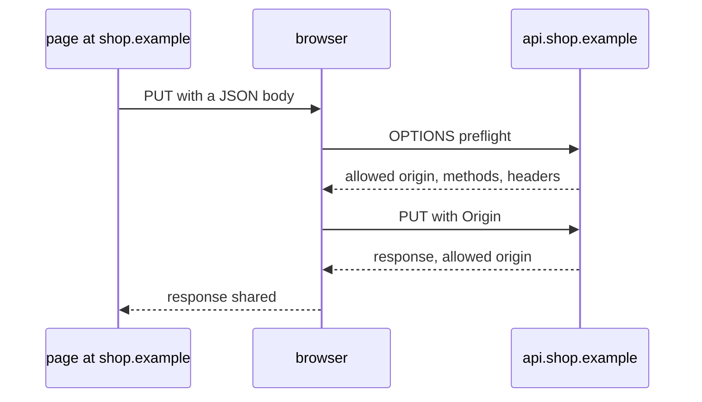

# Same-origin policy and CORS

## The idea

Your browser holds many sites' secrets at once. It is signed in to your mail and your bank, and it attaches each site's cookies to requests for that site. At the same time it runs scripts from every page you open, including pages from sites you have never heard of. Something has to keep a script from one site out of the data of another.

That something is the **origin**. RFC 6454 defines the origin of a URL as three parts, its **scheme**, **host** and **port**, and says two URLs are of the same origin only when all three are equal:

| URL | Same origin as `https://shop.example/cart`? | Why |
|-----|---------------------------------------------|-----|
| `https://shop.example/orders?id=7` | Yes | The path and the query are not part of the origin |
| `https://shop.example:443/` | Yes | 443 is the default port of `https`, so it is the same port |
| `http://shop.example/` | No | Another scheme |
| `https://shop.example:8443/` | No | Another port |
| `https://api.shop.example/` | No | Another host, even though it ends with the same name |

An origin is written, or **serialized**, as `scheme://host`, with `:port` added only when the port is not the scheme's default. Some pages have no such origin: a page from a `data:` URL, or a frame sandboxed by its parent. RFC 6454 gives a URL that names no host a fresh, unique identifier instead, and the HTML Standard calls these **opaque** origins and serializes every one of them as the word `null`. The HTML Standard sums up what an origin is for: two actors that share an origin are assumed to trust each other and to have the same authority.

The **same-origin policy** is the rule the browser builds on it. In RFC 6454's words, reading information from another origin is generally forbidden, and sending information to another origin is permitted. A page from `https://news.example` may make your browser send a request to `https://bank.example`, with the bank's cookies unless they are marked to stay behind on cross-site requests, but its script may not read the answer. If it could, any site you visit could read your bank balance through your own browser.

That the policy allows sending has a consequence of its own. A hostile page can make your browser submit a form to your bank, with your cookies, even though it never sees the response. That attack is **cross-site request forgery** (CSRF), and the same-origin policy does not stop it. The OWASP Cross-Site Request Forgery Prevention Cheat Sheet points out that a plain form submission is a request browsers send to any origin, and recommends tokens tied to the session or checks of headers the browser sets, with the `SameSite` cookie attribute as defense in depth.

Sometimes a server *wants* another origin to read its answers: an API at `https://api.shop.example` serves the shop's front end at `https://shop.example`. **Cross-Origin Resource Sharing** (CORS), defined in the WHATWG Fetch Standard, is how it says so. The browser adds an `Origin` header to a cross-origin request, naming the page's origin, and the server answers with headers that say who may read the response. The browser compares them and only then hands the response to the page. The server decides and the browser enforces. The standard explains why sharing must be something a server opts into: otherwise data in responses behind a firewall, on an intranet, would leak to any page.

The response headers of CORS:

| Header | Meaning |
|--------|---------|
| `Access-Control-Allow-Origin` | The origin that may read the response, written exactly as the browser sent it in `Origin`, or `*` for any origin |
| `Access-Control-Allow-Credentials` | `true` when the response may be shared with a request that carried cookies or HTTP authentication |
| `Access-Control-Allow-Methods` | The methods allowed, in the answer to a preflight |
| `Access-Control-Allow-Headers` | The request headers allowed, in the answer to a preflight |
| `Access-Control-Max-Age` | How many seconds the browser may cache the answer to a preflight, 5 by default |
| `Access-Control-Expose-Headers` | Which response headers the page may read |

A **preflight** protects servers that never heard of CORS. A request that a plain HTML form could also send goes out at once: a method that Fetch calls **CORS-safelisted**, `GET`, `HEAD` or `POST`, with only safelisted request headers, `Accept`, `Accept-Language`, `Content-Language`, `Content-Type` and `Range`, each with a value of at most 128 bytes, and a `Content-Type` of `application/x-www-form-urlencoded`, `multipart/form-data` or `text/plain`. Anything else, a `PUT`, a `DELETE`, a JSON body or an `Authorization` header, might change data on a server that is not ready for it. So the browser first sends an `OPTIONS` request carrying `Origin`, the method it wants in `Access-Control-Request-Method` and the extra header names in `Access-Control-Request-Headers`, and sends the real request only if the answer allows all of it.

**Credentials** change the rules. When a request carries cookies, Fetch's CORS check requires `Access-Control-Allow-Origin` to name the page's origin exactly, not `*`, and requires `Access-Control-Allow-Credentials: true`. The `*` in `Access-Control-Allow-Methods` and `Access-Control-Allow-Headers` counts as a wildcard only for requests without credentials, and it never covers `Authorization`, which Fetch singles out as the one header name a wildcard does not match. The standard itself remarks that sharing responses and allowing requests with credentials together is rather unsafe, and that a preflight never includes credentials.

## A worked example

The program below is the browser's side: Fetch's CORS check, which decides whether a page may read a response. It is run against four servers, each answering with the headers its policy gives for the request's `Origin`, for pages from four origins, with and without cookies.

```python examples/cors_check.py
"""The browser's side of CORS, run against four ways a server might answer.

The check follows the Fetch standard's CORS check: the browser shares a response with the page
only when Access-Control-Allow-Origin allows the page's origin, and, for a request that carried
cookies, only when the response also says Access-Control-Allow-Credentials: true.
"""


def browser_shares(page_origin: str, with_cookies: bool, headers: dict) -> bool:
    allowed = headers.get("Access-Control-Allow-Origin")
    if allowed is None:
        return False
    if not with_cookies and allowed == "*":
        return True
    if allowed != page_origin:
        return False
    if not with_cookies:
        return True
    return headers.get("Access-Control-Allow-Credentials") == "true"


def wildcard(origin: str) -> dict:
    return {"Access-Control-Allow-Origin": "*", "Access-Control-Allow-Credentials": "true"}


def echo_any(origin: str) -> dict:
    return {"Access-Control-Allow-Origin": origin, "Access-Control-Allow-Credentials": "true"}


def ends_with(origin: str) -> dict:
    return echo_any(origin) if origin.endswith("bank.example") else {}


def exact_set(origin: str) -> dict:
    return echo_any(origin) if origin in {"https://app.bank.example"} else {}


pages = {
    "own": "https://app.bank.example",
    "evil": "https://evil.example",
    "look-alike": "https://notbank.example",
    "opaque": "null",
}
for label, origin in pages.items():
    print(f"{label:10} = {origin}")
print()
print("server     cookies  " + "".join(f"{label:12}" for label in pages).rstrip())
for server in (wildcard, echo_any, ends_with, exact_set):
    for with_cookies in (False, True):
        row = f"{server.__name__:10} {'yes' if with_cookies else 'no':8} "
        for origin in pages.values():
            row += f"{'reads' if browser_shares(origin, with_cookies, server(origin)) else '-':12}"
        print(row.rstrip())
```

It prints:

```output examples/cors_check.py
own        = https://app.bank.example
evil       = https://evil.example
look-alike = https://notbank.example
opaque     = null

server     cookies  own         evil        look-alike  opaque
wildcard   no       reads       reads       reads       reads
wildcard   yes      -           -           -           -
echo_any   no       reads       reads       reads       reads
echo_any   yes      reads       reads       reads       reads
ends_with  no       reads       -           reads       -
ends_with  yes      reads       -           reads       -
exact_set  no       reads       -           -           -
exact_set  yes      reads       -           -           -
```

Server by server:

- **`wildcard`** answers `*` for everyone. Without cookies every page reads the response, which is right for public data. With cookies nobody does, not even the shop's own front end: the browser refuses `*` next to credentials, and the `Allow-Credentials: true` this server adds does not change that.
- **`echo_any`** copies the request's `Origin` into its answer and adds `Allow-Credentials: true`, which is the usual "fix" for the previous server. Now every page, the attacker's and an opaque `null` one included, reads every user's private responses with their cookies. This is the most damaging way to get CORS wrong.
- **`ends_with`** trusts any origin that ends with `bank.example`. That includes `https://notbank.example`, which anyone can register: a suffix test does not respect the dots between labels.
- **`exact_set`** compares the `Origin` with a set of serialized origins, character for character, and only the shop's front end gets through.



<!-- text-of-mermaid sha256:1a99d94d574905abb46f291e9783797400fde9d563fbb1eda303677e0bfa8c8e -->
```text
┌──────────────────────┐         ┌─────────┐                      ┌──────────────────┐
│ page at shop.example │         │ browser │                      │ api.shop.example │
└───────────┬──────────┘         └────┬────┘                      └─────────┬────────┘
            │                         │                                     │
            │  PUT with a JSON body   │                                     │
            │─────────────────────────▶                                     │
            │                         │                                     │
            │                         │          OPTIONS preflight          │
            │                         │─────────────────────────────────────▶
            │                         │                                     │
            │                         │  allowed origin, methods, headers   │
            │                         ◀╌╌╌╌╌╌╌╌╌╌╌╌╌╌╌╌╌╌╌╌╌╌╌╌╌╌╌╌╌╌╌╌╌╌╌╌╌│
            │                         │                                     │
            │                         │           PUT with Origin           │
            │                         │─────────────────────────────────────▶
            │                         │                                     │
            │                         │      response, allowed origin       │
            │                         ◀╌╌╌╌╌╌╌╌╌╌╌╌╌╌╌╌╌╌╌╌╌╌╌╌╌╌╌╌╌╌╌╌╌╌╌╌╌│
            │                         │                                     │
            │     response shared     │                                     │
            ◀╌╌╌╌╌╌╌╌╌╌╌╌╌╌╌╌╌╌╌╌╌╌╌╌╌│                                     │
            │                         │                                     │
┌───────────┴──────────┐         ┌────┴────┐                      ┌─────────┴────────┐
│ page at shop.example │         │ browser │                      │ api.shop.example │
└──────────────────────┘         └─────────┘                      └──────────────────┘
```

The diagram shows a request that needs a preflight. The page asks for a `PUT` with JSON; the browser asks permission with `OPTIONS` first, and sends the `PUT` only after the API's answer allows the origin, the method and the headers. The response to the `PUT` must allow the origin again before the page sees it.

## When to use it

- **A browser page on one origin must read responses from another**: a front end and its API on different hosts, a widget embedded on customers' sites. Same-origin requests need no CORS at all.
- **Public data without cookies** can use `*`. The OWASP HTML5 Security Cheat Sheet asks that responses with `Access-Control-Allow-Origin: *` hold nothing sensitive, and that the header be used only on the URLs that need it.
- **Private data with cookies** needs an exact list of trusted origins, each answered by name with `Access-Control-Allow-Credentials: true`. The same cheat sheet warns against reflecting the `Origin` header without checks.
- **Not for server-to-server calls.** CORS is enforced by browsers; any other client ignores it, and can send any `Origin` it likes. The cheat sheet warns not to rely on the `Origin` header alone for access control.
- **Not as access control or CSRF protection.** CORS only decides whether a browser hands a response to a page. Requests that need no preflight still arrive, so the server still authenticates and authorizes every request.
- **Often not at all**: serving the front end and its API from the same origin removes the question.

## Common traps

- **Echoing `Origin` with credentials.** It turns the policy into "every site may read every user's data", as `echo_any` shows.
- **Matching with `endswith`, `startswith` or an unanchored regular expression.** `notbank.example` ends with `bank.example`, and `https://bank.example.attacker.test` starts with `https://bank.example`. Compare whole serialized origins.
- **Allowing `null`.** Every opaque origin is `null`, and anyone can create one, with a sandboxed frame or a `data:` URL. Allowing `null` allows everyone.
- **`*` plus credentials.** The browser refuses it, and the tempting fix is the echo above.
- **Forgetting `Vary: Origin`.** A response chosen by the `Origin` header can be cached and served to a request from another origin. The Fetch Standard's note on CORS and HTTP caches asks for `Vary: Origin` whenever the answer is more complicated than `*` or one fixed origin, and for no `Vary` when the header is the same for everyone.
- **Counting on the preflight to protect state changes.** A `POST` from a form needs no preflight; it arrives with cookies, whatever your CORS policy says. That is CSRF's territory.
- **Normalizing the request's `Origin` before comparing.** A browser sends a serialized origin; lowercasing, trimming or parsing it only creates matches the browser never asked for.

## Complexity

| Step | Cost |
|------|------|
| Deciding an origin with a set of serialized origins | O(1) on average per request, with the origin's length for hashing |
| Deciding it with a list of patterns | O(p) pattern matches for `p` patterns, each linear in the origin's length when the patterns are anchored and simple |
| A preflight | One more round trip before the real request, saved for `Access-Control-Max-Age` seconds by the browser's preflight cache |
| `Vary: Origin` | One cached copy per origin instead of one per URL, in every cache along the way |

The preflight is the cost people notice. Fetch keys its preflight cache by the page's origin, the URL and whether credentials were used, among other things, so each new combination pays the round trip again until its entry expires.

## Expert notes

- **The check, byte for byte.** Fetch's CORS check reads `Access-Control-Allow-Origin`, fails if it is absent, succeeds on `*` only for a request without credentials, fails unless the value equals the serialization of the request's origin, and, for a request with credentials, requires `Access-Control-Allow-Credentials` to be `true`. The value `true` is compared case-sensitively.
- **Unsafe header bytes.** A safelisted header is not safelisted when its value holds a **CORS-unsafe request-header byte**: control characters other than tab, DEL, and characters such as `"`, `(`, `)`, `:`, `<`, `>`, `?`, `@`, `[`, `\`, `]`, `{` and `}`. Safelisted values that add up to more than 1024 bytes are treated as unsafe as well.
- **Same site is not same origin.** The HTML Standard defines a **site** as an opaque origin or a scheme and host, and lists `https://example.com` and `https://sub.example.com` as same site, although they are different origins. The `SameSite` cookie attribute is about cross-site requests, so a subdomain that hosts other people's content counts as your own site.
- **Why `null` exists.** RFC 6454 has the browser send `Origin: null` from a privacy-sensitive context, and the HTML Standard's sandboxing forces a frame without `allow-same-origin` into an opaque origin.
- **Preflights are not credentialed.** A server sees no cookies in a preflight, yet the browser runs the CORS check on the preflight's answer with the credentials mode of the real request that follows, as a note in Fetch's CORS-preflight fetch explains. So when the real request will carry cookies, the preflight answer must already name the origin and allow credentials.
- **CORS is not a data-flow control.** The OWASP HTML5 cheat sheet notes that CORS does not keep the requested data from going to an unauthorized place; once a page may read a response, what it does with it is up to the page.
- **A script injected into your page is your origin.** Cross-site scripting bypasses the whole policy, since the attacker's script runs with your page's origin; see the guide on output encoding.

## Practice

- `cstudy start cors-policy-evaluator`: build a server's sharing policy level by level: serialize origins, answer preflights, combine credentials with the wildcard, then patterns, the `null` origin and a linter for risky settings.

## Further reading

- [RFC 6454, The Web Origin Concept](https://www.rfc-editor.org/rfc/rfc6454): the origin of a URL, comparison, serialization, the `Origin` header and `null`, and the same-origin policy's rules for reading and sending.
- [Fetch Standard, 3.3 CORS protocol](https://fetch.spec.whatwg.org/#http-cors-protocol), [4.10 CORS check](https://fetch.spec.whatwg.org/#cors-check) and [CORS protocol and HTTP caches](https://fetch.spec.whatwg.org/#cors-protocol-and-http-caches): the headers, credentials and wildcards, preflights, safelisted methods and headers, and `Vary`.
- [HTML Standard, origins and sites](https://html.spec.whatwg.org/multipage/browsers.html#origin): tuple and opaque origins, serialization, same site, and sandboxing.
- [OWASP Cross-Site Request Forgery Prevention Cheat Sheet](https://cheatsheetseries.owasp.org/cheatsheets/Cross-Site_Request_Forgery_Prevention_Cheat_Sheet.html): why simple requests carry CSRF risk, tokens, header checks and `SameSite`.
- [OWASP HTML5 Security Cheat Sheet, Cross Origin Resource Sharing](https://cheatsheetseries.owasp.org/cheatsheets/HTML5_Security_Cheat_Sheet.html#cross-origin-resource-sharing): trusted origins only, `*` only on public data, no blind reflection, and access control on every request.
