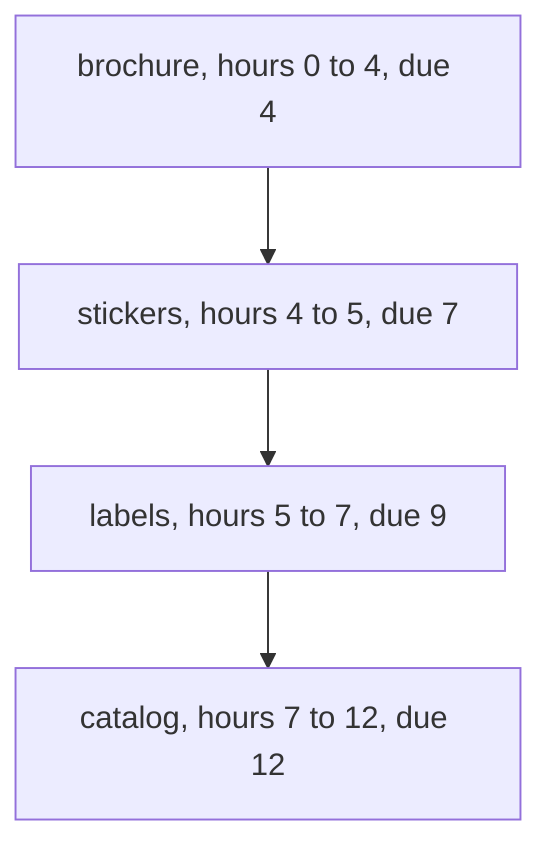
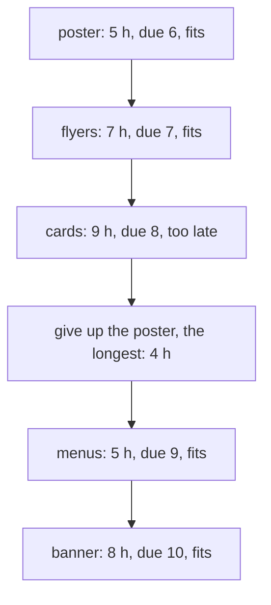

# Scheduling with deadlines

## The idea

One machine, a printing press, a processor core or a person, runs jobs one at a time, each from start to finish without interruption. Job `j` takes `p` hours and is **due** at hour `d`, counted from when work starts. If it finishes at hour `C`, its **lateness** is `C - d`: negative when it is early, zero when it finishes exactly on time, positive when it is late.

Three questions come up again and again:

1. **Can every job be on time?**
2. If not, **how small can the worst lateness be?**
3. **How many jobs can be on time?**

The first two have one answer: run the jobs in order of deadline, **earliest deadline first**. The third needs one more idea, because a job that looked fine when you took it can later be the one to give up. A heap keeps the jobs taken so far, so the longest of them is always at hand.

Two assumptions hold throughout. Every job is available from the start; jobs that arrive over time change the problem, as the expert notes say. And the machine never sits idle while a job is waiting, since idling only pushes every later job later.

## A worked example

A print shop's press has four jobs, each with its hours of printing and the hour it was promised by.

| Job | Hours | Due at hour |
|-----|-------|-------------|
| brochure | 4 | 4 |
| stickers | 1 | 7 |
| catalog | 5 | 12 |
| labels | 2 | 9 |

Shortest first, the rule that minimizes total waiting in the [greedy choices guide](../greedy-choices/guide.md), runs stickers, labels, brochure and catalog, and the brochure, due at hour 4, comes off the press at hour 7. Earliest deadline first runs the brochure first and meets every promise.



<!-- text-of-mermaid sha256:ba205dca4ccdd4862ade096a237e11f1a9c63712e4af836d8a42cb9f60a49f6c -->
```text
┌──────────────────────────────┐
│brochure, hours 0 to 4, due 4 │
└───────────────┬──────────────┘
                ▼
┌──────────────────────────────┐
│stickers, hours 4 to 5, due 7 │
└───────────────┬──────────────┘
                ▼
┌──────────────────────────────┐
│ labels, hours 5 to 7, due 9  │
└───────────────┬──────────────┘
                ▼
┌──────────────────────────────┐
│catalog, hours 7 to 12, due 12│
└──────────────────────────────┘
```

The program prints each job's lateness under both rules, for these four jobs and for an overbooked day of five jobs that cannot all be on time, and compares the worst lateness with the best of every possible order.

```python examples/deadlines.py
"""A print shop has one press. Each job takes some hours and is promised by an hour of the day,
counted from opening. Earliest deadline first keeps the worst lateness as small as it can be."""

from itertools import permutations
from typing import NamedTuple


class Job(NamedTuple):
    name: str
    hours: int
    due: int


def lateness(order: list[Job]) -> list[int]:
    """How late each job finishes, in the order run: negative means early."""
    clock, late = 0, []
    for job in order:
        clock += job.hours
        late.append(clock - job.due)
    return late


def worst(order: list[Job]) -> int:
    return max(lateness(order))


def best_worst_of_every_order(jobs: list[Job]) -> int:
    return min(worst(list(order)) for order in permutations(jobs))


def show(order: list[Job]) -> str:
    pairs = zip(order, lateness(order), strict=True)
    return ", ".join(f"{job.name} {late:+d}" for job, late in pairs)


ALL_FIT = [Job("brochure", 4, 4), Job("stickers", 1, 7), Job("catalog", 5, 12), Job("labels", 2, 9)]
OVERBOOKED = [
    Job("poster", 5, 6),
    Job("flyers", 2, 7),
    Job("cards", 2, 8),
    Job("menus", 1, 9),
    Job("banner", 3, 10),
]

for jobs in (ALL_FIT, OVERBOOKED):
    shortest = sorted(jobs, key=lambda job: job.hours)
    earliest_due = sorted(jobs, key=lambda job: job.due)
    print(f"shortest first:  {show(shortest)}; worst {worst(shortest):+d}")
    print(f"earliest due:    {show(earliest_due)}; worst {worst(earliest_due):+d}")
    print(f"best of every order: worst {best_worst_of_every_order(jobs):+d}")
```

It prints:

```output examples/deadlines.py
shortest first:  stickers -6, labels -6, brochure +3, catalog +0; worst +3
earliest due:    brochure +0, stickers -2, labels -2, catalog +0; worst +0
best of every order: worst +0
shortest first:  menus -8, flyers -4, cards -3, banner -2, poster +7; worst +7
earliest due:    poster -1, flyers +0, cards +1, menus +1, banner +3; worst +3
best of every order: worst +3
```

On the first day, earliest deadline first has no late job, and shortest first is 3 hours late. On the overbooked day no order finishes every job on time, and the best any order can do is a worst lateness of 3 hours. Earliest deadline first achieves exactly that; shortest first leaves the poster 7 hours late.

### Why earliest deadline first is best

The proof is an exchange argument, the same shape as in the [greedy choices guide](../greedy-choices/guide.md). Call a pair of neighboring jobs an **inversion** when the first is due later than the second.

**Swapping an inversion never makes the worst lateness larger.** Say job `x` runs right before job `y`, `x` is due at `dx`, `y` at `dy`, and `dx > dy`. Let the pair finish at hour `C`.

- Before the swap, `y` finishes at `C`, so it is `C - dy` late.
- After the swap, `x` finishes at `C` and is `C - dx` late, which is less than `C - dy` because `dx > dy`. And `y` now finishes before `C`, so it is less than `C - dy` late.
- Every other job runs at the same hours as before, since the pair still occupies the same block.

So after the swap, both jobs of the pair are less late than `y` was before it, and the worst lateness of the whole order cannot have grown.

**Swaps lead to the earliest-deadline order.** Each swap of an inversion fixes the relative order of exactly one pair of jobs and changes no other pair, so the number of pairs out of deadline order drops by one. An order with no inversions between neighbors is sorted by deadline. So start from a best order, swap inversions until none is left, and you hold an earliest-deadline order whose worst lateness is no larger than the best: it is a best order too.

**Ties do not matter.** Two neighbors due at the same hour `d`: whichever runs second finishes at the pair's end `C` and is `C - d` late, and the other finishes earlier. The worst of the pair is `C - d` in either order, so every earliest-deadline order has the same worst lateness.

The first question follows: every job can be on time exactly when the earliest-deadline order has a worst lateness of zero or less. If any order meets every deadline, its worst lateness is at most zero, and earliest deadline first does at least as well.

## Keeping the most jobs on time

On the overbooked day, earliest deadline first has three late jobs: cards, menus and the banner. Minimizing the worst lateness is not the same as minimizing how many jobs are late. Can more jobs be on time?

Only the choice of **which** jobs to keep matters. Once a set of jobs is chosen to be on time, they can run first, in deadline order, which meets all their deadlines if any order does, and the late jobs run after them in any order. So the question is: what is the largest set of jobs that earliest deadline first finishes on time?

The greedy rule takes the jobs by deadline and keeps a **plan**, the jobs it means to finish on time:

1. Take the next job by deadline into the plan.
2. If the plan's total hours now pass this job's deadline, give up the **longest** job in the plan, which may be the one just taken.

A **max-heap** of the plan's hours finds the longest job in O(log n) and removes it, as the trees and heaps guides explain. Python's `heapq` is a min-heap, so the example pushes `-hours`, with an arrival counter that breaks ties between equal hours.

```python examples/most_on_time.py
"""The press is overbooked, so some jobs will be late. Keep as many on time as possible: take the
jobs by deadline, and whenever the kept jobs no longer fit, give up the longest of them. A max-heap
of the kept jobs' hours finds the longest one in O(log n)."""

import heapq
from collections.abc import Iterable
from itertools import combinations, count, product
from typing import NamedTuple


class Job(NamedTuple):
    name: str
    hours: int
    due: int


def by_due(jobs: Iterable[Job]) -> list[Job]:
    return sorted(jobs, key=lambda job: job.due)


def all_on_time(jobs: Iterable[Job]) -> bool:
    clock = 0
    for job in by_due(jobs):
        clock += job.hours
        if clock > job.due:
            return False
    return True


class OnTimePlan:
    """The most jobs that can be on time among those taken so far, taken in deadline order."""

    def __init__(self) -> None:
        self._kept: list[tuple[int, int, Job]] = []  # (-hours, arrival, job): heapq is a min-heap
        self._arrivals = count()
        self.hours = 0

    def take(self, job: Job) -> Job | None:
        """Take the next job by deadline; return the job given up to keep the rest on time."""
        heapq.heappush(self._kept, (-job.hours, next(self._arrivals), job))
        self.hours += job.hours
        if self.hours <= job.due:
            return None
        _, _, longest = heapq.heappop(self._kept)
        self.hours -= longest.hours
        return longest

    def jobs(self) -> list[Job]:
        return by_due(job for _, _, job in self._kept)


def most_on_time(jobs: list[Job]) -> list[Job]:
    plan = OnTimePlan()
    for job in by_due(jobs):
        plan.take(job)
    return plan.jobs()


def never_give_up(jobs: list[Job]) -> list[Job]:
    """By deadline, keep each job that still fits, and never give one up."""
    kept: list[Job] = []
    for job in by_due(jobs):
        if sum(other.hours for other in kept) + job.hours <= job.due:
            kept.append(job)
    return kept


def most_by_brute_force(jobs: list[Job]) -> int:
    return max(
        size
        for size in range(len(jobs) + 1)
        for chosen in combinations(jobs, size)
        if all_on_time(chosen)
    )


jobs = [
    Job("poster", 5, 6),
    Job("flyers", 2, 7),
    Job("cards", 2, 8),
    Job("menus", 1, 9),
    Job("banner", 3, 10),
]
plan = OnTimePlan()
for job in by_due(jobs):
    given_up = plan.take(job)
    if given_up is None:
        print(f"take {job.name:<6} -> {plan.hours:>2} h, due {job.due:>2}: fits")
        continue
    before = plan.hours + given_up.hours
    print(f"take {job.name:<6} -> {before:>2} h, due {job.due:>2}: give up {given_up.name}", end="")
    print(f", {given_up.hours} h, leaving {plan.hours} h")
print("on time:", [job.name for job in plan.jobs()], "| all on time:", all_on_time(plan.jobs()))
print("never giving up a job keeps", [job.name for job in never_give_up(jobs)])
print("most of any set:", most_by_brute_force(jobs))

small = [
    [Job(str(i), hours, due) for i, (hours, due) in enumerate(zip(hours_list, dues, strict=True))]
    for hours_list in product((1, 2, 3), repeat=4)
    for dues in product((2, 4, 6), repeat=4)
]
wrong = sum(len(most_on_time(jobs)) != most_by_brute_force(jobs) for jobs in small)
print(f"{len(small)} inputs of 4 jobs: the heap rule falls short on {wrong}")
```

It prints:

```output examples/most_on_time.py
take poster ->  5 h, due  6: fits
take flyers ->  7 h, due  7: fits
take cards  ->  9 h, due  8: give up poster, 5 h, leaving 4 h
take menus  ->  5 h, due  9: fits
take banner ->  8 h, due 10: fits
on time: ['flyers', 'cards', 'menus', 'banner'] | all on time: True
never giving up a job keeps ['poster', 'flyers', 'menus']
most of any set: 4
6561 inputs of 4 jobs: the heap rule falls short on 0
```



<!-- text-of-mermaid sha256:ac5cb5458331bdd80c07f1597667ba7cca7f56f85cb6f6c335f8aea4336fbc2e -->
```text
┌────────────────────────────────────┐
│      poster: 5 h, due 6, fits      │
└──────────────────┬─────────────────┘
                   ▼
┌────────────────────────────────────┐
│      flyers: 7 h, due 7, fits      │
└──────────────────┬─────────────────┘
                   ▼
┌────────────────────────────────────┐
│    cards: 9 h, due 8, too late     │
└──────────────────┬─────────────────┘
                   ▼
┌────────────────────────────────────┐
│give up the poster, the longest: 4 h│
└──────────────────┬─────────────────┘
                   ▼
┌────────────────────────────────────┐
│      menus: 5 h, due 9, fits       │
└──────────────────┬─────────────────┘
                   ▼
┌────────────────────────────────────┐
│     banner: 8 h, due 10, fits      │
└────────────────────────────────────┘
```

When the cards arrive, the plan holds 9 hours of work due by hour 8. Giving up the cards would be the obvious move, but the poster is the longest job, and giving it up frees 5 hours instead of 2. The plan ends with four jobs on time, the most of any set, while the rule that never gives up a job it took, and so drops each job that does not fit when it arrives, keeps three. The last line checks the rule against brute force on 6,561 small inputs.

### Why giving up the longest job is safe

Number the jobs in deadline order. Two facts about a set of jobs that can all be on time, a **feasible** set, carry the proof:

- **A part of a feasible set is feasible.** Removing a job only makes the jobs after it finish earlier.
- **Adding the next job by deadline.** If a set of earlier jobs is feasible and takes `T` hours, adding the next job `j` keeps it feasible exactly when `T + p ≤ d`, for `j`'s `p` and `d`. Its deadline is the latest so far, so it can run last, and it finishes at `T + p`.

The plan keeps three promises after every job it takes, about the jobs taken so far:

1. **It is feasible.**
2. **It is as large as any feasible set** of those jobs.
3. **Its shortest jobs are as short as can be.** For every `r` up to its size, the plan's `r` shortest jobs take no more hours than any feasible set of `r` of those jobs.

They hold before the first job, for the empty plan. Now take job `j`, with `p` hours, due at `d`, into a plan of `m` jobs and `T` hours that keeps the promises.

**If `T + p ≤ d`, the plan keeps `j`.**

1. The new plan is feasible, by the second fact.
2. A feasible set with more than `m + 1` jobs would leave, without `j`, a feasible set of the earlier jobs larger than `m`, which promise 2 rules out.
3. Take any feasible set `F` of `r` jobs. If `F` leaves out `j`, it has at most `m` jobs, so by promise 3 it takes at least the `r` shortest of the old plan, which is at least the `r` shortest of the new one. If `F` holds `j`, the rest of `F` is a feasible set of `r - 1` earlier jobs, so `F` takes at least `p` plus the `r - 1` shortest of the old plan, which is the total of `r` jobs of the new plan, so at least its `r` shortest. Those `r` shortest are part of a feasible set, so they are feasible, and nothing feasible does better.

**If `T + p > d`, the plan gives up its longest job `q`**, possibly `j` itself, and keeps `m` jobs.

1. **Still feasible.** If `q` is `j`, the plan is unchanged. Otherwise `q` takes at least `p` hours. The old plan without `q` is feasible, and takes `T - (q's hours) + p ≤ T` hours with `j` added. The old plan was feasible, so its last job finished at `T` on time, and `j` is due no earlier, so `T ≤ d`: by the second fact, the new plan is feasible.
2. **No feasible set has `m + 1` jobs.** Such a set without `j` would contradict promise 2. With `j`, the rest of it is a feasible set of `m` earlier jobs, so by promise 3 it takes at least the `m` shortest of the old plan, that is, all `T` hours of it. Adding `j` then needs `T + p > d` hours by `j`'s deadline, so the set is not feasible after all.
3. **Shortest jobs.** For `r` up to `m`, the new plan's `r` shortest jobs are the `r` shortest of the old plan with `j` added, since only a longest one was removed. The bound for any feasible set of `r` jobs is the same as in the first case.

After the last job, promises 1 and 2 say that the plan is a largest set of jobs that can all be on time. Promise 3 is what makes the rest work: it is why giving up the longest job, and not the newest, never costs a job later.

## When to use it

- **One resource, jobs with durations and deadlines, all available now.** Whether all fit and the smallest worst lateness: earliest deadline first. The most jobs on time: deadline order with a heap of the plan.
- **"Minimize the total waiting"** is a different objective: shortest first, or minutes per unit of weight, from the [greedy choices guide](../greedy-choices/guide.md).
- **A choice you may need to take back.** Whenever a greedy rule takes items in one order but may later need to drop the worst of those it holds, keep what it holds in a heap ordered by what makes an item the worst.
- **Jobs that arrive over time, several machines, or weights on the late jobs** change the problem, and several such versions have no fast exact algorithm; see the expert notes before reaching for a sort.

## Common traps

- **Sorting by length when the question is about deadlines.** Shortest first leaves the brochure 3 hours late on a day where every job can be on time.
- **Expecting earliest deadline first to minimize the number of late jobs.** On the overbooked day it is as good as possible on the worst lateness and still has three late jobs, where one is enough.
- **Giving up the newest job instead of the longest.** Never giving up a job already taken keeps three jobs on the overbooked day; giving up the longest keeps four.
- **A max-heap in a min-heap library.** Python's `heapq` keeps the smallest item at `heap[0]`; push `-hours` to get the largest. If two entries can tie on the first element, add a counter as the second, or Python compares the third elements, which may not be comparable at all.
- **"Due at hour 8" is ambiguous.** Here finishing at hour 8 is on time, so the test is `≤`. Check what a statement means by a deadline before writing the comparison.

## Complexity

| Algorithm | Time | Space |
|-----------|------|-------|
| Earliest deadline first | O(n log n) for the sort, O(n) to run it | O(n) |
| The plan with a heap | O(n log n): the sort, n pushes and at most n pops, each O(log n) | O(n) |
| Brute force, every order | O(n! · n) | O(n) |
| Brute force, every set | O(2^n · n log n) | O(n) |

## Expert notes

- **Where the rules come from.** *Elements of Scheduling*, the book on machine scheduling collected by Jan Karel Lenstra and David Shmoys, credits earliest deadline first to J. R. Jackson, in a 1955 report, as Jackson's EDD (earliest due date) rule: if any order completes every job on time, the deadline order does, and it minimizes the maximum lateness either way. Its proof there is the interchange of neighboring jobs used above. The plan with the heap is the Moore–Hodgson algorithm: J. M. Moore published a related method in 1968 and credited this simpler form to his colleague Hodgson. The book states it with a priority queue supporting insert and delete-max, in O(n log n) time.
- **Arrivals change everything.** When jobs have release times and cannot be interrupted, minimizing the maximum lateness is strongly NP-hard. If a running job may be interrupted, a preemptive version of earliest deadline first, which always runs the available job with the earliest deadline, solves it again.
- **Weights break the heap rule.** If each job has a weight and the goal is the smallest total weight of late jobs, the problem is NP-hard; a dynamic program solves it in O(nW) time, where W is the total weight. The Moore–Hodgson rule stays optimal when the weights and the processing times are oppositely ordered, a shorter job never weighing less, which covers equal weights and equal lengths.
- **Python's heap.** `heapq` keeps a min-heap in a plain list, with the smallest item at `heap[0]`. Python 3.14 added max-heap functions, such as `heappush_max` and `heappop_max`; negating the key works in every version. The documentation's notes on priority queues recommend an entry count as a tie-breaker, so that equal priorities come out in the order they went in and the tasks themselves are never compared.

## Practice

- `cstudy start task-scheduler`: the fewest time slots to run labelled tasks when copies of one label need a cooldown between them.
- `cstudy start maximize-capital`: the most capital after at most `k` projects, each needing a minimum capital before it can start.

## Further reading

- [Jan Karel Lenstra and David B. Shmoys (eds.), *Elements of Scheduling*](https://arxiv.org/abs/2001.06005): chapter 3 for Jackson's rule and its proof, and the release-date results; chapter 5 for the Moore–Hodgson algorithm and weighted late jobs.
- [J. M. Moore, "An n job, one machine sequencing algorithm for minimizing the number of late jobs", *Management Science* 15 (1968)](https://doi.org/10.1287/mnsc.15.1.102).
- [Kevin Wayne, lecture slides for Kleinberg and Tardos, *Algorithm Design*, chapter 4](https://www.cs.princeton.edu/~wayne/kleinberg-tardos/pdf/04GreedyAlgorithmsI.pdf): scheduling to minimize lateness, with idle time and inversions.
- [Python `heapq`](https://docs.python.org/3/library/heapq.html): the min-heap, the max-heap functions of 3.14, and the priority-queue notes on tie-breakers.
