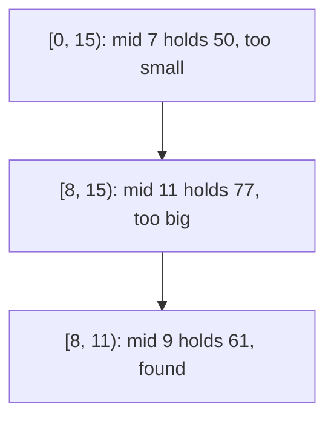

# Searching a sorted array

## The idea

Looking for a value in an array, the plain way is to check every element, one after another: n checks for n elements when the value is missing. When the array is **sorted**, one comparison can rule out half of it. Compare the value you want, the **target**, with the middle element:

- equal: found;
- the middle element is smaller: since the array is sorted, so is every element before it, and the target can only be to its right;
- the middle element is bigger: so is every element after it, and the target can only be to its left.

Repeat on the half that is left. A search among a million elements looks at no more than 20 of them.

What makes this correct is an **invariant**, a statement that is true before the first step and stays true after every step:

> If the target is anywhere in the array, it is inside the interval of positions from `lo` to `hi`.

At the start the interval is the whole array, so the invariant holds. Each step looks at a position `mid` inside the interval, and either finds the target there or removes `mid` together with every position on one side of it; the comparison and the sorted order guarantee that the target was not among the positions removed. So the invariant still holds, and the interval is smaller. When the interval is empty, the invariant says the target is nowhere in the array, and the search can answer "absent" without having looked at most of it.



<!-- text-of-mermaid sha256:202d16682d2fa71065fdc9059202fd87786f6c22e644ab8058d15ebf600a89ed -->
```text
┌──────────────────────────────────┐
│[0, 15): mid 7 holds 50, too small│
└─────────────────┬────────────────┘
                  ▼
┌──────────────────────────────────┐
│[8, 15): mid 11 holds 77, too big │
└─────────────────┬────────────────┘
                  ▼
┌──────────────────────────────────┐
│  [8, 11): mid 9 holds 61, found  │
└──────────────────────────────────┘
```

The drawing shows a search for 61 in the 15 values of the worked example below: three elements looked at, where a scan would have looked at ten.

## Two ways to write the interval

"The interval from `lo` to `hi`" needs one more decision: is `hi` a candidate itself?

- **Half-open**, written `[lo, hi)`: `lo` is the first candidate and `hi` is one past the last. The whole array is `[0, n)`, the interval holds `hi - lo` positions, and it is empty when `lo == hi`.
- **Closed**, written `[lo, hi]`: both ends are candidates. The whole array is `[0, n - 1]`, the interval holds `hi - lo + 1` positions, and it is empty when `lo > hi`.

Each choice fixes three lines of the loop, and the three must agree:

| Line | Half-open `[lo, hi)` | Closed `[lo, hi]` |
|------|----------------------|-------------------|
| Start | `lo = 0`, `hi = n` | `lo = 0`, `hi = n - 1` |
| Keep going while the interval is not empty | `lo < hi` | `lo <= hi` |
| The middle value is too small | `lo = mid + 1` | `lo = mid + 1` |
| The middle value is too big | `hi = mid` | `hi = mid - 1` |

The last row is where they differ for a reason. After `mid` turns out too big, `mid` must leave the interval. In a half-open interval `hi` is already excluded, so `hi = mid` excludes `mid`. In a closed interval `hi` is included, so `hi` must step past `mid`, to `mid - 1`.

Both are correct. This path uses half-open intervals from here on, for three reasons: the size is just `hi - lo`; an empty array needs no special case, since `[0, 0)` is empty from the start; and no bound is ever decremented, which matters with unsigned index types, where `0 - 1` does not give -1 ([common mistakes](../binary-search-mistakes/guide.md)). The [bound searches](../lower-and-upper-bounds/guide.md) of the next guide are written the same way.

## Computing the midpoint

Any position inside the interval keeps the search correct; the middle one is what makes it fast, because it removes half of the interval whatever the comparison says. In a half-open interval the middle is

```text
mid = lo + (hi - lo) / 2      (division rounding down)
```

which is always at least `lo` and below `hi` while the interval is not empty, so `mid` is a real candidate.

On paper, `(lo + hi) / 2` is the same number. In a program it may not be: `lo + hi` can exceed the largest value of the integer type even though `lo` and `hi` both fit. `hi - lo` never does, since it is at most `hi`, and `lo + (hi - lo) / 2` is at most `hi`. Whether that matters depends on the language:

| Language | Integers | `(lo + hi) / 2` |
|----------|----------|-----------------|
| Python | `int` has unlimited precision | Always exact: `(lo + hi) // 2` is fine |
| Java | `int` has 32 bits; a sum that overflows keeps its low-order 32 bits, so it wraps to a negative number; array indexes are `int` | Wrong once `lo + hi` passes 2,147,483,647, which needs an array of more than 2³⁰ elements. The JDK's own `Arrays.binarySearch` computes `(low + high) >>> 1` |
| Go | `int` has 32 or 64 bits, depending on the implementation; signed overflow wraps and never panics | `sort.Search` computes `int(uint(i+j) >> 1)` to avoid the overflow |
| Rust | Indexes are `usize`; by default, overflow panics in a debug build and wraps in a release build | `usize::midpoint`, stable since Rust 1.85, computes it without overflow |
| JavaScript, TypeScript | Numbers are doubles, exact for integers up to 2⁵³ − 1; an array's length is below 2³² | `Math.floor((lo + hi) / 2)` is exact for every index. `(lo + hi) >>> 1` converts to a 32-bit unsigned integer first, so it is right only while `lo + hi` stays below 2³² |

Java shows the problem without any array, since the arithmetic alone overflows:

```java examples/Midpoint.java
// Java's int has 32 bits and wraps around when a sum is too big, so lo + hi can turn negative even
// though lo and hi are both valid indices. The arithmetic shows it without allocating any array.
public class Midpoint {
    public static void main(String[] args) {
        int lo = 1_500_000_000;
        int hi = 2_000_000_000;
        System.out.println("Integer.MAX_VALUE  = " + Integer.MAX_VALUE);
        System.out.println("lo + hi            = " + (lo + hi));
        System.out.println("(lo + hi) / 2      = " + (lo + hi) / 2);
        System.out.println("lo + (hi - lo) / 2 = " + (lo + (hi - lo) / 2));
        System.out.println("(lo + hi) >>> 1    = " + ((lo + hi) >>> 1));
        System.out.println("exact, in a long   = " + ((long) lo + hi) / 2);
    }
}
```

It prints:

```output examples/Midpoint.java
Integer.MAX_VALUE  = 2147483647
lo + hi            = -794967296
(lo + hi) / 2      = -397483648
lo + (hi - lo) / 2 = 1750000000
(lo + hi) >>> 1    = 1750000000
exact, in a long   = 1750000000
```

`lo + hi` is 3,500,000,000, which does not fit in an `int`, so it wraps around by 2³² to -794,967,296, and the midpoint comes out negative. Used as an index, it would throw `ArrayIndexOutOfBoundsException`. `lo + (hi - lo) / 2` never leaves the range. `>>> 1` works for another reason: the true sum of two non-negative `int`s is below 2³², so its 32 bits read as an unsigned number are right, and `>>>` shifts a zero in from the left instead of copying the sign bit.

When does it matter in practice? With 64-bit indexes, never for an array: the sum would need more than 2⁶² elements. With Java's 32-bit `int`, for arrays of more than a billion elements. And whenever `lo` and `hi` are not positions but **values**, as when you [search on the answer](../binary-search-on-the-answer/guide.md) over a range that reaches the type's limit. Writing `lo + (hi - lo) / 2` everywhere costs nothing and removes the question.

## A worked example

Search for 61, then for 40, in these 15 sorted values:

| Position | 0 | 1 | 2 | 3 | 4 | 5 | 6 | 7 | 8 | 9 | 10 | 11 | 12 | 13 | 14 |
|----------|---|---|---|---|---|---|---|---|---|---|----|----|----|----|----|
| Value | 4 | 9 | 15 | 23 | 31 | 38 | 42 | 50 | 57 | 61 | 70 | 77 | 83 | 91 | 96 |

Searching for 61, on the half-open interval:

| Step | Interval | Size | `mid` | Value | Decision |
|------|----------|------|-------|-------|----------|
| 1 | `[0, 15)` | 15 | 7 | 50 | 50 < 61: everything up to position 7 is too small, `lo = 8` |
| 2 | `[8, 15)` | 7 | 11 | 77 | 77 > 61: everything from position 11 on is too big, `hi = 11` |
| 3 | `[8, 11)` | 3 | 9 | 61 | Found at position 9 |

Searching for 40, which is absent:

| Step | Interval | Size | `mid` | Value | Decision |
|------|----------|------|-------|-------|----------|
| 1 | `[0, 15)` | 15 | 7 | 50 | Too big, `hi = 7` |
| 2 | `[0, 7)` | 7 | 3 | 23 | Too small, `lo = 4` |
| 3 | `[4, 7)` | 3 | 5 | 38 | Too small, `lo = 6` |
| 4 | `[6, 7)` | 1 | 6 | 42 | Too big, `hi = 6` |
| | `[6, 6)` | 0 | | | Empty: 40 is absent |

The search for 40 ends with `lo` at 6, between 38 and 42: exactly where 40 would have to be inserted to keep the array sorted. That is no accident, and the [next guide](../lower-and-upper-bounds/guide.md) builds on it.

The program below runs both searches with a trace, writes the same search on a closed interval, checks both against a plain scan, and counts the steps:

```python examples/sorted_search.py
"""Binary search on a sorted array, on a half-open and on a closed interval, with a trace and a count."""

from collections.abc import Callable
from math import floor, log2

Step = Callable[[int, int, int], None]


def search_half_open(items: list[int], target: int, on_step: Step | None = None) -> int:
    """The index of target in items, or -1. If target is present, it is in items[lo:hi]."""
    lo, hi = 0, len(items)
    while lo < hi:  # [lo, hi) still holds at least one candidate
        mid = lo + (hi - lo) // 2
        if on_step:
            on_step(lo, hi, mid)
        if items[mid] == target:
            return mid
        if items[mid] < target:
            lo = mid + 1  # mid and everything before it are too small
        else:
            hi = mid  # mid and everything after it are too big; hi itself is never a candidate
    return -1


def search_closed(items: list[int], target: int) -> int:
    """The same search on [lo, hi], where both ends are candidates."""
    lo, hi = 0, len(items) - 1
    while lo <= hi:  # [lo, hi] still holds at least one candidate
        mid = lo + (hi - lo) // 2
        if items[mid] == target:
            return mid
        if items[mid] < target:
            lo = mid + 1
        else:
            hi = mid - 1  # hi is a candidate, so it must step past mid
    return -1


def show(lo: int, hi: int, mid: int) -> None:
    interval = f"[{lo}, {hi})"
    print(f"  {interval:8}  size {hi - lo:2}  mid {mid:2}  value {values[mid]}")


values = [4, 9, 15, 23, 31, 38, 42, 50, 57, 61, 70, 77, 83, 91, 96]
for target in (61, 40):
    print(f"search {target}:")
    print("  ->", search_half_open(values, target, show))

# Both versions agree with a linear scan on every prefix of the array, for every target.
agree = all(
    search_half_open(values[:n], t) == search_closed(values[:n], t)
    == (values[:n].index(t) if t in values[:n] else -1)
    for n in range(len(values) + 1)
    for t in range(100)
)
print("half-open, closed and a linear scan agree:", agree)

# The interval at least halves on every step, so the loop runs at most floor(log2 n) + 1 times.
for n in (1, 2, 3, 15, 16, 100, 1024):
    evens = list(range(0, 2 * n, 2))
    worst = 0
    for t in range(-1, 2 * n + 1):
        steps: list[int] = []
        search_half_open(evens, t, lambda lo, hi, mid: steps.append(mid))
        worst = max(worst, len(steps))
    print(f"n = {n:4}: at most {worst:2} steps, floor(log2 n) + 1 = {floor(log2(n)) + 1}")
```

It prints:

```output examples/sorted_search.py
search 61:
  [0, 15)   size 15  mid  7  value 50
  [8, 15)   size  7  mid 11  value 77
  [8, 11)   size  3  mid  9  value 61
  -> 9
search 40:
  [0, 15)   size 15  mid  7  value 50
  [0, 7)    size  7  mid  3  value 23
  [4, 7)    size  3  mid  5  value 38
  [6, 7)    size  1  mid  6  value 42
  -> -1
half-open, closed and a linear scan agree: True
n =    1: at most  1 steps, floor(log2 n) + 1 = 1
n =    2: at most  2 steps, floor(log2 n) + 1 = 2
n =    3: at most  2 steps, floor(log2 n) + 1 = 2
n =   15: at most  4 steps, floor(log2 n) + 1 = 4
n =   16: at most  5 steps, floor(log2 n) + 1 = 5
n =  100: at most  7 steps, floor(log2 n) + 1 = 7
n = 1024: at most 11 steps, floor(log2 n) + 1 = 11
```

The traces match the tables. The two versions and the scan agree on every prefix of the array, the empty one included, for every target from 0 to 99, present or not. The last lines measure the worst case over every target, present and absent, for several sizes: it is always `floor(log2 n) + 1` steps, which the next section proves.

## When to use it

- The data is **sorted**, or you can sort it once and then search it many times.
- You can read the element at any position in constant time: an array, a Python list, a Java `ArrayList`. On a linked list, reaching the middle means walking to it. Java's `Collections.binarySearch` documents what that costs: on a large list that is not random access, it performs O(n) link traversals and O(log n) comparisons.
- You only ask "is it there?" and never need the order: a hash set answers in O(1) on average and needs no sorting. A sorted array wins when you also want the order, such as the nearest values, a range, or the first value above a limit ([bounds](../lower-and-upper-bounds/guide.md)), and when memory is tight, since it holds nothing but the values.
- You search once, in data that is not sorted: a scan, O(n), beats sorting first, O(n log n).
- The data changes often: inserting into a sorted array shifts every later element, which is O(n) per insertion. A balanced search tree, such as Java's `TreeMap`, keeps the order with O(log n) insertions.

## Common traps

- **Searching data that is not sorted.** Nothing fails loudly: Java's documentation says the results are "undefined", Rust's that they are "unspecified and meaningless". Sorting by one order and searching by another, such as a descending array searched with an ascending comparison, is the same mistake.
- **Mixing the two interval styles.** A line taken from the other style breaks the search on some input. Pick one style and keep its three lines together ([common mistakes](../binary-search-mistakes/guide.md)).
- **Overflow in `(lo + hi) / 2`.** Harmless in Python, real in Java for very large arrays, and real in every fixed-width language when the bounds are large values instead of positions.
- **Duplicates.** With equal values, a plain search returns *one* of them, not necessarily the first: Java's documentation says "there is no guarantee which one will be found", and Rust's that "any one of the matches could be returned". To get the first or the last, use a [bound search](../lower-and-upper-bounds/guide.md).
- **Stopping at "absent".** A search that ends without finding the target has still computed something useful: where it would go. Throwing that away and scanning for the neighbours undoes the speed.

## Complexity

| Approach | Time | Space |
|----------|------|-------|
| Scan every element | O(n) | O(1) |
| Binary search, iterative | O(log n): at most ⌊log₂ n⌋ + 1 steps | O(1) |
| Binary search, recursive | O(log n) | O(log n) for the call stack |
| Sort once, then answer k searches | O(n log n + k log n) | Depends on the sort |

Why at most ⌊log₂ n⌋ + 1 steps: take an interval of `s` positions and its middle `mid = lo + s // 2`. The part left of `mid` holds `s // 2` positions and the part right of it `s - s // 2 - 1`, which is never more, so whichever part is kept, the size becomes at most `s // 2`. After `k` steps the size is at most `n / 2^k`, and a step runs only while the size is at least 1. So the `k`-th step needs `2^(k-1) ≤ n`, that is `k ≤ log₂ n + 1`. For a million elements that is 20 steps; for a billion, 30.

The bound assumes that reading an element and comparing it cost O(1). Comparing two strings costs up to their length, so a search among strings costs O(m log n) for keys of length `m`.

## Expert notes

- **A bug in the JDK itself.** Bug JDK-5045582, "binarySearch() fails for size larger than 1<<30", was filed in May 2004 against the Java 5 beta: `Arrays.binarySearch` computed `int mid = (low + high) >> 1`, and searching a 1.1-billion-byte array threw `ArrayIndexOutOfBoundsException` with a negative index. The report found similar code in `Collections` and `TreeMap`. It was fixed in Java 6 with `(low + high) >>> 1`, which the current source still uses. The algorithm was right; the arithmetic of the language was not the arithmetic its proof assumed.
- **No search by comparisons can do much better.** A search that learns only from yes/no comparisons, with `k` of them, can follow at most `2^k` different paths, and it must tell apart at least `n + 1` answers: each of the `n` positions, or "absent". So it needs at least log₂(n + 1) comparisons in the worst case. A bound search, which compares once per step and checks for equality once at the end, needs at most ⌊log₂ n⌋ + 2, within one of that limit. Doing better needs more than comparisons, such as hashing.
- **One comparison per step.** The search above asks two questions per step: equal? smaller? The [bound searches](../lower-and-upper-bounds/guide.md) ask only one, `a[mid] >= target`, run all the way down to an interval of one position, and check for equality once at the end. They never stop early, but they answer more questions: the first match among duplicates, and where an absent value would go.
- **Libraries.** Python's `bisect`, Java's `Arrays.binarySearch` and `Collections.binarySearch`, Go's `sort.Search` and `slices.BinarySearch` and Rust's `binary_search` all do this search, each with its own way of reporting "absent"; JavaScript and TypeScript have none built in. The [next guide](../lower-and-upper-bounds/guide.md) compares them.

## Practice

- `cstudy start binary-search`: report where a value sits in a sorted array of distinct values, or that it is absent, in O(log n) steps.

## Further reading

- [Python built-in types: numeric types](https://docs.python.org/3/library/stdtypes.html#numeric-types-int-float-complex): integers have unlimited precision.
- [The Java Language Specification, §15.18.2](https://docs.oracle.com/javase/specs/jls/se21/html/jls-15.html#jls-15.18.2): an integer addition that overflows keeps the low-order bits, and its sign is wrong; [§15.19](https://docs.oracle.com/javase/specs/jls/se21/html/jls-15.html#jls-15.19): `>>>` shifts with zero-extension; [§10.4](https://docs.oracle.com/javase/specs/jls/se21/html/jls-10.html#jls-10.4): arrays are indexed by `int`.
- [Java `Arrays`](https://docs.oracle.com/en/java/javase/21/docs/api/java.base/java/util/Arrays.html) and [Java `Collections`](https://docs.oracle.com/en/java/javase/21/docs/api/java.base/java/util/Collections.html): `binarySearch` on unsorted data is undefined, and which duplicate it finds is not guaranteed; on a large list without random access it does O(n) link traversals.
- [OpenJDK bug JDK-5045582](https://bugs.openjdk.org/browse/JDK-5045582): the midpoint overflow in `Arrays.binarySearch`, fixed in Java 6; [OpenJDK `Arrays.java`](https://github.com/openjdk/jdk/blob/master/src/java.base/share/classes/java/util/Arrays.java): `int mid = (low + high) >>> 1`.
- [The Go specification: integer overflow](https://go.dev/ref/spec#Integer_overflow) and [numeric types](https://go.dev/ref/spec#Numeric_types): signed overflow wraps without a panic, and `int` has 32 or 64 bits; [Go `sort/search.go`](https://go.dev/src/sort/search.go): `int(uint(i+j) >> 1)`.
- [The Rust book: integer overflow](https://doc.rust-lang.org/book/ch03-02-data-types.html#integer-overflow): a panic in debug builds, two's complement wrapping in release builds; [`usize::midpoint`](https://doc.rust-lang.org/std/primitive.usize.html#method.midpoint): stable since 1.85; [slice `binary_search`](https://doc.rust-lang.org/std/primitive.slice.html#method.binary_search): on unsorted data the result is unspecified and meaningless.
- [MDN: `Number.MAX_SAFE_INTEGER`](https://developer.mozilla.org/en-US/docs/Web/JavaScript/Reference/Global_Objects/Number/MAX_SAFE_INTEGER), [unsigned right shift](https://developer.mozilla.org/en-US/docs/Web/JavaScript/Reference/Operators/Unsigned_right_shift) and [array `length`](https://developer.mozilla.org/en-US/docs/Web/JavaScript/Reference/Global_Objects/Array/length): integers are exact up to 2⁵³ − 1, `>>>` works on 32 bits, and a length is an unsigned 32-bit integer.
- [Python design FAQ: how lists are implemented](https://docs.python.org/3/faq/design.html#how-are-lists-implemented-in-cpython): a contiguous array, so indexing costs the same whatever the size or the index; [Java `ArrayList`](https://docs.oracle.com/en/java/javase/21/docs/api/java.base/java/util/ArrayList.html): `get` runs in constant time.
- [Java `TreeMap`](https://docs.oracle.com/en/java/javase/21/docs/api/java.base/java/util/TreeMap.html): guaranteed log(n) time for `get`, `put` and `remove`.
