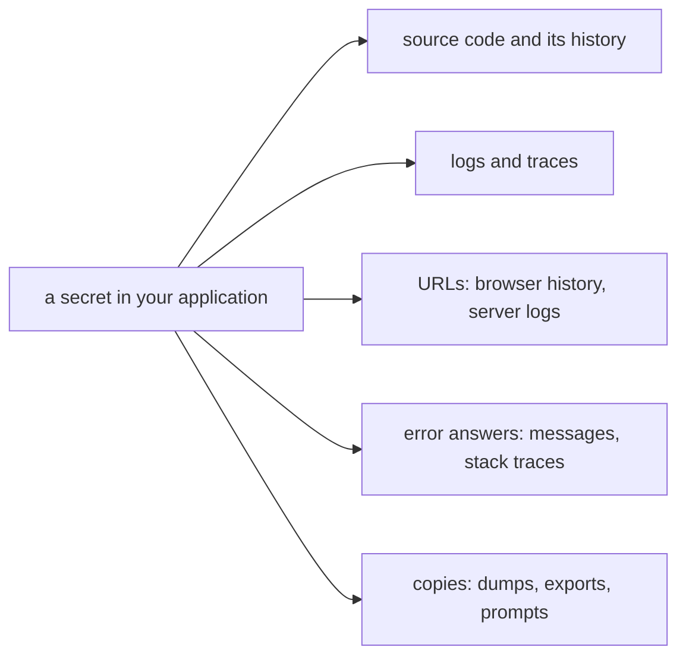

# Secrets and redaction

## The idea

A **secret** is any value that grants access by being known. The OWASP Secrets Management Cheat Sheet lists API keys, database credentials, permissions in identity and access management systems, certificates and SSH keys; session IDs, password reset links, signing keys and the tokens of the previous guide belong to the same family. Many of them are **bearer** credentials: RFC 6750 defines a bearer token as one that any party in possession of it can use, without proving anything else. Whoever reads a bearer token in a log can be you.

**Personal data** is the other thing that must not leak. NIST SP 800-122 defines personally identifiable information (PII) as information that can be used to distinguish or trace an individual's identity, such as a name, a national identity number or biometric records, and any other information that is linked or linkable to an individual, such as medical, financial or employment information.

A secret has a life, and each stage has its rule:

| Stage | Rule |
|-------|------|
| Created | From a cryptographically strong source. Python's `secrets` module exists for this, and its documentation says to prefer it to `random`, which is designed for modelling and simulation; as of 2015, it says, 32 bytes of randomness are believed sufficient for typical tokens |
| Stored | Outside the source code, in a secret store or a file mounted for the process. The cheat sheet warns that environment variables are generally accessible to all processes and may end up in logs or system dumps, and recommends them only when nothing else is possible |
| Delivered and used | Only to the process that needs it, with the least privilege that does the job |
| Rotated | Regularly, so that a stolen copy works only for a short time; better still, short-lived secrets issued on demand |
| Revoked | At once when it leaks. The cheat sheet puts revocation first: exposed keys "should undergo immediate revocation", and only then are they removed from wherever they were found |

Most leaks happen through places that were never meant to hold secrets:

- **Source code and its history.** A key committed and deleted in the next commit is still in the repository's history; the cheat sheet discusses rewriting that history, and warns that doing so brings problems of its own.
- **Logs and traces.** A log line that prints a request prints its `Authorization` header. The OWASP Logging Cheat Sheet lists what should usually not be recorded directly: source code, session identification values, access tokens, sensitive personal data, passwords, database connection strings, encryption keys and payment card data.
- **URLs.** RFC 6750 says not to pass bearer tokens in page URLs, because browsers, web servers and other software may not secure URLs well, in browser history and in server logs.
- **Error answers.** An exception's message and stack trace tell a stranger which libraries you run and where your files are. The OWASP Error Handling Cheat Sheet asks for a generic response to the client, with the details logged on the server.
- **Copies.** Crash dumps, analytics events, support tickets, data exports, and text sent to a language model.

**Redaction** is removing or masking sensitive values from data before it is written or shared. The logging cheat sheet's list of options is to remove, mask, sanitize, hash or encrypt such values, and for personal data it suggests de-identification by deletion, scrambling or pseudonymization. Two strategies work together:

- **Allowlist what you write.** A structured log event with the fields you chose (route, status, duration, user ID) cannot leak a header you never added. This is the main defense.
- **Mask what slipped through.** A filter that recognizes the shapes of secrets, such as `Authorization: Bearer ...` or `api_key=...`, and masks them, catches mistakes. It is a safety net, since it only knows the shapes you taught it.

Personal data in free text, such as a support ticket, is harder: there is no field to leave out. Detectors find it, with patterns for data that has a fixed shape, such as email addresses, and with dictionaries or models for names. Every detector misses some, so redaction is judged first by what it fails to hide.

## A worked example

Python's `logging` module lets a **filter** change a record before it is written. The program attaches the same redacting filter in two places, on a logger and on a handler, and logs two lines, one through the logger `app` and one through its child `app.http`:

```python examples/log_redaction.py
"""Masking credentials in log lines, and the place a redaction filter must sit to see every line."""

import logging
import re
import sys

CREDENTIAL = re.compile(r"(?i)(authorization: bearer |api_key=)[^\s&]+")


class Redact(logging.Filter):
    def filter(self, record: logging.LogRecord) -> bool:
        record.msg = CREDENTIAL.sub(r"\1[redacted]", record.getMessage())
        record.args = None
        return True


handler = logging.StreamHandler(sys.stdout)
handler.setFormatter(logging.Formatter("%(name)-8s %(message)s"))
app = logging.getLogger("app")
app.addHandler(handler)
app.setLevel(logging.INFO)
http = logging.getLogger("app.http")  # a child: its records go up to the handler of "app"

print("filter on the logger:")
redact = Redact()
app.addFilter(redact)
app.info("calling %s with authorization: Bearer %s", "/v1/orders", "f2c71d9a")
http.info("GET /v1/export?api_key=4e8a1b70&format=csv")

print("filter on the handler:")
app.removeFilter(redact)
handler.addFilter(redact)
app.info("calling %s with authorization: Bearer %s", "/v1/orders", "f2c71d9a")
http.info("GET /v1/export?api_key=4e8a1b70&format=csv")
```

It prints:

```output examples/log_redaction.py
filter on the logger:
app      calling /v1/orders with authorization: Bearer [redacted]
app.http GET /v1/export?api_key=4e8a1b70&format=csv
filter on the handler:
app      calling /v1/orders with authorization: Bearer [redacted]
app.http GET /v1/export?api_key=[redacted]&format=csv
```

With the filter on the logger `app`, the line logged through `app` is masked, but the line from `app.http` is not, even though it is written by the same handler. Python's documentation explains why: filters attached to a logger are consulted only for events logged on that logger, so events generated by descendant loggers are not filtered by it, while filters attached to a handler are consulted before the handler emits any event. Moved to the handler, the same filter masks both. A redaction filter belongs where every line passes: on the handler, or on every handler that writes somewhere.



<!-- text-of-mermaid sha256:4f9e69ff35a03afc8a2ad67a9718debc8dbb980464b0fbbb3b58bd84cbdc0569 -->
```text
┌────────────────────────────┐    ┌─────────────────────────────────────┐
│a secret in your application├───►│     source code and its history     │
└──────────────┬─────────────┘    └─────────────────────────────────────┘
               │
               │                  ┌─────────────────────────────────────┐
               ├─────────────────►│           logs and traces           │
               │                  └─────────────────────────────────────┘
               │
               │                  ┌─────────────────────────────────────┐
               ├─────────────────►│  URLs: browser history, server logs │
               │                  └─────────────────────────────────────┘
               │
               │                  ┌─────────────────────────────────────┐
               ├─────────────────►│error answers: messages, stack traces│
               │                  └─────────────────────────────────────┘
               │
               │                  ┌─────────────────────────────────────┐
               └─────────────────►│   copies: dumps, exports, prompts   │
                                  └─────────────────────────────────────┘
```

The diagram lists the paths a secret takes out of an application; each needs its own rule, and the masking filter covers only one.

Hashing is sometimes offered as redaction. It works for some values and not for others:

```python examples/hashed_secrets.py
"""Storing a hash of a random token is safe; hashing a value with few possibilities hides nothing."""

import hashlib
import hmac
import secrets

# A session or reset token: 32 random bytes. The database keeps only its SHA-256.
token = secrets.token_urlsafe(32)
stored = hashlib.sha256(token.encode()).hexdigest()
print("token length:", len(token), "characters; stored hash length:", len(stored))


def matches(presented: str) -> bool:
    return hmac.compare_digest(hashlib.sha256(presented.encode()).hexdigest(), stored)


print("the real token matches:", matches(token))
print("a guess matches:       ", matches(secrets.token_urlsafe(32)))

# A four-digit code "redacted" by hashing it. There are only 10,000 codes to try.
leaked = hashlib.sha256(b"4071").hexdigest()
for n in range(10_000):
    guess = f"{n:04d}"
    if hashlib.sha256(guess.encode()).hexdigest() == leaked:
        print("code recovered from its hash:", guess, "after", n + 1, "tries")
        break
```

It prints:

```output examples/hashed_secrets.py
token length: 43 characters; stored hash length: 64
the real token matches: True
a guess matches:        False
code recovered from its hash: 4071 after 4072 tries
```

A token of 32 random bytes is one of 2^256 possibilities, so storing only its SHA-256, and hashing what a client presents to compare, is sound: a stolen database of hashes gives no usable token, and nobody can try 2^256 guesses. `hmac.compare_digest` compares without stopping at the first different character. A four-digit code is one of 10,000, and hashing it hides nothing: trying every code took 4,072 hashes. The same holds for phone numbers, birth dates and most email addresses. A hash of personal data is a pseudonym, still linked to the person, not an anonymous value.

## When to use it

- **Every system that holds credentials or personal data**, which is nearly every system.
- **Before data leaves its home**: logs, traces, analytics, exports, support tools, datasets for testing, and text sent to an outside model.
- **Allowlisting fields** for structured logs and events; **masking** as a net under them; **hashing** only for values with enough randomness, or with a secret key as in an HMAC, the keyed hash of the guide on cryptographic hashes; **encryption** when authorized people must be able to recover the value.
- **Rotation** on a schedule for service credentials, and **revocation** the moment one leaks. User passwords are the exception: the secrets cheat sheet excludes user credentials from regular rotation, and NIST SP 800-63B-4 forbids forcing users to change passwords periodically.

## Common traps

- **Deleting a committed secret in the next commit.** History keeps it. Revoke the secret first, then clean up.
- **Environment variables as a vault.** The secrets cheat sheet warns that other processes can read them and that they may end up in logs and system dumps.
- **A redaction filter on the wrong logger**, as the example shows.
- **Logging whole objects.** Printing a request, a configuration or an exception with its context prints whatever secrets they hold.
- **Tokens in URLs.** They land in browser history and server logs, as RFC 6750 warns, and leave with every link that someone copies.
- **Hashing low-entropy values and calling it anonymous**, as the four-digit code shows.
- **Comparing secrets with `==`.** An ordinary comparison may stop at the first difference, so its timing can tell an attacker how much of a guess was right; `hmac.compare_digest` avoids that content-based short-circuiting.
- **Detailed errors to clients.** Return a generic error and an ID, and keep the message and the stack trace in the log.
- **Redacting after collection.** Once a secret reaches a log store, it is in backups and copies too. The cheat sheet asks for a process that removes secrets from logs while keeping the logs' integrity, but the only reliable fix is never writing it, and revoking it when it was.
- **Counting only precision.** A redactor that never masks anything wrongly but misses a tenth of the emails has leaked a tenth of the emails. Measure what it misses.

## Complexity

| Operation | Cost |
|-----------|------|
| A masking filter | O(n) per line for each pattern that runs in linear time. OWASP's page on regular expression denial of service warns that many regex engines can take time exponential in the input on patterns with a repeated group that itself repeats or holds overlapping alternatives, so masking patterns are kept simple |
| Hashing a token to store or compare it | O(n) in the token's length, once per check |
| Guessing a hashed value | One hash per candidate: 10^4 for a four-digit code, 10^10 for a ten-digit phone number, 2^256 for 32 random bytes |
| Rotating a secret | Two secrets valid for a while, the old and the new, so that every client can switch before the old one is revoked |

The guessing row is the one that matters: the work an attacker needs is the number of possible values, not the cost of one hash.

## Expert notes

- **Secret scanning.** The secrets cheat sheet suggests detecting secrets before they are committed, at the developer's machine or in a pre-commit hook, rather than finding them in a repository later.
- **Restarts do not revoke.** The same cheat sheet notes that restarting an application does not itself revoke stolen credentials, and recommends dynamic secrets, issued per use, to shrink the window of reuse.
- **Session IDs in logs.** The logging cheat sheet suggests logging a hashed session ID when you need to follow one session's events. A session ID has enough randomness for its hash to be safe, unlike the four-digit code.
- **Log injection.** Text from users can carry line breaks that forge whole log lines. The logging cheat sheet asks to sanitize carriage returns, line feeds and delimiter characters, to encode data for the log format, and prefers structured formats such as JSON.
- **Filters that return records.** Since Python 3.12, a filter may return a new `LogRecord` instead of changing the one it got, so that a filter on one handler does not change what other handlers write.
- **Defaults that move.** The `secrets` module's default token size, `DEFAULT_ENTROPY`, is documented as subject to change at any time; code that needs a fixed size passes it, as the example does with 32.
- **Model prompts are a destination.** Text sent to a language model, and what it sends back, is data leaving your system; the guide on the security of LLM applications covers sensitive information disclosure there.

## Practice

- `cstudy start safe-redaction-python`: hide the personal data that a model found in a text, check its spans against the text, add a safety net for what it missed, and score how safe the result is.
- `cstudy start fix-the-flaws-typescript`: level 4 of the review: session tokens in the service's log, and errors that tell a stranger how the service is built.

## Further reading

- [OWASP Secrets Management Cheat Sheet](https://cheatsheetseries.owasp.org/cheatsheets/Secrets_Management_Cheat_Sheet.html): what counts as a secret, storage, environment variables, rotation, dynamic secrets, detection and what to do after a leak.
- [OWASP Logging Cheat Sheet](https://cheatsheetseries.owasp.org/cheatsheets/Logging_Cheat_Sheet.html): data to exclude, de-identification and log injection.
- [OWASP Error Handling Cheat Sheet](https://cheatsheetseries.owasp.org/cheatsheets/Error_Handling_Cheat_Sheet.html): generic responses outside, details in the log.
- [OWASP, Regular expression Denial of Service](https://community.owasp.org/attacks/Regular_expression_Denial_of_Service_-_ReDoS): patterns that take exponential time.
- [RFC 6750, OAuth 2.0 Bearer Token Usage](https://www.rfc-editor.org/rfc/rfc6750): bearer tokens, and section 5.3 on URLs, cookies and lifetimes.
- [NIST SP 800-122, Guide to Protecting the Confidentiality of Personally Identifiable Information](https://csrc.nist.gov/pubs/sp/800/122/final), and [the definition of PII in NIST's glossary](https://csrc.nist.gov/glossary/term/personally_identifiable_information).
- Python [`secrets`](https://docs.python.org/3/library/secrets.html), [`logging`](https://docs.python.org/3/library/logging.html) (filter objects) and [`hmac`](https://docs.python.org/3/library/hmac.html) (`compare_digest`).
